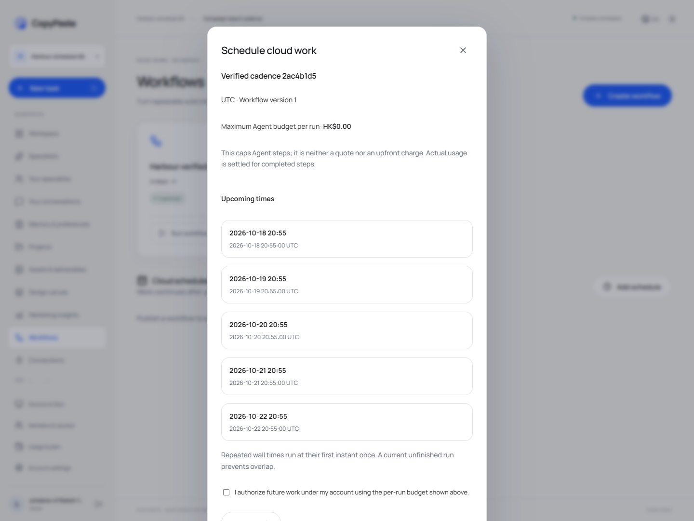
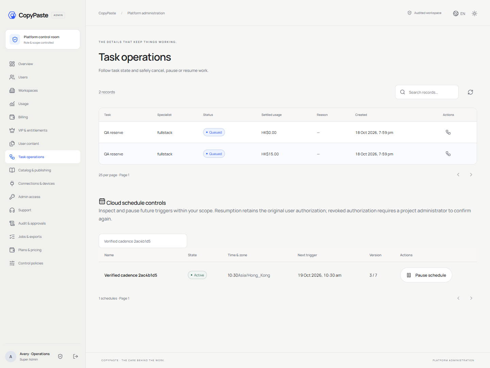
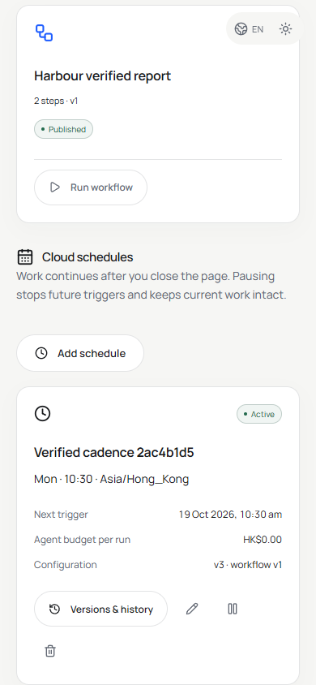

# 0.4.0 云端定时执行验收

本页保留 0.4.0 历史验收；当前增量见 [0.5.0 身份验收](08-enterprise-federation-acceptance.md)，0.4.0 原始代码证据见 [归档](versions/0.4.0/implementation-evidence.json)。

版本：1.9 · 2026-10-19 · 原生 Windows 本机试点。实现规则见 [云端定时](../technical/15-cloud-workflow-schedules.md)，启动与完整边界见 [仓库清单](../technical/12-implementation-and-repositories.md)。本版本机器报告位于 [归档 implementation-evidence.json](versions/0.4.0/implementation-evidence.json)，[0.3.0](06-admin-identity-acceptance.md) 保留历史。

## 核查范围

| 层 | 具体规则 |
| --- | --- |
| 时间 | IANA/时刻/星期输入；香港与 45 分钟偏移；纽约 gap/fold、半小时 DST、跳过整天、闰年与长期漏跑计数 |
| 数据库/API | 工作流程摘要与版本、原子/幂等创建、不可变历史、跨项目和跨企业拒绝、只读角色拒绝、RLS |
| 并发与持久运行 | 同时派发仅一次；真实报表落盘、HKD 与 ROAS；审批阻止重叠；取消释放未来槽位；不确定子任务继续阻止重叠 |
| 时间与授权 | latest 合并千日漏跑、skip 延迟、结束不补跑；CAS 暂停/恢复/时区修改；账号撤销与旧授权不复活；角色哈希变化在收费前拒绝 |
| Admin | 范围过滤、越权拒绝、近期 MFA、版本与原因、保留原授权的恢复；删除清空配置及幂等响应 |
| 客户端 | Web 预览与明确确认；关闭用户页面后实际时钟触发；原生 Worker 生成真实报告；编辑/历史/后台暂停恢复；390px；打包 Desktop 原生 bearer 计划操作 |

新增平台测试为 `tests/schedule-time.test.ts`（4 组）和 `tests/schedules.test.ts`（10 组）。数据库使用真实原生 PostgreSQL；时间边界与漏跑测试使用显式测试时刻，不等同生产硬实时指标。浏览器 `qa:schedules` 单独等待真实系统时钟，在用户页面关闭期间实际派发，不改数据库时刻、不模拟报表输出。

本轮已执行六仓库构建、平台 65 项和 Desktop 3 项测试，均无失败、跳过或取消。云端定时浏览器五组、打包 Desktop 七项、原有 Web/Admin 30 项、持续工作八项、扩展三项及管理员身份六组另有实际报告。窄屏检查发现流程记录按钮溢出，修正换行后重新通过。

原生关闭/重启检查已通过：九个迁移就绪，日历/版本/触发及管理员身份元数据摘要一致，数据库完成正常 checkpoint，既有 5173/5174 服务身份保持。核查摘要不包含可读客户正文、密钥或验证码。

本版本交付结果以 delivery `evidence/versions/0.4.0/` 下的 `verification.json`、`schedules.json`、`desktop.json`、`native-controller.json` 及 docs 归档离线恢复报告为准；尚未出报告的检查不视为通过。全部计划中 102 条综合用例仍为 not_run；本增量不代替公司真实模型、广告 OAuth、生产 SMTP/S3、负载与生产恢复验收。

## 交付边界

支持每日/每周日历、IANA 时区、有限计划数、单计划单运行、明确漏跑和暂停规则；未开放任意 cron、事件触发、并行团队、协作、完整云目录/检查点或 SSE。角色/Skill 的实际任务质量仍待公司接口准入。当前为 localhost 原生试点，Windows 包未签名，不声称已生产部署或商店发布。

## 实际页面

