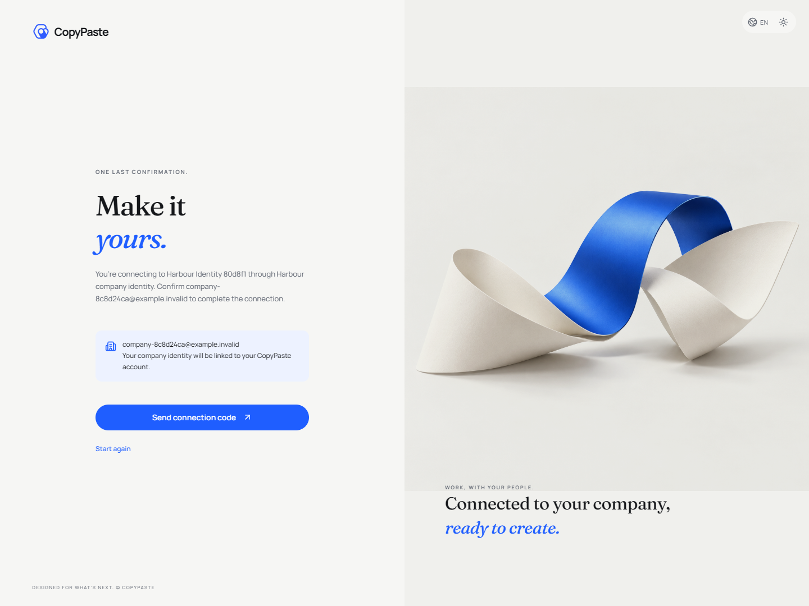
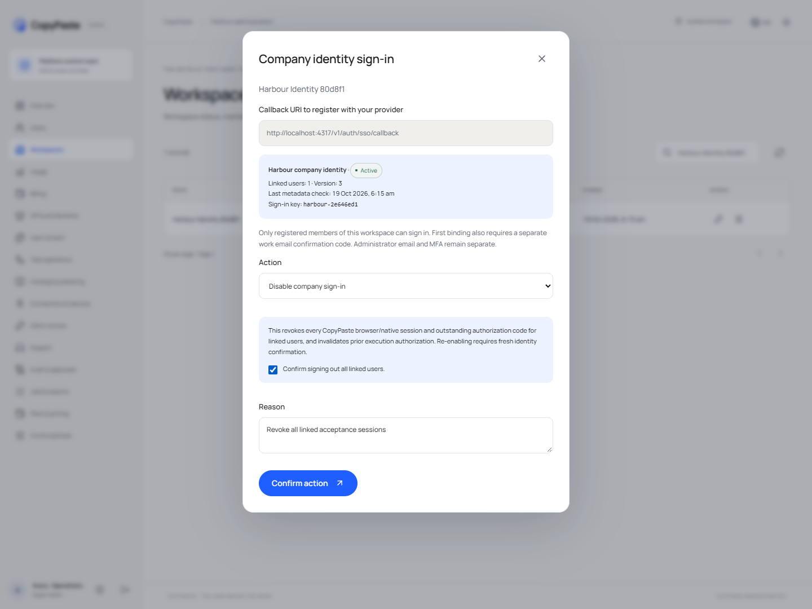
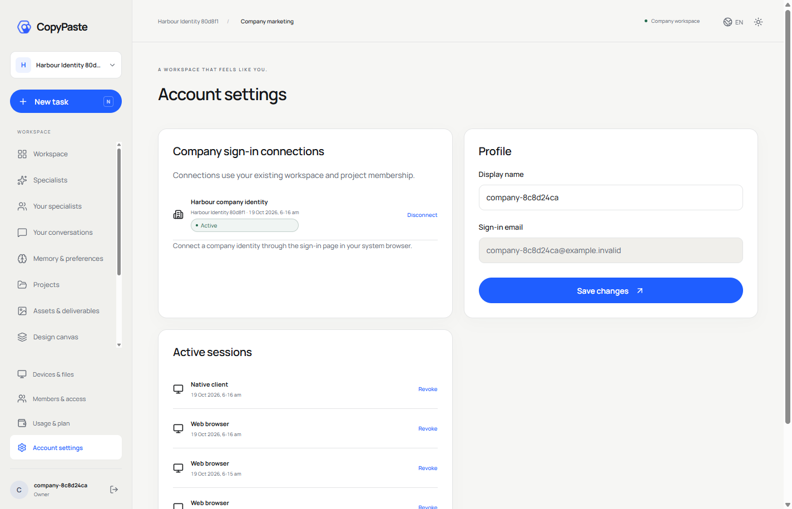
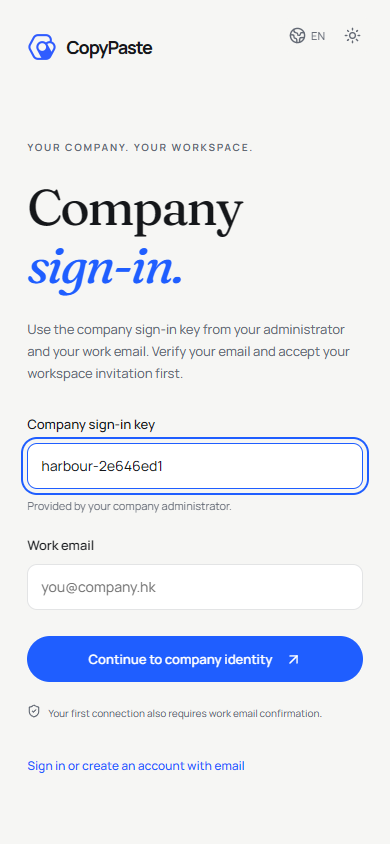

# 0.5.0 企业身份与跨端授权验收

当前增量补齐 OIDC 企业身份、独立邮箱绑定证明及原生授权来源约束。实现与部署边界见 [技术设计](../technical/16-enterprise-federation-and-native-auth.md)。

六仓库类型检查与构建全部通过；平台 84 项、Desktop 3 项逻辑测试全部通过，没有跳过。企业身份部分包含 19 组真实数据库与签名 IdP 测试，覆盖 RSA/EC、首次证明、撤销竞争、原生 refresh family 及更换 issuer 后复用 sub 的隔离。这 19 组包含在平台 84 项中。

公司真实 AI 网关、企业 IdP、广告 OAuth、生产 SMTP/S3 的准入仍需真实配置和授权。未接入的外部能力不返回模拟成功；本轮不代表全部 102 条长期规划用例已执行。

已通过原生签名 IdP 的六组完整浏览器/真实打包 Desktop 流程：邮箱注册与企业初始化、后台配置/检查/启用、首次邮箱证明、系统浏览器到 loopback PKCE、390px 布局与后台 Web/native 撤销。包含 RSA/EC 的逻辑测试与界面核查均不是公司生产 IdP 准入。

| 实际证据 | 本版结果 |
| --- | --- |
| `verification.json` | 六仓库各一次类型检查和构建、84 平台测试、3 Desktop 测试、167 实际路由导出，共 15 步通过 |
| `web-admin.json` | 30 组访问/登录/初始化、业务与后台页面流程通过 |
| `persistent-work.json` | 8 组专家、私密会话、记忆、主题及删除流程通过 |
| `admin-identities.json` | 6 组邀请、本人邮箱/MFA、权限边界、停用/恢复及重发流程通过 |
| `schedules.json` | 5 组真实时钟、关闭页面、后台执行及日历管理通过 |
| `extension.json` | 3 组真实 MV3、Chrome identity/PKCE、文件上传与退出通过 |
| `desktop.json` | 7 组真实打包客户端、浏览器授权、目录、签名命令及 Native Host 通过 |
| `federation.json` | 6 组签名 IdP 与跨端 UI 流程通过；无页面错误 |
| `packaged-windows.json` | 真实 Windows 包的 isPackaged、0.5.0 版本与页面通过 |
| `native-controller.json` | 十个迁移、正常 checkpoint、无崩溃恢复的持久重启、身份/日历/SSO 元数据摘要及原有服务保留通过 |

以上文件位于 delivery 的 `evidence/`，完整汇总见 [当前代码证据](implementation-evidence.json)。浏览器、Electron 与 IdP 均在 finally 关闭；生命周期检查结束后自己的五个服务端口全部释放，既有用户服务保留。SSO 仅在独立 UI fixture 控制器开启 localhost 许可，生命周期已恢复默认配置。

发布阶段核查六个干净独立仓库及统一 0.5.0 版本，生成六个 Git bundle、三个 ZIP、两个 Windows EXE。已实际离线克隆全部 bundle，比对 commit、branch、tree、源码索引及干净 checkout；全部 11 项文件大小/SHA-256 和三个 ZIP 的 CRC/入口核查通过，临时 checkout 已删除，没有使用网络。详见 [离线恢复记录](release-restore-check.json)。Windows 包未签名，源码、产物与测试版本均由发布 manifest 绑定。

