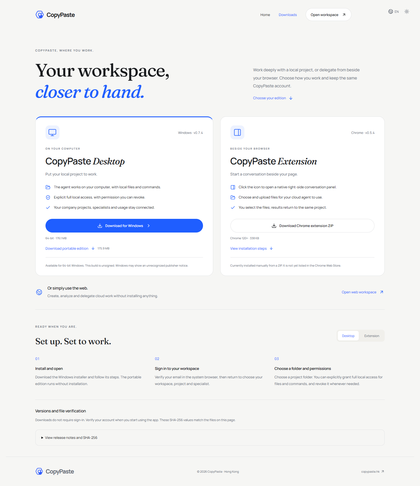
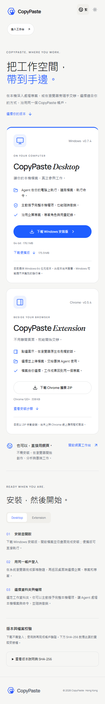

# 193 — 產品下載檢查 / Public download verification

[線上下載頁](https://agent.copypaste.hk/downloads) · [機器記錄](193-product-downloads.json) · [實現與回滾](../development/193-product-downloads.md)

原站點沒有產品入口；`/downloads` 只返回 SPA 兜底，`/downloads/` 返回 403，並不提供下載頁。現已部署公開頁及四個版本檔案。Web 構建及 32 項檢查通過；擴展 89 項檢查通過。

實際公網瀏覽器完成 17 組檢查：首頁/工作台/裝置/登入入口、直接路徑/刷新/斜線、安裝步驟、版本/SHA、HEAD/Range、真實三檔點擊下載及完整散列、403/404、1440/390/320 版面、繁中/英文/深色。瀏覽器均已關閉。未重跑與本次靜態分發無關的付費 Agent 任務。

保留原失敗：部署 V1 遇到伺服器 Python 無 file_digest，V2 上傳包名斷言不符，均在修改配置前停止；V3 成功。瀏覽器 V1 未在程序啟動前指定影片工具目錄；V2 等待 networkidle 超時；V3 的 Range 協議探針後下載等待超時；乾淨瀏覽器獨立探針成功。V4 調整先下載後協議探針，但驗證器未初始化下載記錄；V5 完成三檔完整下載及散列、協議驗證，後於繁中標題含換行的選擇器超時。V6 以整份 HTML 比較時遇 CDN 分析腳本插入；V7 比對實際產品 JS/CSS，續驗剩餘版面/語言/主題/登入入口成功，原 V5 完成下載證據仍保留原失敗狀態。本輪成功結果由已完成下載和續驗結果組成，無付費任務重跑。原記錄不改寫為通過。

Verified actual public download delivery, not complete-product acceptance. Windows is unsigned, extension installation is manual and Chrome Web Store/macOS/Linux distribution is unavailable. Existing backend/database/proxy MainPIDs and restart counts remain identical, with application and migration env bytes preserved.

