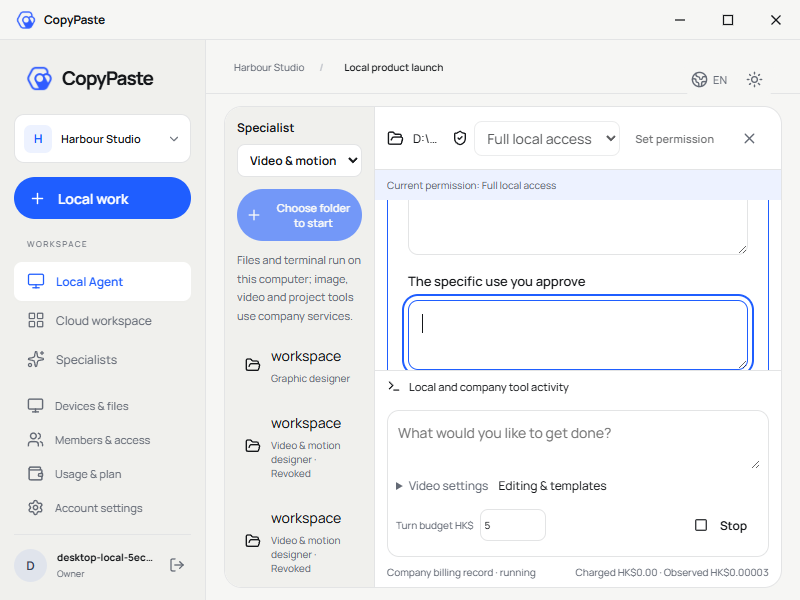
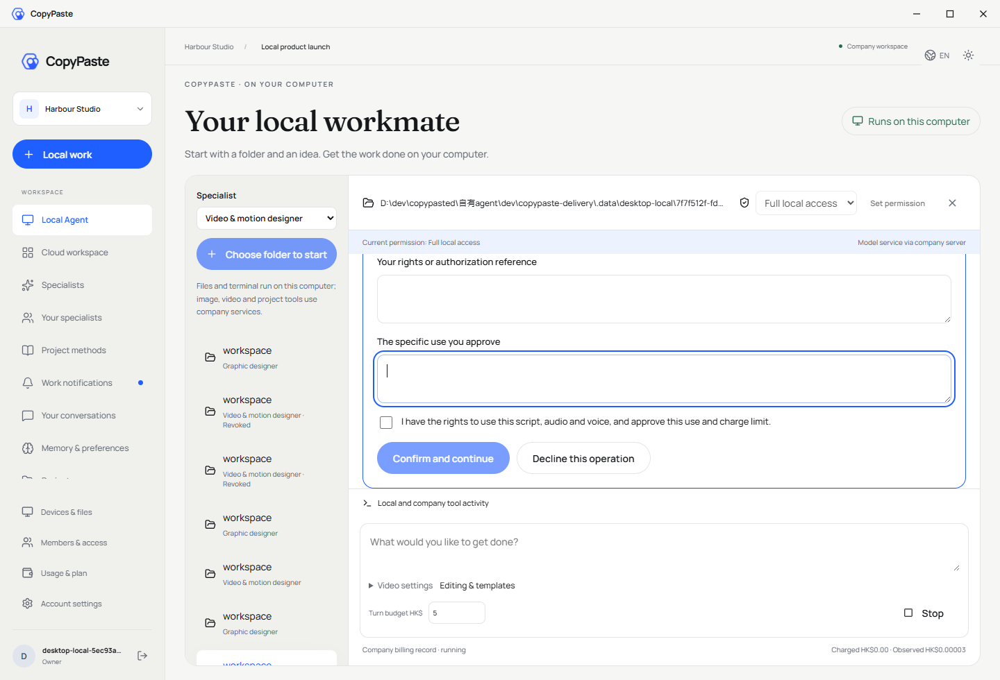
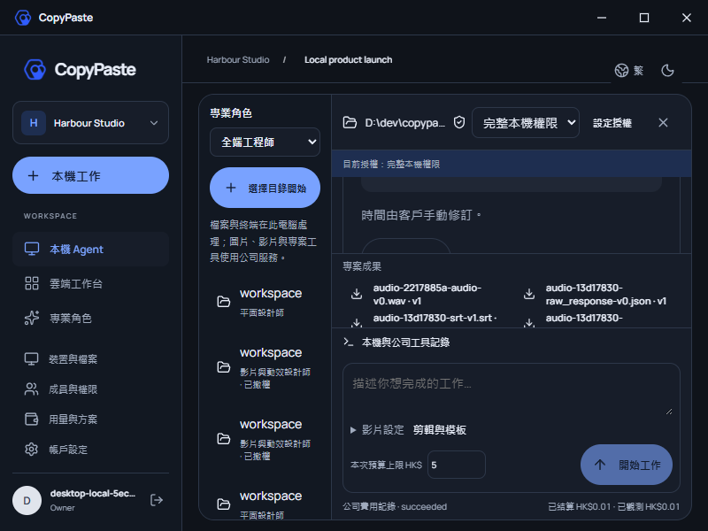
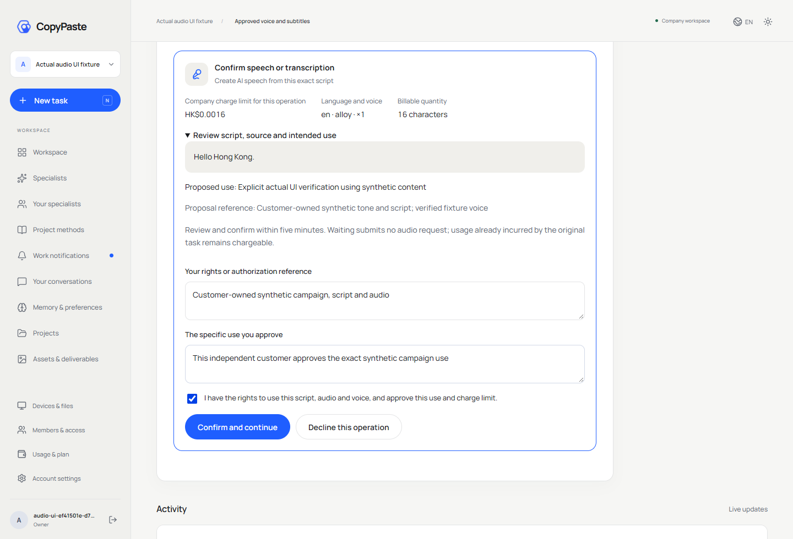
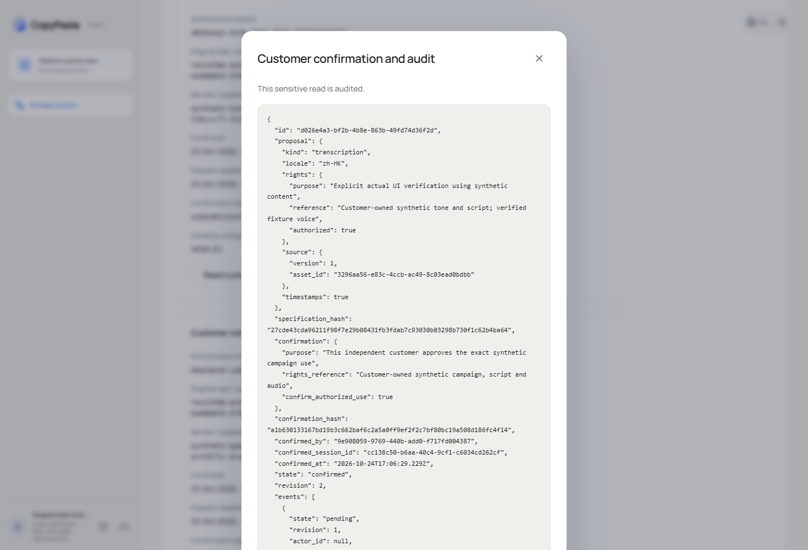
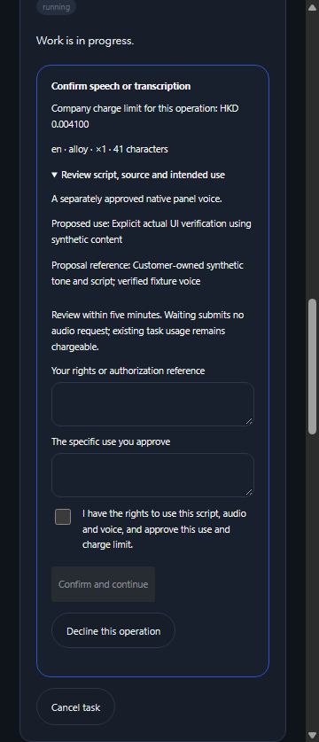
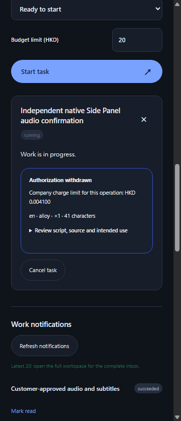

# 客户音频确认与 Desktop 画面复核 / Customer confirmation and Desktop visual review

> 历史复核：本页仅保留第 07/53 轮的实际画面，早于恢复续租竞争修复；当前源码资格和第 08/54 轮画面见[后续复核](audio-authorizations-visual-review-02.md)。下述原检查点引用以当前文件的明确版本范围为准。

本页对应 Web/Admin/真实原生右侧栏第 07 轮、打包 Desktop 第 53 轮。截图来自实际已登录界面或真实 OS 窗口，未裁切、重画或补写状态。模型、音调、转写及原生对话框决策使用明确假服务；不能据此认定真实声音质量、香港粤语准确率、法律权属或原始完整验收。

Desktop 41 项和 Web/Admin/侧栏 13 项交互检查已通过。四组 GIF/MP4 保留观察时序，八个文件均经 FFprobe 计帧和 FFmpeg 完整解码，未修改原始媒体。具体媒体摘要和时长见[完整解码记录](audio-authorizations-media-review.json)；源码、资源关闭及原始检查绑定于[当前检查点](audio-authorizations-checkpoint.json)。

## Desktop

实际 1440×980、1280×800、800×600 无边框窗口均检查可见滚动条与横向溢出。主侧栏、项目会话、消息、成果和弹层保留真实滚动；Home/End 到达首末消息，Tab 焦点可到最后的真实下载操作。聚焦的表单控件在 OS 缩放后仍可见。真实任务、上传和媒体进度保留，符合客户撤回进度条限制后的要求。

下图是 800×600 窗口中聚焦的空白用途输入框，当前权限为客户主动授予的完整本机权限。由于视口有限，表单上下部分需继续滚动访问；这并不表示所有字段同时可见。实际交互随后填写权利依据和用途、勾选并确认，原本机 Codex 才继续音频调用。测试检查了默认未勾选、输入初始为空、确认前无音频 POST、完整表单可操作与无可见滚动条。

较大窗口展示表单末项的复选框及确认/拒绝按钮；同样无可见滚动条。长文案、摘要和输入换行，保留 CopyPaste 的蓝色重点、米白背景、圆角和字体层次。顶部为应用自绘窗口操作，不是 Electron 原生菜单。

实际繁体中文深色状态保留音频历史、文件版本和费用。该截图展示当前历史区域和成果，并不单凭静态图证明全部控件可达；焦点、滚轮、保存和重载另由原生交互回执证明。

## Web 与 Admin

Web 的待确认卡包含固定文案、语言/声音、用途及精确公司费用。下图为测试客户手动填写并勾选后的提交前状态；初始未勾选与空白字段由实际 DOM 交互断言单独验证，不能把本图当作初始状态。

Admin 敏感弹窗展示实际独立客户确认、会话和不可变事件。正文在窗口内换行；敏感读取需独立正文权限和近期 MFA 并写审计。费用权限单独控制；管理员没有代替客户确认的界面或接口。

## Chrome 原生右侧栏

该流程通过实际扩展工具栏打开 Chrome SIDE_PANEL，独立登录并在真实侧栏创建新云端任务。下图展示默认空白依据/用途、未勾选和禁用的确认按钮。客户填写确认后只有一次音频请求；撤回后显示原始固定提案的撤回状态，后续交付被阻断，不重新提交模型或音频操作。此端继续使用云端 Codex，不依赖 Desktop。

## English

These unedited actual captures bind Web/Admin/native right Side Panel run 07 and packaged local Desktop run 53. Desktop's real 1440×980, 1280×800 and 800×600 windows have no visible scrollbar rails or horizontal overflow while retaining actual wheel/Home/End/Tab and last-action access. The compact screenshot shows a focused empty field; other parts remain reachable by scrolling rather than all fitting at once. Truthful progress remains visible. Local Codex resumes the original tool only after the current customer confirms the exact proposal and quote.

The Web image shows the explicitly filled, checked pre-submit state, not the default. The actual default is separately asserted unchecked with blank human fields. Admin shows audited sensitive confirmation content with independent scopes and no proxy-sign action. The native right Side Panel independently creates a cloud task, confirms one audio operation and withdraws delivery without a retry or Desktop dependency. All four original GIF/MP4 pairs fully decode and preserve observed timing. Synthetic media and automated native-dialog decisions do not qualify live professional quality or close original full acceptance.
