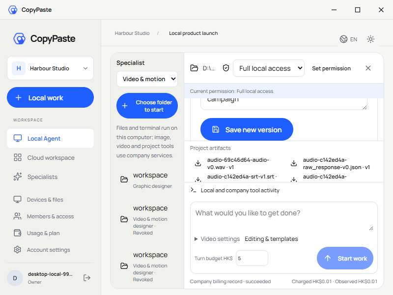
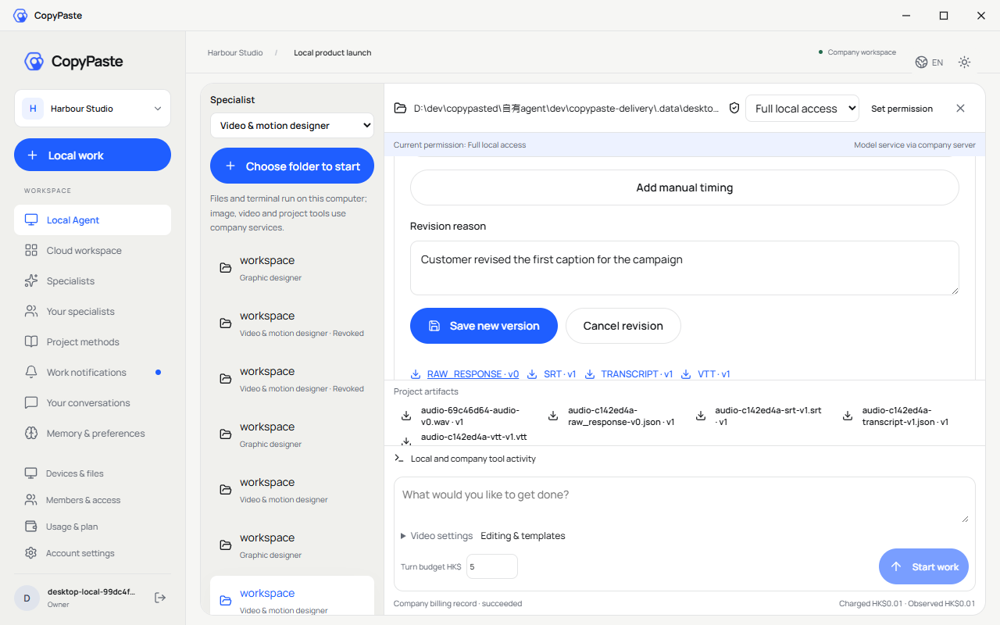
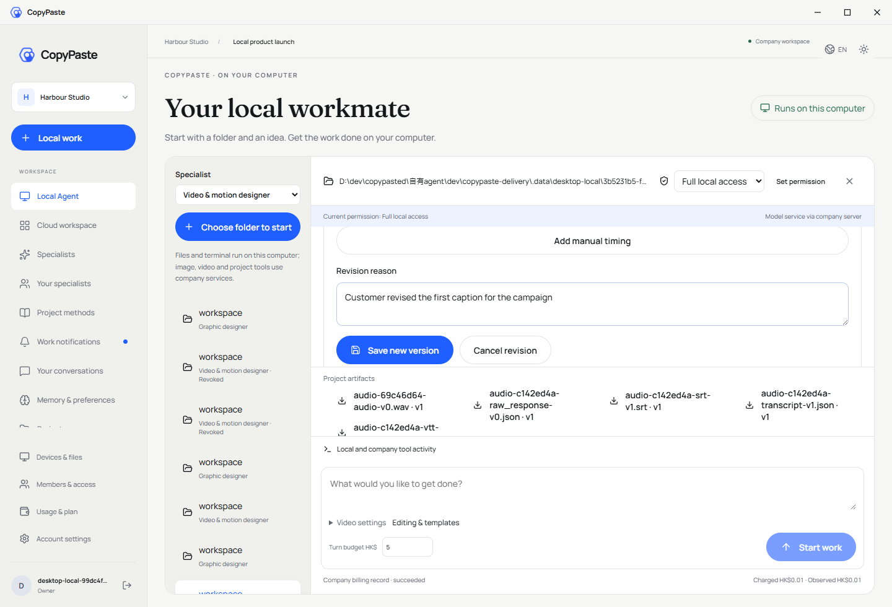
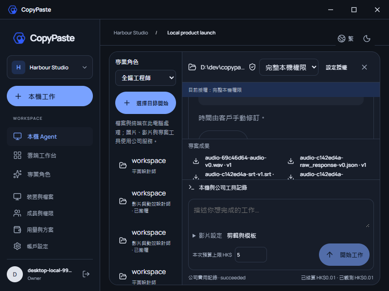
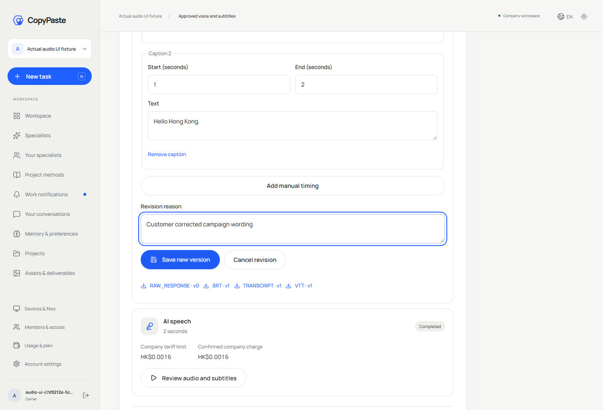
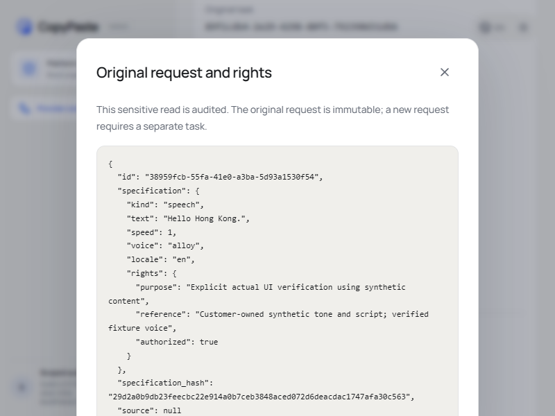
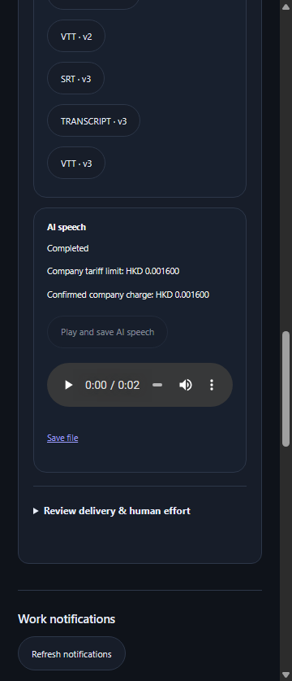

# 配音、字幕与原生 Desktop 画面复核

本轮采用实际 Web/Admin/Chrome 原生 Side Panel 第 06 轮和打包本机 Desktop 第 52 轮的原始截图。模型、合成音调、固定转写和原生对话框决策均为明确测试夹具；实际 Codex 进程、身份接入、HTTP、数据库、WAV 解码、文件保存和版本修订使用真实实现。截图不拼接、不改图；四组 GIF/MP4 按实际观察时间录制，完整解码与摘要另见[媒体核查](audio-production-media-review.json)。

Desktop 沿用 CopyPaste 蓝色、米白、深色主题和原有字体。顶部是自有标题栏与窗口按钮，无 Electron 菜单。消息、左侧会话、成果和其他工作区域隐藏滚动条外观；长文字及文件名换行。实际长消息滚轮、Home/End、末项下载焦点、最后保存按钮均单独检查，不以截图看不到滚动条代替可访问性。

较矮窗口采用紧凑标题与控件留白，避免消息区被固定区域挤占。真实窗口缩放后保留已聚焦字幕控件的可见性；800×600 下保存按钮、输入区、预算及费用回执可同时访问。截图只展示当时滚动位置，完整字幕与历史通过真实纵向滚动/键盘访问。

繁中音频画面先通过实际主题按钮切至真实 `data-theme=dark` 并断言，再定位人工修订提示后捕获。第 51 轮错误命名的浅色画面保留其历史范围，不能当作深色证据，见[修正记录](audio-capture-correction.md)。

Web 使用现有主题表单、清晰的蓝色保存按钮、实际服务时间和可选择的只读历史版本。并发修订实际返回 409，保留旧编辑；人工修订不发生新 AI 调用。窄窗口和繁中深色布局分别检查。

Admin 原始请求弹窗的长 JSON 完整换行于白色弹窗内，实际 1440 与 800 宽度核对内容未丢失且未越过弹窗。读取正文需独立权限、近期 MFA 并留下敏感访问审计；元数据列表不包含原始正文。

Extension 通过浏览器工具栏打开真实右侧 `SIDE_PANEL`，保持对话/附件和云端任务结构，无 Desktop 依赖。WAV 下载校验真实摘要，字幕支持删除、空白人工时间、新增和修订。Desktop 隐藏滚动条的要求不改变 Extension 的独立侧栏布局。

任务、上传及影片真实进度继续保留。用户撤回的是先前关于进度条的限制；本轮约束为隐藏滚动条外观并保证内容可达。真实声音/粤语质量、人工声音授权、后台音频发行、未知 POST 外部对账、签名安装及完整原始验收不由这些画面证明。

English: Original current Web/Admin/native Chrome Side Panel and packaged local Desktop captures were reviewed. CopyPaste styling, frameless native presentation, wrapping content, hidden Desktop scrollbar rails, actual wheel/keyboard/last-action access and resize focus preservation are checked independently. Dark audio capture now asserts the actual rendered theme. Admin retains complete wrapped JSON inside its real modal. Truthful progress remains. Synthetic media and these screenshots do not establish live professional quality or complete product acceptance.
