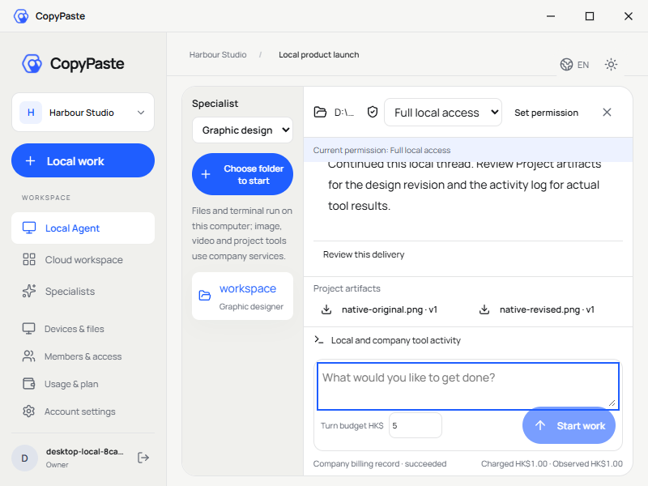
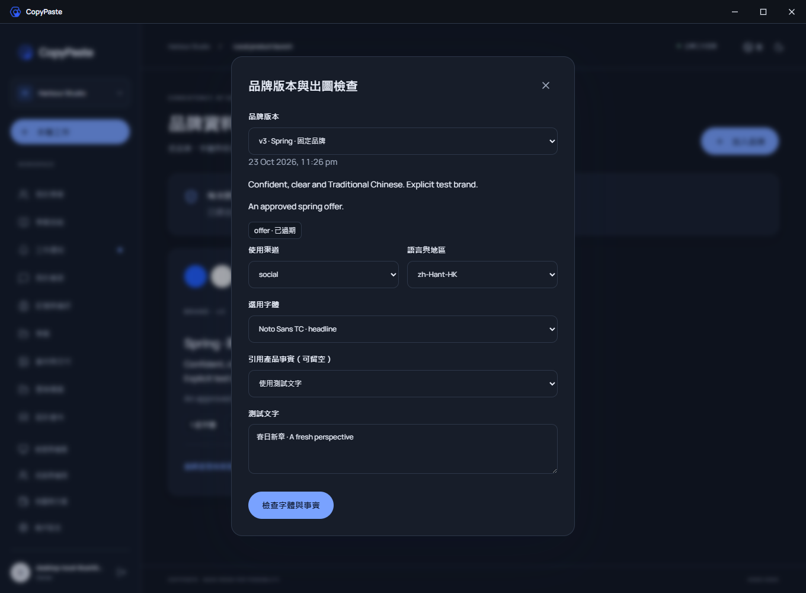

# 品牌页面与 Desktop 视觉复核 / Visual review

本记录只描述已实际查看的页面；最终源码、运行收据与媒体摘要见 [Stage79 检查点](brand-production-checkpoint.json)。截图来自真实 Web 与打包 Electron，没有拼接或生成产品界面，客户内容和模型回复明确使用测试夹具。

| 实际页面 | 观察及用途 |
| --- | --- |
| Desktop33 `workmate-local-33-layout-800-en.png`，800×600 | 品牌标题栏及自绘窗口按钮、蓝色主操作、浅色工作区。主导航、长会话、成果和输入区无可见滚动条；输入、预算、成果按钮及费用回执可见。运行旅程另以真实滚轮、Home/End 和末项按钮焦点验证内容可达，截图本身不证明可滚动。 |
| Desktop33 `workmate-brand-33-preflight-zh-dark.png`，1360×1000 | 深色品牌版本弹层与繁中标签，渠道/语言成组排列，字体、事实和检查动作层级清楚。版本、过期事实状态及实际用户输入可见；没有原生 Electron 菜单或侧边滚动条。 |
| Web02 `workmate-brand-02-editor-facts-en.png`，1360×1000 | CopyPaste 蓝色分栏与当前步骤、圆角输入和事实分组。长表单允许垂直访问，未用隐藏内容替代滚动。 |
| Web02 `workmate-brand-02-missing-glyph-compact-en.png`，390×850 | 控件在窄宽度重排，真实缺字诊断显示 `BRAND_GLYPH_MISSING` 与 `U+10FFFF`；没有横向溢出。 |

Desktop32 的主题断言失败记录保持原样：系统主题可能当前显示浅色，一次切换并不保证进入深色。修正旅程通过实际控件确认目标主题；未修改界面状态来伪造截图。Desktop33 的30项旅程已通过，所有自建应用、浏览器与数据库已退出。字体声明、客户事实和原始验收边界按主文档保留。

English: The reviewer inspected the actual compact frameless Desktop33, its dark Traditional Chinese brand dialog, Web02 fact editor and compact missing-glyph page. They retain CopyPaste's blue controls, rounded fields, spacing and light/dark hierarchy. The packaged journey separately proves wheel/keyboard/focus access and absence of visible scrollbar rails; a static screenshot alone cannot prove interaction. Desktop32's failed theme assumption remains historical, and Desktop33 passes all 30 checks using the actual theme control. No product interface screenshot was composited or generated.
