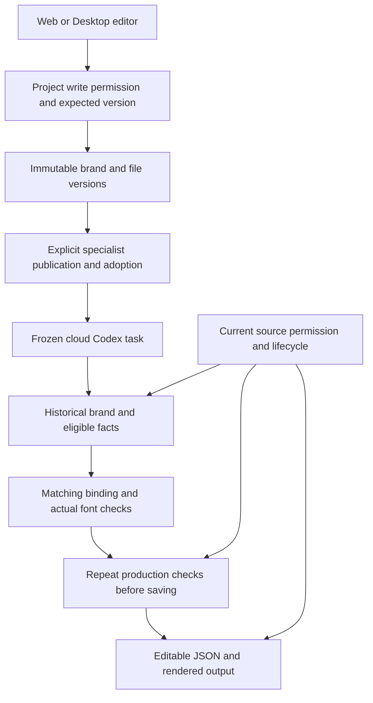

# 79 · 固定品牌版本与生产前检查 / Versioned brand production

本轮对照 REQ-013、TC-013 与 `modules/03-brand-assets-and-deliverables.md` 修复品牌生产基础。检查起点为 Stage78 已发布源代码：品牌只有可变的 `brand_profiles.body`，专家绑定数字版本但执行时读取当前资料，海报文字使用系统字体，未校验促销期限。这些能力不能据此认定为完整品牌管理。

## 实现契约

1. 每次品牌发布追加不可改写的版本，名称、Logo 的素材版本、色彩、字体文件/受控字体、来源与使用声明、产品事实、价格/促销期限、语言及渠道规则一起冻结。编辑使用预期版本与幂等键，竞争编辑返回冲突。旧资料保留原始内容，不补造历史版本或字体授权。
2. 专家及任务读取绑定的历史版本。新版本通过现有专家更新/采用流程显式选择；编辑品牌不能悄悄替换已绑定任务的价格和字体。撤销资料或文件权限仍立即阻断读取与后续交付。
3. 文件字体限制为有界的 TTF/OTF，验证实际文件、SHA、Unicode cmap 与字符覆盖。字体登记包含客户提供的来源、许可说明、渠道和有效期；此记录是客户声明，不代表平台证明版权。受控默认 Noto Sans TC 使用随仓库保存的实际字体及 OFL。
4. 品牌海报携带品牌版本、渠道和语言；文字可选择声明字体键，省略时采用该版本第一项字体配置，显式引用事实键时从固定事实产生文字和价格。生产前与保存前检查有效期、使用范围和缺字；发现问题返回具体键/码点，不静默换字体、价格或事实。自由文字的语义事实识别不在本轮已验证范围；系统主题与客户品牌相互独立。
5. 实际导出将品牌文字转为路径以固定字体外观，另存可编辑 JSON 保留文本及引用。PNG、单页 PDF 审阅稿和有限动态 MP4 继续使用原有真实渲染器。不得将 PDF 审阅稿称为可编辑排版稿或印刷认证稿。
6. 固定版本与 Logo/字体文件进入现有来源追踪、隔离、删除和支持访问链路。历史交付不会仅因今天已过促销期而消失；新生产必须重新检查当前资格。管理员正文访问仍需要既有限时支持授权，不能从元数据接口旁路读取品牌正文。

## 数据、执行和权限细节

| 对象 | 实际职责与边界 |
| --- | --- |
| `brand_profiles` | 继续承载当前名称、正文、版本及内容状态，兼容原接口。发布新版通过数据库触发器创建快照；单纯隔离/恢复不伪造内容版本。 |
| `brand_profile_versions` | 以品牌与版本联合定位，保存正文、名称、摘要、创建者/时间和擦除状态。普通应用只能读取，控制路径追加版本；只允许受约束的删除擦除改写正文，身份与审计摘要保留。迁移只回填旧资料当前版本，不补造早期版本。 |
| `brand_version_assets` | 保存该品牌版本的固定 Logo/字体文件引用。文件必须在项目内共享且当前可用；不能把私人任务文件登记成共享品牌文件。旧品牌版本继续引用其原文件版本。 |
| 专家版本与任务 | 原有不可变专家版本记录品牌 ID/版本。云端上下文读取这一历史版本；日期不合格的事实从可用事实中移除并返回键/状态。发布品牌新版不会自动更新专家或旧任务。 |
| 设计源工程与产物 | 可选 `brand` 绑定包含品牌 ID/版本、渠道和语言；字体/事实键按固定资料解析。输出元数据保存 `brand_reference`，与固定文件依赖一起进入现有来源、隔离、删除和发布副本检查。 |

新版登记在事务内验证实际 Logo/字体文件与摘要。字体仅接受限定大小的独立 TTF/OTF，支持 Unicode cmap4/12；选完整映射，不将多个 cmap 的字符并集合并成虚假的覆盖。文字转路径时临时注册确定摘要的字体，同步完成转换后释放该注册。完整 OpenType 排版、WOFF、字体安装及字体权利法律核验不由此成立。

品牌生产检查同时用于用户预检与真实品牌海报生成；预检只读，不写成任务成果。真实云端工具要求绑定与任务一致，取得固定事实文字/金额，检查所选字体声明的当前渠道与期限、真实字形、品牌语言/渠道。保存前再检查，不合格时事务不发布缺失或不合规成果。Logo 的当前检查包含固定 PNG 版本、最小尺寸与画布安全边距；完整视觉规范和各广告规格另行验收。

读取品牌历史仍受当前企业、项目、成员与内容状态约束；固定版本不绕过撤权。隔离或删除来源后，依赖产物不可继续下载、读取或发布。资料删除会擦除保留版本中的品牌正文，不把历史快照当成无限期正文备份。品牌/字体声明到期只阻止新生产，历史交付的可访问性继续由当前来源权限及保留政策决定。

Admin 可依现有权限管理品牌元数据；修改名称会形成新版本。正文接口返回的有限历史需要原有显式限时支持授权，独立 MFA、范围及审计继续适用。品质汇总、用户列表和财务权限不能旁路获取正文；品牌管理不授予用户本机 OS 权限。

## 验证范围与剩余项

验证必须包含真实数据库迁移、旧版兼容、并发/重放、跨项目/租户拒绝、固定旧版任务、实际字体渲染和缺字、过期事实/字体使用声明、删除与支持访问边界，以及 Web 和打包 Desktop 的实际页面交互。验证收据和截图在运行后追加，不能事先填为通过。

这轮不把字体许可声明当法律核验，不以模拟营销内容代替真实客户盲测，也不据此声称全部 REQ013、102 项需求或 G01–G10 已验收。完整设计、视频、语音、各广告规格及语义层面事实遵循仍需要各自的端到端证据。
