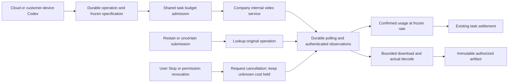

# 生成式视频作业与费用闭环

本项落实原 REQ-019 / TC-019，不以既有模板视频、提示词或生成成功的状态字段代替可播放视频。所有 Agent 继续使用 Codex；视频作业是由 Codex 调用的公司内部媒体服务。Web/Extension 在云端执行，Desktop 的 Codex 在客户本机执行并经公司业务工具发起媒体作业。

## 当前事实与协议边界

2026-10-24 核对 [OpenAI 视频说明](https://developers.openai.com/api/docs/guides/video-generation) 和 [停用公告](https://developers.openai.com/api/docs/deprecations)：Sora 2 和 Videos API 于 2026-09-24 停用，官方没有直接替代接口。旧的创建/查询/下载示例只说明历史资源形态，不能证明公司网关具备能力。公司服务需独立声明 `company-video-jobs-v1` 协议、内部模型别名、价格及通过的验证；不得硬编码停用模型、直接请求供应商或静默更换模型。

用户已经授权先使用模拟数据。模拟验收使用独立的本机 HTTP 协议夹具、真实原生数据库与真实 MP4 文件；必须明确标记模拟模型和业务内容，不能作为真实模型或完整 TC-019 的通过证据。公司接口未配置/未核验时，仅生成式视频步骤不可用，已有模板合成继续可用。

## 完整实现约束

1. 新作业固定租户、项目、原始操作者、私有范围、任务、工具调用键、能力/模型/费率版本、规格、参考文件版本与 operation ID；在任何网络提交前持久保存意图。重复调用返回同一作业，参数不同拒绝。
2. 创建使用内部网关的 multipart `POST /videos`，状态为 `GET /videos/{id}`，媒体为 `GET /videos/{id}/content`。公司协议明确增加按 operation 查询和取消；它们是公司扩展，不能宣称为仍可用的官方 OpenAI 接口。请求地址/凭证只由服务端配置；不接受模型或网页返回的任意 URL，不跟随重定向。
3. 预算沿用原任务预留与最小货币单位。视频最高金额和文本/图像请求共用同一数据库预算边界及并发锁；后台作业不能在原任务预算之外额外收费。结果不明保留预留，不把缺失 usage 当成零。明确的实际用量按冻结费率计算；超过已批准预算进入对账。
4. 异步作业持久排队、租约与处理令牌，跨进程竞争仅一个提交者。提交断线或进程丢失后查原 operation；不通过重提 POST 猜测原请求是否生效。未知状态、失败码、最后确认时间与下一次查询提示分别展示。
5. 取消请求和供应商终止事实分开。排队前取消可证明未调用；提交后不能仅因用户停止就清零费用或释放供应商槽位。取消与完成竞争保留明确终态和实际费用，完成后的重复观察不再次记账。
6. 回调/查询按 operation、模型、规格和单调版本核对；重复事件不改变结果，冲突事件拒绝。回调必须认证，不向浏览器开放成本确认权限；主动查询仍可恢复丢失回调。
7. 完成状态不直接构成成果。仅从固定内部媒体端点读取有界数据，核对摘要、大小、MP4 结构、分辨率、时长与实际解码；通过后保存不可变文件版本及规格/来源记录。当前用户、项目、方案、任务、引用素材和内核授权须在下载与保存时重新检查。
8. 来源被隔离/删除、用户撤权或 Desktop 停止时不再交付或产生新的生成动作；为确认既有费用需要的只读查询/取消走受控服务职责，不获得客户正文访问权限。查询不到既有 operation 不代表费用为零。
9. Web、Desktop 与 Extension 可在对应任务中看到真实作业状态、失败/待对账原因及最终成果；Web/Desktop 提供可操作的生成视频表单，保留任务预算和用户确认。Desktop 无边框、无可见纵横滚动条，真实进度继续保留。
10. 管理后台按动作、企业/项目范围管理作业元数据和对账，不因查看费用而获得提示词、参考图片或视频正文。审计保留真实身份、operation、能力版本与原始费用事实。

取消与管理重查使用服务端返回的公开 `revision` 做并发校验。它只随可见状态、用量、交付或控制操作递增；后台租约续期、下一次轮询时间及无变化的观察使用内部版本，不使用户操作自动过期。真正的状态变化仍拒绝旧版本，调用方刷新后再处理同一原始作业。网络结果不明时保留原幂等键，不能把换键重试当成新的生成。

## 验证与原始验收

必须执行实际协议请求及数据库竞争、断线、重启、重复/冲突事件、取消/完成竞争、未知费用、预算上限、撤权和文件损坏测试。页面证据使用实际 API 写入与真实播放/下载，保存截图和录制，关闭自建浏览器及原生测试数据库。已发布 SQL001–096 保持字节不变，使用新增迁移；原有 OpenAPI 各自保留，接口采用增量契约。所有原始 REQ/TC、NFR 与 G01–G10 保留原完整范围，完成后据实际证据更新逐项进度。

Desktop 原生子工作流完成后，先停止心跳调度并等待在途检查，再关闭本机运行时和提交终态回执，避免已结束子任务的心跳误撤销父流程。回归覆盖终态窗口与子任务关闭期间的计时器触发。真实录制按实际时间保存；GIF 使用独立调色板与编码两遍处理，避免单滤镜等待调色板时缓存整段长录像。

内置 `DEMO_MODE` 网关只模拟文本和图片，会撤下继承的视频已验证标记。生成式视频专项使用配置服务模式连接明确的本地媒体/模型夹具；侧栏推理通过实际公司网关并消费完整回执，按回执而非客户端声称的 token 数结算。夹具数据不代表已连接真实公司供应商，也不构成云端 Codex 实机验证。

统一并发和分钟速率保留原 `current_ai_provider_requests` 投影，包含生成请求、输入 token 计数及经独立审核的终止事实；视频作业在此基础上加入同一计数。已完成的计数/推理释放并发后，仍计入一分钟窗口；已有视频预留也会在输入计数 HTTP 前阻止超出同一企业并发上限的请求。过期且未派发的计数预留继续由原规则回收并记录不可变事件，不能以新增视频路径绕过原规则。

当前 [检查点](../quality/generated-video-checkpoint.json) 绑定 912 项完整平台、60 项专项、17 项本机监督进程、69 项客户端单元、32 项打包 Desktop、5 项 Web/Admin 及 9 项原生 Side Panel 的独立证据，并绑定真实截图、录制与原生候选包。SQL001–096 和各自原 OpenAPI 已核对字节。原 REQ-019 已记录部分验证，完整 TC-019、真实公司供应商、管理后台完整视频能力受控发布、全格式/角色和生产门槛保持未完成。

English: Durable operation, budget, authorization, actual native MP4 decode and client interactions are exercised with explicit reasoning/media/customer fixtures. Actual native Codex is used in native tools and packaged Desktop; Web/Extension UI reasoning is substituted. This does not establish live-provider, complete professional or production acceptance.
