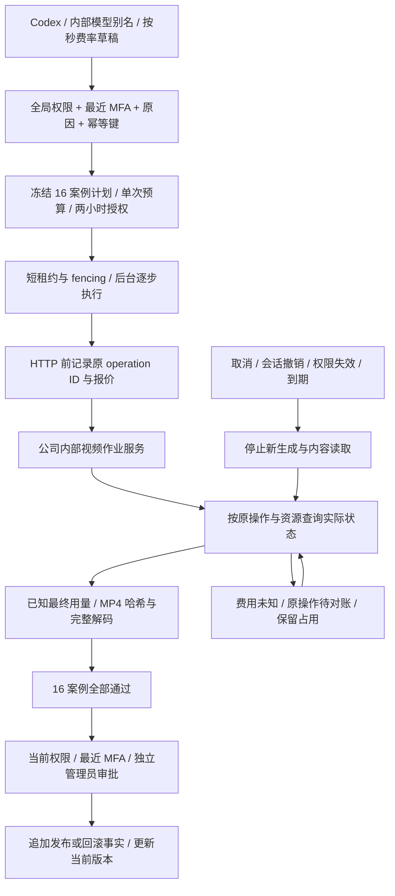

# 后台视频能力发布 / Managed video capability releases

状态：实施中，尚未验收。延续 [80 视频作业](80-generated-video-jobs.md) 和 [53 能力发布](53-controlled-capability-releases.md)，不修改原始需求或 SQL001–097。

## 缺口与目标

当前客户视频作业具备持久化和费用边界，但后台能力配置只接受文字、图片。补充 `internal-video-v1` 的不可变草稿、实际异步验证、独立审批、发布和回滚；已经创建的任务继续使用原模型、Skill、能力和费率快照。

Only Codex is permitted. Every verification request uses the configured company gateway and the fixed `company-video-jobs-v1` protocol. Administrators enter a model alias and a positive HKD rate per billable second; the draft cannot supply a URL, credential, command or alternate kernel.

## 实际验证与费用

验证计划冻结为 15 个生成案例（3 种尺寸 × 5 种时长）及 1 个取消案例，合计最大报价 184 秒 × 单价。包含 PNG/JPEG 参考图、按原 operation ID 查询、按资源 ID 查询、取消后观察最终结果、SHA/字节数校验和完整 MP4/H264 解码。取消请求返回不代表作业已经取消；若服务先完成，取消案例不通过，但真实费用仍保留。

Video validation returns a durable receipt immediately. The worker performs bounded steps with a fenced short lease and heartbeat. A lost create response or expired worker lease uses the original operation lookup, never a second generation POST. Progress counts verified cases; it is not an estimated percentage. Public validity requires all cases, known usage, no budget violation, the unchanged pinned Codex executable, the same gateway/runtime and a still-authorized administrator.

预算扩展保留原数据库函数的 OID，另保存此前实现后再就地扩展，防止升级前已准备的查询继续遗漏新占用。原输入计数、人工核账覆盖层及客户视频费用均继续参与共享边界。升级验收必须先在 SQL097 准备查询，再应用 SQL098，并用该原查询读取新视频占用及阻断状态。

The cancellation probe requires a separate retrieval after the cancel request. A cancel acknowledgement by itself is insufficient. Final eligibility is immutable; later cost observations remain available in the suite receipt without rewriting that decision.

验证使用平台验证预算和同一全局／视频／管理员／验证并发及速率边界，不向客户钱包扣款。每个实际创建请求之前持久化作业意图、报价、平台 UTC 日预算和权限绑定。未知用量保留报价和容量；实际超报价产生不可变违规事实并阻止发布。新的案例必须再次检查剩余单次预算和当日预算。全套报价预检不保证预留未来所有调用，其他调用可能消耗共享预算；因此中途预算不足会明确失败并保留已发生费用。

## 有界后台授权

管理员以最近 MFA、完整全局权限、原因和幂等键申请验证。此操作只授予该不可变计划及预算的一次后台执行，最长两小时；不授予模型发布权限。后台每次创建和读取内容前复核原会话、管理员状态/auth_version、全局权限、任意范围显式拒绝、计划、网关、运行时和取消状态。会话撤销、权限变化或取消立即阻止新生成和内容读取；仅对已经发出的原资源继续查询／取消以确认费用。MFA 的年龄不会把已经授权的长作业转换成新的模型调用授权；发布仍必须重新满足当前敏感操作及独立审批要求。

Cancellation, expiry or loss of authority never upgrades an immutable failed/cancelled/reconciling validation into a pass. Resource reconciliation may record later actual cost, but a new explicit validation is required for publication eligibility. Control receipts expose fixed verification metadata, not customer files or prompts.

服务正常退出只暂停处理器，不等同于管理员取消。未发出的案例保留原 operation ID 与预算占用；已确认费用但尚未完整下载、解码的案例保留原终态和费用。接任处理器复用原作业和内容，不把中断误记为零费用或坏文件。后台租约和两小时授权以数据库时间判断，哈希校验之后再次检查到期，避免机器时钟偏移或较慢文件读取扩大授权。

The interface distinguishes the **current known expense** from the **receipt at the eligibility decision**. Later reconciliation may confirm expense without changing an earlier decision. An unresolved video suite disables another validation in that view. Once all dispatched usage is known, an administrator may explicitly start a new validation; the interface explains that this creates a new receipt and new billable calls. It never silently retries the full suite.

## 后台操作与权限

在「目录 → 模型能力」建立配置，选择「影片生成」，填写公司提供的模型别名及正数每秒港币费率，再填写操作原因保存。模型地址与凭据来自服务器配置，不能由草稿指定。执行验证后立即显示保存的回执；关闭对话框不结束后台执行。进度条只计已经验证的案例数，展开案例可以查看实际尺寸、时长、解码结果和费用。

| 操作 / Action | 权限与效果 / Authority and effect |
| --- | --- |
| 读取配置和回执 / Read | `admin.catalog.read`；返回固定验证元数据，不返回客户文件或提示词。 |
| 新建不可变配置 / Draft | `admin.catalog.draft`；完整全局授权，原因、幂等键；保存后更改创建新版本。 |
| 执行验证 / Validate | `admin.catalog.publish`；完整全局授权、近期 MFA、精确版本、原因和幂等键；冻结平台付费计划。 |
| 停止验证 / Stop | 同上；仅停止新案例并取消原资源，已发生费用继续核对。原幂等键返回原回执；终态的新取消请求拒绝。 |
| 重查原作业 / Recheck | 同上；唤醒原资源的核对，不创建替代视频，不恢复原发布资格。 |
| 发佈 / Publish | 当前 `admin.catalog.publish`、近期 MFA、精确预览和独立管理员审批；不因验证曾通过而跳过复核。 |
| 回滚 / Roll back | 当前 `admin.catalog.rollback`、近期 MFA、精确预览及独立审批；追加新发布事实，历史定义保留。 |

任意范围的显式拒绝继续优先；企业或项目范围的允许不能提升为全局模型发布授权。审批与执行复核沿用原管理后台控制，申请人不能审核自己的申请。原客户任务固定的能力版本与费率不被后台切换重写。

The additive command paths are `POST /v1/admin/capability-releases/validations/{validation}/video-cancellations` and `.../video-rechecks`. Both accept only the exact `expected_version` and an audited `reason`, with the existing Admin session, CSRF and idempotency controls. The full strict request/response definitions are in [the supplemental contract](../contracts/capability-releases.openapi.json). Original OpenAPI definitions retain their own bytes.

## 升级与运行

先在后端使用原生数据库按既有流程执行 `npm run db:migrate`，应用新增 SQL098，再部署后台页面与 worker。SQL001–097 不修改。配置依赖公司内部 `AI_BASE_URL`、域名允许列表、服务密钥及固定 Codex 二进制；后台验证计划由平台单次／当日验证预算支付。新发布的视频能力不要求将旧环境变量 `AI_VIDEO_VERIFIED` 变为 true；数据库中的实际验证与独立发布结果提供版本化资格。环境配置本身不代表真实供应商已验收。

The worker owns execution independently from a request or browser lifetime. A graceful shutdown aborts and awaits its current bounded step, stops and awaits the lease heartbeat, then releases only its own fenced lease. A replacement process looks up the original operation. Existing native PostgreSQL launch and ownership-aware cleanup are used; no Docker, WSL or other virtual environment is required.

## 验收范围

必须验证：草稿格式与单价、权限与拒绝、幂等重放、原操作恢复、不重复创建、并发抢占／过期租约、预算跨渠道共享、实际媒体格式与尺寸时长、取消竞态、旧任务绑定、独立审批和回滚。浏览器实测须包含后台配置、真实状态、窄窗口可读性和录制，结束后关闭自建页面／实例。

Mock provider execution proves the implemented protocol and accounting behavior only. It does not qualify a live supplier, professional creative quality, the original complete video requirement or production readiness. Until current-source test receipts, screenshots and publication records are linked here, this document remains an implementation plan.
