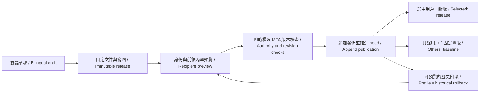

# 102 · 用戶端內容版本與定向發佈 / Client content releases

本增量實作 Admin 對 Web、Desktop 與 Extension 的公告、幫助及可選選單管理。它管理展示內容；既有帳戶、企業、專案、費用、VIP、角色、Skill 與模型能力的實際授權繼續由各自服務執行。Desktop 的 Codex 仍在客戶本機執行；Extension 保持 Chrome 原生右側欄、雲端 Codex 與獲准檔案上傳。

This increment adds versioned announcements, help and optional menu presentation across Web, Desktop and Extension. Execution permissions remain with the existing account, workspace, project, commercial, role, Skill and model services. Desktop keeps customer-local Codex. Extension keeps native Chrome Side Panel chat, cloud Codex and authorized uploads.

## 操作流程 / Operator flow

在 Admin「角色與內容 → 用戶端內容」以目前版本開始，分別編輯繁體中文與 English 標題、正文、顯示狀態和可選開始／結束時間。時間輸入採操作人員本地時區，送出 ISO 時間；服務端以當前時間評估。公告最多 12 則、幫助最多 20 則，每節的識別名稱唯一。純文字不解析成 HTML。

Start from current content under Admin → Catalog → Client content. Edit Chinese and English copy, visibility and optional visibility windows. Local date inputs become ISO instants; the server evaluates time. There are at most 12 announcements and 20 help items, each with a unique section key. Copy is rendered as text, never executable HTML.

可選選單只能引用每端既有可選入口，分別設定名稱、顯示及 0–100 排序。工作台、登入、帳戶、費用核對及本機權限控制不在可隱藏項目中。Web 支援其專業角色、專家、團隊、技能、方案、工作通知、會話、記憶、專案、素材、雲端檔案、設計、特效、分析、流程、連接及品牌入口；Desktop 使用其本身已有的對應入口；Extension 設定設計批量、影片工作台、廣告連接、SEO、創意回饋與 GEO 六個輔助入口。

Optional menus can only reference existing client items. Workspace, login, account, financial review and local permission controls cannot be hidden through this feature. Web and Desktop retain their separate native navigation inventories. Extension manages six existing auxiliary actions: design batches, video workspace, marketing connections, website audits, creative feedback and GEO observations.

選定客户端、企業、用戶、固定分組名稱及顯示比例後，先保存新草稿，再以指定接收者身份預覽發佈前後的內容。保存草稿不改用戶內容。預覽包含確切版本摘要、接收範圍、當前發佈序號、原因與到期時間。操作人員核對後，在獨立確認框發佈；回滾也必須先預覽與確認。

Save a draft with clients, workspaces, users, stable cohort key and percentage. Preview the exact before/after presentation for a selected recipient. Saving a draft does not publish it. A separate confirmation publishes the reviewed version. Rollback requires its own preview and confirmation.

## 範圍、保底與歷史 / Audience, baseline and history

選中條件為 client ∩ tenant filter ∩ user filter ∩ percentage。空的企業／用戶名單表示該維度不限。百分比採 `SHA256("client-content:" + cohort_key + ":" + user_id)` 前八位十六進位對 10,000 取餘數，與 `percentage × 100` 比較；同一用戶與分組在不同請求及客戶端保持一致，另外仍須符合 client 條件。0% 不展示新版；不足 100% 而無用戶身份時保持舊版。

Audience matching intersects client, optional workspace filter, optional user filter and a deterministic percentage bucket. The same user and cohort remain stable across requests and clients. Zero percent always keeps the baseline. Partial percentages without an authenticated user also keep the baseline.

首次發佈凍結當時已公開的舊公告、幫助及選單。之後的定向發佈以目前統一版本為保底。未被選中的用戶使用這份完整且不可變的保底，不會因某個新公告或選單不包含他而丟失原內容。每次僅允許一個定向發佈；須先回滾或明確向全部三端、全部用戶發佈，才能再開始新的定向發佈，避免未定義的多層覆蓋。

The first publication freezes existing public legacy copy. Later targeted releases freeze the current shared version as their complete baseline. Unselected users keep that immutable document. One targeted rollout is allowed at a time; publish to everyone or roll back before starting another targeted rollout. This prevents ambiguous chains of overlapping baselines.

回滾只接受已實際發佈的版本，不能將未發佈草稿冒稱歷史版本。回滾新增發佈事實與序號，引用歷史版本及其當時的保底，保留原有文件、預覽、發佈與審計。舊版仍在歷史中，可以按序號分頁。

Rollback accepts previously published versions only and appends a new publication revision with the historical audience and baseline. It never rewrites a release or erases history. Version and publication lists are independently paginated.

## 服務端約束 / Server boundaries

新增 SQL118；SQL001–117 保持已發佈原字節。`client_content_releases` 固定正文、範圍、canonical JSON 與 SHA256，資料庫同時校驗正文和摘要。`client_content_previews` 固定操作、版本、期望序號、上一發佈、保底、管理員、登入會話、auth version、原因和樣本。預覽五分鐘有效。`client_content_publications` 追加發佈；單例 head 只能按一遞增並引用匹配且有效的預覽。三種事實表禁止 UPDATE／DELETE；RLS 與 grants 只允許 cp_control，cp_app、cp_queue 及 PUBLIC 不可讀寫。

SQL118 adds immutable releases, previews and publication facts plus a guarded singleton head. PostgreSQL validates canonical-document equality, SHA256 and exact preview/head relationships. Facts reject updates and deletions. Only cp_control can access these tables; RLS and grants exclude application and queue roles. Published SQL001–117 remain unchanged.

所有寫入再次讀取有效 Admin bindings，要求全局對應 catalog 權限；任一相關 scoped explicit deny 亦阻斷全局內容操作。敏感操作鎖住有效登入會話並核對最近十分鐘 MFA。指定企業／用戶需要相應目錄讀取權限且目標仍有效；同時指定樣本企業與用戶時，樣本必須是該企業的有效成員。

Writes recheck global catalog permission, explicit restrictions, the live administrator session and recent MFA. A scoped allow cannot grant global content control; an explicit scoped deny blocks an overlapping global action. User/workspace selectors require directory permission and active subjects. A user/workspace preview sample must represent an active membership.

草稿以管理員＋Idempotency-Key＋請求摘要防止重試建立重複版本。發佈以唯一 preview_id 防止重複發佈，重放之前仍重新核對即時權限。確認時鎖住 head，核對預覽的操作者、會話、auth version、操作、時限、序號與保底；失效、過期、改權及併發替換不能覆蓋新內容。首次預覽後即使舊目錄內容被另一人修改，確認也會拒絕並要求重新預覽。

Draft retries bind the administrator, idempotency key and request hash. Publication retries bind a unique preview and still recheck current authority. Confirmation locks the head and verifies actor, session, auth version, action, deadline, revision and baseline. Stale previews cannot overwrite another publication. Legacy changes after a first preview also invalidate it.

開始使用版本化內容後，舊目錄的公告、幫助、選單草稿／發佈／回滾入口返回明確 409，避免繞過版本流程。角色、Skill、方案及政策繼續使用原本專用流程。舊公開 API 不洩露定向新版，僅向匿名及舊客戶端提供統一版本或保底。

After the first managed publication, legacy help/announcement/navigation write routes return 409 with guidance to the versioned workflow. Role, Skill, plan and policy services retain their own controls. Anonymous and older clients receive shared or baseline copy, never a targeted audience's document.

## 三端同步 / Client delivery

`GET /v1/client-content?client=web|desktop|extension&project_id=<optional>` 必須登入。身份取自服務端 principal；企業來自經 membership 驗證的 X-Tenant-ID，專案另驗 projectAccess。不能由請求任意冒用另一 user_id。回應 `private, no-store`，只包含該身份生效的內容及發佈元資料，不含受眾 ID 名單。

The authenticated endpoint derives identity from the live principal and validates workspace/project context. It returns only effective copy and publication metadata with private/no-store caching, excluding audience ID lists.

新增路由與請求／回應資料結構見 [OpenAPI contract](../contracts/client-content-openapi.json)。用戶端讀取入口為 `/v1/client-content`；管理端版本與歷史入口為 `/v1/admin/client-content`、`/publications`，草稿預覽為 `/:id/previews`，確認入口為 `/publish` 及 `/rollback`。後兩者只接受已核對的 `preview_id`，不接受確認當下任意替換正文或接收範圍。

The additive OpenAPI contract documents the authenticated client read, version/history lists, draft creation, recipient preview and confirmation routes. Publish and rollback accept only a reviewed preview ID, preventing confirmation from substituting unreviewed copy or recipients.

三端登入後載入並每十五秒重新核對；Web／Desktop 在焦點返回時更新。切換身份、企業、專案或退出時清除舊值，晚到回應不能覆蓋新身份。Web 在工作台展示公告與幫助，選單依配置名稱及排序。Desktop 透過主進程限定 GET 橋接，公告區保持有界、無可見滾動條並可用鍵盤／滾輪查看；不改本機執行與權限。Extension 由原生側欄讀取，純文字公告／幫助與輔助選單保留聊天、檔案及帳戶操作。

Clients refresh every 15 seconds; Web/Desktop also refresh on focus. Identity/context changes clear old values and reject late responses. Desktop uses a GET-only native bridge and bounded notices with hidden scrollbar rails. Extension keeps native Side Panel chat and account/file controls. These presentation updates do not change local versus cloud execution.

## 核查與範圍 / Verification scope

本增量使用原生 PostgreSQL、實際瀏覽器與本機客戶端流程核查；測試帳號、正文與模型服務仍按使用者要求使用假資料。最終選定結果、失敗嘗試、確切源碼、未修改截圖與實際錄製媒體將綁定本階段質量檢查點。原始 102 項需求與完整專業角色驗收、真實 provider 質量、商業上線及 G01–G10 不因展示內容增量自動判定通過。

Verification uses native PostgreSQL and actual client surfaces with synthetic accounts/copy and the authorized synthetic model setup. The stage checkpoint binds selected results, failed attempts, exact sources, unedited screenshots and actual recordings. Original requirement decisions, live professional qualification and G01–G10 remain separate.

最終版本通過五個相關後端測試文件共 79 項、Desktop 橋接與檔案測試 10 項，以及實際四端交互 7 項。選定證據為 core-03 與 ui-05，保留先前嘗試與其確切源碼。實際素材包含 8 張未修改 PNG、四端各一組 GIF／MP4；深色原生側欄公告文字達到 4.5:1 對比度檢查要求。測試帳號／正文為假資料，本增量不呼叫模型。自有瀏覽器、原生側欄、Desktop、預覽服務與測試資料庫在流程結束後關閉。

The final source passes 79 related backend checks, ten Desktop bridge/file checks and seven actual client journey checks. Selected evidence is core-03 and ui-05, with all earlier attempts and exact source inputs retained. Eight unedited PNGs and four real GIF/MP4 pairs show the actual clients. Native dark notice text passes a 4.5:1 contrast check. This increment makes zero model calls. Owned browsers, native panel, Desktop, previews and test database are closed afterwards. See the [source-bound checkpoint](../quality/client-content-checkpoint.json) and [delivery evidence](../../dev/copypaste-delivery/evidence/client-content-ui-05.json).

