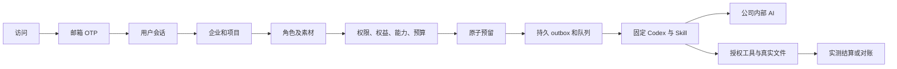

# 实际开发、独立仓库与交付

<!-- extension-folder-stage119 -->
Extension 0.5.1 新增独立浏览器资料夹核对、私人会话可恢复上传及相对路径索引；客户另按发送后才调度云端 Codex。发布使用 V2 切片 proof 核查及八分支非强推。详见 [方案](../technical/119-extension-selected-folders.md) 与 [准确证据](../quality/extension-folder-checkpoint.json)。

<!-- native-pairing-stage118 -->
Desktop 0.7.1 已加入持久配对、精确创建重试、先于创建的退休、旧设备失败停止、账户迟到响应隔离及未知设备的卸载清理。SQL128 为向前迁移；完整产品、公司签名安装版本及真实模型验收继续保留。详见 [实现方案](../technical/118-recoverable-native-pairings.md) 与 [准确证据](../quality/native-pairing-checkpoint.json)。

<!-- desktop-removal-stage117 -->
Desktop 0.7.0 已接通原生确认、本机 Codex／文件／程序／浏览器撤权、设备签名云端断开、Host 退出与注册归属检查、可选安全缓存清理、Windows 卸载钩子及重新 PKCE 登录。离线与未验证结果保留加密待发回执。公司签名已安装产品卸载／升级和原始完整产品验收仍未证明。详见 [实现方案](../technical/117-desktop-removal.md) 与 [准确证据](../quality/desktop-removal-checkpoint.json)。

**阶段 116：Desktop 0.6.0 受控更新。** 当前新增 migration 127，SQL001–126 字节保留；后台权限、签名发布、原生下载及验证、本机检查点和安装握手已实现。64 后台＋96 桌面单元＋22 本机 Codex 检查、13 构建／类型检查、4 实际界面流程通过。交付提供新目录中的未签名开发 Setup／Portable；正式发布须显式构建信任根和公司签名凭据，未满足时发布构建失败。所有旧失败日志及源码归档保留，原完整产品验收结论不改写。见[当前实施与资格边界](116-desktop-updates.md)及[绑定证据](../quality/desktop-updates-final-checkpoint.json)。

**阶段 87 当前增量：** Desktop 目录监听、稳定快照、持久批量队列、原轮次客户回答、实际应用重启后暂停、原线程/固定版本继续、独立费用和预算/撤销已有限定验证。57 项打包 Desktop、91 项 Desktop 单元、161 项客户端单元通过；原 50/69 项保留。紧凑摘要分行及页面 Home/End 修复已核对；输入框保留光标操作。全部 14 个运行素材/许可证保留，仓库媒体不进入运行 ASAR。本阶段不新增 API/SQL；沿用阶段 86 未变化后端/Web/Admin/Extension 的历史 1023/25/36/14 范围，不宣称完整套件重跑。REQ-040/042 更新部分，原 102 项为 86 部分／16 未证明完整／0 完整验收；至少十二个专业角色和 G01–G10 继续开放。见[当前方案与精确证据](87-desktop-folder-work.md)。

下文保留原规范和各阶段历史记录；历史「当前」及阶段专用命令仅解释其原始回执。新发布流程使用本阶段检查点、文档/媒体核对和提交清单。

**阶段 86 历史基线：** 共享配置草稿/精确预览/不可变发布、新工作固定版本、旧任务保留原版或原先无配置状态，已在实际 Web、原生侧栏及本机 Codex 核对。本机三次执行采用 v3/v3/v4，资料工具与本地原字节、各自费用结算均检查。侧栏聊天附件先建立本人私有会话，分片校验与精确恢复回执不回退共享；同项目另一编辑者不能列出、下载、读取版本或访问私有会话。独立 Admin 正文/费用权限与隔离/恢复/永久擦除继续生效。平台 1023（保留原 1001）、核心 25、兼容 36、客户端 139、实际 Web/Admin/侧栏 14、打包 Desktop 50 分别通过，选定源码精确相符。SQL103 增量保留 SQL001–102 和四份历史契约；487 配置路由加 1 条条件 demo 路由。REQ-065 更新为部分验证，原 102 项为 84 部分／18 未证明完整／0 完整验收，G01–G10 和其余全部差异保留。假模型证据不代表真实专业质量。见[当前方案与限定证据](86-shared-project-guidance-and-private-chat.md)。

以下保留既有规范及历史记录；阶段专属命令仅解释当时回执，当前增量以前述方案、检查点和发布流程为准。 Existing specifications and historical records follow. Stage-specific commands explain their original receipts; the current increment uses the guidance, checkpoint and publication flow above.

**阶段 85 历史基线：** 原任务中的音频提案需原客户以当前登录会话独立确认精确内容和公司报价；默认不勾选，权利依据/用途为空。模型与 Admin 不能代签。拒绝、截止、停止及撤权阻断派发，撤回阻断交付但保留真实或未知费用。新增 SQL102，保留 SQL001–101、四份已发布契约及旧角色/Skill。平台 1001（全部原 988 用例保留）、核心 56、兼容 80、客户端 124、真实 Web/Admin/原生侧栏 13、打包 Desktop 41 分别通过；全部选定源码摘要精确相符。Desktop 保持客户本机 Codex、主动可撤销全权限、无边框/菜单，无可见纵横滚动条，保留滚轮/键盘/末项焦点及真实进度。原生右侧栏保持云端 Codex 和获准文件上传。真实声音/粤语质量、后台音频发行和未知 POST 外部证据结算仍保留；原 102 REQ/102 TC 为 83 部分／19 未证明／0 完整验收，G01–G10 不变。见[当前方案与限定证据](85-audio-rights-and-administration.md)。

**阶段 84 历史基线：** 公司内部配音/文件转写、原始音讯和真实字幕时间、无 AI 的版本修订、共享预算与未知费用保留、来源门控及独立后台正文/费用权限已在明确假数据下局部核对。平台 988 项保留原 968 项，音频/网关 43、兼容 80、客户端 124、真实 Web/Admin/原生侧栏 10、打包本机 Desktop 40 项分别通过。新增 SQL101，SQL001–100 和两份原 OpenAPI 保持。Desktop 本机 Codex、可撤销全权限、无边框/菜单、无可见纵横滚动条，保留真实滚动、键盘、缩放后焦点与真实进度。原生侧栏继续云端 Codex 与获准文件上传。真实音质、独立人工声音授权、音频能力后台发行及未知 POST 专属对账仍待补齐；原 102 REQ/102 TC 保持 83 部分／19 未证明／0 完整验收，G01–G10 保留。见[方案与限定证据](84-internal-audio-production.md)。

**阶段 83 历史基线：** 固定 GEO 问句和完整 Agent/skills 配置、独立 Codex 重复运行、私有原始回答与真实 JSON、人工消费者样本单独声明及后台来源治理已局部核对。平台 968 项保留原 946 项，专项 22、客户端 124、真实 Web/Admin/原生右侧栏 13、打包本机 Desktop 37 项分别通过。SQL100 新增，SQL001–099 与原 OpenAPI 保持。Desktop 本机 Codex、主动可撤销全权限、无边框/菜单、无可见纵横滚动条，保留滚动/键盘/真实进度；GEO 明确在浏览器打开，本机 GEO 协议仍待实现。原 102 REQ/102 TC 保持 83 部分／19 未证明／0 完整验收，G01–G10 保留。见[当前方案及证据](83-reproducible-geo-observations.md)。

**阶段 82 历史基线：** 精确素材版本与用户明确确认的广告级身份、独立口径反馈、实际 JSON 下载／模型读取继承来源、撤销和保留期清理已局部核对。平台 946 项保留原 929 项，专项 17、兼容 43、真实 Web 4、打包 Desktop 36 项分别通过；SQL099 新增，SQL001–098 及原 OpenAPI 保持。Desktop 本机 Codex、无边框、无可见纵横滚动条，保留实际滚动／键盘／真实进度；原生 Side Panel 为云端 Codex 和文件上传。102 REQ/102 TC 保持 83 部分／19 未证明／0 完整验收，G01–G10 保留。见[当前方案及证据](82-confirmed-creative-feedback.md)。

**阶段 81 历史基线：** 后台视频模型不可变配置、16 案例异步验证、原作业恢复、费用核对、独立审批、发布及回滚已在明确假服务和真实 MP4 下验证。平台 929 项（原 912 项保留）、兼容 106、契约 7、真实后台页面 7 项分别通过；新增 SQL098，SQL001–097 与两份原 OpenAPI 保持。Desktop 本机 Codex、无边框、隐藏纵横滚动条并保留滚动／键盘／真实进度；原生侧栏仍是云端 Agent。102 REQ/102 TC 保持 83 部分／19 未证明／0 完整验收，G01–G10 保留。见[当前方案及证据](81-managed-video-capability-releases.md)。

**阶段 80 历史基线：** 生成式视频原作业、共享预算与未知费用保留、取消/对账、真实 MP4 和三端预览；Desktop 设置紧凑、无边框、无可见纵横滚动条且保留滚动/键盘与真实进度。平台 912、专项 60、客户端 69、打包 32、Web/Admin 5、侧栏 9、本机监督进程 17 项分别通过，模型与媒体内容为明确夹具。SQL097 新增，SQL001–096 与各原 OpenAPI 字节保留。原 102 REQ/102 TC 为 83 部分/19 未证明/0 完整验收，G01–G10 保留。见 [方案和证据](80-generated-video-jobs.md)。

**阶段 79 历史基线：** 不可变品牌版本、固定专家/云端设计任务、真实字体/价格/渠道/期限检查与来源治理；Web/打包 Desktop 品牌表单已实际执行。平台 874、客户端 68、打包 30、品牌 Web 4、Web/Admin 4、原生侧栏 8 项分别通过。SQL096 为新增迁移，SQL001–095 与原规范各自字节保留。原 102 REQ/102 TC 为 82 部分/20 未证明/0 完整验收，G01–G10 与 TC-056 仍未证明。Desktop 保留本机 Codex、无边框、真实进度及无可见纵横滚动条、可滚动和键盘访问。见 [方案与限定证据](79-versioned-brand-production.md)。

**阶段 78 历史基线：** 补齐固定交付版本的接受/修改/弃用、独立人工投入、实际读取复用及带范围的后台品质汇总，修正控制端来源检查。Desktop 保留本机 Codex、无边框、真实进度和隐藏滚动条；紧凑窗口实际聚焦输入、输入区及回执可用。平台 861、客户端 68、打包 26、Web/Admin 4、原生侧栏 8 项分别验证。新增 SQL095 和六项接口（434 总计），SQL001–094 与原规范不变。102 REQ/102 TC、81/21/0、G01–G10 及 TC-056 真实业务验收边界保留。见 [方案与当前证据](78-business-delivery-quality.md)。

**阶段 77 历史基线：** Desktop 新会话接入十二项客户本机浏览器工具，真实操作/上传/截图/下载经本机 Codex 与公司网关；Stop/撤权回收页面。Desktop 取消旧进度条约束，保留真实进度，隐藏滚动条并重排成果/代码/表格，验证三种实际窗口、滚轮/键盘及双语浅深主题。平台 851、客户端 68、内核 17、独立浏览器 10、打包旅程 25 项分别通过；SQL001–094、428 条接口、102 REQ/102 TC 与 81/21/0 保留。Extension 仍为原生右侧栏获准文件上传与云端 Codex，无新 UI 计数。见 [当前方案与限定证据](77-desktop-native-browser.md)。

**阶段 76 历史基线：** Desktop 流程由本机父子 Codex 执行，新增不可变私有版本、独立子费用确认、人工审批、真实成果下载、Stop/撤权与来源治理；平台 848 项、重叠定向 75 项、真实父子流程 3 项、原生内核 17 项、客户端 56 项、实际打包旅程 19 项通过。18 个本机角色协议准入不代表完整专业验收；102 REQ/102 TC、NFR、G01–G10 和 81/21/0 保留。Extension 继续原生右侧栏获选文件上传与云端 Agent，本轮按相同产品及验证器字节复核，未增加其 UI 计数。见 [实现与证据](76-desktop-native-workflows.md)。

**阶段 75 历史基线：** Desktop 保持本机 Codex，视频角色接通七项公司工具、私有工程、真实合成、播放/保存、版本修改及停止/撤权控制。平台 830 项、重叠定向 58 项、原生 17 项、客户端 47 项和实际打包旅程 18 项通过；当前 17 个本机角色准入不等于全专业验收。见 [实现与源码证据](75-desktop-private-video.md)。原 102 REQ/102 TC、NFR、G01–G10 和 81/21/0 状态保留；较早记录沿用其原始源码范围。

**阶段 74 历史基线：** 本机 Codex 的追问、选择/自填回答、同任务回合继续、等待时停止及撤权已接通；当前 Desktop 有 47 项客户端、17 项真实原生和 12 项实际打包旅程检查。后端源码未变，沿用阶段 73 的 818 项完整回归范围。详见 [方案与限定证据](74-desktop-native-user-input.md)。18 角色/29 Skill 及全部原始验收范围保留，以下较早记录保持各自原始源码边界。

**最新实现（阶段 72）：** Desktop 已接入本机 Codex、客户授权、主进程 IPC、公司网关费用及实际打包旅程。原文保留其初始/历史范围，当前方案与证据见 [本机执行及控制面](72-desktop-local-execution-and-control-plane.md)。下列旧回执不自动认定为新源码通过。

**2026-10-22 方向检查：** [CLIENT01](../requirements/03-client-execution-amendment.md) 已明确 Desktop 的 Codex 必须本机运行且支持用户可授予的完整本机权限。当前实现仍是云端 Codex 与受限文件桥接，不能算满足该要求。Extension 已接入原生右侧栏对话、历史和明确版本附件，验证范围见 [实现说明](71-extension-cloud-conversations.md)。具体代码依据与优先改造项见 [方向检查](69-desktop-local-codex-and-extension-direction.md)。下方历史测试/包记录保留原实际范围。

后续已实现独立 [本机 Codex supervisor](70-desktop-native-codex-supervisor.md)，通过 9 项原生集成测试；主进程产品入口、客户授权/费用通道及完整新客户端资格仍待接入。候选安装包中的库文件不代表页面已启用本机 Agent。

阶段 52 历史基线见 [任务能力与原价冻结](52-capability-versions-and-frozen-task-pricing.md)：完整平台 435/435、714 份源码一致，其中 35/35 专项与既有模板/私人流程；实际锁定 Codex 请求、管理员重试继承、撤销后原价结算；063 已升级两库，各保留 124 张原公共表和 001–062 原字节。后台完整配置验证/发布/回滚、用户可见版本采纳及全部原始验收继续开放。以下阶段 51 等页面与原生包回执保留原来源范围，不代表已重新执行所有当前后台流程。

<!-- stage51-support -->
阶段 51 当前六仓库同步 [限时只读支持](51-controlled-read-only-support.md)，Platform 424/424 与当前页面/运行字节分别绑定；两库 062 只追加支持范围，不改 122 张原公共表。独立 Desktop renderer 更新用户授权表单，主窗口继续无边框且无默认菜单；原生侧栏继续采用 Chrome Side Panel。最新预览摘要在 [原生包清单](../quality/native-surfaces-artifacts.json)，完整安装/签名/系统和生产门槛保留。

2026-10-20 最新增量为 [事务费用通知与三端账户视图](50-durable-financial-notifications.md)。规范资金/付款/退款来源经数据库捕获进入持久 outbox，投递和每次读取复查当前接收权限；Web、独立无边框 Desktop 和 Chrome 原生 Side Panel 显示精确个人余额、已读状态及未知退款。Platform 410/410、707 份来源一致，真实三端费用 8/8、808 份来源一致，十项已有后台/成员/原生/会话上下文复查均通过。061 两库升级前后各 120 张原公共表行摘要一致；新客户端预览按当前实际运行字节重新打包，旧包归档保留。下方数字属于各自历史阶段，全部 102 条综合验收继续独立跟踪。

此前企业席位与存储实际执行见 [容量守卫与页面](48-enterprise-seat-and-storage-enforcement.md)。邀请接受、成员恢复、上传预留、历史版本及清理释放使用统一事务约束；Web、独立 Desktop、原生 Side Panel 与后台容量读取已接入。058/059 两次原生升级均记录两库、23 类业务行的完整前后比较；首次全量发现的私人附件删除冲突及原失败回执保留。

当前方案增量最终验证：Platform 340/340（688 份来源）、Admin 方案 6/6、原规范响应 108/108；完整方案/VIP/配额和全部综合验收继续按逐项进度跟踪。

2026-10-20 当前方案增量见 [不可变定义与历史绑定](46-immutable-plans-and-legacy-grant-bindings.md)。新增结构化方案页面、原规范草稿/发佈入口和共用独立审批，两库已升级 056。原有无边框 Desktop 和原生 Side Panel 字节保持；下方退款阶段回执保留为历史记录。

2026-10-20 当前退款增量见 [原交易来源与现金核实](45-source-bound-refunds-and-cash-reconciliation.md)：Platform 324/324、683 份源码一致，费用及退款实际页面 8/8，原规范响应 100/100，补充退款合同 14/14。原消费补偿保留真实资金及到期来源；现金退款先冻结，再独立核实分次实付、剩余未付及未知/差额。历史授信来源对账、真实支付/VIP/outbox、完整原生及全部综合验收继续保留。无边框 Desktop 和原生 Side Panel 预览字节不因本轮后台修改重建。

2026-10-20 共享审批阶段增量见 [独立请求与原始契约](43-shared-admin-approval-requests.md)：当时平台 303/303、三端认证 12/12，原有客户端预览不因后台改动重打包；完整需求验收仍逐项保留。

版本：2.0 · 2026-10-19 · 产品代码：0.5.0。以下记录实际代码和运行边界；v1.5 的 102 条长期需求继续保留，不能把本轮检查等同全量验收。

当前源码持续修复已扩展到 35 个迁移、持久删除/上传/事件、云文件、项目技能、通知、默认助手、资料补齐、执行容量、后台记录、持久模板、真实 PDF 审阅稿、CSV 冻结指标及 AnalysisSpec 报告任务；原始完整离线包保留，本次客户端预览包另列，不用下述 0.5.0 历史指标代替本轮验证。实际行为分别见 [基础修复](17-erasure-transfer-retention-events.md)、[持久云文件](18-persistent-cloud-files.md)、[项目技能](19-project-skill-lifecycle.md)、[通知](20-in-app-notifications.md)、[默认助手](21-default-assistant-and-first-delegation.md)、[资料补齐](22-pre-execution-input-checkpoint.md)、[执行容量](23-execution-capacity-and-fair-dispatch.md)、[后台记录](24-admin-record-pages-and-test-isolation.md)、[持久模板](25-role-template-registry-and-runtime-binding.md)、[PDF 设计交付](26-design-pdf-review-delivery.md)、[营销导入](27-marketing-import-metrics-and-evidence.md) 与 [报告任务](28-analysis-report-tasks-and-evidence.md)。

## 1. 路径与仓库

唯一根目录为 `D:\dev\copypasted\自有agent\`。代码、开发脚本、依赖和构建产物全部位于 `dev/`；主文档位于 `docs/`。六个独立 Git 仓库都有 main 分支、锁文件、中英 README、Mermaid 逻辑图、实际截图与许可说明。

| dev 下仓库            | 实际职责                                                                                       |
| --------------------- | ---------------------------------------------------------------------------------------------- |
| `copypaste-platform`  | 原生 PostgreSQL、Fastify API、身份/权限、任务/Worker、费用/VIP、Admin 控制面、Codex 和受控工具 |
| `copypaste-web`       | 官网式入口、邮箱注册登录、企业初始化、工作台、18 角色与项目/业务模块                           |
| `copypaste-admin`     | 独立邮箱/TOTP 身份、16 页运营控制台、用户/消耗/费用/VIP/内容/执行/权限/审计                    |
| `copypaste-extension` | Chrome MV3 侧栏、PKCE、主动文件/网页选择、可选 Native Messaging                                |
| `copypaste-desktop`   | Electron Windows 客户端、完整工作区快照、目录授权、签名云命令、原生 Host                       |
| `copypaste-delivery`  | 原生启动/关闭、集成验收、截图、构建/版本/产物清单                                              |

Web、Admin、扩展与 Desktop 可独立安装和构建，不在 build 时依赖相邻源码。Desktop 的 `renderer/` 是显式导入的 Web 快照，`renderer-source.json` 保存实际哈希；Admin 的基础 UI 来源与调整记录在 `shared-source.json`。集成控制器和跨端 QA 需要六仓库同级，启动/构建根可用 `COPYPASTE_DEV_ROOT` 指定；浏览器 QA 当前使用同级布局及默认本机端口。

## 2. 锁定技术与原生运行

| 层      | 本次实际版本/实现                                                                             |
| ------- | --------------------------------------------------------------------------------------------- |
| 工具    | Node 22.14.0、npm 10.9.2、TypeScript 7.0.2，精确依赖在各锁文件                                |
| 服务    | Fastify 5.12.7、pg 8.23.1、pg-boss 12.38.0、Zod 4.6.7                                         |
| 数据    | 原生 PostgreSQL 18.4、独立 app/control/queue/owner 身份、当前 35 个有序迁移、RLS              |
| 界面    | React 19.3.1、Vite 8.3.4、React Router 7.18.4、Lucide 1.59.0                                  |
| Desktop | Electron 44.5.1、electron-builder 26.15.3、DPAPI + AES-256-GCM、独立 Node-mode Chrome Host    |
| Agent   | Codex 0.163.0-alpha.10.2、app-server stdio JSON-RPC、实际生成协议、公司 Responses provider    |
| 媒体    | resvg 2.6.2、pdf-lib 1.17.1、原生 FFmpeg/FFprobe 8.1、真实 PNG、单页图片 PDF 与 H.264/AAC MP4 |
| QA      | Playwright 1.64.1、真实原生 Chromium、真实打包 Electron、Node test                            |

不使用 Docker、WSL 或任何虚拟化。Windows 中文路径只使用临时 ASCII junction 解决 PostgreSQL bootstrap 路径限制，真实数据、二进制仍位于 D 盘。控制器 shutdown 先关闭 API，再停界面与数据库；数据库使用 pg_ctl fast 完成 checkpoint，不使用强制终止。只操作自己启动的进程；生命周期脚本验证无崩溃恢复的重启、专家/会话/记忆记录保留及用户既有 5173/5174 进程保持。浏览器 QA 在 finally 关闭自己的所有上下文、页面和实例。

## 3. 启动、登录与开户

在 `dev/copypaste-delivery` 安装依赖后，`npm run bootstrap` 安装六仓库并生成本机唯一配置/源码构建；`npm start` 顺序启动数据库、API、Web 与 Admin，`npm run stop` 关闭自己的开发栈。现有环境可直接 `npm start`。首次使用后在 platform 执行 `npm run db:migrate` 准备隔离测试库。

默认入口：Web `http://localhost:4317`，Admin `http://localhost:4318`，API `http://localhost:4310`，数据库 `127.0.0.1:55432`。4319 是仅本机认证关闭控制口，令牌只保存在忽略的 `.data/`。

客户：访问 → 工作邮箱验证码 → 自动注册/登录 → 创建企业及首个项目 → 创建专属专家/私密会话或选择业务模块 → 记录笔记或问答/计划/执行 → 素材/预算 → 成果与明确发布。返回用户选择已有工作区，邀请绑定邮箱和项目。开发邮件只在 platform `.data/mailbox/`；生产必须真实 SMTP，没有默认用户账号。

管理员：在 platform 执行 `npm run admin:create -- admin@your-company.example super_admin`，将本机 enrolment 文件的 TOTP URI 导入认证器后删除文件。登录同时验证邮箱 OTP 与 TOTP，没有共享管理员密码。首次超管由受信 CLI 引导；后续账号通过后台邀请、本人邮箱验证与 MFA 开通。UI 已支持姓名、停用/恢复、重发、他人 MFA 重设、本人验证器更换和会话撤销。详见 [管理员账号生命周期](14-admin-identity-lifecycle.md)。

OTP 10 分钟有效、5 次错误上限、单次原子消费；Web/Admin 独立 HttpOnly 会话与 CSRF。原生端独立 PKCE、严格回调、短期 access token、refresh family 轮换与重放撤销；浏览器 Cookie 不能当原生 bearer。封禁、退出、移除和撤销在新请求重查。

## 4. 实际业务与逻辑约束

| 领域           | 已实现                                                                                                 | 当前界限                                                              |
| -------------- | ------------------------------------------------------------------------------------------------------ | --------------------------------------------------------------------- |
| 企业/项目      | 成员、邀请、角色/项目范围、最后 owner 保护、API/RLS 双层隔离，OIDC 企业身份与独立邮箱连接证明          | 不含 SAML/SCIM、强制 SSO 和完整组织目录同步；公司 IdP 仍需准入        |
| 角色/Skill     | 18 角色、29 个实际 Skill 包、版本/哈希校验、启停和展示发布                                             | 全部仍待公司真实任务准入；数量不等于上线资格                          |
| 专家/会话/记忆 | 角色实例及不可变版本、所属用户私密会话、五种记忆范围、固定引用/到期/删除、问答/计划/执行和输入摘要审批 | 有界历史/文本记忆；不含暂停检查点、并行专业团队、协同编辑与全套 SSE   |
| 任务           | 固定内核、原子消息/任务/预算/outbox、去重、租约/fencing、取消、工具授权复核、私密产物和明确发布        | 公司真实 AI 仍待准入；每会话一次只运行一个任务                        |
| 软件产出       | 角色限制的源文件读写、CAS 哈希、路径边界、真实 ZIP/manifest                                            | 不执行不可信客户 shell；不能声称生成代码已运行测试                    |
| 设计           | 固定 PNG 引用、文本/色块图层 JSON、版本化修改、真实 SVG/PNG/MP4                                        | 有界海报/模板动效，不等于完整图形编辑器/AI 视频/可变字体系统          |
| Image 2        | 内部 generate/edit、图片素材授权、独立计费/对账、真实 PNG 校验                                         | 缺公司精确端点/别名/密钥，尚未真实调用公司 Image 2                    |
| 资产/品牌      | 明确上传、版本、下载、缩略图、分享/撤销、品牌记录、私密归属/项目发布副本                               | 本地存储已验；S3 未接真实 bucket；删除后的物理对象/运行缓存回收待建设 |
| 数据/SEO       | CSV 实际指标、整数金额、先聚合后除、零分母 null、提交 HTML 检查                                        | 不自动抓任意 URL，不保证 GEO 排名；无完整跨平台归因                   |
| 连接器         | Google Ads/GA4/GSC/Meta OAuth、加密 token、固定报表端点与原始报告资产                                  | 缺真实授权；有界报表非完整历史分页/标准化管线                         |
| 流程           | 最多 8 步数据/Agent/人工审批、持久 cursor/子任务、每日/每周云端日历、冻结授权与历史、审批后继续        | 无任意 cron、事件触发、任意脚本或外部发布工作流                       |
| 本地端         | 逐目录 grant、1 小时、默认只读、create-only、签名云命令和一次 nonce 结果                               | 云端手动排程已贯通，Codex 自主本地文件工具未接入；结果暂非客户端签名  |
| 费用/VIP       | 整数 HKD micros、资金来源、预留/一次结算、个人/企业权益、冻结套餐                                      | 人工确认付款，无在线支付收单；月费商业定价未确认                      |
| Admin          | 16 页、邀请与本人 MFA、账号生命周期、68 权限、8 内置角色、范围/deny/限额/委派、审计                    | 支持仅元数据；无客户正文委托或静默代登录                              |

云端计划的 IANA 日历、版本/预算确认、漏跑合并、单计划单运行、原授权恢复与删除详见 [定时工作流](15-cloud-workflow-schedules.md)。用户关闭页面后由原生 Worker 执行；不把运行未完成或费用待对账的子任务视为可重叠槽位。

实际注册 Codex 工具包括 `project_assets`、`asset_text_read`、`deliver_text`、`marketing_metrics`，及按角色开放的 `code_read`、`code_write`、`code_package`、`font_catalog`、`design_render`、`image2_generate`、`image2_edit`。设计目录中其他 tool_id 不代表本次均已注册。AI 视频/语音所需角色明确返回能力未接入。

金额以 1 HKD = 1,000,000 micros 记账。资金预留锁钱包、结算只一次，来源退款和确认付款引用有唯一约束。结果不确定保留预留，进入对账，禁止盲目重试收费。VIP 不充值余额，实际开始/结束时间决定权限；任务接受冻结套餐规则，提交与 Worker 再查当前资源权限。

Starter/Pro/Business 试点默认并发 1/3/8、单任务预算 HK$100/500/5,000；月费 0 是未定价字段，不是已确认免费承诺。后台可发布版本化套餐。

专家、会话、记忆的固定版本、私有 RLS、删除墓碑和计划审批详见 [持续工作约束](13-persistent-agents-conversations-memory.md)。ask/plan 仅开放读取工具，不要求图像能力即可进行文本分析；execute 按角色完整能力及预算校验。

后台金额/VIP 使用 5 分钟预览、payload hash、目标版本、幂等提交及近期 MFA；HK$10,000 默认要求不同管理员审批。明确 deny 优先；委派不能超过自身来源授权；不能自授权或破坏最后永久超级管理员。联系信息、消耗、余额、内容正文/下载各有独立权限，集合查询在 SQL 先过滤后分页。导出当前最多 500 行、15 分钟有效，下载时重查源权限。

## 5. 内核、网关和设备真实性

Codex 固定版本，独立 CODEX_HOME/workspace、公司 Responses provider、只读 sandbox、关闭 shell/多 Agent/网页搜索；用户请求不能覆盖 kernel/provider。实际跑通了真实 Codex 的 initialize、thread/start 和受控 Responses fixture 工具回合，记录真实 fixture token 用量。它不能替代公司模型/媒体业务准入。

公司网关需服务端 `AI_BASE_URL`、精确 host allowlist、API key、文本和 Image 2 模型别名、实际 HKD 费率。`AI_VERIFIED` 与图像验证默认 false。未验证时报不可用，不回落外部模型、不用样例冒充完成。用户已说明 API 上线支持 gpt 6 luna max，但其机器别名没有从该表述推定。

Desktop 使用 Windows DPAPI CurrentUser 保护 profile key，AES-GCM 保存凭证和 grant；独立 Chrome Host 由 `.cmd` 启动 Electron Node 模式，避免 GUI stdin 缺失。密钥不依赖并发 Chromium profile。主界面 sandbox/contextIsolation，禁止直接网络和任意 IPC。平台命令 Ed25519 签名、固定公钥、2 分钟 nonce，一次 claim/结果；本地 grant 先检查过期和撤销，再查 journal，不能覆盖现有文件。Native Host 响应最多 900 KB，大文件使用用户主动文件选择。

## 6. 实际 API 与交付产物

platform 的 `contracts/implemented-routes.json` 从真实 Fastify 应用导出 167 个 method/path；实际请求字段以本轮客户端和服务端为准。它与主文档规划的 183 路径/221 操作尚未完全一致，不能把规划 OpenAPI 当本次全部已实现的客户端生成依据。主契约保留为后续建设目标。

Windows 产物在 Desktop `release/`：0.5.0 x64 Setup、Portable、win-unpacked。本次为未签名、本机 localhost origin 包；生产须配置公司 HTTPS origin 并重新打包。扩展 `dist/` 可手工加载，固定 ID 与平台/桌面公开配置一致；尚未上架商店。注册原生 Host 需要安装版稳定路径与用户明确确认。

最终提交和 SHA-256 记录在 delivery 的 `evidence/release-manifest.json` 及本 docs 质量汇总。实际检查见 [当前验收](../quality/08-enterprise-federation-acceptance.md)。没有自动安装到用户系统、发布商店、合并远端或部署生产。

delivery 执行 `npm run release`，要求六仓库已提交且干净、实际验证通过。集中交付目录 `dev/copypaste-delivery/release/` 包含 11 项产物：六个独立 Git bundle、Web/Admin/Chrome ZIP、Windows Setup 与 Portable。`release-manifest.json` 保存全部提交、Git tree、来源索引 SHA-256、文件大小与 SHA-256；该产物清单本身忽略入 Git，避免记录自己提交的循环。

本轮已真实离线克隆全部六个 bundle，逐个验证提交、tree、来源索引和干净 checkout；三个 ZIP 实际解压校验 CRC，Chrome manifest 位于根目录，全部 11 项校验 SHA-256/大小。详见 [离线恢复核查](../quality/release-restore-check.json)。恢复命令为 `git clone <仓库.bundle> <目标目录>`；生产依赖和私有 `.env` 需按 README 重新准备，不包含于源码 bundle。

| 独立仓库  | 0.5.0 实际交付提交 |
| --------- | ------------------ |
| platform  | `031324d`          |
| web       | `6f401f0`          |
| admin     | `b417c95`          |
| extension | `3a0db4d`          |
| desktop   | `75bdb6a`          |
| delivery  | `8043ebd`          |

## 7. 0.5.0 身份增量

企业 OIDC、首次邮箱证明、本人连接管理、后台全域 SSO 权限、固定元数据与跨端凭证撤销已进入六仓库。Web 与打包 Desktop 统一使用系统浏览器链路。迁移 010 绑定原生码来源会话及用户版本，撤销旧设备会话覆盖轮换后的凭证 family。完整规则与配置见 [企业身份联邦](16-enterprise-federation-and-native-auth.md)。当前版本提交以实际发布 manifest 与 [当前代码证据](../quality/implementation-evidence.json) 为准；0.4.0 记录保留在 [历史验收](../quality/07-cloud-schedule-acceptance.md) 及版本归档中。

## 8. 当前源码修复增量

2026-10-19 当前源码平台 180/180、Desktop 原生单元 4 项通过；资料补齐 Web 5 组、Admin 3 组、源码 Desktop 与 Chrome MV3 各 8 组。另有模板 Web/Electron 八组检查及 PDF Web/Electron 七组检查，见 [模板注册与运行约束](25-role-template-registry-and-runtime-binding.md) 和 [PDF 设计交付](26-design-pdf-review-delivery.md)。规范 225 个操作与常规实际 247 个 method/path 不代表字段及全部验收已完成。最新响应样本结果见 [严格 schema 报告](../quality/runtime-contract-samples.json)。上述记录独立于历史 0.5.0 包的 84 项测试和产物。

显式运行前资料选择保持原任务、私人会话和单笔预算，完整边界见 [运行前资料补齐](22-pre-execution-input-checkpoint.md)。所有模型/媒体测试依赖暂用获准假数据，Codex 与业务持久化仍真实执行；没有替换历史安装包、ZIP 和 bundle。停止命令会等待自己控制的原生进程及数据库 checkpoint 实际结束，再返回完成。

新增企业/用户/能力原子执行容量、跨企业交错派发与原任务自动排队，细则及证据边界见 [容量与公平调度](23-execution-capacity-and-fair-dispatch.md)。完整 NFR 规模、供应商逐请求限流及独立生成式视频队列仍待完成。

营销 CSV 的原文/口径、八位精确计算、并发去重、冻结报告和 Web/Desktop 实际下载见 [营销数据与证据](27-marketing-import-metrics-and-evidence.md)。新增迁移 032/033，两套原生数据库保持既有摘要记录；当前平台 159/159、营销六组跨端验证和 Desktop 四项单元通过。当前常规清单 234 个 method/path，未实现的规范接口仍记为未完成；未重打历史发布物。

上段保留 CSV 增量时点记录。报告阶段迁移 034、AnalysisSpec/比较、私人 Codex 报告、分页事实工具、固定资产与规范快照/证据读取见 [报告任务](28-analysis-report-tasks-and-evidence.md)。该阶段平台回归 167/167、报告 Web/Electron 六组、严格 HTTP 样本 26/26 通过；清单 243 个实际 method/path，独立 renderer 40 项来源摘要。完整验收和正式资格仍未完成。

后续 [文件导入与更正链](29-file-imports-and-correction-lineage.md) 加入固定 CSV/XLSX 来源、工作表与标题列选择、规范 `POST /v1/dataset-imports`、更正祖先和来源生命周期。迁移 035 已应用且保持字节不变；最新平台 180/180、文件四组与原 CSV 六组跨端流程、严格 HTTP 样本 31/31 通过。实际清单 247 个 method/path，renderer 41 项来源摘要；历史安装包仍未替换。

本次 Desktop 无边框、自绘标题栏/窗口控制及 Chrome 按钮触发的原生右侧侧栏见 [窗口及侧栏](30-native-window-and-browser-sidepanel.md)。另行构建 `release/frameless/` 安装器/便携版和扩展 `release/sidepanel/` ZIP；本机默认配置、未签名，与历史完整离线包分开记录。

2026-10-20 已重新生成当前客户端预览，包含当前 45 项 renderer 来源及 Desktop 会话上下文白名单修复；当前源码与打包版真实窗口/侧栏各 10/10、Desktop 25/25、产物准入 11/11、独立检出 5/5。ASAR 内 31 份构建文件与当前 dist/renderer-dist 一致；完整运行目录、安装器、扩展及运行源码摘要绑定实际 QA。先前预览、失败原记录及旧完整离线包独立保留。安装/卸载、完整原生认证和系统矩阵仍按原验收条件执行。

规范成员变更及操作查询、后台管理暂停、独立审批和数据库策略快照的当前实现见 [Admin 成员控制](36-admin-membership-control-and-policy-snapshots.md)。Web、Admin、Desktop 和 Platform 的独立源码仓库及双语 README 已更新；当前 renderer 来源 45 项。该阶段的历史安装器、便携版、扩展 ZIP 和完整离线包保留原字节；最新客户端预览状态见上段，完整离线后端发布及页面综合验收另行记录。

2026-10-20 新增 [账户生命周期与在途控制](../technical/37-admin-account-lifecycle-and-inflight-control.md)：四个规范写入口与严格操作响应、当前权限/MFA/幂等/版本、全局用户与单企业边界、关闭及重开独立复核、原会话/策略/前态重检、批量守卫、旧 PATCH 移除及共用取消费用保护。十二组专项与当前六组真实 HTTP 是局部证据；上一阶段 233 项回执归档 stage36-platform，当前页面、完整列表/详情/费用/VIP 规范、原生及发布包仍独立待验收。

2026-10-20 新增 [规范后台目录与范围消耗](../technical/38-admin-canonical-directories-and-scoped-usage.md)：用户列表、详情及企业列表采用严格原始 DTO，实际页面同步迁移；独立账务账户 ID、真实登录时间、签名游标及当前字段/企业/项目范围、账本确认扣费和有效 VIP 已作目录/导出专项及七组实际页面/HTTP 增量验证。原始响应和最终截图随该增量记录，旧 245 项回执归档 stage37-platform。完整消耗钻取、规范资金/VIP写、批量导出、旧成员页面、原生及发布仍独立待验收；不改变全部 102 项和 G01–G10。

后续账务内核增量见 [授信与实际结算来源](39-billing-credit-and-settlement-provenance.md)：累计资金采用 BigInt；结算可消耗授信预留之后收到的有效未冻结资金；还款按真实债务而非负净余额计算；信用下限同时约束债务和承诺。041 保存新扣费来源与新入账还款事实，并由数据库约束精确金额、企业隔离及不可变历史。历史账本和未记录来源保持原状；十二组专项属于完整费用/VIP 验收的局部证据，最新全套回归以 Delivery 原始 TAP 为准。
