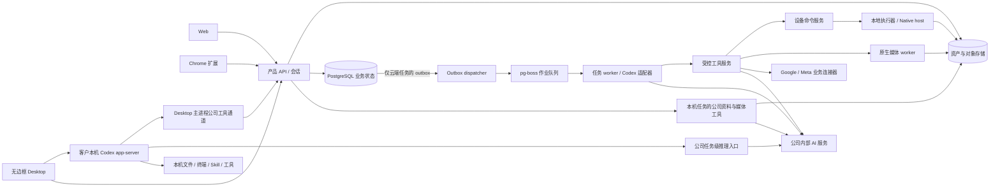

# 技术架构与技术栈

阶段 88 当前增量：客户本机批准的固定程序、结构化参数、原生进程树及停止/撤销、父进程退出清理、原费用回执；浏览器普通打开与弹窗统一每任务三页/每执行器两个活动上下文，实际销毁后释放、复用前清除存储；会话等待不锁住其他会话的新建和操作。68 项打包 Desktop、114 项 Desktop 单元、18 项原生 Codex、184 项客户端、91 项相关后端及 6 项严格声明检查通过。模型和部分原生对话框决定为明确假数据；完整产品、至少十二个合格角色及 G01–G10 仍未验收。 见[方案及边界](../technical/88-approved-local-programs.md)。当前源码和已发布版本分别以本阶段检查点、最终提交及远程回执为准；下文保留历史阶段原范围。

**阶段 87 历史范围：** Desktop 目录监听、稳定快照、持久批量队列、原轮次客户回答、实际应用重启后暂停、原线程/固定版本继续、独立费用和预算/撤销已有限定验证。57 项打包 Desktop、91 项 Desktop 单元、161 项客户端单元通过；原 50/69 项保留。紧凑摘要分行及页面 Home/End 修复已核对；输入框保留光标操作。全部 14 个运行素材/许可证保留，仓库媒体不进入运行 ASAR。本阶段不新增 API/SQL；沿用阶段 86 未变化后端/Web/Admin/Extension 的历史 1023/25/36/14 范围，不宣称完整套件重跑。REQ-040/042 更新部分，原 102 项为 86 部分／16 未证明完整／0 完整验收；至少十二个专业角色和 G01–G10 继续开放。见[当前方案与精确证据](87-desktop-folder-work.md)。

下文保留原规范和各阶段历史记录；历史「当前」及阶段专用命令仅解释其原始回执。新发布流程使用本阶段检查点、文档/媒体核对和提交清单。

**阶段 86 历史基线：** 共享配置草稿/精确预览/不可变发布、新工作固定版本、旧任务保留原版或原先无配置状态，已在实际 Web、原生侧栏及本机 Codex 核对。本机三次执行采用 v3/v3/v4，资料工具与本地原字节、各自费用结算均检查。侧栏聊天附件先建立本人私有会话，分片校验与精确恢复回执不回退共享；同项目另一编辑者不能列出、下载、读取版本或访问私有会话。独立 Admin 正文/费用权限与隔离/恢复/永久擦除继续生效。平台 1023（保留原 1001）、核心 25、兼容 36、客户端 139、实际 Web/Admin/侧栏 14、打包 Desktop 50 分别通过，选定源码精确相符。SQL103 增量保留 SQL001–102 和四份历史契约；487 配置路由加 1 条条件 demo 路由。REQ-065 更新为部分验证，原 102 项为 84 部分／18 未证明完整／0 完整验收，G01–G10 和其余全部差异保留。假模型证据不代表真实专业质量。见[当前方案与限定证据](86-shared-project-guidance-and-private-chat.md)。

以下保留既有规范及历史记录；阶段专属命令仅解释当时回执，当前增量以前述方案、检查点和发布流程为准。 Existing specifications and historical records follow. Stage-specific commands explain their original receipts; the current increment uses the guidance, checkpoint and publication flow above.

**阶段 85 历史基线：** 原任务中的音频提案需原客户以当前登录会话独立确认精确内容和公司报价；默认不勾选，权利依据/用途为空。模型与 Admin 不能代签。拒绝、截止、停止及撤权阻断派发，撤回阻断交付但保留真实或未知费用。新增 SQL102，保留 SQL001–101、四份已发布契约及旧角色/Skill。平台 1001（全部原 988 用例保留）、核心 56、兼容 80、客户端 124、真实 Web/Admin/原生侧栏 13、打包 Desktop 41 分别通过；全部选定源码摘要精确相符。Desktop 保持客户本机 Codex、主动可撤销全权限、无边框/菜单，无可见纵横滚动条，保留滚轮/键盘/末项焦点及真实进度。原生右侧栏保持云端 Codex 和获准文件上传。真实声音/粤语质量、后台音频发行和未知 POST 外部证据结算仍保留；原 102 REQ/102 TC 为 83 部分／19 未证明／0 完整验收，G01–G10 不变。见[当前方案与限定证据](85-audio-rights-and-administration.md)。

**阶段 84 历史基线：** 公司内部配音/文件转写、原始音讯和真实字幕时间、无 AI 的版本修订、共享预算与未知费用保留、来源门控及独立后台正文/费用权限已在明确假数据下局部核对。平台 988 项保留原 968 项，音频/网关 43、兼容 80、客户端 124、真实 Web/Admin/原生侧栏 10、打包本机 Desktop 40 项分别通过。新增 SQL101，SQL001–100 和两份原 OpenAPI 保持。Desktop 本机 Codex、可撤销全权限、无边框/菜单、无可见纵横滚动条，保留真实滚动、键盘、缩放后焦点与真实进度。原生侧栏继续云端 Codex 与获准文件上传。真实音质、独立人工声音授权、音频能力后台发行及未知 POST 专属对账仍待补齐；原 102 REQ/102 TC 保持 83 部分／19 未证明／0 完整验收，G01–G10 保留。见[方案与限定证据](84-internal-audio-production.md)。

**阶段 83 历史基线：** 固定 GEO 问句和完整 Agent/skills 配置、独立 Codex 重复运行、私有原始回答与真实 JSON、人工消费者样本单独声明及后台来源治理已局部核对。平台 968 项保留原 946 项，专项 22、客户端 124、真实 Web/Admin/原生右侧栏 13、打包本机 Desktop 37 项分别通过。SQL100 新增，SQL001–099 与原 OpenAPI 保持。Desktop 本机 Codex、主动可撤销全权限、无边框/菜单、无可见纵横滚动条，保留滚动/键盘/真实进度；GEO 明确在浏览器打开，本机 GEO 协议仍待实现。原 102 REQ/102 TC 保持 83 部分／19 未证明／0 完整验收，G01–G10 保留。见[当前方案及证据](83-reproducible-geo-observations.md)。

**阶段 82 历史基线：** 精确素材版本与用户明确确认的广告级身份、独立口径反馈、实际 JSON 下载／模型读取继承来源、撤销和保留期清理已局部核对。平台 946 项保留原 929 项，专项 17、兼容 43、真实 Web 4、打包 Desktop 36 项分别通过；SQL099 新增，SQL001–098 及原 OpenAPI 保持。Desktop 本机 Codex、无边框、无可见纵横滚动条，保留实际滚动／键盘／真实进度；原生 Side Panel 为云端 Codex 和文件上传。102 REQ/102 TC 保持 83 部分／19 未证明／0 完整验收，G01–G10 保留。见[当前方案及证据](82-confirmed-creative-feedback.md)。

**阶段 81 历史基线：** 后台视频模型不可变配置、16 案例异步验证、原作业恢复、费用核对、独立审批、发布及回滚已在明确假服务和真实 MP4 下验证。平台 929 项（原 912 项保留）、兼容 106、契约 7、真实后台页面 7 项分别通过；新增 SQL098，SQL001–097 与两份原 OpenAPI 保持。Desktop 本机 Codex、无边框、隐藏纵横滚动条并保留滚动／键盘／真实进度；原生侧栏仍是云端 Agent。102 REQ/102 TC 保持 83 部分／19 未证明／0 完整验收，G01–G10 保留。见[当前方案及证据](81-managed-video-capability-releases.md)。

**阶段 80 历史基线：** 生成式视频原作业、共享预算与未知费用保留、取消/对账、真实 MP4 和三端预览；Desktop 设置紧凑、无边框、无可见纵横滚动条且保留滚动/键盘与真实进度。平台 912、专项 60、客户端 69、打包 32、Web/Admin 5、侧栏 9、本机监督进程 17 项分别通过，模型与媒体内容为明确夹具。SQL097 新增，SQL001–096 与各原 OpenAPI 字节保留。原 102 REQ/102 TC 为 83 部分/19 未证明/0 完整验收，G01–G10 保留。见 [方案和证据](80-generated-video-jobs.md)。

**阶段 79 历史基线：** 不可变品牌版本、固定专家/云端设计任务、真实字体/价格/渠道/期限检查与来源治理；Web/打包 Desktop 品牌表单已实际执行。平台 874、客户端 68、打包 30、品牌 Web 4、Web/Admin 4、原生侧栏 8 项分别通过。SQL096 为新增迁移，SQL001–095 与原规范各自字节保留。原 102 REQ/102 TC 为 82 部分/20 未证明/0 完整验收，G01–G10 与 TC-056 仍未证明。Desktop 保留本机 Codex、无边框、真实进度及无可见纵横滚动条、可滚动和键盘访问。见 [方案与限定证据](79-versioned-brand-production.md)。

**阶段 78 历史基线：** 补齐固定交付版本的接受/修改/弃用、独立人工投入、实际读取复用及带范围的后台品质汇总，修正控制端来源检查。Desktop 保留本机 Codex、无边框、真实进度和隐藏滚动条；紧凑窗口实际聚焦输入、输入区及回执可用。平台 861、客户端 68、打包 26、Web/Admin 4、原生侧栏 8 项分别验证。新增 SQL095 和六项接口（434 总计），SQL001–094 与原规范不变。102 REQ/102 TC、81/21/0、G01–G10 及 TC-056 真实业务验收边界保留。见 [方案与当前证据](78-business-delivery-quality.md)。

**阶段 77 历史基线：** Desktop 新会话接入十二项客户本机浏览器工具，真实操作/上传/截图/下载经本机 Codex 与公司网关；Stop/撤权回收页面。Desktop 取消旧进度条约束，保留真实进度，隐藏滚动条并重排成果/代码/表格，验证三种实际窗口、滚轮/键盘及双语浅深主题。平台 851、客户端 68、内核 17、独立浏览器 10、打包旅程 25 项分别通过；SQL001–094、428 条接口、102 REQ/102 TC 与 81/21/0 保留。Extension 仍为原生右侧栏获准文件上传与云端 Codex，无新 UI 计数。见 [当前方案与限定证据](77-desktop-native-browser.md)。

**阶段 76 历史基线：** Desktop 流程由本机父子 Codex 执行，新增不可变私有版本、独立子费用确认、人工审批、真实成果下载、Stop/撤权与来源治理；平台 848 项、重叠定向 75 项、真实父子流程 3 项、原生内核 17 项、客户端 56 项、实际打包旅程 19 项通过。18 个本机角色协议准入不代表完整专业验收；102 REQ/102 TC、NFR、G01–G10 和 81/21/0 保留。Extension 继续原生右侧栏获选文件上传与云端 Agent，本轮按相同产品及验证器字节复核，未增加其 UI 计数。见 [实现与证据](76-desktop-native-workflows.md)。

**阶段 75 历史基线：** Desktop 保持本机 Codex，视频角色接通七项公司工具、私有工程、真实合成、播放/保存、版本修改及停止/撤权控制。平台 830 项、重叠定向 58 项、原生 17 项、客户端 47 项和实际打包旅程 18 项通过；当前 17 个本机角色准入不等于全专业验收。见 [实现与源码证据](75-desktop-private-video.md)。原 102 REQ/102 TC、NFR、G01–G10 和 81/21/0 状态保留；较早记录沿用其原始源码范围。

**阶段 74 历史基线：** 本机 Codex 的追问、选择/自填回答、同任务回合继续、等待时停止及撤权已接通；当前 Desktop 有 47 项客户端、17 项真实原生和 12 项实际打包旅程检查。后端源码未变，沿用阶段 73 的 818 项完整回归范围。详见 [方案与限定证据](74-desktop-native-user-input.md)。18 角色/29 Skill 及全部原始验收范围保留，以下较早记录保持各自原始源码边界。

**阶段 73 历史基线：** Desktop 保持本机 Codex，接通公司图片/设计/资料工具和私有成果下载；16 个角色的本机协议可准入。真实原生 14 项、平台完整回归 818 项、打包 Electron 9 项旅程通过，供应商/系统对话框决定明确为假数据夹具。全 18 角色/29 Skill 和完整产品验收仍保留。见 [本机公司工具](73-desktop-native-company-tools.md)。下列阶段 72 及更早记录只证明原始源码范围。

实施状态：本分册保留长期设计约束；本轮锁定版本、实际 API/工具、各端实现与差异，以 [实际开发清单](12-implementation-and-repositories.md) 和 [运行验收](../quality/04-implementation-acceptance.md) 为准，未实现项没有删除。

版本：1.5 基础设计；2026-10-22 按 [CLIENT01](../requirements/03-client-execution-amendment.md) 修订客户端执行位置。下图为当前执行分工；阶段 72 已接入本机 Codex/完整权限及公司费用通道，限定证据与待验收范围见 [本机执行及控制面](72-desktop-local-execution-and-control-plane.md)。历史回执保留原始源码范围。

## 1. 架构选择

初期采用模块化单体业务服务，加独立任务、媒体和本地执行器。避免在业务边界未验证时拆分大量微服务；执行资源仍独立隔离，不能把多企业工具调用放进同一无限权限进程。

| 层 | 设计默认 | 选择原因与升级边界 |
| --- | --- | --- |
| Web | React + TypeScript + Vite | 工作区与复杂编辑共用组件；首期不依赖服务端页面渲染 |
| 品牌 UI | 版本化 JSON/CSS token 与共享 React 组件 | 继承 CopyPaste 官网浅深色、Logo 与组件语言；三端和管理页统一，客户作品独立品牌 |
| 产品 API | TypeScript + Fastify | schema 驱动校验、流式接口、模块边界清楚 |
| 业务存储 | PostgreSQL | 任务、账本、权限和 outbox 原子提交 |
| 作业队列 | PostgreSQL + pg-boss | 与本机原生开发兼容，初期不增加 Redis 依赖；业务任务表仍为权威 |
| 对象存储 | S3-compatible 对象服务 | 原始文件、产物和快照分层存储；本地可用文件系统适配 |
| 内核 | Codex，锁定 CLI/app-server 与协议版本 | 用户已确定的唯一内核；受控 stdio 集成，产品层负责权限、状态、计费和工具 |
| 图像排版 | 受控 SVG/HTML 描述 + 原生 Chromium 渲染 | 文字与图像分层，字体和输出尺寸可确定 |
| 视频 | 原生 FFmpeg + 固定模板 | 真实成片、输入输出可检查；AI 生成走内部服务 |
| 扩展 | Chrome Manifest V3 + side panel | ChatGPT 式对话及文件获取/读取/上传，Agent 在云端运行 |
| Desktop | 无边框 Electron + 本机 Codex app-server | 本机会话、文件、终端、Skill；支持客户主动授予完整本机权限 |
| 可选 Native Host | TypeScript 文件桥接 | 扩展的增强目录能力，不代替 Desktop 的本机 Agent |

版本在初始化时按兼容矩阵锁定；不使用漂移的 latest 依赖。选型是本轮建议，精确版本与生产云供应商仍需工程验证。参考来源集中于 [来源登记](../governance/02-glossary-and-sources.md)。

品牌来源与采样记录见 [视觉规范](../product/07-brand-design-system.md)，token、字体、主题、组件和跨端落地见 [前端设计集成](10-frontend-design-system.md)。应用打包自身版本的资源，不在运行时直接加载官网 CSS/脚本；主题偏好不增加业务 API，也不更改客户品牌配置。

## 2. 组件关系

Desktop 任务只保存本机执行归属与费用，不创建云端 Agent outbox；公司工具共享项目、产物和账本规则，不能接管本机执行循环。逻辑连线不意味着开放数据库或对象库给客户端。外部 AI 供应商凭证只出现在内部服务域，设备主动建立到产品服务的出站连接。

Codex 是 CORE01 的固定架构约束。默认助手、预设/定制角色、团队及 Routine 共用 Codex 执行链；内核适配边界仅负责官方协议/版本转换。运行配置 kernel 固定 codex，版本启用、模板发布、任务启动/恢复均校验；Codex 故障不触发其他内核回退。具体边界及准入见 [Codex 与内部网关](02-runtime-and-ai-gateway.md)。

## 3. 任务提交时序

Web/Extension 云端流程：客户端提交幂等请求 → API 核验身份和输入 → 数据库事务创建任务/预算/outbox → 返回 task_id → dispatcher 投队列 → worker 校验租约和授权 → 云端 Codex 与工具执行 → 结果转存及事件提交 → SSE 通知。

Desktop 本机流程：公司登录及业务授权 → 本机用户选择权限模式 → main process 启动本机 Codex 并加载 Skill → 本机工具执行及流式交互 → 按约定同步事件/费用和选定产物。本机任务不投递到旧云端 Codex 队列；本机执行契约及恢复设计见 [方向检查](69-desktop-local-codex-and-extension-direction.md)，本机入口使用独立 desktop-executions 契约，旧云端任务 API 不承接 Desktop 原生登录的 Agent 请求。

仅对 Web/Extension 云端任务，进程在事务提交后、投递前崩溃时，dispatcher 可重新扫描 outbox；投递后崩溃可能重复消息，worker 依据任务版本和稳定 operation_id 去重。队列清空可从业务 outbox 重建，不能丢任务真相。

## 4. 状态、事件与费用的一致性

云端任务在业务事务内同时写状态、事件和 outbox；Desktop 事务保存本机归属、控制事件与费用，不创建云端 Agent outbox。两类任务的费用变更均同时写 reservation 与 ledger。对象先上传暂存并校验，再提交资产引用，失败的孤立对象由清理任务处理。

执行租约含 monotonically increasing fencing token，旧 worker 即使继续运行也不能提交数据库结果或新受控工具操作。对已经送达上游的动作只能查询实际结果，不能通过数据库租约撤销已发生副作用。

## 5. 执行隔离

云端 worker 池按任务/企业范围分配工作区、身份、网络白名单和资源限制。MVP 首先使用结构化业务工具；如果启用内核自带 shell，必须落在经过验证的原生受限执行环境，不能共享 API 服务的主机权限与密钥。

开发、本地桥接及 Desktop 使用原生进程，不调度本地 Docker、WSL 或虚拟机。生产云端隔离技术需单独评估，本文不通过部署命令启动任何环境。

## 6. 扩展与拆分条件

媒体、连接同步和本地命令天然独立队列。出现数据库争用、单类型作业长时间阻塞或团队独立发布需求后，再按已有模块边界拆服务。先做查询索引、分页、归档与并发限制，不以无限增加 worker 代替容量分析。

后续独占云电脑复用 workspace_id、设备/执行器命令及资源账本；实时画面采用有权限和期限的观察通道，不能公开内核控制端口。

Web 1.1 的云文件树由元数据及对象版本支撑，计算工作目录按任务物化，完成后回存，不需永久独占进程。会话和 Agent/团队是业务记录，不能直接等同内核原生 Session。共享配置与技能解析出固定的有效版本，工具执行前仍核查当前权限。

团队协调者生成有依赖的成员任务，复用 M03 调度、事件与总预算。等待成员时释放执行槽，避免协调者占住全部企业并发；子任务按本次调用身份和项目范围执行，Agent 角色本身不是新的授权主体。基础云端 Routine 使用服务端调度，不依赖浏览器或桌面进程在线。

Artifact 的 HTML/网页预览使用隔离源和受限渲染策略，不能获得工作台 cookie、平台凭证或任意出站能力。预览面板与执行器浏览器租约分别计量和清理；文件内容、技能正文与网页资料不能改写平台强制权限。

## 7. 失败域与交付检查

业务 API、数据库、对象存储、内部 AI、平台连接和设备分别监控。用户能够查询已保存任务，即使 AI/设备短暂不可用。发布前验证数据库恢复、队列重建、文件引用一致性及至少一个真实完整业务任务。

## 8. Admin 控制面

ADMIN01 增加独立 React/TypeScript/Vite 管理端 apps/admin，复用 packages/ui 的 CopyPaste 品牌组件，通过专用 AdminSession/MFA 接入 /v1/admin/*。逻辑服务仍在模块化单体中，权限、用户/内容、费用及权益复用同一领域规则和事务，不另建平行账本或 Agent 运行链。跨企业查询与管理通过独立受限授权入口，普通企业管理员不能访问。页面和工作包见 [后台产品设计](../product/08-admin-dashboard.md) 与 [技术设计](11-admin-control-plane.md)。

管理聚合、批量、导出及通知使用独立作业并限并发；Admin 故障不应阻塞普通用户已获准任务查询和执行。后台配置只引用受控版本，不能关闭 Codex 唯一内核、内部 AI 路由或角色资格门槛。M1 同步交付人工费用/VIP 和安全管理基础，M2 完整配置发布和批量功能。
