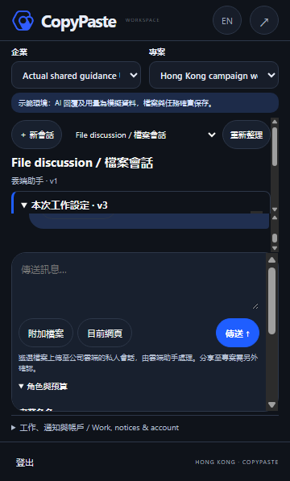
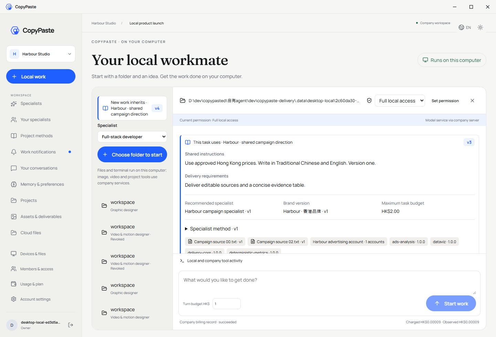

# 阶段 86 实际界面复核 / Actual interface review

复核日期：2026-10-25。实际 Web/Admin/原生侧栏来自 `project-configuration-ui-14.json`，打包本机 Desktop 来自 `desktop-local-ui-64.json`。两份实际流程分别通过 14 项和 50 项；原始失败尝试保留原结论。这里记录抽样人工图像复核，完整来源摘要、截图及录制以[当前检查点](shared-project-checkpoint.json)为准。

| 编号 | 实际样本 | 观察结果与范围 |
| --- | --- | --- |
| VIS86-01 | Web 英文发布预览 | 依赖、品牌、文件版本、预算与发布动作分区明确；预览和返回编辑、确认发布均可见。保留 CopyPaste 蓝色、米白底与既定字体。 |
| VIS86-02 | 原生侧栏繁中深色紧凑设置，实际 360×597 内容区 | 摘要、记录与设置使用独立滚动区域；输入、附件、当前页面和发送保留在实际侧栏内。脚本另核对命中区域、真实点击发送和附加工具末项键盘访问。设置展开后多重滚动区仍偏密集，视觉层次需要继续收敛。 |
| VIS86-03 | Admin 英文敏感正文 | 正文位于独立弹窗，原 JSON 按可用宽度换行；查看使用独立正文权限，与只读元数据、财务权限分开。该界面仍是管理用结构化正文查看器，不声称已具备全部业务内容编辑器。 |
| VIS86-04 | Desktop 繁中深色共享配置编辑，实际 800×600 | 自定义标题栏保留；到达底部后保存/预览可见，内容可滚动，无可见纵横滚动条和水平溢出。先前输入可经滚动及键盘返回，不通过裁切取消必需操作。 |
| VIS86-05 | Desktop 新发布 v4 与原线程 v3 | 新工作的 v4 摘要与本次任务的 v3 同屏区分；原线程继续后保留原资料和费用。输入框及操作区保留，正文由内部记录区域滚动。 |
| VIS86-06 | Desktop 营销反馈繁中深色紧凑报告 | 账户分组分别显示，30.000001 HKD 和未知转化保留原口径；侧栏和偏好操作固定。实际流程通过工作区焦点、End、Ctrl+Home 和末项可达检查，无可见滚动条。 |

实际截图没有改图或添加产品内容。模型回复、品牌/广告资料和部分原生对话框决策是明确夹具；浏览器、数据库、实际文件和客户本机 Codex 进程分别运行。原始录制按观察时间保留，五组 GIF/MP4 由[完整解码核查](shared-project-media-review-01.json)验证，不通过加速伪造响应时间。

本次没有完成全部页面/动态状态、200% 缩放、目标 DPI、完整键盘矩阵、对比度、屏幕阅读器或 reduced-motion 验收，也不代表真实模型成果的专业质量。原 102 项完整验收、至少十二个合格角色及 G01–G10 仍开放。浏览器、Electron、API、预览与数据库的本轮自建资源均按原始回执关闭；未使用 Docker、WSL 或虚拟化。

## English

This review samples the actual stage-86 UI from Web/Admin/native Side Panel attempt 14 and packaged customer-local Desktop attempt 64. Their independent journeys pass 14 and 50 bounded checks. Samples include publication review, the real 360×597 Traditional Chinese Side Panel, separately authorized Admin bodies, the 800×600 Desktop editor, v4-for-new-work versus retained v3, and compact creative feedback.

The CopyPaste identity, frameless native shell and usable scrolling remain. Desktop exposes no scrollbar rails or horizontal layout overflow in the checked states. Native keyboard access uses a reachable, named workspace scroll region; inputs, conversations and dialogs retain their own keyboard behavior. The actual Side Panel keeps the composer, Send and current-page actions visible and hit-tested while guidance/settings are expanded. Its compact expanded-settings state still has a dense stack of scroll regions and needs further visual simplification.

Screenshots are unedited. Recordings preserve observed timing; the separate media receipt fully decodes all five GIF/MP4 pairs. Synthetic reasoning/media content and native-dialog decisions remain explicit fixtures. This sample does not qualify every state, 200% zoom, DPI, screen readers, reduced motion, live professional output or complete product acceptance. Historical failures and all original requirements remain intact.
