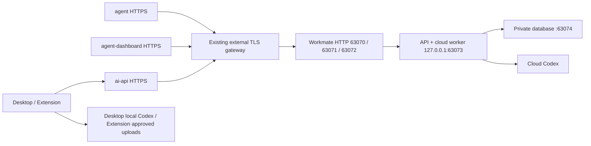
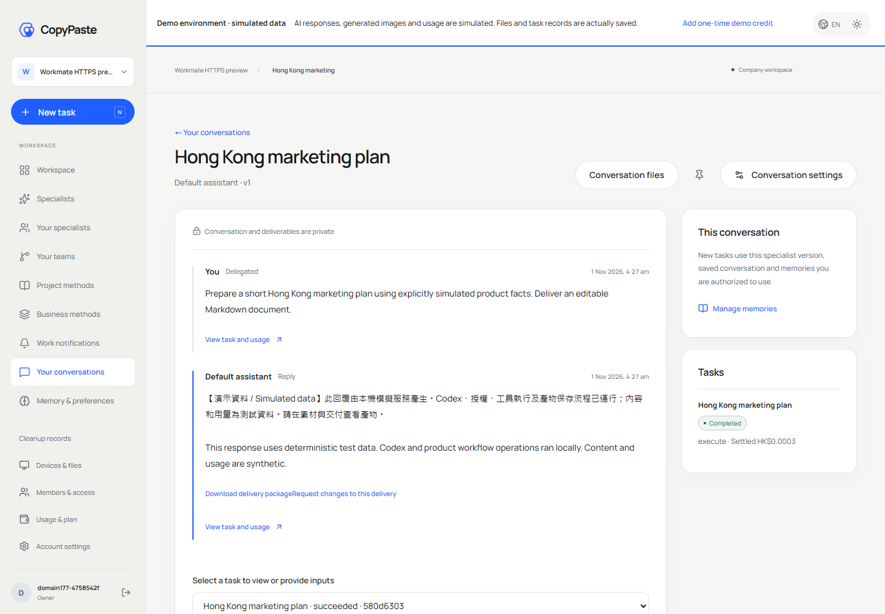
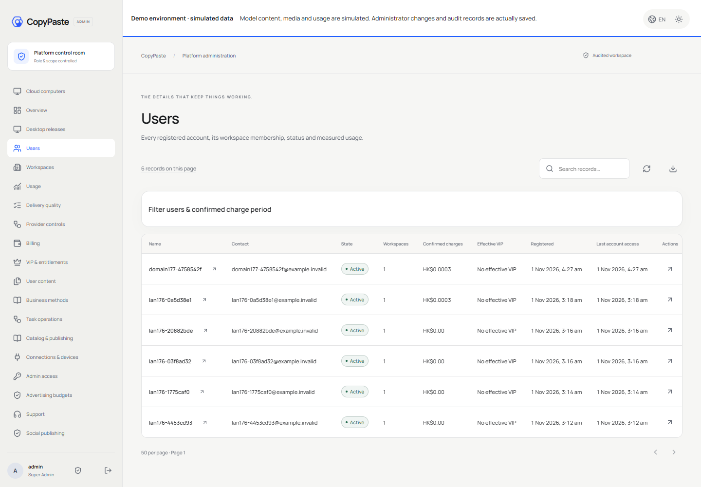

# Workmate 正式域名试用部署 / Public-domain preview deployment

本次增量基于不可变 v0.1.3 和阶段176部署，启用正式 HTTPS 域名，更新浏览器登录及原生客户端。AI、媒体、广告和支付继续使用已授权假数据；不是实供应商生产验收。

This additive deployment enables public HTTPS domains and updates browser authentication and native clients. It builds on immutable v0.1.3 and stage176. External providers remain explicitly synthetic.

| 入口 / Entry | 地址 / Address | 上游 / Upstream |
| --- | --- | --- |
| 用户端 / Web | https://agent.copypaste.hk | HTTP `192.168.196.204:63070` |
| 管理后台 / Admin | https://agent-dashboard.copypaste.hk | HTTP `192.168.196.204:63071` |
| 平台 API | https://ai-api.copypaste.hk | HTTP `192.168.196.204:63072` |
| 测试收件箱 / Test mailbox | https://agent-dashboard.copypaste.hk/ops/mailbox/ | 独立操作口令 / Separate operator password |

`192.168.196.204` 是服务器 ZeroTier 地址，与原内网 `192.168.31.20` 为同一台主机。三个高位端口在所有服务器 IPv4 接口监听；API `63073`、数据库 `63074` 仍仅监听回环。公开 TLS 由现有外部反代终止，内部转发使用 HTTP。Web/Admin 请求同源 `/v1/`，经独立代理进入后端；Desktop/Extension 访问正式 API 域名。

The ZeroTier and LAN addresses belong to the same server. The external gateway terminates TLS and forwards HTTP to the three high ports. Web/Admin keep same-origin `/v1/` proxies. Native clients use the public API hostname. Backend/database ports remain loopback-only.

## 登录与权限 / Login and permissions

1. 用户端输入邮箱，发送验证码；未接入 SMTP 时，到受口令保护的测试收件箱读取对应邮件。验证后新用户创建企业工作区和项目，再领取一次模拟额度、选择角色并提交任务。
2. 后台使用原管理员邮箱 `admin@workmate.local`，需要邮件验证码及验证器 TOTP。后台会话独立于用户会话，原用户、用量、费用、VIP、内容、审批和审计权限持续生效。
3. 原管理员、收件箱、数据库用户及密码均保留。服务器明文凭据位于 `/root/cfg/workmate/credentials.txt`，root `0600`；目录 `0700`。读取命令：`sudo cat /root/cfg/workmate/credentials.txt`。不要将凭据复制进代码仓库或分发包。
4. 用户和后台 Cookie 均为 `Secure`、`HttpOnly`、`SameSite=Lax`，分别绑定各自主机，保留 CSRF 和旧会话隔离。原 HTTP 高位端口用于上游及维护；日常登录请使用 HTTPS 正式域名。

Request a code on Web, read the matching protected test email, verify, create a workspace/project, add simulated credit and submit work. Admin requires independent email OTP plus TOTP. Credentials are unchanged and remain plaintext in the root-only server credential file. Customer/Admin sessions use separate host-only Secure cookies; CSRF and stale-session protection remain enforced. Use the HTTPS hostnames for sign-in.

## 客户端 / Native clients

- [Desktop 0.7.2 安装版 / Setup](https://agent.copypaste.hk/downloads/CopyPaste-0.7.2-x64-Setup.exe)
- [Desktop 0.7.2 便携版 / Portable](https://agent.copypaste.hk/downloads/CopyPaste-0.7.2-x64-Portable.exe)
- [Chrome Extension 0.5.3](https://agent.copypaste.hk/downloads/CopyPaste-Extension-0.5.3.zip)
- [客户端清单 / Client manifest](https://agent.copypaste.hk/downloads/workmate-domain-clients-177.json) · [SHA256](https://agent.copypaste.hk/downloads/workmate-domain-clients-177.sha256)

Desktop 在 Windows 客户本机运行固定 Codex `0.163.0-alpha.11`，保留主动完整本机权限、无边框、自定义窗口控制和隐藏滚动条。安装后选择浏览器安全登录，授权后返回本机窗口。模型请求仍经公司服务器，客户端不包含供应商密钥。Windows 安装包仍未签名；未启用未经签名校验的自动更新。

Desktop runs pinned Codex locally on the customer's Windows computer, with explicit full permission, a frameless shell and hidden scroll rails. Complete browser authorization and return to the native app. Company services handle model access; supplier keys are not embedded. These installers remain unsigned, and the existing verified-update gate is preserved.

Extension ZIP 解压至固定目录，在 Chrome 扩展管理页启用开发者模式并“加载已解压的扩展程序”。固定 ID 为 `fffkcnmfdhahlnifgdilabheppkgnlok`。点击工具栏图标打开浏览器右侧原生 Side Panel；浏览器授权后，选择允许读取的文件/目录上传，任务由云端 Codex 执行。Desktop 文件桥接仍需用户主动开启及授权，不自动获得本机权限。

Extract the Extension ZIP, enable developer mode in Chrome extensions and load its unpacked directory. Click the toolbar action to open the native right Side Panel. Sign in through the browser, select approved files and upload them for cloud Codex work. Optional Desktop file bridging requires explicit permission.

## 运行与回退 / Operations and rollback

```sh
sudo systemctl status workmate-db workmate-api workmate-lan-proxy
sudo journalctl -u workmate-api -n 100 --no-pager
curl http://127.0.0.1:63073/health/ready
```

后端增量：`/opt/workmate/overlays/domains-177/backend/`；前端：`/opt/workmate/overlays/domains-177/frontends/`。API 专用 drop-in 为 `/etc/systemd/system/workmate-api.service.d/domains-177.conf`。冻结包不修改；现有 `node_modules`、目录化角色/Skill 和持久化数据库继续复用。配置备份位于 `/root/cfg/workmate/domains-177-backup/`，包含旧 `app.env`、原代理及前端切换前代理配置。

Only Workmate API and its independent proxy are restarted/reloaded. Other services, global nginx, system Node, shared databases and foreign keys are preserved. To roll back, restore the backed-up environment/proxy and remove this exact API drop-in, then reload systemd and restart only the owned API/proxy. A full rollback also restores LAN-only origin/cookie policy and requires matching external routing.

## 构建与交付 / Build and delivery

[本轮源码与部署增量 / Source and deployment increment](https://agent.copypaste.hk/downloads/workmate-domains-177.zip) 补充原 v0.1.3 完整包；不替换原 ZIP、标签或旧安装包。本轮源码、部署脚本、双语 README、实际页面截图和交互录像同步至各 Git 分支。凭据不随包分发。

The domain increment supplements the original complete bundle and includes matching build inputs, deployment scripts, bilingual guides and actual captures. Immutable release bytes/tags and old installers are preserved. Credentials are excluded.



真实 AI、SMTP、媒体、广告和支付接入仍需要单独配置和验收。Windows 专属的云端程序/浏览器精确执行配置未因此获得 Linux 资格。不要将域名上线等同于上述接入完成。

Real AI, SMTP, media, advertising and payment qualification remains separate. Windows-specific cloud execution profiles are not qualified for Linux by this domain deployment.

## 实际页面与核查 / Actual pages and validation

13 项正式域名浏览器流程、4 项真实打包/原生面板检查及桌面浏览器 PKCE 授权通过；6 项 Cookie/配置检查与20项并发/传输检查通过。记录使用实际 Codex 与明确模拟供应商，录像仅包含登录后页面。自建浏览器、原生窗口和页面均关闭。

Public-domain browser journeys, real packaged/native surface checks and Desktop browser PKCE authorization passed. Cookie/config and transport/concurrency checks also passed. Actual Codex uses explicit synthetic providers; recordings exclude OTP/TOTP entry. Owned windows and browser contexts are closed.






