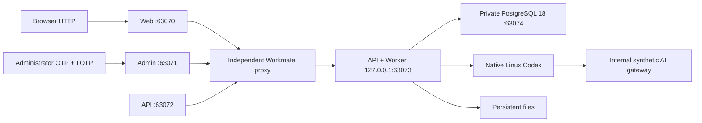
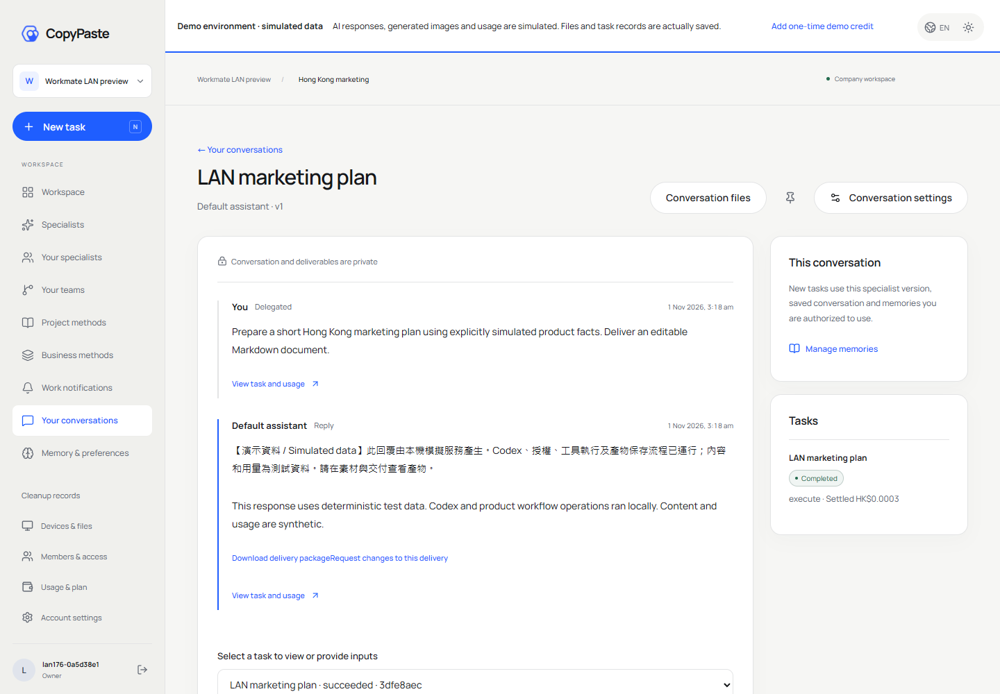
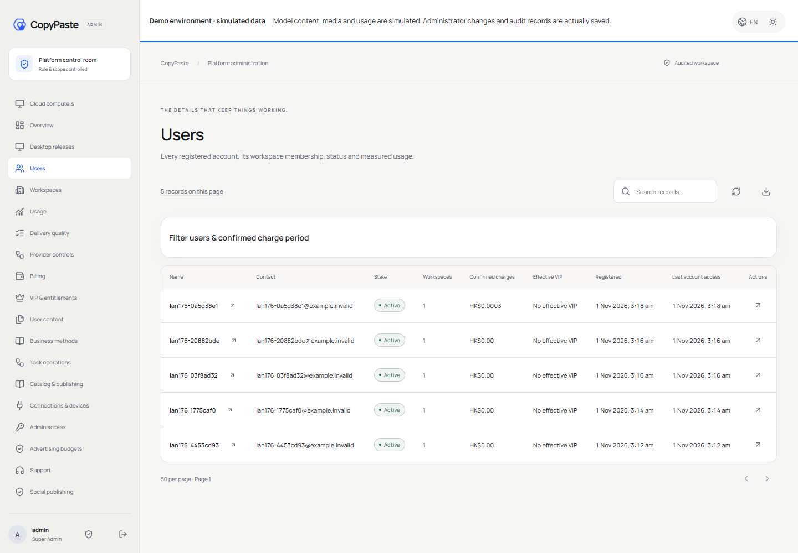

# Workmate 内网 HTTP 部署 / LAN HTTP deployment

服务器：`192.168.31.20`。基于不可变 `v0.1.3` 完整发行包，追加 `lan-http-176-v2` Web/Admin 兼容更新。当前按用户要求使用内网 HTTP、假数据；正式域名稍后提供。

Server: `192.168.31.20`. The immutable `v0.1.3` bundle is the base, with the `lan-http-176-v2` Web/Admin compatibility increment. LAN HTTP and synthetic services are explicitly requested; the official domain follows later.

| 入口 / Entry | 地址 / Address | 用途 / Purpose |
| --- | --- | --- |
| Web | http://192.168.31.20:63070 | 用户工作台 / Customer workspace |
| Admin | http://192.168.31.20:63071 | 独立管理员与权限 / Independent administrator access |
| API | http://192.168.31.20:63072 | API；Web/Admin 默认使用同源代理 / API and same-origin frontend proxy |
| 测试收件箱 / Test mailbox | http://192.168.31.20:63071/ops/mailbox/ | 独立操作口令保护 / Separate operator credentials |
| 数据库 / Database | `127.0.0.1:63074` | 仅服务器本机 / Server loopback only |
| 后端 / Backend | `127.0.0.1:63073` | 仅独立代理访问 / Private upstream |

所有本次生成的数据库用户、密码、主密钥、收件箱操作口令、管理员邮箱及 TOTP 种子均按要求**明文保存在服务器 `/root/cfg/workmate/credentials.txt`**。配置目录为 `/root/cfg/workmate/`；敏感文件由 root 持有，权限 `0600`，目录 `0700`。不需要修改其他项目的 key。

All generated database users/passwords, master key, mailbox operator password, administrator email and TOTP seed are intentionally stored in plaintext at **server `/root/cfg/workmate/credentials.txt`**, as requested. Sensitive files are root-owned `0600` under a `0700` directory. Other projects' keys are preserved and are not reused.

## 登录与使用 / Sign-in and usage

1. SSH 登录后执行 `sudo cat /root/cfg/workmate/credentials.txt`，读取操作口令；将管理员 TOTP URI 导入验证器。管理员邮箱为 `admin@workmate.local`。
2. 打开 Web，输入工作邮箱并发送验证码。本轮尚未接真实 SMTP，验证码写入服务器本地测试邮件；使用独立操作口令打开测试收件箱后查看。只有持有该口令的试用操作人员可以查看本地邮件。
3. 输入对应邮件的 6 位验证码，创建企业工作区和首个项目，领取一次模拟额度，再创建任务。选择角色、填写目标和预算，查看工作进度、交付及素材。模型、媒体、广告、支付均为明确标注的假数据；工作记录和文件实际保存。
4. Admin 需要独立邮箱验证码和验证器 TOTP，不能直接使用用户端会话。登录后可管理用户、企业、用量、费用、VIP/权益、内容及权限；敏感操作继续受原有权限、金额/范围限制、审批和审计约束。

1. Read the server credential file through SSH and import the administrator TOTP URI into an authenticator. Administrator email: `admin@workmate.local`.
2. Request a Web email code. Until SMTP is configured, open the protected test mailbox using its separate operator credentials. This mailbox is intended for operators running the authorized LAN preview.
3. Verify the matching six-digit code, create a workspace/project, add one-time simulated credit and submit a task with a role, goal and budget. Records/files persist; external AI/media/advertising/payment data remain synthetic.
4. Admin requires its own email OTP plus TOTP. Its existing scoped permissions, amount limits, approvals and audits remain enforced for user, billing, VIP and content management.



## 运行、文件与下载 / Operations, files and downloads

三个独立且开机启用的服务 / Three independent enabled services:

```sh
sudo systemctl status workmate-db workmate-api workmate-lan-proxy
sudo journalctl -u workmate-api -n 100 --no-pager
curl http://127.0.0.1:63073/health/ready
```

只管理上述 Workmate 服务。数据库、应用及代理使用独立目录和高位端口；没有替换系统 Node，没有重载共享 nginx/PostgreSQL，也未调用 Docker、WSL 或虚拟化。

Manage only these Workmate units. The database, application and proxy have separate directories/ports. System Node and shared nginx/PostgreSQL remain in place; Docker/WSL/virtualization were not invoked.

| 路径 / Path | 内容 / Content |
| --- | --- |
| `/root/cfg/workmate/` | 明文凭据、环境、安装和保留检查记录 / Plaintext credentials, environment and audit records |
| `/opt/workmate/releases/v0.1.3/` | 冻结运行包 / Frozen runtime base |
| `/opt/workmate/overlays/lan-http-176-v2/` | 当前 Web/Admin 构建、源码和文件摘要 / Current frontends, sources and digests |
| `/opt/workmate/toolchains/` | 独立 Node 24.22.2 与固定 Codex CLI / Private Node and pinned Codex CLI |
| `/opt/workmate/sources/` | 六端冻结可构建源码及原文档 / Six frozen source repositories and original docs |
| `/var/lib/workmate/` | 专用 PostgreSQL 数据、文件与邮件 / Private database, files and mail |
| `/var/log/workmate/` | 独立代理日志 / Independent proxy logs |

[冻结完整包 / Frozen complete bundle](http://192.168.31.20:63070/downloads/workmate-v0.1.3-complete.zip) · [LAN 页面更新及源码 / LAN frontend increment and sources](http://192.168.31.20:63070/downloads/workmate-lan-http-176-v2.zip)

[本轮完整部署增量、源码及操作录像 / Deployment increment, current frontend sources and recordings](http://192.168.31.20:63070/downloads/workmate-lan-deployment-176.zip)。服务器也保存本轮手册 `/root/cfg/workmate/DEPLOYMENT-README.md` 和增量源码 `/opt/workmate/sources/lan-deployment-176/`。This increment supplements the frozen complete bundle; it does not replace its immutable bytes.

原 `v0.1.3` ZIP、标签及 Windows 安装包保持原字节。LAN 更新包含对应前端源码与锁文件，不能把它当作原 ZIP 已被替换。当前 Git 分支保存完整更新说明与部署脚本。

The original release ZIP, tags and Windows installers retain their original bytes. The LAN overlay contains its corresponding frontend sources/lockfiles; it is an explicit increment. Current Git branches carry deployment scripts and updated guides.

## 后续配置边界 / Configuration boundaries

- 正式域名提供后，统一更新三项 origin、反向代理、登录回调/CORS，并为正式环境接入 HTTPS 与 SMTP。当前不预设域名。
- 原冻结 Desktop/Extension 仍保持原本 localhost 配置及发布策略，尚未重打包为本次 HTTP 内网地址。Desktop 继续在客户本机运行 Codex；Extension 继续使用原生右侧 Side Panel 上传获准文件，由云端执行。正式端点确定后再提供对应客户端构建。
- 本 Linux 服务器支持实际 Codex 内核与平台工具。发行包内任意云端程序及部分云端浏览器使用 Windows 精确运行配置；本次没有将其伪装为 Linux 可用，也未削弱执行边界。需要经过验证的 Linux 配置或对应 Windows 执行节点后才启用这些能力。
- API、媒体/广告/支付凭据与费率继续采用已授权假数据，没有复用 `/root/cfg/` 下其他业务的密钥。

When the official domain arrives, update origins, proxy routes, callbacks/CORS and the intended HTTPS/SMTP configuration together. Frozen native clients retain their existing localhost endpoint policy; this deployment does not silently repoint their installers. Desktop execution remains customer-local, and Extension remains a file-upload Side Panel for cloud execution. Windows-specific exact cloud program/browser profiles are not qualified on this Linux host. Real providers, rates and SMTP remain a separate configuration step.

核查与截图见 [本轮部署核查 / Deployment evidence](../quality/lan-deployment-176.json)；开发调整见 [开发说明 / Implementation](../development/176-lan-http-deployment.md)。

## 实际页面与交互 / Actual pages and interactions

13 项完整 HTTP 浏览器旅程和一次独立操作收件箱浏览器检查通过。Eight HTTP crypto cases and eleven session transport cases also passed. Native private-IP HTTP was used without secure-context bypass flags; all owned browser instances were closed.






