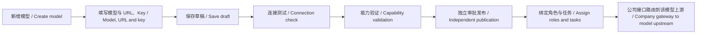
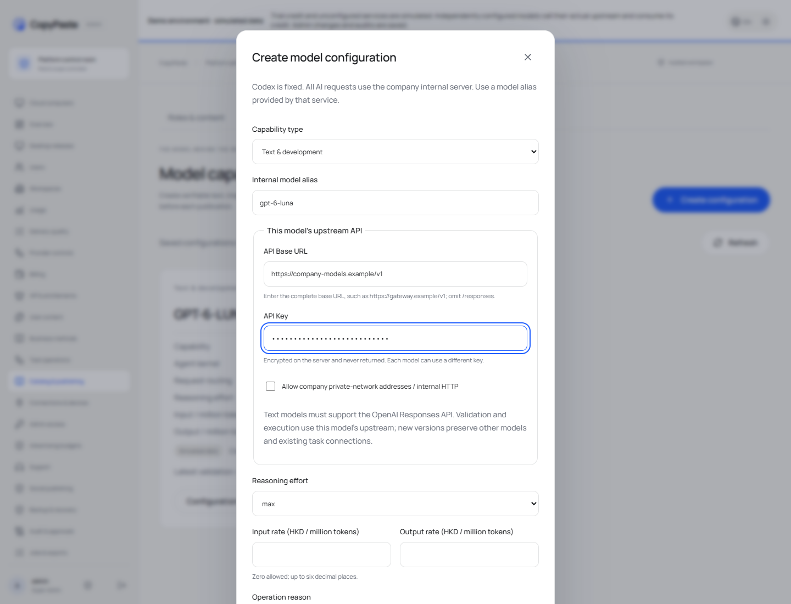

# 每个模型独立配置 API / Per-model API configuration

进入 [Admin → 模型能力](https://agent-dashboard.copypaste.hk/catalog?view=capabilities)，点击“建立配置 / Create configuration”。在同一个表单中填写模型别名（例如 `gpt-6-luna`）、API Base URL、API Key、推理强度及费率。地址填写上游的基础地址，例如 `https://company-models.example/v1`，不要填写 `/responses` 或 `/chat/completions`。这只是格式示例，不是已接通的服务。

Open **Admin → Model capabilities → Create configuration**. Each configuration owns its model alias, upstream base URL, API key, reasoning setting and rates. Different models may use different addresses and keys. Text models must implement the OpenAI Responses API.

保存后，详情中会显示该模型的上游地址及“密钥已配置”状态，密钥不会回显。点击“测试此模型连线 / Test this model connection”，检查地址、认证和 `/models` 中的模型别名。部分服务不支持模型列表，仍需通过原有完整能力验证确认兼容性。连接测试不会产生推理；完整能力验证及正式执行会消耗上游实际额度。

Save the draft, test its connection, run full capability validation and complete the existing independent publication approval. A saved draft or successful connection test does not enable a model for customers. The existing role/template/default-model assignment chooses the published capability. A configuration version has one model binding, including one upstream; publishing another version preserves the connection frozen into existing work.

修改配置时建立新版本，可以明确选择保留来源版本的密钥；更换地址或网络范围必须重新填写密钥。当前没有替你填写真实供应商的 Key。试用额度仍是模拟记账；明确配置上游的模型会实际请求该上游，不会因为处于试用模式而自动模拟真实模型响应。

Keys are encrypted on the server and excluded from client responses, audit bodies, replay results and delivery packages. The administrator permission is `admin.catalog.publish`, protected by the existing administrator sign-in and authorization. Private-network HTTP needs explicit permission in that model's configuration. Redirects, loopback and metadata endpoints are rejected in production.

[实际录制 / Actual recording](../assets/model-connections-178/178-model-connections.mp4) · [需求 / Requirements](../requirements/178-per-model-connections.md) · [开发 / Implementation](../development/178-per-model-connections.md) · [变更 / Changes](../changes/178-per-model-connections.md) · [核查 / Evidence](../quality/model-connections-178.json)

部署使用 `/opt/workmate/overlays/model-connections-178/`，数据库版本157，现有环境变量及登录凭据保留在服务器 `/root/cfg/workmate/`。新连接由后台加密保存到数据库；不是把 Key 写进前端或共享环境变量。原服务器明文部署凭据文件仍保留原样。迁移后回退时须保留兼容 schema157 的 API，不能直接启动 schema156 的旧 API。

Deployment changes the owned API and Web/Admin builds. Desktop and Extension continue to use the company gateway, so their existing installers remain usable without supplier keys. The earlier frozen v0.1.3 packages and tags retain their original bytes and scope. This increment qualifies per-model routing and configuration; it does not certify a real vendor or expand the earlier complete-product acceptance.

[源码与运行增量 / Source and runtime increment](https://agent.copypaste.hk/downloads/workmate-model-configuration-178.zip) · [SHA256](https://agent.copypaste.hk/downloads/workmate-model-configuration-178.zip.sha256)
