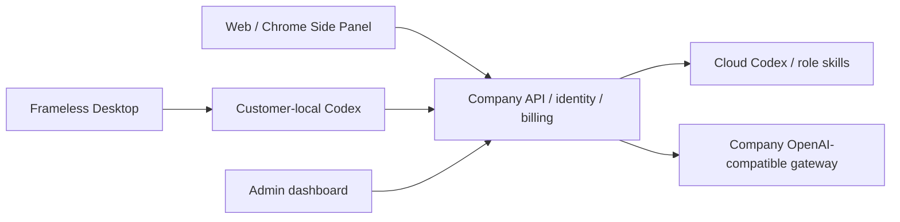

# Workmate v0.1.0-rc.1 / 首个冻结候选版

**首个冻结候选版本 / First frozen candidate: `v0.1.0-rc.1`**

本版用于 Windows x64 本地试用，AI 提供方使用已获准的模拟数据。产品版本与各组件 package.json 版本独立。Web / Extension 在云端运行 Codex；Desktop 在客户本机运行固定版本 Codex，可由客户主动授予完整本机权限。Extension 保留 Chrome 原生右侧 Side Panel，负责获准文件读取与上传。管理后台保留独立管理员登录、用户/企业控制、费用/VIP/用量及内容权限。

This release candidate provides a Windows x64 local trial with explicitly synthetic AI providers. Product and component versions are independent. Web and Extension use cloud Codex; Desktop runs pinned Codex locally with customer-controlled full OS permission. Extension uses Chrome's native right Side Panel for conversation and consented file upload. Admin provides separate administrator authentication, account controls, billing/VIP/usage and content permissions.

**首次启动 / First source startup**：六组件按 `copypaste-platform`、`copypaste-web`、`copypaste-admin`、`copypaste-desktop`、`copypaste-extension`、`copypaste-delivery` 放在同一父目录。要求 Windows x64、Node.js ≥22.14、Git、原生 .NET 构建工具；禁止 Docker/WSL。进入 delivery 执行 `npm run bootstrap`，在 desktop 执行 `npm run runtime:prepare`，回到 delivery 执行 `node scripts/start-frozen-demo-148.mjs`。该入口校验 Codex 版本及 SHA-256，避免使用系统 PATH 中的其他版本；停止用 `npm run stop`。管理员首次开户按 platform 已有 enrollment 命令创建独立管理员，勿使用客户登录代替。

Place all six named repositories under one parent. Run delivery `npm run bootstrap`, desktop `npm run runtime:prepare`, then delivery `node scripts/start-frozen-demo-148.mjs`. This entry verifies the pinned Codex binary instead of selecting an arbitrary PATH version. Stop with delivery `npm run stop`. Enroll an independent administrator using the platform's documented enrollment command.

**使用流程 / Journey**：浏览器打开 Web → 邮箱验证码 → 进入企业/项目 → 选择预设角色 → 提交任务并审核所需权限 → 查看结果、费用、下载。Desktop 配置同一后端，使用浏览器授权登录，再选择本机目录和权限。Chrome 在开发者模式加载 extension 的 `dist/`，点击扩展打开右侧面板、登录并主动选择上传文件。营销分析支持原始 CSV/XLSX 上传、明确数字/日期口径、字段映射、精确预览、确认和持久化分析快照；改变格式会撤销旧确认。

Open Web, verify email, select workspace/project and a role preset, review permissions, run a task and inspect results/usage/downloads. Desktop signs in through browser authorization and then selects local scope. Load Extension `dist/` unpacked in Chrome, click its action to open the native side panel, sign in and explicitly attach files. Marketing imports retain original bytes, require explicit conventions and mapping, preview exact facts and create a durable analysis snapshot; changing conventions clears confirmation.

**冻结依据 / Qualification**：当前后端 17 项必要检查通过；Web、Admin、Extension、Desktop 构建完成，Windows 未签名目录包已在真实窗口验证。当前 UI 冒烟覆盖 Web OTP、Desktop 原生 PKCE 和两端原文件→精确预览→分析快照，共 4 组旅程；保留 4 张实际截图、2 组实际 GIF/MP4。阶段147的真实本地/云端 Codex 与 Chrome 原生侧栏为历史证据，本轮未重复完整回归，也没有把模拟 AI 回复称作真实模型验收。

Seventeen focused backend checks passed. All client builds completed; the unsigned Windows directory package was exercised in a real window. Four current smoke groups cover Web OTP, native Desktop PKCE and actual original-file imports through durable snapshots, with four screenshots and two GIF/MP4 pairs. Stage147 local/cloud Codex and native Chrome Side Panel evidence stays historical. Broad regression was deliberately omitted at the user's request; synthetic model replies are not production model acceptance.

**边界 / Boundaries**：这是首个候选冻结版。生产内部 API/真实媒体和 Google/Meta 等账户联调、签名安装及更新、完整权限/故障/并发矩阵和全量验收仍待完成。项目/企业聚合整删尚未实现；归档项目的恢复权限路径需要修复，不能视为已支持。UTF-16 CSV 上传需 BOM；其他编码转换为 UTF-8。原有102项需求逐条记录保留，88项必需完整验收范围仍开放，并非88个模块完全未实现。

Production provider/account integration, signed installers/updates and comprehensive permission/failure/concurrency acceptance remain open. Aggregate project/tenant erasure is unimplemented; archived-project restoration still needs its access-path fix. UTF-16 CSV uploads require a BOM. All102 original requirement records remain, including88 open required full-acceptance scopes; this does not mean88 entirely missing modules.

冻结标签 / Frozen tags: `v0.1.0-rc.1` (docs), `v0.1.0-rc.1-backend`, `-web`, `-admin`, `-desktop`, `-extension`, `-delivery` (full tag prefix for each component). Each tag identifies a complete independent Git history; compact release source archives omit historical evidence/media, which remain available in Git.

**固定运行时准备 / Pinned runtime preparation**：`runtime:prepare` 不下载或查找 PATH。先解压本版 Windows 便携 ZIP，在 PowerShell 设置 `$env:COPYPASTE_LOCAL_CODEX_BIN` 为解压目录中的 `resources/local-codex/codex.exe` 绝对路径（保留旁边全部 helper 文件），再在 desktop 执行 `npm run runtime:prepare`。源码单独交付时，需自行提供与 `contracts/local-codex-runtime.json` 相符的同一组原生文件。首次启动会自动执行原生 PostgreSQL 迁移到145，无需容器。

`runtime:prepare` neither downloads nor searches PATH. Extract this release's Windows directory ZIP, set PowerShell `$env:COPYPASTE_LOCAL_CODEX_BIN` to its absolute `resources/local-codex/codex.exe` path, keep all sibling helpers, and run desktop `npm run runtime:prepare`. A source-only install must supply the exact locked native files. Native database startup applies schema145 automatically.

运行后访问 Web `http://localhost:4317`、Admin `http://localhost:4318`。本机开发验证码保存在 platform `.data/mailbox/`，不是公共邮件服务。另开终端在 platform 执行 `npm run admin:create -- admin@example.com super_admin`，按 `.data/enrolment/` 的一次性资料绑定认证器后删除该私密资料；不提供共享默认密码。Windows 包连接同一后端后使用浏览器登录。

Open Web at localhost4317 and Admin at localhost4318. Development OTP messages are in platform `.data/mailbox/`. In another terminal run platform `npm run admin:create -- admin@example.com super_admin`, enroll its one-time authenticator material, then delete that private enrollment file. No shared administrator password is provided.

## 交付包 / Deliverables

本地路径：`dev/copypaste-delivery/release/workmate-v0.1.0-rc.1/`。包含 Windows 未签名便携目录 ZIP、Web/Admin 静态构建、Chrome 扩展 ZIP、六组件可构建源码 ZIP、`release-manifest.json` 和 `SHA256SUMS`。Windows 包解压后运行 `CopyPaste.exe`，需要启动对应后端；不是脱离后端的离线产品。静态包需部署到配置好的同源/代理环境；源码本地启动入口会启动开发代理。

Local output includes the unsigned Windows directory ZIP, Web/Admin static bundles, Chrome extension ZIP, six-component buildable source ZIP, release manifest and SHA-256 checksums. Extract the Windows directory and launch `CopyPaste.exe` with its backend running. Static bundles require configured same-origin/proxy hosting; the source launcher starts development proxies. Chrome ZIP must be extracted before Load unpacked.

`release-manifest.json` 绑定六组件提交、源码树、产品标签、实际构建哈希、固定 Codex、数据库145版及明确的模拟模式。Git 分支和冻结标签通过已授权 SSH 推送并读取远端核对。GitHub Release 网页/附件上传使用的本地 HTTPS 凭证曾被 GitHub 返回403（该凭证所属账号被暂停）；该渠道状态与 SSH Git 推送分开记录，未上传成功前不得声称网页附件已发布。

The manifest binds exact independent commits/trees, tags, actual build hashes, pinned Codex and schema145. Authorized SSH branch/tag publication is verified separately. GitHub's REST API rejected the locally stored HTTPS credential with403 and an account-suspended message; this describes that credential's account, not an inference about the company account. A Release webpage/asset upload is not claimed without success.

## 必要核查与省略项 / Focused checks and omissions

|编号 / ID|状态 / State|内容 / Scope|
|---|---|---|
|F01|通过 / Passed|后端17项：精确值、CSV/XLSX口径、UTF-16原上传、权限与幂等|
|F02|通过 / Passed|Web、Admin、Extension、Desktop构建；原生表面12项边界检查|
|F03|通过 / Passed|真实Web邮箱登录、Desktop浏览器授权及两端上传至快照的4组冒烟|
|F04|冻结交付 / Frozen artifacts|六端源码、Windows/Web/Admin/Extension包、哈希及双语说明|
|F05|按要求省略 / Deliberately omitted|完整历史/全量功能回归、跨系统矩阵、生产真实提供方验收|
|F06|后续 / Follow-up|真实内部API与外部账号、签名更新、聚合整删、归档恢复及完整验收|

原 backend-01 经用户要求主动停止，UI01/02/03 原失败和所有执行器保持原字节；选择 backend-03/build-01/UI04 为本版依据。UI03 是第二次邮件验证码受限，UI04 复用真实已登录浏览器走正常原生授权，没有降低验证码限制。完整需求清单见 [编号表](../quality/remaining-work-stage148.md)，资格见 [冻结检查点](../quality/release-freeze-checkpoint-148.json)。

Original stopped/failed attempts are retained unchanged. backend-03/build-01/UI04 qualify this release. UI04 uses an already authenticated browser for native authorization without weakening OTP limits. See the numbered ledger and source-bound checkpoint for exact scope.
