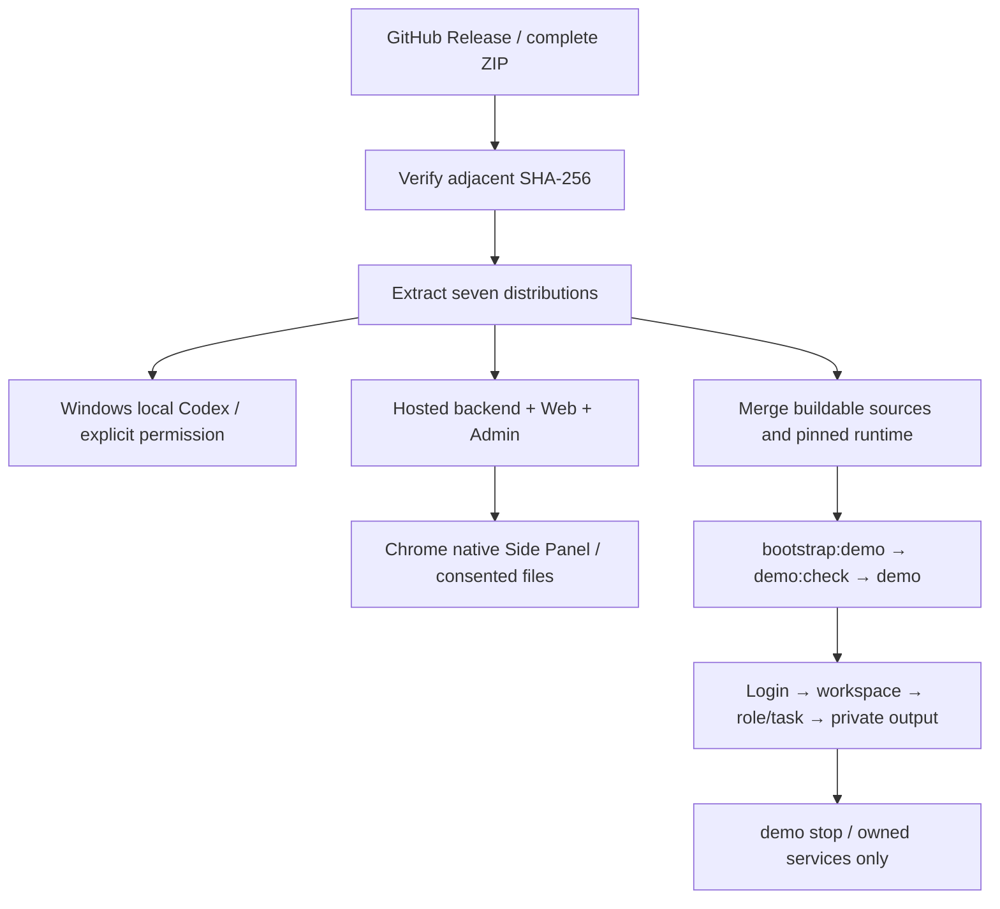
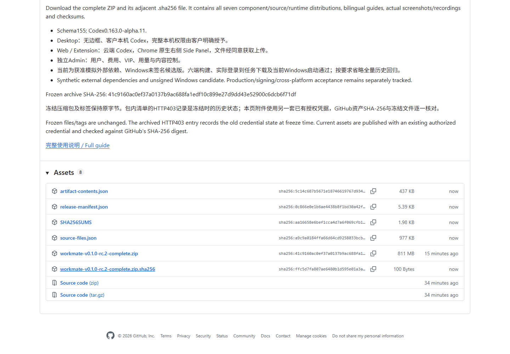

# Workmate v0.1.0-rc.2 · 线上发布交付 / Online publication

[完整交付包 / Complete ZIP](https://github.com/copypasteltd/workmate/releases/download/v0.1.0-rc.2/workmate-v0.1.0-rc.2-complete.zip) · [GitHub Release](https://github.com/copypasteltd/workmate/releases/tag/v0.1.0-rc.2)

已发布到原冻结标签，完整包850,454,316字节，SHA-256为 `41c9160ac0ef37a0137b9ac688fa1edf10c899e27d9dd43e52900c6dcb6f71df`。GitHub提供完整ZIP、相邻`.sha256`、`release-manifest.json`、`SHA256SUMS`、`source-files.json`和`artifact-contents.json`六个附件，逐一核对GitHub报告的尺寸和SHA-256。完整ZIP内已经包含七个分包，下载后在本机解压选择所需部分，无须另找构建产物。

The complete frozen candidate is published under its original tag. All six uploaded assets match the frozen bytes. The complete ZIP contains the seven distributions; component hashes in SHA256SUMS apply to those extracted files. Original frozen files and rc.1/rc.2 tags remain unchanged. A real unauthenticated browser loaded the public release, expanded the asset list and downloaded the checksum file with an exact-byte comparison.

## 包与使用路径 / Distributions and usage

| 包 / Package | 使用逻辑 / Usage |
| --- | --- |
| windows-x64-unsigned | 解压运行无边框Workmate；客户本机Codex，权限由客户明确授予 / Local Codex and explicit native permission |
| web | 云端服务配套的Web构建；登录、工作区、角色、任务、交付文件 / Hosted customer Web |
| admin | 独立Admin身份；用户、费用/VIP、用量、内容与权限控制 / Dedicated operator dashboard |
| extension | Chrome开发者模式加载解压目录，点击打开右侧栏；同意后上传所选文件 / Native Side Panel with consented uploads |
| backend | 服务端构建及完整001–155迁移，按说明配置并启动 / Backend distribution and schema155 migrations |
| buildable-sources | 六端完整源码、锁文件、说明和真实媒体 / Six buildable source repositories |
| source-runtime-windows-x64 | 与源码合并的固定Codex及配套文件 / Pinned native runtime companions |

将两个源码/运行文件包解压合并到同一个较短父目录；进入生成的 `dev/copypaste-delivery`，依次运行 `npm run bootstrap:demo`、`npm run demo:check`、`npm run demo`。默认数据库55432若占用，先在每个启动窗口将 `COPYPASTE_SOURCE_DATABASE_PORT` 设置为空闲本机端口。结束执行 `npm run stop`。独立目录和公司API的详细配置见[源码首次启动](../development/158-current-source-startup.md)及[原冻结说明](v0.1.0-rc.2.md)。

Extract and merge the two source/runtime archives under the same short parent, enter generated `dev/copypaste-delivery`, then run the three source-demo commands above. Select a free explicit database port in every launch shell when the default is occupied. Stop with `npm run stop`. The bootstrap installs locked dependencies using native Windows tooling; no Docker/WSL is involved.

## 冻结与验收范围 / Freeze and qualification

原包中的HTTP403记录描述冻结时旧凭据的状态，本次使用另一套已有授权凭据完成发布；不回写历史清单，也不移动标签。本轮Git分支另行同步发布工具、实际发布媒体和说明，产品运行逻辑及冻结包不变。当前是模拟外部依赖、Windows未签名候选版；真实公司API、外部平台、签名更新和完整专业/客户综合验收按[原编号清单](../quality/remaining-work-stage159.md)继续保留。

This publication fixes the delivery channel using an existing authorized credential. The old HTTP403 entry is historical. Current branch documentation and publishing tools are a post-freeze supplement; product/runtime bytes in the candidate remain sealed. Synthetic external dependencies and unsigned Windows distribution are explicit. Live providers, signing and full customer/professional acceptance remain separately tracked. Broad repeated regression was omitted at the user's request; Stage158 build/first-task/native-start evidence remains the qualification baseline.

[Actual MP4](../assets/release-publication-159/workmate-release-publication-159-01-release-assets-download.mp4) · [Publication evidence](../quality/release-publication-159.json)
