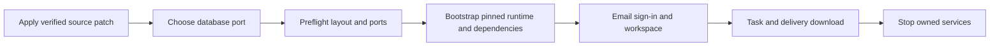

# rc.3 源码首次启动补丁 / Source onboarding patch

本补丁修正源码包根目录入门文档的相对链接，并在 `bootstrap:demo` 安装依赖之前检查启动端口。已经冻结的七类分发包、Codex文件、标签与原有校验值保持。云端的 `CODEX_BIN` / `CODEX_VERSION` 是独立运营配置；源码演示仍显式使用配套的固定本机版本，不自动升级云端。

This source-only patch fixes the root guide links and checks startup ports before dependency installation. Existing frozen distributions, runtime binaries, tags and checksums remain intact. Production cloud runtime settings stay independent; the source demo continues to select its supplied pinned runtime explicitly.

## 先应用源码补丁 / Apply to extracted sources

需要 Windows x64、Node.js 22.14+ 和 Git for Windows。补丁目标为完整解压的 `workmate-v0.1.0-rc.3-source`，其中包含 `dev/copypaste-platform` 等六个源码目录。配套 runtime ZIP 与源码 ZIP 解压合并到这个相同根目录。最新 Git 分支已包含源码修改，可以直接进入下一节。

Use Windows x64, Node.js 22.14+ and Git for Windows. Select the extracted source root containing all six `dev/copypaste-*` directories. Merge the original source and runtime companion ZIPs at this same root. Current Git branch checkouts already contain the code changes and can continue below.

在独立解压的 `workmate-v0.1.0-rc.3-onboarding-162` 补丁目录打开 PowerShell：

Open PowerShell in the separately extracted patch directory:

```powershell
$workmateSourcePath = 'D:\dev\copypasted\自有agent\dev\rc3\workmate-v0.1.0-rc.3-source'
node .\apply-onboarding-patch-162.mjs $workmateSourcePath
```

应用器先核对六个明确文件的原始摘要、补丁摘要和目录边界；本地修改或链接目录会被拒绝。已完整应用时返回 `already_applied`。它使用自己的临时 Git 元数据，不操作父目录仓库的索引，也不将 `.env`、数据库或运行时文件列为补丁目标。

The applier checks the exact six destinations, original hashes, patch hash and directory boundaries before applying. Locally modified source and linked directories are refused. A fully applied patch returns `already_applied`. Owned Git metadata keeps parent repository indexes separate. Local configuration, databases and runtime binaries are outside the patch destinations.

## 再检查并安装 / Check before setup

**数据库端口必须在第一次配置创建之前选好。** 以下 `55439` 为示例；`demo:preflight` 会检查它与四个应用端口是否可用。已有应用会保留。若已有 `.env` 使用其他端口，应在当前 shell 选择与其一致的端口；入口不会改写已有配置。

**Select the database port before the first initializer.** Port `55439` below is an example. The preflight checks it and four application ports without contacting or stopping other applications. For an existing configuration, select its matching port; existing settings are preserved.

```powershell
Set-Location "$workmateSourcePath\dev\copypaste-delivery"
$env:COPYPASTE_SOURCE_DATABASE_PORT = '55439'
npm run demo:preflight
npm run bootstrap:demo
npm run demo:check
npm run demo
```

`demo:preflight` 只检查源码目录、现有演示配置和此刻的端口可用性，不安装依赖、创建配置或启动数据库。`bootstrap:demo` 也自动执行相同的端口检查，然后准备固定运行时、安装锁定依赖及构建。端口在检查后仍可能被其他应用占用，真正启动时继续执行原有检查。

The preflight checks layout, existing demo configuration and current port availability. It does not install dependencies, create configuration or start PostgreSQL. Bootstrap repeats the check before runtime preparation and installation. Port availability is a point-in-time observation; the original startup check remains active.

## 登录到交付 / Sign in and complete a task

1. 打开 `http://localhost:4317`，输入邮箱。开发验证码位于源码 `dev/copypaste-platform/.data/mailbox/`。
2. 创建模拟企业和项目，领取一次模拟额度，选择角色、输入任务及预算，查看执行和成果，下载文件。
3. Admin 为 `http://localhost:4318`。在平台源码目录执行 `npm run admin:create -- admin@example.com super_admin`，按输出配置 TOTP，再通过邮箱验证码和 MFA 登录。普通用户不自动成为管理员。
4. Desktop 在客户机器运行固定 Codex；完整本机权限由客户明确授予。Chrome 扩展仍使用原生右侧 Side Panel，文件经选择和同意上传给云端 Agent。
5. 结束时从同一 Delivery 目录执行 `npm run stop`，等待自己启动的服务退出，然后关闭自己打开的浏览器页面。

1. Open `localhost:4317`, sign in with email OTP from the platform development mailbox.
2. Create a simulated workspace/project, obtain the one-time synthetic credit, choose a preset, enter a task and budget, inspect its delivery and download the file.
3. Admin is on `localhost:4318`. Enroll it separately with `npm run admin:create -- admin@example.com super_admin` in the platform directory, configure the printed TOTP setup and sign in with OTP plus MFA.
4. Desktop executes Codex locally under the customer's explicit permission. The native Chrome Side Panel uploads explicitly selected files to the cloud agent with consent.
5. Run `npm run stop` in the same Delivery directory, wait for owned services to exit and close your test pages.



外部 AI、媒体、广告与支付继续使用已授权的假数据；模拟额度不是支付。当前 Windows 包未签名。完整生产与专业业务验收按原编号继续跟踪。

External AI, media, ads and payment dependencies remain authorized synthetic data. The Windows distribution is unsigned. Original full production and professional acceptance scopes remain open.


以上图像和录制沿用先前实际流程，保留原始范围；本轮检查针对补丁、文件保留及提前端口拒绝。

The media retains its original real first-run scope. This increment qualifies the source patch, preservation checks and early port rejection.

[冻结版说明 / Frozen guide](v0.1.0-rc.3.md) · [原编号验收 / Original acceptance](../quality/remaining-work-stage160.md)
