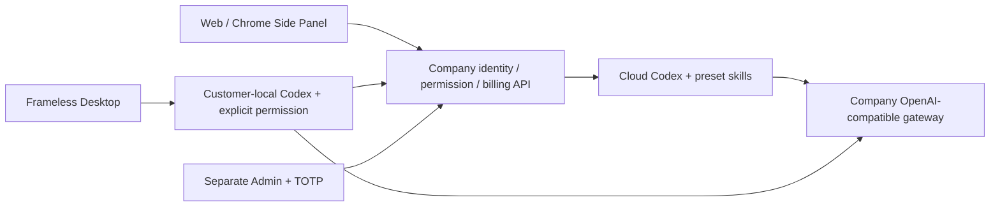
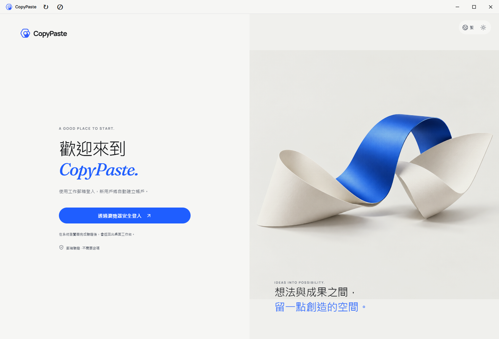

# Workmate v0.1.0-rc.3 · 完整冻结交付 / Complete frozen distribution

本补丁版纳入管理总览的权限、个人预留及云端资源扣费修复；后端/Admin重新构建，未变的Desktop/Web/Extension复用已核对的rc.2构建字节。两版既有冻结包和标签保持。

This patch includes the Admin permission/counting correction, personal reservations and cloud-resource charges. Backend/Admin are rebuilt. Unchanged client binaries retain their qualified rc.2 bytes. Previous frozen tags and packages are preserved.

本次将当前六个独立仓库与数据库155版统一冻结。该版包含首版之后的项目封存恢复、范围数据导出、工作流与内容历史、本机/云端任务暂停恢复、角色复制、会话目录及云端同会话独立多工作。产品发版号与组件npm版本独立；精确提交、树、构建和Codex文件均由清单绑定。旧 v0.1.0-rc.1 保留原字节和标签。

This candidate freezes all six current repositories and schema155 together. It incorporates post-first-freeze project lifecycle, scoped data export, workflow/content history, local/cloud task pause/resume, specialist copying, conversation directories and independent cloud tasks. Product and component npm versions are independent; the manifest binds exact commits, trees, builds and runtime files. The first frozen candidate remains unchanged.

## 完整交付 / Deliverables

单文件：workmate-v0.1.0-rc.3-complete.zip。解压后为 workmate-v0.1.0-rc.3/，包含以下七类包及说明、版本清单、源文件索引、分发内容索引、Git推送回执与SHA256SUMS。complete ZIP自身的校验值位于相邻 .sha256 文件。

The complete ZIP contains the following seven distributions plus this guide, release manifest, source/content indexes, Git publication receipt and SHA256SUMS. The complete archive has its own adjacent .sha256 checksum.

|包 / Package|用途 / Use|
|---|---|
|windows-x64-unsigned.zip|当前Windows便携Desktop，解压运行 CopyPaste/CopyPaste.exe；Current unsigned native Windows application|
|web.zip|当前用户Web静态构建；Current customer Web build|
|admin.zip|当前独立管理后台静态构建；Current independent Admin build|
|extension.zip|Chrome MV3原生右侧Side Panel；Native Chrome right Side Panel|
|backend.zip|已编译后端、运行素材及锁定依赖清单；Compiled backend, runtime assets and lockfiles|
|buildable-sources.zip|六仓完整可构建源码、双语README及其引用媒体、中央设计与发版文档；All six buildable sources, bilingual READMEs/media and authoritative documents|
|source-runtime-windows-x64.zip|固定Codex0.163.0-alpha.11及三个配套文件，与源码包合并解压；Pinned four-file native runtime companion for source startup|

上述文件名均带 workmate-v0.1.0-rc.3- 前缀。不包含本机密钥、数据库、node_modules或历史大体积验证材料；完整Git历史和历史验收材料在对应分支/标签保留。

All filenames use the workmate-v0.1.0-rc.3- prefix. Local secrets, databases, dependencies and historical raw evidence are excluded. Full Git history and historical acceptance evidence remain on their component branches/tags.

## 首次体验 / First run

1. Windows x64准备Node.js22.14或更高版本、npm，以及Desktop源码构建所需的Windows .NET构建工具。禁止Docker、WSL和虚拟机。将源码包和runtime包解压合并到同一个较短父目录，例如 D:/dev/copypasted/自有agent/dev/rc3/。不要继续嵌套长目录：原生PostgreSQL的Windows目录解析有长度限制。
2. 在生成的 workmate-v0.1.0-rc.3-source/dev/copypaste-delivery/ 打开PowerShell，依次执行 npm run bootstrap:demo、npm run demo:check、npm run demo。首次依赖安装需访问npm registry；模拟模型不需要真实AI密钥。
3. 若55432端口已被使用，在每一个相关PowerShell先设置 $env:COPYPASTE_SOURCE_DATABASE_PORT="55439"（或另一个空闲非特权端口）。既有 .env 不会被改端口，既有服务不会被关闭。
4. 浏览器打开 http://localhost:4317，邮箱登录；开发验证码在源码platform/.data/mailbox中。建立模拟企业/项目、添加一次模拟额度、选择角色或默认助理、填写任务和预算、查看进度与交付、下载文件。Admin在 http://localhost:4318，必须单独通过平台 npm run admin:create -- admin@example.com super_admin 登记管理员并配置TOTP。普通用户不会自动成为管理员。
5. Windows包启动后经浏览器授权登录，选择本机工作目录和权限；完整权限由客户主动授予。Desktop的Codex在客户机器执行。Chrome解压extension包后通过“加载已解压的扩展程序”选择该目录，点击扩展图标打开原生右侧面板；文件由客户明确选择并同意上传，Agent在云端执行。
6. 结束后在另一PowerShell的同一delivery目录执行 npm run stop，等待自有服务退出，再关闭自己打开的测试页面。

1. On Windows x64, provide Node.js22.14+, npm and the native Windows .NET build tools required by Desktop. No Docker/WSL/VM is used. Merge the source and runtime ZIPs under one short parent; avoid deeply nested paths for native PostgreSQL.
2. In workmate-v0.1.0-rc.3-source/dev/copypaste-delivery run npm run bootstrap:demo, npm run demo:check, then npm run demo. Locked dependency installation uses npm registry access; synthetic models need no live AI secret.
3. If55432 is occupied, set $env:COPYPASTE_SOURCE_DATABASE_PORT="55439" (or another free local unprivileged port) in each relevant shell before setup/start. Existing settings and processes are preserved.
4. Open localhost4317, complete email OTP from platform/.data/mailbox, create a simulated workspace/project, add the one-time synthetic credit, choose a preset/default assistant, set a task/budget and download its delivery. Admin is on localhost4318 and requires separate enrollment plus TOTP using the platform admin:create command.
5. Desktop uses browser authorization and explicitly granted local directory/OS permission; its Codex runs on the customer machine. Extract the Chrome ZIP and Load unpacked, then click its action to open the native right Side Panel. Explicitly selected files are uploaded to the cloud agent with consent.
6. Run npm run stop from the same delivery directory and wait for owned services to exit. Close your own test tabs afterward.

仅从Git获取源码时，先明确设置 COPYPASTE_LOCAL_CODEX_BIN 为匹配 codex.exe 的绝对路径，并保留相邻三个helper，再运行 bootstrap:demo。入口不会从PATH猜版本或自动下载Codex。backend包提供编译服务与依赖描述，适用于已有配置的后端环境；新的本地完整体验使用上述源码入口。静态Web/Admin需配置同源API代理；源码入口已启动开发代理。

From Git without the companion, explicitly supply COPYPASTE_LOCAL_CODEX_BIN and the three adjacent matching helpers before bootstrap:demo. The entry point neither guesses through PATH nor downloads Codex. The backend distribution supplies compiled service code and dependency metadata for an already configured backend environment; use the source launcher for a new complete local trial. Static Web/Admin bundles require same-origin API routing; the source launcher provides development proxies.

## 执行与权限 / Execution and permissions

预设角色、营销创作/广告与SEO分析、企业重复流程、文件与交付、费用和VIP控制均沿用当前实现。当前模型/媒体/广告/支付等外部依赖使用用户已授权的合成数据，界面、额度与交付有模拟标记；实际Codex进程、身份权限、队列、账本、文件和下载使用真实代码。生产AI请求仍须经公司OpenAI兼容网关。

Preset roles, marketing creation/advertising/SEO analysis, repeated business workflows, files/deliveries and Admin billing/VIP controls retain the current implementation. External model/media/ads/payment dependencies are explicitly synthetic and labeled. Codex execution, identity/permissions, queues, ledger, files and downloads use real application code. Production AI requests must use the company OpenAI-compatible gateway.

## 本版必要验证 / Focused qualification

六端源码构建通过；三项配置创建/保留检查通过；独立解压源码实际走通邮箱登录、企业/项目、模拟额度、真实固定Codex、任务交付及私有文件下载；重复本机数据库启动会拒绝同目录活实例，并保留原进程；当前Windows包实际启动、默认菜单移除、页面无横向溢出通过。自建浏览器、Desktop和服务已关闭。

All six source builds pass. Three initializer/preservation cases pass. Independently unpacked source completes actual email login, workspace/project, synthetic credit, real pinned Codex, task delivery and private download. A second launcher refuses the live owned database directory and preserves its process. The current Windows package opens with no application menu or horizontal overflow. Owned browsers, Desktop and services are closed afterward.

按加速发版要求，完整历史回归、全平台矩阵和真实外部提供方验收不重跑。当前Windows包未签名；生产提供方、签名安装/更新及完整权限矩阵仍按[原编号范围](../quality/remaining-work-stage160.md)跟踪，不能将本次冻结写为生产全面验收。

Broad historical regression, cross-platform matrices and live external-provider acceptance are deliberately omitted. The Windows distribution is unsigned. Production integration, signed installers/updates and full permission matrices remain in their original numbered scopes. This freeze establishes the bounded synthetic candidate.

[精确证据 / Exact evidence](../quality/release-freeze-checkpoint-158.json) · [源码启动细则 / Source startup](../development/158-current-source-startup.md)

## Git与发布渠道 / Git and release channel

六组件分别使用backend、web、admin、desktop、extension、delivery分支，文档使用docs/main。冻结标签为 v0.1.0-rc.3 及其六个组件后缀标签；清单记录实际提交。SSH分支和标签通过已授权推送并读取远端核对。

Component branches are backend, web, admin, desktop, extension and delivery; authoritative documents use docs/main. The product tag is v0.1.0-rc.3 with six component suffix tags. The manifest records exact commits, and SSH branch/tag references are verified after publication.

GitHub发布入口：[Workmate v0.1.0-rc.3](https://github.com/copypasteltd/workmate/releases/tag/v0.1.0-rc.3)。完整ZIP、校验文件和索引在资产上传、摘要核对成功后对外交付；以实际发布回执为准。

The GitHub release assets are delivered only after successful uploads and digest verification. See the final publication receipt for actual status.

## 本次补丁 / This patch

9项费用/权限SQL和HTTP检查、3组实际Admin操作通过；额外完成本次后端/Admin构建。此前完整首用和Windows启动结果保持原范围，不重复计作本次新验收。

Nine focused accounting/authority cases and three actual Admin journeys pass. This freeze rebuilds Backend/Admin; earlier first-run and native-client checks retain their original scope.

[当前冻结依据 / Current freeze evidence](../quality/release-freeze-checkpoint-161.json) · [权限和费用修复 / Admin correction](../development/160-admin-overview-accuracy.md)
