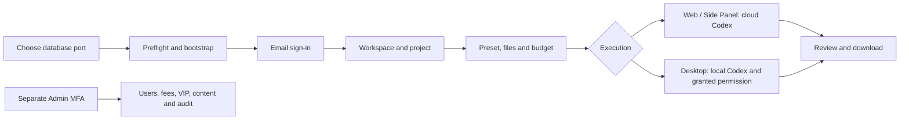

# Workmate v0.1.0-rc.4 · 冻结交付 / Frozen handoff

本版把已提交的首次启动和登录会话修复统一纳入新构建。交付覆盖 Desktop、Web、Admin、Chrome 原生右侧 Side Panel、后端，以及六仓完整可构建源码和固定 Codex 配套文件。AI、媒体、广告和支付采用已授权的假数据。Windows 包为未签名候选版；正式服务凭据和签名不包含在交付中。

This candidate integrates the source onboarding and session fixes into fresh builds. It includes all clients, the backend, six buildable source trees and pinned Codex binaries. AI, media, ads and payments use the authorized synthetic mode. Windows executables are unsigned; production credentials and signing material are not included.

[Release 下载 / Download](https://github.com/copypasteltd/workmate/releases/tag/v0.1.0-rc.4) · [构建记录 / Build evidence](../quality/release-freeze-checkpoint-164.json) · [原编号验收 / Original acceptance](../quality/remaining-work-stage164.md)

## 交付内容 / Contents

下载 `workmate-v0.1.0-rc.4-complete.zip` 及旁边的 `.sha256`。完整包内包括以下七个 ZIP、使用说明、版本清单、源码文件清单和 `SHA256SUMS`。

Download the complete ZIP and its adjacent checksum. The complete bundle contains seven distributions, the guide, manifests and checksums.

| 文件后缀 / Suffix | 内容 / Contents |
| --- | --- |
| `windows-x64-unsigned.zip` | 可直接运行的 `CopyPaste/CopyPaste.exe` 和全套资源；`installers/` 内有 Portable 和 Setup。Unpacked Windows app, portable launcher and NSIS installer. |
| `web.zip` | 当前 Web 静态构建。Current Web build. |
| `admin.zip` | 独立管理后台静态构建。Separate Admin build. |
| `extension.zip` | Chrome 扩展构建，保留原生右侧 Side Panel。Native Chrome Side Panel. |
| `backend.zip` | 编译后端、业务源码、迁移、角色/技能、资源及依赖锁文件。Compiled backend, source, migrations, presets/skills and lockfiles. |
| `buildable-sources.zip` | 六仓当前源码、中英 README、相关截图/GIF/录制及主文档。Six source trees, bilingual READMEs, linked media and authoritative docs. |
| `source-runtime-windows-x64.zip` | Codex `0.163.0-alpha.11` 及三个固定辅助程序。Pinned Codex and its three helpers. |

所有文件通过版本清单及摘要关联到各端独立 Git 提交与标签；旧版本保留。源码不带 `.git`、依赖目录、客户 `.env`、本地数据库或私人证据。完整 Git 历史位于 GitHub 各端分支及标签。

Manifests bind distributions to independent component commits/tags. Previous releases are preserved. Sources exclude Git metadata, installed dependencies, private configuration, databases and private evidence. Full history remains in the component branches and tags.

| 独立源码目录 / Source directory | GitHub 分支 / Branch | 固定标签 / Frozen tag |
| --- | --- | --- |
| `dev/copypaste-platform` | `backend` | `v0.1.0-rc.4-backend` |
| `dev/copypaste-web` | `web` | `v0.1.0-rc.4-web` |
| `dev/copypaste-admin` | `admin` | `v0.1.0-rc.4-admin` |
| `dev/copypaste-desktop` | `desktop` | `v0.1.0-rc.4-desktop` |
| `dev/copypaste-extension` | `extension` | `v0.1.0-rc.4-extension` |
| `dev/copypaste-delivery` | `delivery` | `v0.1.0-rc.4-delivery` |
| `docs/` 主文档 / Main docs | `docs` / `main` | `v0.1.0-rc.4` |

远端统一为 `git@github.com:copypasteltd/workmate.git`。需要完整历史时按上表分别克隆对应分支；固定标签对应本次冻结源码。发布后的回执文档可继续前进，冻结标签不移动。

The shared remote is `git@github.com:copypasteltd/workmate.git`. Clone the corresponding branches independently for full history. Frozen tags identify this release even when branches later receive publication receipts or updates.

## 本机首次使用 / First local run

需要 Windows x64、Node.js 22.14+、Git for Windows。使用原生 PostgreSQL；不使用 Docker、WSL 或虚拟机。

Use Windows x64, Node.js 22.14+ and Git for Windows. The demo uses native PostgreSQL without virtualization.

1. 将源码 ZIP 和 runtime ZIP 解压合并到同一个 `workmate-v0.1.0-rc.4-source/` 根目录。确认其中有 `dev/copypaste-delivery` 和 `dev/copypaste-desktop/.data/runtime/windows-x64/codex.exe`。
2. **第一次创建配置之前**选好可用数据库端口；下面 `55439` 是示例。不要占用其他项目已有的数据库。首次预检会检查该端口及应用的 4310、4317、4318、4319 端口；发现占用立即退出并保留对方服务。
3. 在 PowerShell 执行以下步骤，路径按解压位置调整。

1. Merge source and runtime ZIPs into the same source root; confirm both the Delivery folder and prepared Codex exist.
2. Choose an available database port **before configuration is first created**. Port 55439 is an example. Preflight refuses occupied ports while preserving existing services.
3. Run the following from PowerShell, adjusting the extracted path.

```powershell
$workmateSourcePath = 'D:\dev\copypasted\自有agent\dev\rc4\workmate-v0.1.0-rc.4-source'
Set-Location "$workmateSourcePath\dev\copypaste-delivery"
$env:COPYPASTE_SOURCE_DATABASE_PORT = '55439'
npm run demo:preflight
npm run bootstrap:demo
npm run demo:check
npm run demo
```

`demo:preflight` 不安装依赖或写配置。`bootstrap:demo` 先预检，再核对固定运行时、安装锁定依赖并构建。`demo:check` 检查配置和固定运行时；`demo` 启动本次演示所需原生服务和模拟业务依赖。已有配置必须与所选数据库端口一致，不会被自动改写。预检只能反映检查时的端口状态。

Preflight performs no installation or configuration writes. Bootstrap checks ports, verifies the pinned runtime, installs locked dependencies and builds. Check validates configuration/runtime; demo starts owned native services and synthetic dependencies. Existing settings must match the selected database port and are preserved. Port checks are point-in-time observations.

## 登录、执行与交付 / Sign-in, execution and delivery

1. **Web**：打开 `http://localhost:4317`，邮箱登录；开发验证码位于 `dev/copypaste-platform/.data/mailbox/`。创建企业和项目，领取一次模拟额度，选择预设角色、填写任务/附件/预算。查看执行进度、审批、成果版本并下载交付。登录过期会回到登录页，旧请求不会覆盖新登录。
2. **Admin**：打开 `http://localhost:4318`。先在平台源码目录执行 `npm run admin:create -- admin@example.com super_admin`，按输出设置 TOTP，再以邮箱验证码和 MFA 登录。普通客户不会自动获得管理员权限。按授权管理用户、企业、费用、用量、VIP、角色/技能和内容；额度与授权变更保留审计。
3. **Desktop**：演示后端就绪后，解压 Windows ZIP，运行 `CopyPaste/CopyPaste.exe`；也可使用 `installers/` 中的 Portable 或 Setup。无边框和默认 Electron 菜单，Agent 在客户本机运行。登录、配对本机设备并选工作目录后使用；客户可以主动授予完整本机权限。停止/撤权及账户隔离仍由客户端与服务端共同处理。
4. **Extension**：将扩展 ZIP 完整解压，在 Chrome 扩展管理页开启开发者模式并“加载已解压的扩展程序”。点击扩展打开浏览器原生右侧 Side Panel，按页面完成登录。选取文件并同意上传后由云端 Codex 执行；本机 Agent 任务使用 Desktop。开发配置预期扩展 ID 位于 `dev/copypaste-desktop/deployment.json`；自行打包改变 ID 时按各端 README 同步部署与允许来源。
5. 结束时在同一 Delivery 目录运行 `npm run stop`，等待本次启动的服务退出；关闭自行打开的页面和应用。

1. **Web**: Sign in using the development mailbox OTP, create a workspace/project, obtain synthetic credit and submit a preset-based task with files and budget. Review progress, approvals, versions and downloads. Expiration clears the old workspace and stale responses cannot replace a newer sign-in.
2. **Admin**: Enroll separately with the platform command above, configure TOTP and sign in with OTP plus MFA. Manage users, organizations, charges, usage, VIP, presets/skills and content according to granted permissions. Ordinary customers never become administrators automatically.
3. **Desktop**: Start the demo backend, then launch the unpacked app or its Portable/Setup executable. It is frameless and runs Codex on the customer's own computer. Sign in, pair the device and select a working directory. Full local permission is explicitly granted by the customer.
4. **Extension**: Load the extracted extension through Chrome developer mode. Its button opens the native right Side Panel. Sign in, select files and consent to upload for cloud execution. If rebuilding changes its ID, update deployment/allowed origins following the component READMEs.
5. Run `npm run stop` in the same Delivery directory and close the apps/pages you opened.



## 本版验证范围 / Qualification scope

本版重新构建六个仓库，并生成 Windows unpacked、Portable 与 NSIS 安装程序，逐文件核对实际 ASAR 与当前主进程/界面构建，核对固定 Codex 摘要。此前阶段163的28项定向 HTTP 结果和3组实际 Web/SQL 登录旅程、阶段162的9项启动检查，在受检源码摘要仍一致的前提下复用。按要求省略全量历史回归；没有将打包检查宣称为新一轮原生安装或生产业务验收。

All six repositories are rebuilt. The Windows unpacked app, Portable and NSIS installer are generated; ASAR entries match the current compiled main/renderer files and Codex hashes match the pin. Stage163's 28 focused HTTP results/three real Web-SQL journeys and stage162's nine startup checks are inherited only with matching source hashes. Broad regression is omitted as requested. Packaging is not presented as new installed-client or production acceptance.


以上媒体来自此前实际 Web 流程，保留各自原范围；本版未伪造新截图或生成模型成果。102个原编号继续保留，88项必选完整验收范围仍开放，不等于88个未实现模块。正式模型/广告/支付、签名安装与更新、多平台及完整专业交付验收仍见原编号清单。

Media comes from earlier actual Web journeys with its original scope. The original 102 IDs remain; 88 mandatory whole-acceptance scopes remain open, which is not a count of unimplemented modules. Production providers, signed installation/update, other operating systems and full professional acceptance remain tracked explicitly.
