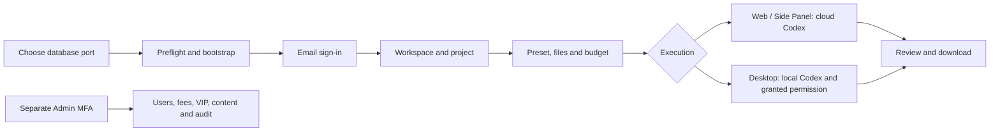
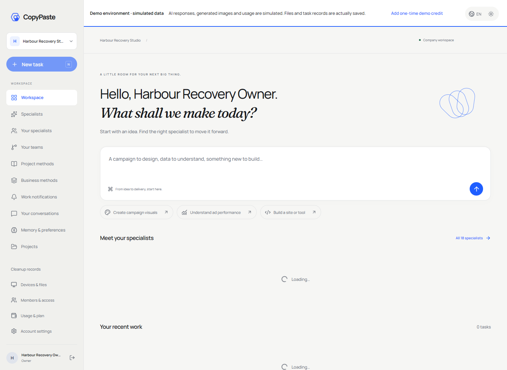

# Workmate v0.1.1 · 完整冻结更新 / Complete frozen update

发布后交付入口见 [当前交付 / Handoff](v0.1.1-handoff.md)。阶段171仅澄清在线说明中的历史表述；已发布ZIP、清单、标签和产品源码保持冻结。Stage171 clarifies this online guide only; published archives, manifests, tags and product sources remain frozen.

本版是在v0.1.0基础上冻结的完整更新包，加入用户运营筛选及多维消耗报表。数据库迁移至156；服务端与Admin使用最新构建。用量页面支持固定快照、付款方／企业／项目／创建期间／能力／来源筛选、原账本与退款明细及同选择CSV。内部供应商实际成本明确未知，不用客户售价代替。

This complete update adds operational user filters and immutable consumption reports to v0.1.0. Use schema156 and matching backend/Admin builds. Reports distinguish confirmed charges, consumption refunds, holds and reconciliation, with payer/project/capability/source filters, original ledger detail and same-snapshot CSV. Actual supplier cost is explicitly unknown.

**冻结检查范围 / Freeze checks**：沿用源码完全一致的阶段169 Backend/Admin构建、6项原生SQL/API和6组实际浏览器／CSV旅程；未改Web/Extension/Desktop/Delivery运行构建逐文件对照阶段167，Windows目录及两种安装包逐文件一致并复用。No broad historical rerun; exact-source focused checks and unchanged client builds are verified and reused.

**已知限制 / Known limits**：已授权假数据；Windows未签名；正式提供方／真实供应商成本／按入账期间报表／完整专业业务和跨OS矩阵仍开放。完整源码及全部端交付不等于上述生产资格已验收。Existing frozen v0.1.0 assets/tags remain unchanged.

管理后台报表的时间条件是工作建立期间，显示该批工作截至快照的累计费用，不是费用入账期间；五分钟后需重新建立快照。A report is a work-creation cohort with cumulative accounting, not a posting-date report; refresh after the five-minute expiry.


本版统一冻结当前全部端及源码，纳入首次工作区丢响应恢复、Admin费用/VIP正确用户目标、用户目录条件恢复，以及最新按用户创建者查看任务和二十类内容的入口。六仓均配中英README、逻辑图及真实截图/交互录制。交付覆盖 Desktop、Web、Admin、Chrome 原生右侧 Side Panel、后端，以及六仓完整可构建源码和固定 Codex 配套文件。AI、媒体、广告和支付采用已授权的假数据。Windows 包未签名；正式服务凭据和签名不包含在交付中。

This release freezes all current clients and source, including workspace recovery, correct Admin fee/VIP targets, persistent directory filters and creator-filtered user tasks/content. Each component includes bilingual handbooks, logic diagrams and actual interface/interaction media. It includes all clients, the backend, six buildable source trees and pinned Codex binaries. AI, media, ads and payments use the authorized synthetic mode. Windows executables are unsigned; production credentials and signing material are not included.

[Release 下载 / Download](https://github.com/copypasteltd/workmate/releases/tag/v0.1.1) · [构建记录 / Build evidence](../quality/release-freeze-checkpoint-170.json) · [原编号验收 / Original acceptance](../quality/remaining-work-stage169.md)

## 交付内容 / Contents

下载 `workmate-v0.1.1-complete.zip` 及旁边的 `.sha256`。完整包内包括以下七个 ZIP、使用说明、版本清单、源码文件清单和 `SHA256SUMS`。

Download the complete ZIP and its adjacent checksum. The complete bundle contains seven distributions, the guide, manifests and checksums.

| 文件后缀 / Suffix | 内容 / Contents |
| --- | --- |
| `windows-x64-unsigned.zip` | 可直接运行的 `CopyPaste/CopyPaste.exe` 和全套资源；`installers/` 内有 Portable 和 Setup。Unpacked Windows app, portable launcher and NSIS installer. |
| `web.zip` | 当前 Web 静态构建。Current Web build. |
| `admin.zip` | 独立管理后台静态构建。Separate Admin build. |
| `extension.zip` | Chrome 扩展构建，保留原生右侧 Side Panel。Native Chrome Side Panel. |
| `backend.zip` | 编译后端、业务源码、迁移、角色/技能、资源及依赖锁文件。Compiled backend, source, migrations, presets/skills and lockfiles. |
| `buildable-sources.zip` | 六仓当前源码、中英 README、相关截图/GIF/录制及主文档。Six source trees, bilingual READMEs, linked media and authoritative docs. |
| `source-runtime-windows-x64.zip` | Codex `0.163.0-alpha.11` 及三个固定辅助程序。Pinned Codex and its three helpers. |

所有文件通过版本清单及摘要关联到各端独立 Git 提交与标签；旧版本保留。源码不带 `.git`、依赖目录、客户 `.env`、本地数据库或私人证据。完整 Git 历史位于 GitHub 各端分支及标签。

Manifests bind distributions to independent component commits/tags. Previous releases are preserved. Sources exclude Git metadata, installed dependencies, private configuration, databases and private evidence. Full history remains in the component branches and tags.

| 独立源码目录 / Source directory | GitHub 分支 / Branch | 固定标签 / Frozen tag |
| --- | --- | --- |
| `dev/copypaste-platform` | `backend` | `v0.1.1-backend` |
| `dev/copypaste-web` | `web` | `v0.1.1-web` |
| `dev/copypaste-admin` | `admin` | `v0.1.1-admin` |
| `dev/copypaste-desktop` | `desktop` | `v0.1.1-desktop` |
| `dev/copypaste-extension` | `extension` | `v0.1.1-extension` |
| `dev/copypaste-delivery` | `delivery` | `v0.1.1-delivery` |
| `docs/` 主文档 / Main docs | `docs` / `main` | `v0.1.1` |

远端统一为 `git@github.com:copypasteltd/workmate.git`。需要完整历史时按上表分别克隆对应分支；固定标签对应本次冻结源码。发布后的回执文档可继续前进，冻结标签不移动。

The shared remote is `git@github.com:copypasteltd/workmate.git`. Clone the corresponding branches independently for full history. Frozen tags identify this release even when branches later receive publication receipts or updates.

## 本机首次使用 / First local run

需要 Windows x64、Node.js 22.14+、Git for Windows。使用原生 PostgreSQL；不使用 Docker、WSL 或虚拟机。

Use Windows x64, Node.js 22.14+ and Git for Windows. The demo uses native PostgreSQL without virtualization.

1. 将源码 ZIP 和 runtime ZIP 解压合并到同一个 `workmate-v0.1.1-source/` 根目录。确认其中有 `dev/copypaste-delivery` 和 `dev/copypaste-desktop/.data/runtime/windows-x64/codex.exe`。
2. **第一次创建配置之前**选好可用数据库端口；下面 `55439` 是示例。不要占用其他项目已有的数据库。首次预检会检查该端口及应用的 4310、4317、4318、4319 端口；发现占用立即退出并保留对方服务。
3. 在 PowerShell 执行以下步骤，路径按解压位置调整。

1. Merge source and runtime ZIPs into the same source root; confirm both the Delivery folder and prepared Codex exist.
2. Choose an available database port **before configuration is first created**. Port 55439 is an example. Preflight refuses occupied ports while preserving existing services.
3. Run the following from PowerShell, adjusting the extracted path.

```powershell
$workmateSourcePath = 'D:\dev\copypasted\自有agent\dev\release-v011\workmate-v0.1.1-source'
Set-Location "$workmateSourcePath\dev\copypaste-delivery"
$env:COPYPASTE_SOURCE_DATABASE_PORT = '55439'
npm run demo:preflight
npm run bootstrap:demo
npm run demo:check
npm run demo
```

`demo:preflight` 不安装依赖或写配置。`bootstrap:demo` 先预检，再核对固定运行时、安装锁定依赖并构建。`demo:check` 检查配置和固定运行时；`demo` 启动本次演示所需原生服务和模拟业务依赖。已有配置必须与所选数据库端口一致，不会被自动改写。预检只能反映检查时的端口状态。

Preflight performs no installation or configuration writes. Bootstrap checks ports, verifies the pinned runtime, installs locked dependencies and builds. Check validates configuration/runtime; demo starts owned native services and synthetic dependencies. Existing settings must match the selected database port and are preserved. Port checks are point-in-time observations.

## 登录、执行与交付 / Sign-in, execution and delivery

1. **Web**：打开 `http://localhost:4317`，邮箱登录；开发验证码位于 `dev/copypaste-platform/.data/mailbox/`。创建企业和项目，领取一次模拟额度，选择预设角色、填写任务/附件/预算。查看执行进度、审批、成果版本并下载交付。登录过期会回到登录页，旧请求不会覆盖新登录。
2. **Admin**：打开 `http://localhost:4318`。先在平台源码目录执行 `npm run admin:create -- admin@example.com super_admin`，按输出设置 TOTP，再以邮箱验证码和 MFA 登录。普通客户不会自动获得管理员权限。按授权管理用户、企业、费用、用量、VIP、角色/技能和内容；额度与授权变更保留审计。
3. **Desktop**：演示后端就绪后，解压 Windows ZIP，运行 `CopyPaste/CopyPaste.exe`；也可使用 `installers/` 中的 Portable 或 Setup。无边框和默认 Electron 菜单，Agent 在客户本机运行。登录、配对本机设备并选工作目录后使用；客户可以主动授予完整本机权限。停止/撤权及账户隔离仍由客户端与服务端共同处理。
4. **Extension**：将扩展 ZIP 完整解压，在 Chrome 扩展管理页开启开发者模式并“加载已解压的扩展程序”。点击扩展打开浏览器原生右侧 Side Panel，按页面完成登录。选取文件并同意上传后由云端 Codex 执行；本机 Agent 任务使用 Desktop。开发配置预期扩展 ID 位于 `dev/copypaste-desktop/deployment.json`；自行打包改变 ID 时按各端 README 同步部署与允许来源。
5. 结束时在同一 Delivery 目录运行 `npm run stop`，等待本次启动的服务退出；关闭自行打开的页面和应用。

1. **Web**: Sign in using the development mailbox OTP, create a workspace/project, obtain synthetic credit and submit a preset-based task with files and budget. Review progress, approvals, versions and downloads. Expiration clears the old workspace and stale responses cannot replace a newer sign-in.
2. **Admin**: Enroll separately with the platform command above, configure TOTP and sign in with OTP plus MFA. Manage users, organizations, charges, usage, VIP, presets/skills and content according to granted permissions. Ordinary customers never become administrators automatically.
3. **Desktop**: Start the demo backend, then launch the unpacked app or its Portable/Setup executable. It is frameless and runs Codex on the customer's own computer. Sign in, pair the device and select a working directory. Full local permission is explicitly granted by the customer.
4. **Extension**: Load the extracted extension through Chrome developer mode. Its button opens the native right Side Panel. Sign in, select files and consent to upload for cloud execution. If rebuilding changes its ID, update deployment/allowed origins following the component READMEs.
5. Run `npm run stop` in the same Delivery directory and close the apps/pages you opened.



## 本版验证范围 / Qualification scope

v0.1.1使用阶段169源码一致的Backend/Admin构建和6项原生SQL/API、6组实际Admin页面／CSV检查。Web、Extension、Desktop及Delivery运行产物逐文件对照阶段167，复用核对一致的Windows完整目录87个文件、Portable、Setup及固定Codex。阶段166的8项SQL/API和8组页面检查属于较早版本证据。按要求省略全量历史重复回归；阶段171只核对发布资产、摘要、源码分支与冻结标签，没有重新运行功能测试。

v0.1.1 uses the exact-source stage169 backend/Admin builds, six native SQL/API cases and six actual Admin/CSV journeys. Unchanged Web, Extension, Desktop and Delivery outputs match stage167. The same87 Windows files, Portable, Setup and pinned Codex are verified and reused. Stage166's eight cases/journeys are earlier evidence. Broad historical regression is omitted as requested. Stage171 verifies release assets, checksums, branches and frozen tags; it runs no new functional tests.

## 本版交互恢复 / Recovery and Admin targets

首次建企业的请求在发送前保存原键及原名称。结果不确定时继续保留，刷新后先读取当前账号可访问的回执。已提交则恢复同一个企业和项目，未提交才以同一键重试；已撤回、删除或停用结果不自动重建。显式退出移除草稿名称，保留无正文标识用于同一账号恢复。原首项目已归档时仍可恢复企业，再使用当前可见项目。

The initial creation persists its original key/body before sending. After an uncertain reply, reloading reconciles the owner-scoped receipt and retries only the same request when necessary. Removed or unavailable results never trigger an automatic new company. Explicit sign-out redacts private draft names. If the original project was archived, the workspace can still be recovered using its currently accessible projects.

Admin用户详情将真实用户DTO传给费用/VIP弹窗；费用账户限定该主体，VIP目标只读且正确。切换详情用户销毁旧弹窗/预览；目录过滤写入URL，返回及刷新可以恢复。人工变更仍需独立权限、当前MFA和策略确认。用户详情可直接进入该用户创建的任务与内容；用户范围和资源范围同时鉴权，正文/下载权限独立。搜索/分页/刷新保留用户，返回恢复原目录；切换用户清空旧正文。品牌按首版实际作者归属，不把旧未知作者资料算给任意用户。注册、最近账户访问、VIP到期及消费范围组合筛选已在阶段168实现并纳入本版；账户访问不代表真人在线。

User detail passes the actual user DTO to Admin fee/VIP dialogs. Accounts are filtered to that subject and VIP locks the correct target. Changing users unmounts old previews/dialogs. Directory filters persist in the URL. Current authorization, MFA, policy and confirmation still apply. User detail opens creator-filtered tasks/content under the intersection of current user and resource scopes. Body/download authority stays separate. Search/paging/reload retain the target; returning restores directory filters and changing users clears old bodies. Brands use their original author; unknown legacy authors remain unattributed. Stage168 registration, account-access, VIP-expiry and spend filters are included in this release; account access does not imply human presence.




[实际MP4 / Actual MP4](../assets/functional-closure-165/workmate-functional-closure-165-01-recover-original-workspace.mp4)


首单和会话媒体为此前实际流程，本次恢复媒体标注165；各自范围保留。102个原编号继续保留，88项必选完整验收范围仍开放，不等于88个未实现模块。正式模型/广告/支付、签名安装与更新、多平台及完整专业交付验收仍见原编号清单。

First-task/session media retains its earlier scope; current recovery media is explicitly labelled165. The original 102 IDs remain; 88 mandatory whole-acceptance scopes remain open, which is not a count of unimplemented modules. Production providers, signed installation/update, other operating systems and full professional acceptance remain tracked explicitly.

## 用户任务与内容 / User tasks and content


[MP4](../assets/admin-user-resources-166/workmate-admin-user-resources-166-02-user-task-content-scope.mp4) · [本轮冻结 / Freeze details](https://github.com/copypasteltd/workmate/blob/v0.1.1/docs/development/167-final-release-freeze.md)

## 冻结后的开发 / Development after this freeze

`v0.1.1`及六个组件标签固定本次交付；后续修复通过分支、新提交和新版本发布，绝不覆盖本包或移动旧标签。组件包保留各自实际版本（例如Desktop0.7.1），总交付版号为v0.1.1，不伪造已签名或正式服务状态。

The release and six component tags remain immutable. Further work advances branches and a new version. Component package versions remain their actual values (for example Desktop0.7.1); v0.1.1 identifies the overall delivery without implying signing or production-provider qualification.
