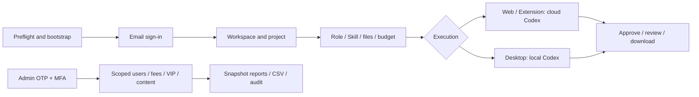

# Workmate v0.1.2 · 完整冻结版 / Complete frozen release

本版把当前所有端及源码统一冻结，新增按费用实际入账期间统计、跨期退款、香港日分组和同快照明细/CSV。保留登录、首次工作区恢复、预设角色/Skill、任务执行、审批、成果版本、费用/VIP和后台用户与内容管理流程。数据库版本156。

This release freezes every current client and source tree. It adds posting-period consumption, cross-period refunds, Hong Kong daily groups and matching snapshot detail/CSV, alongside sign-in, workspace recovery, role/Skill presets, execution, approvals, deliverables, billing/VIP and Admin user/content controls. Database schema156.

[发行下载 / Download](https://github.com/copypasteltd/workmate/releases/tag/v0.1.2) · [冻结记录 / Freeze record](../quality/release-freeze-checkpoint-173.json) · [原编号验收 / Acceptance ledger](../quality/remaining-work-stage172.md)

## 下载内容 / Downloads

下载 `workmate-v0.1.2-complete.zip` 和旁边的 `.sha256` 文件。完整包内有七个归档、双语说明、真实截图/GIF/MP4、版本与源码清单、逐文件校验记录和 `SHA256SUMS`。

Download the complete ZIP and adjacent checksum. It contains seven archives, bilingual guides, actual screenshots/GIF/MP4, release/source manifests and file checksums.

| 归档后缀 / Suffix | 内容 / Contents |
| --- | --- |
| `windows-x64-unsigned.zip` | `CopyPaste/CopyPaste.exe` 及完整资源；`installers/` 内有 Portable、NSIS Setup。Unpacked Windows app, Portable and Setup. |
| `web.zip` | Web 静态构建 / Web static build |
| `admin.zip` | 本次重新构建的独立后台 / Rebuilt independent Admin |
| `extension.zip` | Chrome 原生右侧 Side Panel / Native Chrome Side Panel |
| `backend.zip` | 编译后端、业务源码、迁移、角色/技能、锁定依赖说明 / Backend build, source, migrations, roles/skills and lockfiles |
| `buildable-sources.zip` | 六仓当前可构建源码、中英 README、逻辑图、关联实际媒体及主文档 / Six buildable source trees, bilingual READMEs, diagrams, linked actual media and authoritative docs |
| `source-runtime-windows-x64.zip` | 固定 Codex `0.163.0-alpha.11` 和三个辅助程序 / Pinned Codex and three helpers |

源码包不含 `.git`、已安装依赖、客户配置/密钥、数据库和私人证据。完整历史保留在各端 Git 分支。总交付版号是v0.1.2；组件保留自身真实版本号，Windows二进制沿用核对一致的构建。

Sources exclude Git metadata, installed dependencies, customer configuration/secrets, databases and private evidence. Full history remains on component branches. v0.1.2 identifies the bundle; components retain their actual package versions and unchanged Windows binaries retain their build version.

| 源码目录 / Source | 分支 / Branch | 固定标签 / Frozen tag |
| --- | --- | --- |
| `dev/copypaste-platform` | `backend` | `v0.1.2-backend` |
| `dev/copypaste-web` | `web` | `v0.1.2-web` |
| `dev/copypaste-admin` | `admin` | `v0.1.2-admin` |
| `dev/copypaste-desktop` | `desktop` | `v0.1.2-desktop` |
| `dev/copypaste-extension` | `extension` | `v0.1.2-extension` |
| `dev/copypaste-delivery` | `delivery` | `v0.1.2-delivery` |
| `docs/` | `docs` / `main` | `v0.1.2` |

远端：`git@github.com:copypasteltd/workmate.git`。各端独立克隆相应分支；冻结标签固定本版，发布回执随后在文档分支更新。全部旧版本的归档与标签保留。

Clone the corresponding branch independently. Frozen tags remain fixed; publication receipts subsequently advance the documentation branches. Previous release archives/tags remain preserved.

## 第一次启动 / First run

需要 Windows x64、Node.js22.14+、Git for Windows；使用原生 PostgreSQL，不使用 Docker/WSL/虚拟机。以下为已授权假数据演示的本机启动流程。正式部署的域名、TLS、服务配置和内网 AI 网关按各端 README 配置。

Use Windows x64, Node.js22.14+, Git for Windows and native PostgreSQL. These steps start the authorized synthetic demonstration without virtualization. Configure production domains, TLS, services and the internal AI gateway following the component READMEs.

1. 把源码 ZIP 和 runtime ZIP 解压合并到同一 `workmate-v0.1.2-source/`。确认有 `dev/copypaste-delivery` 和 `dev/copypaste-desktop/.data/runtime/windows-x64/codex.exe`。
2. **第一次创建配置前**选好未占用的原生数据库端口。示例55439；预检还检查应用4310、4317、4318、4319端口，遇到占用即退出并保留其他项目服务。
3. 按实际解压位置修改下面路径，在 PowerShell 中执行。

1. Merge source and runtime ZIPs into the same source root; confirm Delivery and the pinned Codex exist.
2. Select an unused database port before configuration is first created. Preflight also checks application ports and preserves existing services.
3. Adjust the extracted path and run in PowerShell.

```powershell
$workmateSourcePath = 'D:\dev\copypasted\自有agent\dev\release-v012\workmate-v0.1.2-source'
Set-Location "$workmateSourcePath\dev\copypaste-delivery"
$env:COPYPASTE_SOURCE_DATABASE_PORT = '55439'
npm run demo:preflight
npm run bootstrap:demo
npm run demo:check
npm run demo
```

预检不会安装依赖或写配置；bootstrap 预检后校验固定 runtime、安装锁定依赖并构建。已有配置与所选数据库端口必须一致，不会自动改写。启动状态不确定时先检查已有进程和日志，勿重复启动。结束时在同一 Delivery 目录执行 `npm run stop`，关闭自己打开的页面与客户端。

Preflight installs nothing and writes no configuration. Bootstrap verifies the pinned runtime, installs locked dependencies and builds. Existing settings must match the selected database port and are preserved. Inspect existing processes/logs before repeating an uncertain start. Stop owned services with `npm run stop` in the same Delivery directory and close the pages/apps you opened.

## 登录到交付 / Sign-in to delivery

| 端 / Client | 使用流程 / Workflow |
| --- | --- |
| Web | `http://localhost:4317` 邮箱登录，开发验证码见平台 `.data/mailbox/`。建立企业/项目，领取模拟额度，选角色/Skill，提交任务、附件、预算，查看执行/审批、成果版本和下载。Sign in with the development mailbox OTP, create a workspace/project, obtain synthetic credit, submit a preset-based task and review/download results. |
| Admin | `http://localhost:4318`。先在平台目录执行 `npm run admin:create -- admin@example.com super_admin`，按输出配置 TOTP，以邮箱验证码+MFA登录。普通客户无自动管理员权限；用户/企业、费用/VIP、角色/内容及账务操作受独立权限、范围和审计约束。Enroll separately, configure TOTP and use OTP plus MFA. Administrative permissions/scopes and audit apply independently. |
| Desktop | 后端就绪后运行完整目录中的 `CopyPaste.exe`，或使用 Portable/Setup。无边框、无 Electron 默认菜单；登录、设备配对、选择目录，Codex 在客户本机执行，客户可主动授予完整本机权限。Frameless local Codex with explicit full local permission after sign-in, device pairing and directory selection. |
| Extension | 解压后在 Chrome 开发者模式“加载已解压的扩展程序”。点击打开原生右侧 Side Panel，使用对话/附件结构，用户同意后读取并上传文件，云端 Codex 执行。自行构建改变扩展ID时同步部署与允许来源配置。Load unpacked, sign in through the native Side Panel, select files and consent to upload for cloud execution; update allowed origins if rebuilding changes the extension ID. |



## 本版费用报表 / Consumption reports

Admin 可切换“工作创建批次”和“费用入账期间”。前者显示指定建立期间工作的累计账务；后者只纳入指定香港日期内实际入账的扣费及有效消费退款，可以包含旧任务。退款单日净额可为负数；跨期退款保留原扣费编号、金额和日期引用。

Admin switches between work-creation cohorts and ledger posting periods. Cohorts show cumulative accounting for selected works. Posting periods include only charges and valid consumption refunds posted within the selected Hong Kong dates, including older works. Refund-only days may have a negative net; original charge identity, amount and date remain visible across periods.

日/用户/付款方/企业/项目/能力/来源等分组与明细、CSV使用同一快照和筛选；快照五分钟失效后须刷新。入账期间不把当前预占算作期间发生额，用量单位标注为工作累计上下文；供应商实际成本仍明确未知，不以客户售价代替。

Groups, detail and CSV share a snapshot and filters; refresh after its five-minute expiry. Posting-period holds are excluded from period activity, units are labelled as lifetime work context, and actual supplier cost stays explicitly unknown.


[实际MP4 / Actual recording](../assets/admin-posting-period-172/workmate-admin-posting-period-172-01-posting-period-workflow.mp4)

## 冻结检查与范围 / Freeze checks and scope

本轮重新构建 Backend/Admin；继承源码一致的阶段172检查：8项新原生SQL/API、1项精确投影、6项既有SQL/API、7组实际Admin/CSV旅程。阶段173未重跑功能测试；按要求省略无关广泛历史回归。Web/Extension/Desktop/Delivery未改运行产物逐文件匹配阶段170；87个Windows资源、Portable、Setup和固定Codex核对后复用。打包核对归档完整性、逐文件摘要、当前源码与标签。

Backend/Admin are rebuilt in this freeze. Exact-source stage172 qualification is inherited: eight new native SQL/API cases, one exact-projection case, six earlier SQL/API cases and seven actual Admin/CSV journeys. Stage173 runs no new functional tests or broad historical regression. Unchanged client/runtime outputs match stage170; all87 Windows files, Portable, Setup and pinned Codex are verified and reused. Packaging checks archive integrity, per-file digests and source/tag identity.

**已知待办 / Remaining:** AI、媒体、广告、支付使用已授权假数据；Windows未签名。正式提供方、真实成本、多系统签名安装/更新及完整专业业务验收继续保留在原编号台账中。原102项编号不变，88项必选完整验收范围开放，不能理解成88个未实现模块。当前完整包包含全部端和可构建源码，不代表这些生产验收已完成。

AI, media, ads and payments use authorized synthetic services; Windows is unsigned. Production providers/cost, signed installation/update, other operating systems and full professional acceptance remain in the original ledger. The102 original IDs and88 open mandatory whole-acceptance scopes are retained; these are not88 unimplemented modules.

后续修改通过新提交和新版本交付，旧ZIP、清单和冻结标签不覆盖。Current changes advance branches/new releases; frozen files and tags remain immutable.
