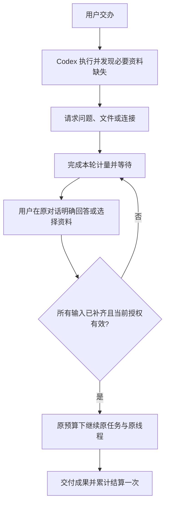

# 业务资料澄清与原任务继续 / Business clarification and continuation

本项细化原有 REQ-007、REQ-072、REQ-073、REQ-074、REQ-076 与 REQ-078。用户以自然语言交办后，Codex 在执行过程中发现实际阻塞成果交付的业务信息缺失时，可在原对话中请求补充。例如设计任务的画布尺寸、营销活动的目标受众、分析报告的统计口径。文件和外部账户继续使用各自的明确授权流程。

This increment refines the existing requirements for natural-language delegation, specialist inputs and continuation. Codex may request essential missing business information inside the original conversation. Files and connected accounts retain their separate authorization controls.

1. 提问必须对应当前任务的实际缺口；支持纯文字回答和最多八个建议选项。建议不预选、不自动提交，始终允许用户自行填写，不能限制为模型提供的选项。
2. 回答必须由当前获准操作该项目的用户明确确认。空白、超过 4,000 字符、过期版本、错误类型或包含额外资源选择的回答拒绝；不能让模型替客户填写。
3. 用户补充信息后继续原任务、原对话与原预算预留。多项所需资料全部补齐后才能排队；先前已计量的用量累计到同一次最终结算。不能创建第二个付费任务或重复收费。
4. 业务回答只作为任务资料，不构成付款、提额、外部账户授权或 Desktop 本机权限授权。取消、撤权、来源失效、费用不确定和容量限制沿用既有服务端规则。
5. 回答与对应问题在原对话中保留一条用户记录。同一回答重试不新增重复记录；已确认的答案和问题定义不能改写。后续更改需求须明确表达为后续工作。
6. Web 在会话及任务详情显示问题；Extension 在原生右侧栏的原对话内显示问题，不要求客户切到高级工具。Desktop 云端任务界面保持兼容；本机 Codex 的原生问答继续使用既有本机流程。
7. 问题与回答遵守企业、项目及私有会话隔离。管理员读取正文仍需要既有正文权限和审计，不能利用回答入口冒充客户。删除原会话时清除问题、回答、检查点和正文记录，同时保留必要的费用事实。

Questions must reflect actual blockers. Suggestions are optional, free text is always available, and nothing is selected automatically. Confirmed answers continue the same measured task and budget; all outstanding inputs must be ready before continuation. Answers cannot grant tools, access or spending. Version checks and semantic replay prevent edits and duplicate notes. Existing privacy, deletion and administrator controls remain applicable.

验收以本阶段检查点绑定的源码、原生数据库、实际客户端及原始记录为准。测试继续使用已经授权的假业务数据及假模型响应；定向澄清检查不等于全部专业角色、真实模型质量或整个产品完成验收。

Acceptance is bounded by the exact source and original evidence recorded for this increment. Synthetic business data and provider responses remain authorized; targeted clarification checks do not qualify every specialist or establish production model quality.
