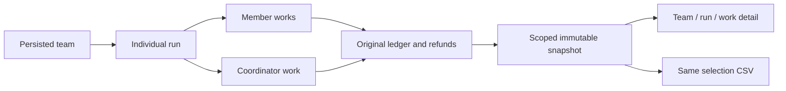

# 團隊費用追溯 / Team consumption attribution

Admin消耗報表新增團隊及單次團隊執行分組，團隊ID和執行ID可與發起人、付款帳戶、企業、項目、角色、來源及兩種期間依據交叉篩選。資料來自任務持久保存的原始團隊執行關係，不從提示詞或名稱推斷。

Admin consumption reports add team and individual team-run grouping. Team/run IDs intersect initiator, payer, enterprise, project, role, source and either period basis. Attribution comes from persisted task/run bindings rather than names or prompts.

成員與協調員各自的實際扣費、退回和預留按既有帳目加總；不再加入整組批准預算，也不將同一工作費用分攤給每個成員。不同執行保持獨立，非團隊工作另列。入帳期間維持既有實際期間規則，當前預留不冒充期間發生額。

Sum each member/coordinator work's actual accounting once. Do not add the approved team budget or duplicate a work's charge across members. Runs remain separate from one another and from standalone works. Existing posting-period/current-hold semantics remain intact.

只讀取受現行用量權限覆蓋的工作，連接團隊執行還必須匹配原企業及項目。費用頁不讀團隊名稱、brief、私有對話、方法正文或成果。明細與CSV保留原快照、付款方和選擇；匯出權限不會由團隊篩選提升。

Scope applies before capture, and the team-run join also matches tenant/project. Billing reads no private team name, brief, conversation, method body or output. Detail/CSV retain the same payer, snapshot and selection; grouping never grants export authority.

新快照保留team_attribution_version=1及四項團隊欄位；CSV附加相同欄位。舊加密快照沒有來源時顯示「未記錄」，不當成「非團隊工作」，且保留舊CSV欄位。省略的請求條件不添加預設值，不改舊冪等識別。

New snapshots record attribution version1 and four team columns, also appended to CSV. Legacy snapshots with no provenance are explicitly unrecorded and keep their prior CSV shape; they are never classified as standalone. Omitted filters stay omitted for replay compatibility.

原102項需求及完整驗收範圍保留。本輪只補齊團隊費用功能；供應商實際成本、所有專業角色／媒體／權限／生產規模仍按原需求驗收。本輪是v0.1.2之後的源碼更新，不改已發布歸檔或標籤。

Original requirement IDs and whole-acceptance scope remain. This increment implements team billing attribution; supplier cost and complete professional/media/permission/production-scale acceptance remain open. It advances source after v0.1.2 without replacing frozen archives/tags.

[合同 / Contract](../contracts/admin-team-usage-174.json)
