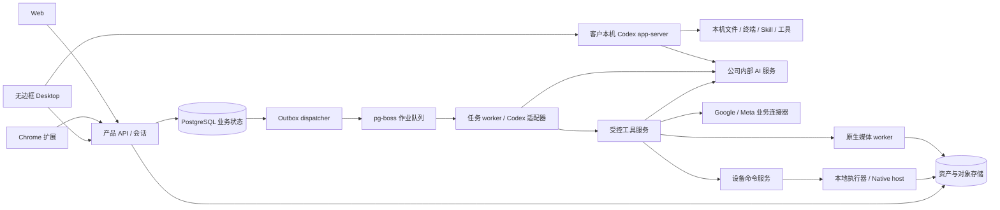

# 技术架构与技术栈

实施状态：本分册保留长期设计约束；本轮锁定版本、实际 API/工具、各端实现与差异，以 [实际开发清单](12-implementation-and-repositories.md) 和 [运行验收](../quality/04-implementation-acceptance.md) 为准，未实现项没有删除。

版本：1.5 基础设计；2026-10-22 按 [CLIENT01](../requirements/03-client-execution-amendment.md) 修订客户端执行位置。下图为当前执行分工；阶段 72 已接入本机 Codex/完整权限及公司费用通道，限定证据与待验收范围见 [本机执行及控制面](72-desktop-local-execution-and-control-plane.md)。历史回执保留原始源码范围。

## 1. 架构选择

初期采用模块化单体业务服务，加独立任务、媒体和本地执行器。避免在业务边界未验证时拆分大量微服务；执行资源仍独立隔离，不能把多企业工具调用放进同一无限权限进程。

| 层 | 设计默认 | 选择原因与升级边界 |
| --- | --- | --- |
| Web | React + TypeScript + Vite | 工作区与复杂编辑共用组件；首期不依赖服务端页面渲染 |
| 品牌 UI | 版本化 JSON/CSS token 与共享 React 组件 | 继承 CopyPaste 官网浅深色、Logo 与组件语言；三端和管理页统一，客户作品独立品牌 |
| 产品 API | TypeScript + Fastify | schema 驱动校验、流式接口、模块边界清楚 |
| 业务存储 | PostgreSQL | 任务、账本、权限和 outbox 原子提交 |
| 作业队列 | PostgreSQL + pg-boss | 与本机原生开发兼容，初期不增加 Redis 依赖；业务任务表仍为权威 |
| 对象存储 | S3-compatible 对象服务 | 原始文件、产物和快照分层存储；本地可用文件系统适配 |
| 内核 | Codex，锁定 CLI/app-server 与协议版本 | 用户已确定的唯一内核；受控 stdio 集成，产品层负责权限、状态、计费和工具 |
| 图像排版 | 受控 SVG/HTML 描述 + 原生 Chromium 渲染 | 文字与图像分层，字体和输出尺寸可确定 |
| 视频 | 原生 FFmpeg + 固定模板 | 真实成片、输入输出可检查；AI 生成走内部服务 |
| 扩展 | Chrome Manifest V3 + side panel | ChatGPT 式对话及文件获取/读取/上传，Agent 在云端运行 |
| Desktop | 无边框 Electron + 本机 Codex app-server | 本机会话、文件、终端、Skill；支持客户主动授予完整本机权限 |
| 可选 Native Host | TypeScript 文件桥接 | 扩展的增强目录能力，不代替 Desktop 的本机 Agent |

版本在初始化时按兼容矩阵锁定；不使用漂移的 latest 依赖。选型是本轮建议，精确版本与生产云供应商仍需工程验证。参考来源集中于 [来源登记](../governance/02-glossary-and-sources.md)。

品牌来源与采样记录见 [视觉规范](../product/07-brand-design-system.md)，token、字体、主题、组件和跨端落地见 [前端设计集成](10-frontend-design-system.md)。应用打包自身版本的资源，不在运行时直接加载官网 CSS/脚本；主题偏好不增加业务 API，也不更改客户品牌配置。

## 2. 组件关系

逻辑连线不意味着开放数据库或对象库给客户端。外部 AI 供应商凭证只出现在内部服务域，设备主动建立到产品服务的出站连接。

Codex 是 CORE01 的固定架构约束。默认助手、预设/定制角色、团队及 Routine 共用 Codex 执行链；内核适配边界仅负责官方协议/版本转换。运行配置 kernel 固定 codex，版本启用、模板发布、任务启动/恢复均校验；Codex 故障不触发其他内核回退。具体边界及准入见 [Codex 与内部网关](02-runtime-and-ai-gateway.md)。

## 3. 任务提交时序

Web/Extension 云端流程：客户端提交幂等请求 → API 核验身份和输入 → 数据库事务创建任务/预算/outbox → 返回 task_id → dispatcher 投队列 → worker 校验租约和授权 → 云端 Codex 与工具执行 → 结果转存及事件提交 → SSE 通知。

Desktop 本机流程：公司登录及业务授权 → 本机用户选择权限模式 → main process 启动本机 Codex 并加载 Skill → 本机工具执行及流式交互 → 按约定同步事件/费用和选定产物。本机任务不投递到旧云端 Codex 队列；本机执行契约及恢复设计见 [方向检查](69-desktop-local-codex-and-extension-direction.md)，本机入口使用独立 desktop-executions 契约，旧云端任务 API 不承接 Desktop 原生登录的 Agent 请求。

进程在事务提交后、投递前崩溃时，dispatcher 可重新扫描 outbox；投递后崩溃可能重复消息，worker 依据任务版本和稳定 operation_id 去重。队列清空可从业务 outbox 重建，不能丢任务真相。

## 4. 状态、事件与费用的一致性

业务事务内同时写状态、事件和 outbox；费用变更同时写 reservation 与 ledger。对象先上传暂存并校验，再提交资产引用，失败的孤立对象由清理任务处理。

执行租约含 monotonically increasing fencing token，旧 worker 即使继续运行也不能提交数据库结果或新受控工具操作。对已经送达上游的动作只能查询实际结果，不能通过数据库租约撤销已发生副作用。

## 5. 执行隔离

云端 worker 池按任务/企业范围分配工作区、身份、网络白名单和资源限制。MVP 首先使用结构化业务工具；如果启用内核自带 shell，必须落在经过验证的原生受限执行环境，不能共享 API 服务的主机权限与密钥。

开发、本地桥接及 Desktop 使用原生进程，不调度本地 Docker、WSL 或虚拟机。生产云端隔离技术需单独评估，本文不通过部署命令启动任何环境。

## 6. 扩展与拆分条件

媒体、连接同步和本地命令天然独立队列。出现数据库争用、单类型作业长时间阻塞或团队独立发布需求后，再按已有模块边界拆服务。先做查询索引、分页、归档与并发限制，不以无限增加 worker 代替容量分析。

后续独占云电脑复用 workspace_id、设备/执行器命令及资源账本；实时画面采用有权限和期限的观察通道，不能公开内核控制端口。

Web 1.1 的云文件树由元数据及对象版本支撑，计算工作目录按任务物化，完成后回存，不需永久独占进程。会话和 Agent/团队是业务记录，不能直接等同内核原生 Session。共享配置与技能解析出固定的有效版本，工具执行前仍核查当前权限。

团队协调者生成有依赖的成员任务，复用 M03 调度、事件与总预算。等待成员时释放执行槽，避免协调者占住全部企业并发；子任务按本次调用身份和项目范围执行，Agent 角色本身不是新的授权主体。基础云端 Routine 使用服务端调度，不依赖浏览器或桌面进程在线。

Artifact 的 HTML/网页预览使用隔离源和受限渲染策略，不能获得工作台 cookie、平台凭证或任意出站能力。预览面板与执行器浏览器租约分别计量和清理；文件内容、技能正文与网页资料不能改写平台强制权限。

## 7. 失败域与交付检查

业务 API、数据库、对象存储、内部 AI、平台连接和设备分别监控。用户能够查询已保存任务，即使 AI/设备短暂不可用。发布前验证数据库恢复、队列重建、文件引用一致性及至少一个真实完整业务任务。

## 8. Admin 控制面

ADMIN01 增加独立 React/TypeScript/Vite 管理端 apps/admin，复用 packages/ui 的 CopyPaste 品牌组件，通过专用 AdminSession/MFA 接入 /v1/admin/*。逻辑服务仍在模块化单体中，权限、用户/内容、费用及权益复用同一领域规则和事务，不另建平行账本或 Agent 运行链。跨企业查询与管理通过独立受限授权入口，普通企业管理员不能访问。页面和工作包见 [后台产品设计](../product/08-admin-dashboard.md) 与 [技术设计](11-admin-control-plane.md)。

管理聚合、批量、导出及通知使用独立作业并限并发；Admin 故障不应阻塞普通用户已获准任务查询和执行。后台配置只引用受控版本，不能关闭 Codex 唯一内核、内部 AI 路由或角色资格门槛。M1 同步交付人工费用/VIP 和安全管理基础，M2 完整配置发布和批量功能。
