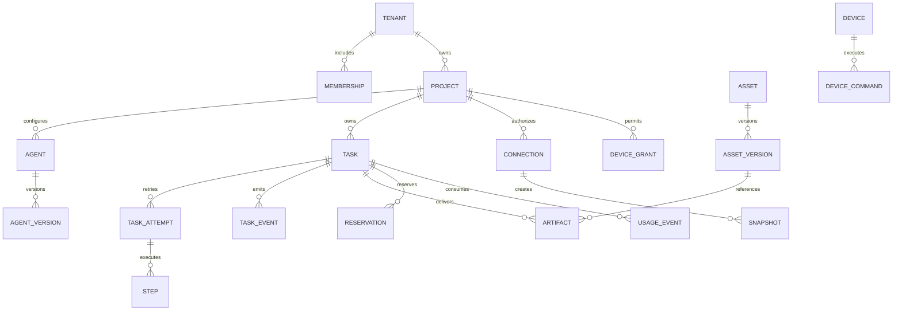

# 数据模型、约束与生命周期

版本：1.5 · 2026-10-18。此为逻辑及关系模型，实施时形成经迁移测试的 SQL，不宣称数据库已创建。

## 1. 通用字段与类型

业务主键采用 UUID，显示编号可另建。企业内表默认含 id、tenant_id、created_at、updated_at、version；项目表额外有 project_id。时间使用 timestamptz/UTC，业务日期 date 与 source_timezone 独立。

计费 amount_micros 使用 bigint，API 为整数字符串；广告金额与指标使用 numeric(28,8)。任意参数 JSONB 必须同时有 schema_version 和服务端 schema 校验，不能用 JSONB 绕过关键外键和唯一约束。

## 2. 主要关系

图展示核心关系；下表补齐流程、报表、审计及账本。

## 3. 表与关键字段

| 表 | 核心字段与约束 |
| --- | --- |
| tenants / users | 企业名、状态、默认时区；用户登录标识和状态；users 为全局身份，不存供应商密钥 |
| memberships / project_memberships | user_id、role、state、auth_version；tenant+user 及 project+user 唯一 |
| invites / sessions | 邀请摘要、目标角色、过期和 consumed_at；会话摘要、用户、撤销及最近认证时间 |
| projects | 名称、默认语言、时区、状态、retention_policy_id |
| brand_versions | brand_id、version_no、规则 JSON、asset_version_refs、published_at；brand+version 唯一 |
| agents / agent_versions | 名称、项目、当前配置；版本包含模板、职责、品牌、工具/技能及模型策略 |
| conversations / messages | agent_id 与 agent_group_id 互斥、项目、用户、标题、归档/置顶、mode；消息意图、序号、附件版本、目标任务/成员与派生任务 ID，不存隐藏完整推理 |
| memories | scope_type、scope_id、来源、内容引用、有效期、状态和版本；检索前核查 scope |
| tasks | project/agent/conversation、type、status、input_version、capability_version、budget、review_state、current_attempt_id |
| task_attempts | task_id、attempt_no、runtime/session 映射、lease_owner、lease_expires_at、fencing_token；task+attempt_no 唯一 |
| steps | attempt_id、step_key、依赖、status、input_hash、output_refs、operation_id、checkpoint_ref；attempt+step_key 唯一 |
| task_events | task_id、attempt_id、seq、type、payload、occurred_at；task+seq 唯一且递增 |
| approvals | task/step、action_hash、scope_version、approver、expires_at、state；批准后不可修改参数 |
| external_actions | operation_id、provider、request_hash、external_id、state、last_checked_at；tenant+operation 唯一 |
| assets / asset_versions | 项目、类型、状态；版本摘要、MIME、大小、对象 key、来源、使用范围及父版本 |
| upload_sessions | 项目、目标对象、预期大小/摘要、expiry、完成状态及分片引用 |
| artifacts / reviews | task_id、asset_version_id、specification_id、delivery_state；审阅绑定具体版本、用户和意见 |
| media_jobs | task/step、capability_version、operation_id、provider_job_id、status、poll_cursor、cost_state |
| connections / connector_syncs | provider、secret_ref、auth_version、允许账户/项目、state；同步范围、分页游标、截止时间和结果 |
| snapshots / fact_rows | 原始/标准快照、schema_version、spec_hash、checksum；事实粒度、账户、日期、维度、口径、币种及数值 |
| reports / evidence | snapshot_refs、analysis_spec、formula_version、报告资产；evidence 定位源数据及计算，不只保存自然语言引用 |
| geo_experiments / geo_samples | 固定问句和观测配置；样本请求摘要、模型/产品、回答引用、时间及提及结果 |
| creative_mappings | asset_version、source_account、creative_id、有效期、匹配来源及确认人 |
| workflow_versions / triggers | 输入输出 schema、步骤、工具和预算；trigger 时区、表达式、版本、生效时间及 catch_up |
| trigger_occurrences / inbox_events | trigger+scheduled_at+workflow_version 唯一；provider+event_id 唯一，防重复触发 |
| devices / device_grants | 设备公钥、系统、协议、在线、撤销；授权项目、动作、root 本地引用摘要及 expiry |
| device_commands | task/step、device/grant、command_id、lease、fencing、input_hash、state、result_ref；device+command 唯一 |
| budget_accounts / reservations | 企业期间/任务预算限额及版本，资金可用额统一读取 billing_accounts；reservation 引用账户/桶及 task/operation 的 reserved、consumed、released、state |
| usage_events / ledger_entries | operation+usage_event_id 唯一；计量单位、数量、价格版本；不可变资金事件及关联 reservation |
| plan_versions / subscriptions | 权益、费用规则、币种和版本；企业生效区间与方案引用 |
| invoices / invoice_lines | 账期、状态、舍入规则；usage/adjustment 引用、单位、单价及金额，禁止修改已开账单事实 |
| audit_events / support_grants | 操作者、对象、动作、结果、最小摘要；支持访问原因、范围、时限和撤销 |
| outbox / idempotency_records | 事件、投递标识和时间；主体+route+key 唯一，请求摘要、响应摘要及过期 |
| deletion_requests / deletion_tombstones | 目标、范围、状态、步骤及例外；恢复备份后需要重新执行的删除标识 |
| agent_template_versions | 发布角色方法、工作示例、技能版本及连接定义；实例引用固定版本，不含用户凭证 |
| skill_versions / skill_installations | 来源、内容摘要、输入输出、工具依赖、审核状态；项目安装版本、enabled、revocation、version |
| agent_skill_bindings | agent_version_id、installation_id；版本唯一且同项目，实际调用检查当前安装/授权与安全禁用 |
| project_config_versions | project_id、版本、说明、资料/角色/技能/连接引用和发布人；运行固定配置，权限不固定为旧授权 |
| cloud_workspaces / workspace_nodes | 项目/会话隔离区；parent_id、kind、name、asset_version_id、version；同一父节点名唯一，目录不可成环，文件引用同企业获准对象 |
| agent_group_versions / group_members | 协调者、成员 AgentVersion、职责及共享范围；同组成员不重复，不能跨项目越权绑定 |
| group_runs / task_assignments | 父任务、成员任务、依赖、group_version、交付清单；树和依赖图无环，共用总预算预留 |
| execution_plan_versions | task_id、version、input_hash、方案与交付、报价版本、state；批准时校验当前任务/输入，不允许旧确认执行新范围 |
| task_dependencies | task/step、类型、所需范围、状态、resource_refs、version；依赖解除操作稳定唯一，取消任务不可被迟到回调唤醒 |
| solution_versions / solution_installations | 可发布方法包及验证任务引用；目标项目独立绑定资源，安装不复制源凭证与私有内容 |
| routine_drafts / routines | 可编辑配置、来源任务、Agent/团队、输入输出、预算和时间；确认后关联 workflow_version/trigger，会话与每次运行可追溯 |
| notifications | 接收人、项目、会话、任务、类型、read；按接收人及当前资源权限过滤，跨用户不可猜测读取 |

## 4. 关键索引与跨企业约束

任务索引为 tenant_id+project_id+created_at、tenant_id+status+updated_at；事件按 task_id+seq；同步按 connection_id+state；设备命令按 device_id+state+lease_expires_at；账本按 tenant_id+created_at 和 operation_id。

父对象建立 unique(tenant_id,id)，子表采用组合外键 (tenant_id,parent_id)，防止同一事务插入跨企业引用。项目引用也校验 project_id 属于同一企业。数据迁移与测试必须覆盖这些约束，而非仅靠 ORM 自动附加 where。

所有企业表应用 RLS，运行角色不拥有表；在事务内设定服务端验证的企业上下文。备份、迁移和受控运营角色分离，不能通过复用特权连接绕过隔离。

## 5. 一致性事务

TaskAccept：校验幂等和资源 → 锁预算账户 → task/attempt/reservation → task_event/outbox → 提交。重放同键同摘要返回原响应，同键不同摘要返回 IDEMPOTENCY_CONFLICT。

MessageDelegation：conversation+client_message_id 唯一；明确 intent=delegate 时，在同一事务保存消息与所派生任务/预留/outbox。intent=supplement 只补对应任务；discussion 不隐式派生执行。无有效预算或资源权限时不创建半个已接受任务。

PlanApprove：检查 task.version、plan.version、input_hash、有效价格与权限 → 保存批准及 mode 变更审计 → 冻结执行快照 → outbox；客户端提交 confirmed_plan_id 本身不构成授权。RoutineActivate 同样比较草稿版本，原子生成流程版本、触发器及去重记录，重放返回同一计划。

StepCommit：校验 attempt/fencing/version → 最终化输出引用 → 步骤状态 → 用量事件/账本 → 任务状态及事件 → 提交。外部调用不放在长事务内，调用前后通过 operation 记录衔接。

## 6. 归档、导出与删除

对象 key 不含客户原始路径；metadata 指向对象的唯一版本。业务导出包含可读资料、任务与资产清单，不含 token、密钥、隐藏权限或其他企业信息。

默认保留期遵循 [NFR](../requirements/02-nonfunctional-and-service-levels.md)。删除在线副本、缩略图、提取文本、记忆索引及公司管理的导出缓存；用户已下载的本地副本不在服务器可保证删除的范围，客户端仅在获准缓存范围清理。

备份不承诺单条即时物理删除，恢复后先应用 tombstone，再恢复用户可访问服务。必要账务和审计记录按政策最小化保留，并在删除状态中解释例外。

## 7. 模型迁移

新增字段先允许兼容读取，回填后再加约束；枚举新增先更新所有消费者。不可变资产和价格版本不原地改写。schema migration、程序版本和契约版本共同记录，恢复演练验证相互兼容。

## 8. 角色预设数据与事务

agent_template_versions 增加 kind、role_key、category、runtime_profile_id、输入 schema、步骤、交付及验收定义；template_skill_bindings 固定 skill_version_id/content_hash/required，template_model_bindings 固定 profile_key、required 与已解析 capability_version_id，模板定义摘要关联 AgentVersion 和任务执行快照。

runtime_profiles.kernel 以 NOT NULL / CHECK(kernel = 'codex') 固定为 Codex；记录锁定版本、包摘要、app-server 协议版本与实测状态。启用配置必须有固定版本及真实验证；已有任务引用不可变配置，版本回滚不能改写历史。默认助手、角色/团队与 Routine 均解析到该表，服务在模板发布、实例化及任务启动/恢复时重复检查，客户字段不能覆盖内核。

model_profile_versions 独立记录用户指定、内部 alias、协议、能力验证及禁止静默替换策略，内核固定不改变模型约定。配置表不保存明文供应商密钥。role_qualification_runs 记录模板/技能/运行配置摘要、正常/修改/异常场景、task/asset/费用/业务评价引用、结果及验证人；设计快照中这些证据为空。

TemplateInstantiate 在一个事务内核验版本、发布资格、当前权限及获准依赖，复用/建立允许的绑定并创建不可变 AgentVersion，提交幂等结果；预检查不预留长期权限。TemplatePublish 校验三类证据与拟发布版本一致，冻结定义并记录审计。不同企业的定制保存于其项目；官方目录只发布可复用方法，不含客户资料和凭证。

发布计数按不同 role_key 与专业实质差异去重，只计算合格且实际可用条目，至少十二个、覆盖 engineering/design 且含 designer；在目录种子中存在十八项不代表已经满足运行门槛。

## 9. Admin 数据模型与迁移

ADMIN01 新增逻辑实体详见 [控制面表清单](11-admin-control-plane.md)：AdminPrincipal/Session、角色版本与绑定、AdminOperation/Approval/Audit、BillingAccount/CreditBucket/AccountTransaction、PaymentRecord/Refund、EntitlementGrant/Projection、ContentControl、CatalogRelease、AdminJob 及 SupportSession。实施迁移复用现有 users、ledger_entries、plan_versions 和 support_grants，不能再建立一套余额或审计权威表。

平台管理员 ID 独立于普通 User；允许绑定人员身份进行追踪，不能据此继承企业权限。RoleBinding 记录明确范围与有效期，显式拒绝和授权版本在服务端决定。全局用户目录按 users.id 去重；多企业关系只保存在 Membership。账户主体为 user 或 tenant，资金账项引用 billing_account_id；默认企业任务使用企业账户，并记录 initiating_user_id，不能按团队成员复制消费。

资金正数 micros 配方向，桶区分 paid/promotional/reserved；AccountTransaction 与现有 ledger_entries 统一为一套不可变分录模型。账户余额更新、预留、账项、AdminOperation、审计和 outbox 同事务；operation+effect 唯一，收款外部 reference 唯一，退款锁原账项并限制累计可退金额。幂等键过期后仍有业务唯一约束，冲突不靠覆盖历史修正。

EntitlementGrant 固定 plan_version_id、subject、starts_at、ends_at、source、actor 与替换关系。有效区间校验 ends_at > starts_at；重叠策略、最大席位与金额上限由领域规则处理，JSON Schema 不单独证明这些跨行条件。到期按当前权威时间计算，projection 只是缓存。在途预留固定规则和原引用，新步骤重新检查权限和可用权益。

ContentControl 引用真实对象和版本，隔离、删除、分享撤销传播至访问路径及索引。AdminJob 冻结目标/版本/筛选摘要并逐项存结果，不在 worker 中重跑可变列表代替快照。审计只有追加写入与受控保留流程，普通管理员不得修改；敏感读、下载和失败操作也记录。迁移验证覆盖历史企业预算账户映射、未确认付款、旧 support.metadata 授权及旧会话失效，不能给所有企业 Admin 自动升级平台权限。
