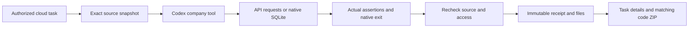

# 云端 API 与 SQLite 实际检查 / Cloud API and SQLite checks

云端 Codex 新增 `api_test` 和 `database_test_native` 公司工具，在当前任务获准的源码副本上实际运行 HTTP 应用请求及 SQLite 数据、约束检查。结果与之前的程序检查使用同一套私有来源、幂等、版本、下载与撤销规则。Desktop 的 Agent 继续在客户本机运行；Extension 继续使用浏览器右侧面板获取获准附件并上传云端。

Cloud Codex gains company tools for actual application HTTP requests and native SQLite checks against an authorized task source snapshot. Both reuse private source lineage, idempotency, version binding, authorized downloads and revocation. Desktop Codex remains customer-local; Extension remains a native right Side Panel with authorized file upload.

## 客户工作流程 / Customer workflow

1. 用户登录，进入企业和项目，在具备相应工具授权的软件任务中批准执行及预算。
2. Codex 使用 `code_write` 写入 HTTP handler 或 SQL 源码，通过公司工具执行具体断言。API 需要导出请求处理函数或尚未监听的 `http.Server`；SQL 入口为任务内 `.sql` 文件。
3. 断言失败保留真实失败。Codex 修改源码后重新检查；旧记录标注源码变更，不会沿用旧版本的通过状态。
4. 任务页「软件检查记录」区分 API、SQLite 与普通指令，支持展开断言名称、预期值、实际值和错误。用户可下载原始 JSON 回执和实际执行文件 ZIP。
5. `code_package` 仅附入与当前完整源码摘要一致的检查，不把单项通过解释为软件整体已验收。

Sign in, open an authorized project task, approve its execution and budget, then ask Codex to implement and check the source. Inspect named assertions and their actual values in Software checks. Download the immutable record or execution files; the latter include the real SQLite database when available. Source edits require new checks. Matching code packages retain individual failures and passes.



## API 请求与信任边界 / API requests and trust boundary

`api_test` 输入包括 `entry`、可选 `export_name`、1–20 个请求与最长 30 秒总时限。请求声明名称、方法、任务内相对路径、受限请求头、可选 body，以及预期状态码、精确 JSON 或文本、选定响应头。工具不接受外部 URL、可执行文件、环境变量、任意命令或模型提供的验证代码。每个响应正文最多 16 KiB、响应头最多 16 KiB，单请求最长 5 秒；不会跟随重定向。

请求由可信公司父进程的 Node HTTP client 编码，响应由同一 HTTP client 解析并比对。客户 handler 在原生 Windows AppContainer 内，由 Node HTTP server 处理真实 HTTP/1.1 字节。两端使用继承的匿名管道及有界帧协议传输，未授予网络能力。它验证应用的 HTTP 行为，不验证 TCP、DNS、TLS、外部站点、真实支付/广告端点或部署网络配置。公司父进程不会向客户代码发送公司密钥。

The trusted parent constructs real HTTP/1.1 requests and compares parsed responses outside the customer process. The customer's handler executes inside an AppContainer with no network capabilities; HTTP bytes travel over inherited anonymous pipes. This checks application request/response behavior. It does not establish external endpoint, TCP, DNS or TLS behavior. Unexpected output, interrupted responses, excessive bodies, missing assertions, deadlines and cancellation cannot produce a successful check.

原生守护程序的输入通道只接受有界 base64 数据帧、EOF 和取消控制。取消监视与写入线程独立，即使客户不读取输入，仍由 Job 的时限和单进程限制终止。普通 `process_run_allowed` 继续使用无输入模式。回执明确记录是否启用了输入通道。

```json
{
  "entry": "api.cjs",
  "requests": [{
    "name": "Reject unauthenticated requests",
    "method": "GET",
    "path": "/records",
    "expect": {"status": 401, "json": {"error": "unauthorized"}}
  }]
}
```

## 原生数据库检查 / Native database checks

`database_test_native` 当前只接受 `engine: "sqlite"`。固定 Node 的原生 SQLite 引擎每次在任务副本内建立新数据库，执行 SQL 入口，再执行最多 30 项带绑定参数的检查。可以精确断言行数据、修改行数、插入 ID 或 SQLite 错误码；支持事务及回滚、外键、主键、唯一约束和 CHECK 约束。64 位整数超出 JavaScript 安全整数范围时使用十进制字符串，BLOB 使用 base64。结果行最多 100 行。

可信 SQL runner 不加载客户 JavaScript；禁用扩展加载并保持外键检查。客户 SQL 中的 PRAGMA、ATTACH、DETACH、VACUUM 在进入原生引擎前拒绝，避免改变验证配置或访问其他数据库/文件目标。每项检查只允许一条 SQL 语句；字符串与注释不会被误认成可执行关键字。输入 schema 可包含正常事务及多条建表、种子数据语句。SQL 仍受原生进程、内存、文件及总时限限制。

The native SQLite runner executes real SQL with bound values in a fresh database, keeps foreign keys enabled and disables extension loading. Each check contains one statement. Customer PRAGMA, ATTACH, DETACH and VACUUM are rejected before native execution. Expected database errors are recorded with their actual error codes. The output ZIP contains the actual SQLite database and detailed results. This is not PostgreSQL/MySQL compatibility testing; the platform's own PostgreSQL remains a separate service.

```json
{
  "engine": "sqlite",
  "entry": "schema.sql",
  "checks": [{
    "name": "Read seeded customer data",
    "sql": "SELECT name FROM records WHERE id=?",
    "params": [1],
    "expect": {"rows": [{"name": "CopyPaste"}]}
  }]
}
```

## 记录、权限与交付 / Records, access and delivery

运行配置升级为 `windows-node22-appcontainer-v2`，继续固定 Node v22.14.0 及原有执行文件摘要。原生 Job 仅允许一个进程、512 MiB 内存，禁止子进程与网络。新增回执字段 `check_result`、`check_input`、`harness_sha256`，原有退出码、原生清理、源码和输出文件摘要保持。通过同时要求实际退出成功、所有声明断言完成且通过、未触发限制，并完成原生资源及临时目录回收。

两种工具只注入获准的云端 execute 任务；ask/plan、不含该权限的角色和 Desktop 不获得这些云端执行能力。`task_tool_receipts` 的迁移 **116** 仅追加允许的工具名；SQL001–115 保持原字节。两个软件记录 GET 接口支持所有三类检查，保留私有所有者、租户/项目、来源可用性、精确版本及保留期约束。幂等重放不会重复运行；撤销原始来源后，记录及衍生下载一并失效。

Web 与 Desktop renderer 分别构建。当前检查的浏览器截图及录制来自真实登录的 Web 流程，不冒充 Desktop 本机执行录像。角色仍按完整依赖进行预检；尚未实现的云端 `browser.preview` 继续阻止依赖它的模板宣称就绪。

Qualification uses the actual pinned cloud Codex runtime, native Windows boundary, native SQLite and PostgreSQL, plus browser downloads. Model responses and credit use the user's authorized synthetic data. Live provider quality, arbitrary npm packages, cloud browser preview, signed production release and whole-product acceptance remain separate work. [Current evidence](../quality/cloud-development-checkpoint.json) records exact sources, retained attempts and cleanup; the historical requirement decisions remain unchanged.

## 上游依据 / Upstream references

- [Node v22.14.0 HTTP](https://nodejs.org/download/release/v22.14.0/docs/api/http.html) describes the HTTP request, response and server APIs used by the trusted transport.
- [Node v22.14.0 SQLite](https://nodejs.org/download/release/v22.14.0/docs/api/sqlite.html) documents the actual native database and statement APIs; this pinned version marks SQLite experimental.
- [Microsoft AppContainer implementation](https://learn.microsoft.com/en-us/windows/win32/secauthz/implementing-an-appcontainer) documents the native Windows capability boundary.

本次不使用 Docker、WSL 或虚拟化环境；测试结束关闭本次创建的浏览器和服务，保留用户原有进程。
