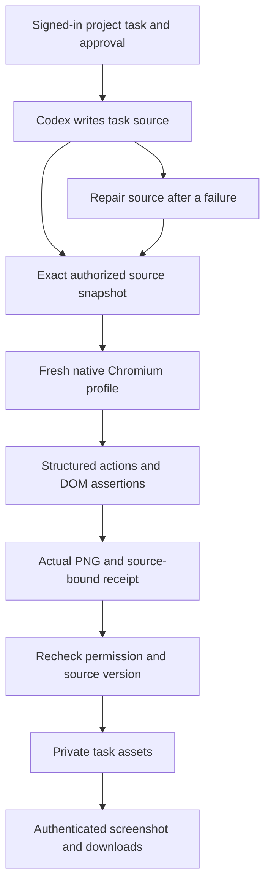

# 云端实际页面交互与软件角色版本 / Cloud browser checks and software role versions

云端 Codex 的 `browser_preview` 公司工具实际打开当前任务的 HTML、JavaScript、CSS 和资源，执行声明的页面操作，比较 DOM 结果，并保存实际 PNG、页面文本、DOM、源码及执行回执。Web 和 Desktop 的软件检查组件可展开查看该截图。Desktop Agent 仍在客户本机运行；该工具只加入获准的云端执行任务。

The company `browser_preview` tool runs actual Chromium interactions against the cloud task's authorized source snapshot. It retains a real PNG, page text, DOM, source files and execution receipt. The software-check component displays the screenshot through an authenticated API. Customer Desktop Codex continues to execute locally; this cloud tool is not injected into Desktop tasks.

## 从登录到下载 / Sign-in to delivery

1. 用户登录，进入企业和项目，选用具备 `browser.preview` 权限的软件角色，提交任务并批准执行及预算。角色预检要求本次使用的运行环境和所有依赖真实可用。
2. Codex 用已有的源码工具创建 HTML 和资源；框架项目须先产出浏览器可加载的本地构建文件。工具不代替 npm 安装或框架构建。
3. Codex 提供任务内入口、视口、操作和具名断言，例如填写客户名称、勾选 VIP、保存，再比较实际状态。公司控制器执行操作并判断结果。
4. 失败检查保持失败。修改源码后重新执行，旧记录标注版本已变更。通过记录只适用于相同完整源码摘要。
5. 用户在任务详情的「软件检查记录」展开输出，查看实际截图、断言的预期值和实际值，下载原始回执或实际执行文件 ZIP。
6. `code_package` 仅包含与当前完整源码一致的检查回执；执行文件 ZIP 另含本次截图与 `sources/` 下的确切源码。单项通过不代表整套软件已完成验收。

Sign in, select an authorized software role, approve the task and budget, then ask Codex to implement and exercise the page. Inspect the actual screenshot and assertions under Software checks. Preserve failures, repair the source using its previous digest and repeat the checks. Download the immutable execution files or matching source package.



## 输入与执行 / Input and execution

`entry` 必须是当前任务已存在的 `.html` 或 `.htm` 文件，不能是外部 URL 或绝对路径。视口为 320–1600 × 240–1200 像素，默认 1280 × 800。总时限为 100–30000 毫秒，默认 15 秒。输入严格拒绝额外字段；不接受公司或模型提供的任意 shell、控制器脚本、环境变量、文件上传路径或外部浏览器目标。

最多 20 项操作：`click`、`fill`、`select`、`check`、受限按键的 `press`、`wait_for`。1–30 项具名 DOM 断言支持精确文本、包含文本、输入值、元素数量和可见性；对异步更新在有限时限内轮询。默认遇到页面 JavaScript 错误判为失败。操作、断言、原生浏览器退出和进程回收全部成功，且未超时或取消，才产生通过结果。

The schema accepts only an existing task HTML entry, a bounded viewport, structured interactions and named expectations. The company controller evaluates assertions outside customer JavaScript. It records actual values, page errors, denied requests, completed actions, native exit and cleanup. A predicted result or an incomplete assertion sequence cannot become a pass.

```json
{
  "entry": "index.html",
  "viewport": {"width": 1280, "height": 800},
  "actions": [
    {"action": "fill", "selector": "#name", "value": "香港團隊"},
    {"action": "check", "selector": "#vip", "checked": true},
    {"action": "click", "selector": "button[type=submit]"}
  ],
  "checks": [
    {"name": "Saved customer and VIP state", "selector": "#result", "expect": {"text": "香港團隊 · VIP"}}
  ]
}
```

## 原生进程与页面边界 / Native process and page boundaries

运行配置为 `windows-chromium1248-job-v1`：Playwright Core 1.64.1、Chromium 156.0.8078.4，固定 305 个运行文件的路径、长度和 SHA-256。运行前校验配置、守护程序源文件及二进制；浏览器文件缓存只复用未变化文件的校验结果。缺少或不匹配时拒绝执行，不回退到系统浏览器或关闭 sandbox。

可信 C# 守护程序保留匿名 CDP 管道，在暂停状态建立 Chrome，将其加入原生 Windows Job 后才恢复。Job 限制为 20 个进程、每进程 512 MiB、总内存 1536 MiB、CPU 50%，关闭最后 Job 句柄时终止整组进程。禁止 `--no-sandbox` 等削弱参数；实际 Chromium renderer 必须持有 untrusted integrity RID 0 和 restricted token，前后两次将 CDP 进程列表与原生 Job 列表交叉核对。Chrome broker 与 renderer 的权限不同，不宣称整个浏览器都处于无网络 AppContainer。

客户页面放入独立来源 `http://preview.invalid` 的 sandbox iframe；可信顶层 `http://preview-controller.invalid` 仅提供无脚本容器。客户代码不能读取顶层 DOM、移除其 sandbox 或把页面操作引向控制器。CSP 禁止子框架、workers、外部连接、对象及不受控 base；运行后再次核对顶层和任务 frame 来源。

The guardian assigns Chrome to a bounded native Windows Job before resuming its first process. Actual renderer token measurements and process membership are recorded before and after page work. Customer code executes in a cross-origin sandboxed iframe beneath a company-owned top-level document. This is Chromium's native renderer sandbox and a process-resource boundary. It is not an operating-system guarantee that every Chrome broker process lacks network capability.

## 资源、网络与回收 / Resources, network and cleanup

只从内存中的授权任务文件提供同源 GET/HEAD 资源。每任务最多 500 个源码文件、单文件 1 MiB、源码总量 20 MiB；只提供已声明的浏览器 MIME 类型。运行设置 offline、固定不可解析代理、禁用 QUIC 和直接 WebRTC UDP；Playwright 拦截所有外部资源及 WebSocket，CSP 禁止 connect、workers 和子框架，初始化时禁用 WebRTC/WebTransport 构造器。下载、弹窗、设备权限、用户文件选择不提供给任务。每次执行使用全新 profile，源站存储配额 8 MiB，限制缓存，最多 200 次资源请求。

这是浏览器配置、请求路由和页面策略共同建立的外部访问限制，真实 HTTP/WebSocket/文件/RTC canary 会验证已覆盖路径。它不等于操作系统级网络隔离；浏览器漏洞、任意外部协议及所有网络栈的完整安全认证不在本次验收结论内。

取消通过任务独占标记交给原生守护程序；守护程序独立监视截止时间及控制器句柄。正常返回必须取得 `job_empty` 回执。控制器异常退出后，可通过原生 `OpenJobObject` / `QueryInformationJobObject` 独立确认所属 Job 已消失或为空；只在控制器和守护程序均已退出、Job 确认清空且目录归属正确时回收残留 profile。不按进程名称批量结束浏览器，不操作用户原有页面。

Fresh profiles, routed task-only assets, offline configuration, CSP and disabled communication APIs constrain page access. Native deadlines and Job lifetime protect cleanup independently of the JavaScript controller. Orphan reclamation inspects the exact owned Job and directory; it never kills browsers by name or adopts user sessions. No Docker, WSL or virtual machine is used.

## 回执、截图与权限 / Receipts, screenshots and access

回执保存入口、完整输入、断言、实际输出文件摘要、源码摘要、浏览器/守护程序摘要、frame 规则、原生进程测量、退出码、停止原因和时间。PNG 最多 4 MB，页面文本保留 100000 字符、DOM 200000 字符，控制台和拒绝请求均有数量与字节上限。原图与断言来自同一次实际浏览器执行。

新增截图接口：

```text
GET /v1/tenants/:tenant/projects/:project/tasks/:task/software-checks/:check_id/preview
GET /v1/tasks/:task_id/software-checks/:check_id/preview
```

两种接口均检查登录、租户、项目、任务私有所有者、来源授权、保留期、检查回执及确切截图版本；读取存储后再次检查权限和来源。服务端核对 PNG 签名、长度、SHA-256 和实际视口尺寸，返回 `Cache-Control: private, no-store` 的 base64 JSON。前端仅在展开内容进入视区时请求，核对长度及摘要后创建 Blob URL；卸载时中止请求并释放 URL。撤销原始来源后，截图、回执、执行 ZIP 及匹配源码包的可用性一起受约束。

Screenshot reads use the same tenant/project/private-task/source authorization as execution files. Storage reads are followed by renewed access and availability checks. Server and client verify the exact PNG bytes. Lazy loading and Blob URL cleanup keep closed output panels from allocating images unnecessarily. SQL migration 117 only appends the new tool name; published migrations 001–116 remain byte-for-byte unchanged.

## 软件预设版本 / Software preset versions

以追加文件发布四份 Skill 1.1.0：`fullstack-engineering`、`frontend-implementation`、`backend-api`、`qa-testing`。六个角色新增 1.1.0：`fullstack`、`frontend`、`backend-api`、`software-qa`、`ui-ux`、`landing-page`，在保持原角色权限的前提下绑定新的软件 Skill。定义包含真实工具用法、失败修复、源码 SHA、浏览器截图、组件检查与端到端集成的区别，以及 Desktop 本地执行约束。

旧 Skill、旧 catalog 和旧角色 digest 保持；已批准任务不被暗中切到新版本。新版本的供应和执行依赖必须通过预检，但不会自动获得专业质量验收。历史角色和任务的精确绑定及禁用、撤销、替换逻辑继续验证。

Four new immutable Skill packages and six software role versions add the executable tool workflow without expanding role permissions or rewriting accepted task bindings. Historical versions remain resolvable. Availability does not automatically confer professional qualification.

## 安装、核查与验证范围 / Setup and qualification scope

在独立后端仓库安装依赖、配置原生运行时并构建：

```powershell
npm ci
node scripts/setup-cloud-browser.mjs --download
npm run build
node scripts/probe-cloud-browser.mjs --compiled
```

首次也可使用 `--source <approved-chrome-win64-folder>`，但必须与固定文件清单完全一致。已有运行目录用不带参数的 setup 重新核验；带来源的安装拒绝覆盖已有目录。运行时更新须单独审阅和更新 contract。当前执行配置仅支持 Windows x64，其他系统会报告运行环境不可用，不以无 sandbox 执行替代。浏览器包不会提交 Git。

本次完整证据、保留的失败轮次、测试数、原生 Desktop 独立打包、真实 Web 截图/GIF/MP4 及源码摘要见 [验证检查点](../quality/cloud-browser-checkpoint.json)。模型响应及额度继续使用用户批准的假数据。真实云端 Codex、Chromium、DOM 交互、PNG、PostgreSQL 和文件下载需要实际运行后才记为验证通过。

API、SQLite、程序及页面检查分别执行；当前静态预览未把生成的 HTTP server、数据库和页面连成一个运行中的应用，也未安装任意 npm 包。真实模型业务质量、客户广告授权、外部服务、签名安装包、生产部署和完整专业验收继续使用各自的准入条件。原有 102 项需求的完整验收结论不会因本次组件检查而自动改为完成。

For exact selected runs and retained failures, see the checkpoint. Synthetic provider responses and credit are authorized; runtime execution, DOM checks, files and downloads are actual. Component checks do not prove an integrated deployed server/database/browser application, arbitrary framework support, live professional quality or full product acceptance.

## 上游依据 / Upstream references

- [Microsoft Job objects](https://learn.microsoft.com/en-us/windows/win32/procthread/job-objects)
- [Microsoft nested Jobs](https://learn.microsoft.com/en-us/windows/win32/procthread/nested-jobs)
- [Job process list structure](https://learn.microsoft.com/en-us/windows/win32/api/winnt/ns-winnt-jobobject_basic_process_id_list)
- [Playwright browser context](https://playwright.dev/docs/api/class-browsercontext)
- [Chromium native DevTools pipe](https://github.com/chromium/chromium/blob/main/content/browser/devtools/devtools_pipe_handler.cc)
- [libuv Windows stdio descriptor format](https://github.com/libuv/libuv/blob/v1.49.2/src/win/process-stdio.c)
