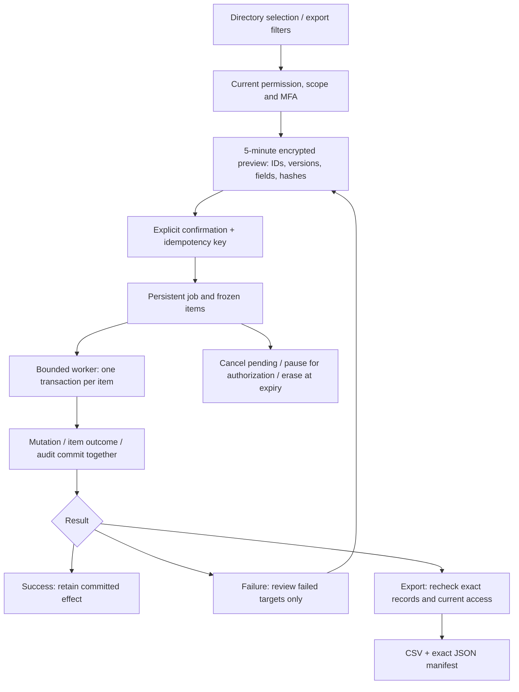

# 103 · 持久批量任務與資料匯出 / Persistent Admin data jobs

Admin 的實際產品流程改為「選擇對象 → 凍結預覽 → 明確確認 → 背景逐項執行 → 查看結果」。用戶目錄、任務用量、費用流水與審計資料均可建立資料快照匯出；帳戶批量啟用／凍結獨立執行，單批最多 100 位。CSV 上限為 10,000 筆，超限明確拒絕，不能靜默截斷。費用及 VIP 原有獨立命令、金額來源與審批機制繼續適用。

The actual Admin workflow now selects targets, freezes a preview, requires explicit confirmation, executes persistent items in the background and displays each result. Exports cover directory records, individual task usage, ledger entries and audit metadata. Activation/freezing supports up to 100 accounts. Exports reject more than 10,000 rows explicitly. Existing financial and VIP commands retain their approval and provenance rules.

## 使用流程 / Usage

1. 登入 Admin 並完成電郵與 TOTP 驗證，進入「批次與匯出」。以目錄搜尋和勾選選擇帳戶，或建立匯出並指定來源、關鍵字、企業／專案／用戶及時間條件。匯出條件獨立設定；用戶日期代表註冊時間，其他來源代表記錄建立時間，結束時間不包含在內。
2. 預覽展示精確對象、版本、輸出欄位與前五筆已授權樣本。管理員勾選已核對並確認後，才建立隊列任務。確認鍵能恢復遺失回應，同一預覽不能建立第二份任務。
3. 查看已成功、失敗、待處理、取消數量及逐項錯誤。取消只停止未執行項目，已完成的帳戶變更和會話撤銷保留。關閉帳戶與重新開通已關閉帳戶須走既有單帳戶審批流程。
4. 部分成功後，重試先生成新的失敗對象預覽，管理員核對其最新版本，再確認獨立子任務。成功項目從不加入子任務。同一父任務只能有一個子任務；子任務仍失敗時，可從該子任務繼續明確核對。
5. 完成的匯出可下載 CSV 或完整 JSON 對象清單。部分匯出必須勾選接受缺失項目；JSON 聲明原始總量、成功／失敗計數、條件、版本和指紋。新註冊或新入庫記錄不會混入既有快照。

Sign in with email and TOTP, select accounts or export criteria, review exact targets and fields, then confirm. Follow persistent item results. Retry creates a separately confirmed child containing only failed targets; committed successes remain untouched. Downloads use the frozen set and require explicit acceptance of partial output. New matching records cannot enter an older file. Billing and entitlement operation history remains in a separate tab on the same page.

## 權限與資料 / Authority and data

- 所有 API 限 Admin 身份，寫入受 Origin／CSRF 保護；讀取私有資料與執行敏感操作均要求十分鐘內的有效 MFA。後台不能使用普通用戶或 Extension 憑據取得管理快照。
- `admin.jobs.read/create` 控制任務；匯出另需 `admin.exports.create/download` 及來源的 `admin.users.read`、`admin.usage.read`、`admin.billing.read` 或 `admin.audit.read`。帳戶全域狀態另受 `admin.users.status.write`、批次上限與重疊企業／專案 deny 約束。
- 來源讀取與匯出權限在逐筆 SQL 條件中交集。聯絡資料使用既有 `admin.users.contact.read` 欄位權限；無權者只取得遮罩。審計只有中繼資料，費用只有白名單流水欄位；不輸出提示詞、帳務細節 JSON 或審計正文。
- 預覽綁定建立者、實際會話、身份版本、目前角色／範圍／限制／到期日及完整定義。確認重查所有對象及政策；執行每項前重查會話、MFA、權限、政策、版本和指紋。新會話須明確重新授權；權限／政策已改時須取消並重新預覽。
- 每位管理員只能列出和讀取自己的任務。下載再次核對精確的成功對象、權限交集、欄位投影與指紋，資料或授權改變即拒絕，不會使用過去的 grant 放行。

Current admin identity, recent MFA, source permissions, export/action permissions and explicit denies constrain the snapshot, each execution item and downloads. Raw credentials and hidden fields never enter progress/event payloads. Private responses use `Cache-Control: private, no-store`; downloads also use `nosniff`. CSV quoting protects commas/quotes and prefixes spreadsheet formulas even when preceded by whitespace or control characters.

## 持久執行與故障 / Persistence and failure

SQL119 新增四張強制 RLS 的 control-plane 表：`admin_data_previews/jobs/items/events`。`cp_app`、`cp_queue` 與 PUBLIC 均無存取權。資料庫驗證每個任務必須保留原預覽的建立者、條件和精確對象；每個 item 必須匹配凍結清單的順序、ID、版本和指紋。定義、對象、終態結果及事件不可覆寫，嘗試次數只能向前遞增。

原生 Worker maintenance 每次最多執行 30 項，先取得既有管理權限鎖，再取得會話、任務及標準帳戶／成員鎖；批量預覽先按既有規則取得全部用戶權限鎖，避免鎖次序交錯。單項的帳戶變更、會話撤銷、item 結果與審計同一交易提交；崩潰回滾後可安全接手。只有 PostgreSQL 暫時性錯誤自動退避，最多三次；對象改變等業務錯誤直接成為可核對的失敗結果。

A bounded maintenance loop processes at most 30 items. Standard authority and account locks protect canonical lifecycle invariants. Mutation, outcome and audit commit atomically, so a crash cannot leave a committed mutation with a pending outcome. Only transient database errors receive bounded backoff, with three attempts maximum. Business conflicts produce explicit item failures. One failed child is retried through a fresh preview rather than resetting immutable parent outcomes.

快照以 AES-256-GCM 加密並保存 SHA-256 內容摘要。預覽五分鐘後、任務十五分鐘後由 maintenance 清除密文，保留不可變的對象 ID、版本、摘要和結果。即使 maintenance 尚未清理，API 到期後也不允許使用密文。取消不會提前抹掉審計或撤銷已完成的合法操作。

Encrypted payloads are erased by maintenance after five minutes for previews and fifteen minutes for jobs. IDs, digests and immutable outcome facts remain. APIs enforce expiry before maintenance cleanup. The legacy synchronous endpoints remain for compatibility with existing contracts; actual Admin controls use `/v1/admin/data-jobs` and its explicit confirmation flow.

## 部署與核查 / Deployment and verification

在唯一工作區原生執行既有 `db:migrate`，套用新增 SQL119，重新建構及啟動 Platform 和 Admin；Worker maintenance 必須啟用。沒有 Docker／WSL 或額外虛擬化依賴。密鑰由既有 `MASTER_KEY` 管理，不能更換後假定舊密文仍可解讀。API 規範見 [OpenAPI](../contracts/admin-data-jobs-openapi.json)，確切程式及核查綁定見 [checkpoint](../quality/admin-data-jobs-checkpoint.json)。

Run the existing native migration and build commands, apply SQL119 and enable the platform worker. Keep the persistent master key available for the short-lived encrypted snapshots. No Docker or WSL is involved. See the additive OpenAPI and checkpoint for exact source/evidence bindings. Tests use synthetic accounts and mock model data as authorized; this increment makes no new live AI quality or entire-product acceptance claim.
