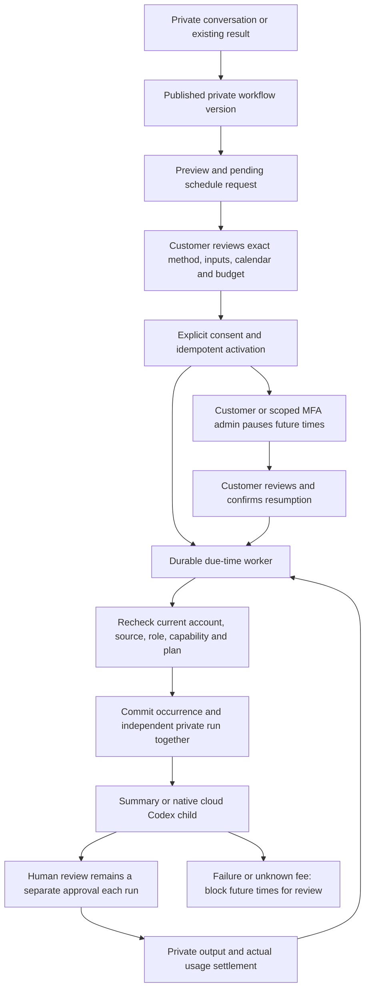

# 104 · 私有雲端定時工作流 / Private cloud workflow schedules

**阶段 105 / Stage 105：** 私有云端计划在来源撤回／读取失败时同步关闭已打开的私有弹窗；正常轮询保留可读草稿。九项实际跨端流程通过，含真实来源隔离无刷新与明确模拟的 HTTP403。后端未变，沿用旧 78 项检查基线；不扩大完整产品或 Desktop 验收。见[实现与证据](105-live-private-schedule-views.md)。

用戶可以請流程顧問在私有對話裡準備每日／每週工作，也可以將已有的私有流程保存為計劃。Codex 只能準備提案；客戶必須在 Web 或 Chrome 原生右側欄核對方法、固定輸入、時區、交付與每次預算，主動勾選後確認啟用。關閉頁面仍由公司雲端 Worker 執行。Desktop 繼續在客戶本機運行 Codex，其原生憑證不能啟用本功能作為本機執行的替代。

Customers can prepare daily/weekly work in a private consultant conversation or save an existing private workflow as a schedule. Codex prepares a request only. Web or the actual Chrome right Side Panel displays the fixed method, inputs, time zone, outputs and per-run budget; the customer explicitly checks consent and activates it. The company cloud worker continues after the client closes. Desktop keeps its customer-local Codex execution; its native credentials cannot activate a cloud replacement through these routes.

## 客戶操作 / Customer workflow

1. 電郵登入並選擇企業／專案，建立流程顧問。`workflow-consultant` 1.2.0 在既有 1.1.0 能力上，新增固定版本的 `workflow-scheduling` Skill；舊角色版本與 Skill 檔案保留。對話需明確提供每天或每週指定日、當地時刻、IANA 時區、漏跑策略和交付內容。缺失資料由模型追問；工具不提供啟用能力。
2. 在「工作流程」或顧問工作詳情核對待確認提案。來源顧問必須成功完成，提案未過期，流程版本及來源仍有效。確認包含完整定義摘要和 Agent 步驟總預算；改動任一欄位或摘要不能沿用舊確認。
3. 啟用不預扣所有未來費用。每次到時建立獨立私有 run，沿用其不可變流程版本、角色／Skill 摘要及輸入引用；各 Codex 子工作走原有預算預留、用量和費用結算。顧問準備費用另外記錄。固定輸入不會自行變成最新廣告帳戶資料；刷新資料和變更方法需要另行核對。
4. 每次人工審批點都保留。暫停計劃只停止未來觸發，正在執行的工作與已產生費用仍保留。需要停止當次執行時，從對應私有 run 單獨取消。運行中、等待人工輸入或費用待核對的工作不會因恢復計劃而重播。
5. 恢復必須重新核對並確認，從現在起排程，略過暫停期間。修改計劃先生成獨立提案，核對後才追加新版本；舊 run 和歷史時區保留。停止計劃是終態；再次安排需建立新計劃。
6. 「每次結果與版本」提供每頁 50 筆游標翻頁、原版本時區、觸發／略過原因、實際已結算費用和對應 run／工作連結。游標保留資料庫微秒精度；舊 run 可透過精確 ID 取得，不受最近 100 次列表限制。費用待核對不等於免費，應從原工作費用狀態處理。

Sign in, select a workspace/project and create the consultant. Supply explicit daily/weekly times, IANA zone, missed-run policy and outputs. Review the pending fixed-version request and confirm its exact digest and Agent-step budget. Each due time creates an independent private run using existing charging and human-review rules. Pause preserves current work; cancellation is per run. Resumption requires customer confirmation and skips the paused interval. Calendar editing creates a new pending request before adding an immutable version. History paginates actual occurrences with the original zone, settled charges and exact run links. Fixed inputs do not automatically refresh external account data.

## 一致性與執行 / Consistency and execution

- 原生 PostgreSQL 新增 SQL120：`cloud_schedule_requests`、`cloud_schedules`、`cloud_schedule_versions`、`cloud_schedule_occurrences`，以及 `workflow_runs` 的三個私有排程引用。SQL001–119 不改寫。四表強制 RLS，以企業和個人擁有者隔離；同專案成員不能取得別人的計劃正文。
- 未確認提案通常七天到期，亦不超過來源工作內容保留期限。同一來源工作、同一提案內容即使模型換 call ID，也只產生原提案；首次略去的開始時間會固定保留。客戶 mutation 使用固定 idempotency key 與精確內容，遺失回應可以取回同一結果。
- Worker 使用既有 user-authority 鎖順序和 `FOR UPDATE SKIP LOCKED`，每輪最多處理 20 個候選。每個版本內的本地時刻，以及整個計劃的實際時刻，具有唯一約束；觸發紀錄與私有 run 在同一事務提交。獨立確認時區修改後，相同牆鐘標籤可以對應不同實際時刻；相同實際時刻不會重複計費。資料庫另驗證已啟用請求、有效計劃版本、擁有者及原方法，拒絕偽造或改綁 run。
- 每個計劃至多有一個進行中／等待審批 run。來源、帳戶授權版本、角色／Skill、能力或方案失效會阻擋新執行；失敗和費用未知不自動重試付費步驟。恢復後追加新排程版本，不修改舊執行。
- Web 與 Side Panel 在控制操作成功後，等待讀取到已提交的版本才重新開放後續修改；背景輪詢不得重新啟用舊版本按鈕。此約束覆蓋恢復後立即修改的操作，後端仍嚴格拒絕過期版本。
- 漏跑策略必須明確選 `latest` 或 `skip`。多次漏跑合併為一筆可追蹤略過事實，最多只補最近一次；重疊觸發不啟動第二個 run。夏令時不存在的時刻記錄略過；回撥重複牆鐘時刻只執行一次。
- 到期／刪除來源工作會觸發私有提案及版本正文清理，停止計劃；原觸發和費用事實保留。來源被隔離或存取撤回後，客戶 API 和畫面清除不可見正文。回應繼承既有 `Cache-Control: no-store`。

The additive SQL120 schema enforces tenant/private-owner RLS, immutable requests/versions/occurrences, exact activated-request bindings and unique local/absolute due times. The worker uses the existing user-authority lock order and skip-locked bounded selection. Each occurrence and its run commit atomically. Concurrent workers cannot double-launch. Current authority and source availability are rechecked, overlapping work is skipped, and failed/unknown paid work blocks future launches for explicit review. DST gaps are recorded as skipped; a repeated wall time runs once. Source erasure removes private bodies while retaining trigger and charge facts.

## Admin 控制 / Admin control

Admin「執行控制」新增私有計劃元資料表，按現有 `admin.execution.read` 的企業／專案範圍和顯式 deny 查詢，支援分頁。欄位只有 ID、擁有者 ID、狀態、版本、時區／時刻、每次預算、下次時間及錯誤代碼；不返回名稱、指令、預期交付或對話正文。

管理員暫停要求 `admin.execution.pause`、近期 TOTP MFA、操作理由和精確控制版本，以冪等命令記錄審計。已開始的 run 保留。不存在管理員恢復私有付費計劃的介面；恢復由客戶重新確認。暫停權限不附帶查看或改寫私有內容的權利。

Admin execution control lists scoped metadata only and paginates it. Pausing requires `admin.execution.pause`, recent MFA, a reason and the exact version, with idempotent audit. It preserves current runs and grants no private-content access. The customer explicitly confirms any resumption; no administrator resume endpoint exists.

## 部署與重現 / Deployment and reproduction

以原生 Node／PostgreSQL 套用 SQL120，保留既有 Worker maintenance 的 `private_cloud_schedules`、私有工作流推進及來源清理。不得使用 Docker／WSL。從 Delivery 執行 `node scripts/run-cloud-schedule-checks.mjs <新的兩位編號> full` 和 `node scripts/run-cloud-schedule-ui.mjs <新的兩位編號>`。後者使用固定原生 Codex、明確假模型／帳戶資料、實際 Web、Admin 及 unpacked Chrome 原生 Side Panel；每次保存確切源碼和失敗嘗試，關閉自有瀏覽器、資料庫和服務，保留使用者原有頁面。

Apply SQL120 using native Node/PostgreSQL and keep the existing maintenance worker enabled. Reproduce from Delivery using the two commands above with a fresh attempt number. The UI journey uses the pinned native Codex binary with explicitly synthetic Responses, actual Web/Admin builds and an actual unpacked Chrome SIDE_PANEL. Each attempt archives its exact source and releases owned services and pages. This scope does not establish live model quality or full acceptance of all 102 original requirements.

文件與發布使用本階段新增的 `docs/tools/record_cloud_schedules.py`（`record` → `sync` → `audit`）。完成現有敏感資料掃描、新增空白核查及歷史連結核查後，先提交六個端倉庫，再由 `docs/tools/finalize_cloud_schedules_manifest.py finalize` 綁定實際 Git 物件、提交主文件倉庫並執行同工具的 `verify`。最後使用 Delivery 既有 `node scripts/publish-workmate.mjs --push` 原子且不強制地更新八個遠端分支，重新讀取遠端 SHA 核對結果；舊驗證器及其歷史證據保持原樣。

The stage-specific document tool records exact qualification sources, updates bilingual READMEs/media and decodes the recordings. Run staged credential/whitespace/archive-link reviews, commit the six component repositories, finalize the publication manifest against their actual Git blobs, commit the documentation repository and verify it. The existing Delivery publisher atomically pushes the eight mapped branches without force. Re-read remote SHAs to confirm publication; historical verifiers and evidence remain unchanged.

[API contract / API 合約](../contracts/private-cloud-schedules-openapi.json) · [Exact evidence / 確切證據](../quality/private-cloud-schedules-checkpoint.json)
