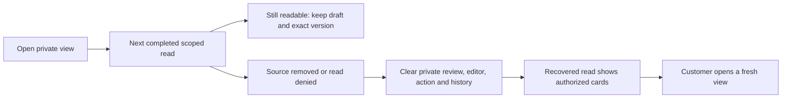

# 105 · 私有计划弹窗同步失效 / Live private schedule views

来源被撤回后，旧版本会在轮询中清空计划卡片，但已经打开的历史弹窗仍持有自己的内容快照。真实浏览器联调在不刷新页面的情况下复现了该问题。现将完成的、按用户和项目限制的读取结果同时应用到卡片与弹窗。

An actual browser regression reproduced a private history remaining open after its source was quarantined and the schedule cards disappeared. The completed scoped read now governs open dialogs as well as cards. No page reload is needed; clearance occurs when the next authoritative response arrives.

确认、编辑、操作与历史弹窗分别保存用户当时看到的对象。正常轮询期间不卸载输入表单，不静默替换编辑或操作的版本；提交继续由后端校验精确版本。读取失败时清空这些私有对象；成功读取中缺少某对象时关闭对应弹窗。读取恢复后只恢复有权查看的列表，不重新打开旧弹窗或恢复已清除的草稿。

待确认请求由不可变 ID 和摘要绑定。成功轮询更新同一请求的就绪、过期与预览信息，使顾问完成或提案过期能反映到打开的确认页；不会修改其方法与输入，也不会自动授予确认、激活、恢复或费用权限。

Readable drafts remain mounted during ordinary polling. Editable/action snapshots retain the original control version for exact server validation. Failed reads clear private view objects; successful reads close views whose resource is absent. Recovery restores authorized cards and leaves discarded views closed. Immutable pending requests refresh readiness and expiry without creating new consent or paid authorization.

## 验证范围 / Verification scope

- `private-view-ui-01` 使用修复前的实际源码，复现来源隔离后历史弹窗持续显示；保留失败记录和对应源文件。
- `private-view-ui-02` 的九项实际交互通过，旧包装计数仍要求八项／八图／三组录制，因而包装结果拒绝通过；保留原报告。
- `private-view-ui-03` 明确要求九项、十一图和四组录制，全部通过。包含真实邮箱、MFA、PKCE、原生云端 Codex、原生右侧栏、逐次执行／结算，以及来源隔离后的无刷新清除。
- 读取失败案例明确通过 HTTP403 响应模拟，仅用于客户端错误处理。来源隔离使用实际数据库状态转换；模型与账号数据为假数据。没有将模拟拒绝描述为真实权限配置变更。
- 后端源码与既有 `cloud-schedule-core-07` 一致，沿用其 78 项检查记录并重新核对源码摘要；本轮没有重复运行后端测试。原 102 REQ／TC、G01–10 和完整验收结论保留。

The selected actual journey checks nine flows with eleven unedited PNGs and four GIF/MP4 pairs. The denied-read case explicitly simulates HTTP403, while source quarantine is a real state transition. The backend retains its unchanged 78-check baseline; those tests were not rerun. This increment does not qualify live model quality, new Desktop behavior or the complete original product.

Desktop 继续在客户本机运行 Codex；Extension 继续使用原生右侧对话和获准附件上传，由公司云端执行。没有新增 API、数据库迁移、角色、Skill 或收费授权。所有 AI 请求继续经公司内部 OpenAI 兼容接口。

## 重现和发布 / Reproduction and publication

从 Delivery 执行 `node scripts/run-private-view-ui.mjs <新的两位编号>`。使用原生 PostgreSQL、固定原生 Codex 与原生 Chromium；禁止 Docker／WSL。每轮保存确切源码，结束后关闭自有服务及浏览器，保留用户原有页面。

文档工具为 `docs/tools/record_live_private_views.py`：`record --ui 03` → `sync` → `audit`。新增发布工具从实际 Git HEAD／暂存对象生成摘要，记录声明的换行转换；核对当前源码、所有发布对象和七个干净仓库后，按既有八分支映射原子普通推送并重新读取远端 SHA。既有冻结验证器和历史报告不改写。

[本轮证据 / Evidence](../quality/live-private-views-checkpoint.json) · [原云端计划方案 / Schedule design](104-private-cloud-schedules.md)
