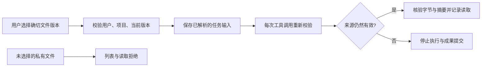

# 私有输入与原生应用就绪 / Selected inputs and native readiness

本轮处理完整回归暴露的跨模块问题：用户明确选中的私有资料不能被后续任务读取、云端 HTTP 检查在应用初始化前开始请求计时、来源失效后私有流程确认弹窗仍保留旧内容。实际结果及确切源码以 [当前检查点](../quality/platform-integration-checkpoint.json) 为准；失败记录同时保留。

This increment repairs integration failures involving explicitly selected private inputs, native application startup timing and stale private workflow confirmation. The linked checkpoint binds actual results to exact source. Initial failures remain available.

## 私有文件的明确授权 / Explicit private file authorization

`task-private-asset-scope.ts` 在既有会话、已确认方案和本机会话规则之外，接受当前任务中已经解析的 `file` 输入依赖。授权同时要求任务与文件属于同一租户和项目、私有任务与文件属于当前用户、依赖状态为 `resolved`、权限范围为 `project.asset_version.read`，且确切的 `asset_versions.id` 包含在用户选择中。传入文件 ID 本身不能授权；未选择的同用户私有文件不进入文件列表，也不能通过读取工具获取。

读取仍要求资产有效、未到保留期限、版本未擦除和当前用户具有项目权限。原有输入校验在启动、每次工具操作和结果提交时继续执行：替换版本、隔离来源或撤销权限会停止任务，不能自动切换到新版本。返回内容前核验实际字节数与 SHA-256，并记录确切版本的读取来源，因此素材反馈及 GEO 的后续成果保留原始证据链。

An exact resolved file dependency authorizes the selected private version within the same owner, tenant and project. Unselected private files remain inaccessible. Existing checks still stop execution when input versions change or sources become unavailable. Content bytes and hashes are checked before return; actual reads preserve downstream provenance.

## 实际应用就绪 / Actual application readiness

`cloud-api-bootstrap.cjs` 完成客户模块初始化、HTTP Server 校验及管道监听后，才发送严格的单字段 `{"ready":true}` 控制帧。控制器等待该帧，再启动每条请求原有的最长 5 秒计时。整个原生进程的配置期限、取消、内存、单进程和无网络限制继续有效；等待初始化不能无限延长执行。

第一帧必须是唯一的就绪帧；额外字段、重复就绪、提前响应、残缺帧和不合法响应继续使检查失败。初始化期间进程结束或取消会结束等待并清理资源。实际 HTTP 请求及断言仍经标准 Node HTTP 解析器与匿名管道执行，不代表外部 TCP/TLS 连通性。

首轮独立复现使用实际原生进程和固定的 5.5 秒模块初始化：旧实现出现 `HTTP_REQUEST_TIMEOUT`；修复后使用相同模块字节重新验证两条独立连接。新增检查同时覆盖初始化超期、取消等待、错误就绪帧和重复就绪。

The native bootstrap announces readiness only after the application and transport exist. Each unchanged request deadline then starts. The overall process deadline and native restrictions still apply. Strict framing, startup failure and cancellation remain failures; HTTP behavior is measured through the actual parser over anonymous pipes.

## 私有确认与恢复 / Private confirmation and recovery

Web `PrivateCloudWorkflows` 在权威读取失败或当前列表已无对应私有 run 时关闭原有确认。普通成功轮询保留原来的版本、预算和用户选择，不能用后台新版本替换已核对的快照。恢复访问只恢复卡片，用户需要重新打开并确认；先前勾选状态不恢复。服务端继续检查确切 revision、definition hash、cursor、预算及当前授权。

实际页面回归包含明确模拟的单次 HTTP403，以及真实数据库来源隔离和恢复，均无需重新载入页面。数据库恢复属于隔离测试操作，不代表新增了后台一键恢复功能。原生 Chrome 右侧栏、客户审批、独立执行、结算和 MFA 后台暂停也在同次流程中继续验证。

Web clears an open private workflow confirmation when the authoritative read fails or omits its run. Recovery restores the card and requires fresh consent. Normal polling keeps the original version and budget snapshot. The real source-quarantine test and explicitly simulated HTTP403 are distinguished in the evidence.

## 兼容与接口 / Compatibility and operations

Desktop 网关曾拒绝实际本机请求中的四项合法媒体工具。真实固定版本 `0.163.0-alpha.11` 的声明复现确认：数组的 `minItems` 会保留，超过 5,000 字节的标准化 schema 会依次去除说明并压缩深层复杂结构。依据[该固定版本的实现](https://github.com/openai/codex/blob/rust-v0.163.0-alpha.11/codex-rs/tools/src/json_schema/compaction.rs)，后端只转换内部注册的 schema，再与用户请求中的原始声明严格比较；不转换传入声明。工具数上限、名称、重复检查及业务执行前完整 Zod 校验保持有效，未知工具、缺失约束和额外字段继续拒绝。

保留修复前原生请求、未生效的 `oneOf`／`anyOf` 诊断和修复后的真实请求。后者包含 23 个公司媒体工具、12 个浏览器工具及三个本机程序工具，使用假模型返回、没有付费模型请求；两个实际媒体任务及其费用结算另由相关后端检查覆盖。测试启动器读取实际二进制的版本与摘要，并同步设置 `CODEX_BIN`、`CODEX_VERSION` 及两项原生测试路径，不改变生产云端 Codex 的独立版本配置。

The company gateway now derives the pinned native schema representation from trusted registrations, preserving array constraints and applying the observed bounded compaction. Incoming declarations are compared unchanged; original business validation still runs before effects. The actual native probe includes all media, browser and program namespaces. Test configuration explicitly matches its binary version; the separately configured production cloud runtime is unchanged.

- SQL001–120 保留，本轮没有新数据库迁移。
- 原路由基线及旧补充文件保留。新增 `client-operations-route-additions.json` 明确登记 25 条已经实现的用户端内容、页面预览、私有计划和持久后台任务接口；检查仍要求与实际注册接口完全相等，不接受自动收录或通配忽略。
- 历史音频升级检查分别固定到 SQL102、SQL103，再验证升级到当前全部迁移后原费用、媒体字节及授权事实保持不变。
- 历史视频角色继续按原摘要、Skill 及七项模板工具检查；当前角色允许后续合法版本，不能给旧任务增加付费权限。媒体效果检查核验发布的确切 Skill 包和定义。
- 回归启动器同时提供两个测试使用的明确 Codex 可执行文件配置，并核对已固定二进制摘要；没有 PATH 回退。

Original migrations, route baselines, historical role digests, paid authority and measured financial facts are retained. The additive route declaration remains subject to exact runtime equality. The runner supplies and checks the explicitly pinned native Codex executable for every native test.

## 可复查结果 / Reviewable results

[检查点与失败记录](../quality/platform-integration-checkpoint.json) 包含完整后端回归、相关修复检查、实际页面流程、源码摘要、截图及录制。各端中英 README 展示实际页面与 GIF／MP4；文档审计核查所有本地链接及录制的完整解码。原 REQ／TC102 和 G01–G10 的完整验收结论保持原值。

完整 97 文件批次执行 1,230 项，1,229 项通过、一项既有原生会话恢复测试在 120 秒超时取消。该文件在不改变源码和期限的独立复查中两项通过，恢复用例约 16 秒；首次超时原因尚未确定，不能称该完整批次全绿。原始超时与复查分别保留。

The complete batch records 1,229 passes and one timed-out/cancelled continuation test. Its unchanged file passes both checks independently. The initial timeout remains unattributed; this is not a wholly passing single-batch run.

完整后端回归也覆盖全部相关修复测试，直接作为修复验收来源，不重复生成另一份同内容的通过批次。页面流程完成后的唯一差异是音频并发测试在查询真实锁等待前调用 `pg_stat_clear_snapshot()`；[PostgreSQL 18 文档](https://www.postgresql.org/docs/18/monitoring-stats.html#MONITORING-STATS-VIEWS)说明同一事务会保留首次读取的活动快照。修复保留实际行锁、10 秒观测期限、心跳更新、费用及状态断言。检查点逐字核对这三行测试差异，绑定更新后的完整回归；其余页面运行源码与实际截图批次严格一致。

继续使用用户已授权的假模型和假账号。实际执行不等于生产模型质量或客户业务验收；Desktop 继续在客户本机运行 Codex，保留既有完整本机权限、无边框及滚动条约束，本轮原生工具修复不代表新增页面验收。所有代码与文档在 D 盘规定路径维护，未使用本地 Docker、WSL 或虚拟机；关闭本次测试创建的浏览器与服务，保留用户既有实例。

The checkpoint retains full backend regression, targeted repairs and actual UI evidence with exact source bindings. Models and accounts remain synthetic. Product acceptance and live professional quality are not inferred from technical execution. Desktop remains local Codex; Extension remains the native right cloud Side Panel with authorized uploads. Owned test browsers and services are closed without touching existing user instances.
