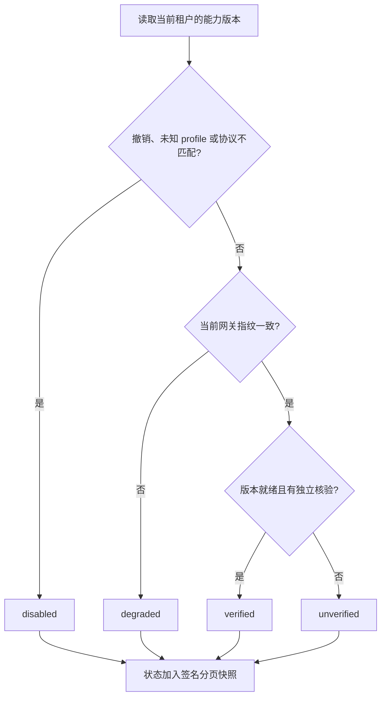

# 按协议显示模型能力 / Profile-specific capability inventory

`GET /v1/capabilities` 与 `/v1/capabilities/details` 原来只把文本和图片协议识别为已实现，导致已经配置的视频、配音和转写仍显示为禁用。媒体核验标志也统一落到图片配置，不能表达各项能力的独立状态。当前实现按确切 profile 和已实现协议匹配，读取该 profile 自己的核验标志；任务执行权限和费用授权继续由原有业务入口独立检查。

The customer inventory previously recognized only text and image protocols and reused image verification for other media. It now matches each exact profile to its implemented protocol and its own verification flag. Inventory status does not itself authorize execution or charges.

| Profile | Protocol | Bootstrap verification |
| --- | --- | --- |
| `internal-text-v1` | `responses` | `AI_VERIFIED` |
| `internal-image2-v1` | `images` | `AI_IMAGE_VERIFIED` |
| `internal-video-v1` | `company-video-jobs-v1` | `AI_VIDEO_VERIFIED` |
| `internal-speech-v1` | `openai-speech-wav-v1` | `AI_SPEECH_VERIFIED` |
| `internal-transcription-v1` | `openai-file-transcription-v1` | `AI_TRANSCRIPTION_VERIFIED` |

能力版本被撤销、profile 未注册或协议不匹配时仍显示 `disabled`。网关指纹变化显示 `degraded`；确切版本就绪，并有已受控发布记录或对应的启动核验标志时，才显示 `verified`；其余显示 `unverified`。此处的协议核验状态不代表真实模型的音质、粤语能力、图片质量或客户业务验收。

Revoked versions, unknown profiles and mismatched protocols remain disabled. A changed gateway produces degraded status. A ready version requires its controlled publication or its own bootstrap verification flag to appear verified. These protocol states do not establish live professional quality.

分页指纹除原有版本 ID、撤销状态和发布 revision 外，还绑定当前的显示状态。用户读取下一页前，如果该状态因配置变化而改变，服务端返回 `410 CURSOR_EXPIRED`，要求从第一页重新读取。签名继续绑定当前用户、认证版本、租户、项目、是否详细视图、每页数量及有效期；不能把其他租户或其他视图的游标混用。

The signed pagination snapshot includes each resolved availability state alongside version, revocation and publication revision. A changed state expires the old cursor. Actor, authentication version, tenant, project, view, page size and expiry remain bound to the signature.

## 核查与交付 / Verification and delivery

实际核查与源码摘要记录在[检查点](../quality/capability-inventory-checkpoint.json)。先用新增的 Fastify 路由注入检查复现旧实现，实际执行登录、鉴权、数据库事务和响应序列化，再应用修复，运行能力目录、受控发布及任务能力绑定的相关回归。所有尝试、原始日志、确切源码和独立数据库清理结果分别保留，不覆盖失败记录。

The checkpoint records actual Fastify route reproduction through injection, the subsequent repaired run, related publication and immutable task-binding regression, exact sources and owned database cleanup. Initial failed attempts remain unchanged.

本轮没有新增页面或改变 Desktop／Extension 的执行位置。各端中英 README 保留并标明阶段 106 的实际截图与交互录制；相关页面运行证据沿用其原始源码与时间，不将旧录制说成本轮重新录制。模型和账号继续采用用户已授权的假数据；全部 AI 请求仍通过公司内部网关。未调度 Docker、WSL 或虚拟化。

There is no new page in this API correction. Bilingual READMEs retain the actual Stage 106 screenshots and recordings with their original scope. They are not presented as a new recording. Models and accounts remain synthetic; company gateway and native execution boundaries are preserved.

重现命令在 Delivery 仓库运行：`node scripts/run-capability-inventory.mjs <新的两位编号> core`。完整 97 文件后端基线和实际页面流程见[阶段 106](106-selected-inputs-and-runtime-readiness.md)；本轮重新运行受影响的相关检查，其余保留原始证据与源码摘要。

Reproduce from Delivery with the command above. Stage 106 retains the complete backend and actual client baseline; this increment reruns the affected capability suites.

阶段 106 完整批次的 1,229 项通过和一项超时取消，以及原文件独立复查两项通过的记录分别保留；该超时尚未归因，本轮能力目录修复不关闭它。

Stage 106 retains its 1,229 passes, one unattributed timeout/cancellation and two passing unchanged-source runtime checks separately. This inventory correction does not close that timeout.
