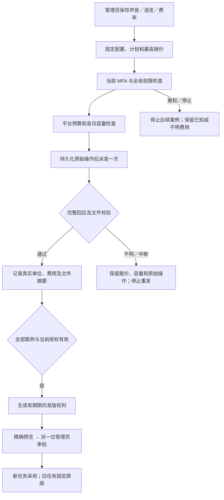

# 后台语音与转录发版 / Managed audio capability releases

本增量把语音生成与音讯转录接入现有模型配置后台：保存不可变配置，实际执行公司内部接口的格式验证，查看逐项进度与平台费用，再通过另一位管理员独立审批发布或回滚。客户任务继续使用创建时固定的模型、费率、声音及语言范围。

Speech and transcription use immutable Admin configurations, actual company-gateway protocol checks, durable progress and platform-funded costs. A different authorized administrator must approve publication or rollback. Customer tasks retain their original model, rates, voices and locales.



| 配置 / Profile | 固定内容 / Frozen choices | 验证矩阵 / Verification matrix | 费用单位 / Pricing unit |
|---|---|---|---|
| `internal-speech-v1` | 公司模型、1–8 个声音、1–3 种语言、正整数微港元费率 / Company model, voices, locales and positive micro-HKD rate | 每个声音 × 语言 × 0.25／1／4 倍速度；实际 WAV 完整解码 / Every voice × locale × slow, normal and fast; complete native WAV decoding | Unicode scalar |
| `internal-transcription-v1` | 公司模型、语言、是否启用分段时间及费率 / Company model, locales, segment-time option and rate | 每种语言 × WAV／MP3 × JSON；启用时间时另验 `verbose_json`、真实顺序时间段及文件时长边界 / Each locale × WAV/MP3 × JSON, plus actual bounded segment times when enabled | 输入音讯毫秒 / Input audio millisecond |

## 执行、授权与费用 / Execution, authority and accounting

- 验证任务在数据库中持久保存，由后台 Worker 执行；关闭浏览器窗口不取消验证。每次处理有独立租约、心跳及原操作 ID，多个执行器不能同时提交同一案例。
- 首次创建复核当前会话、MFA、全局目录权限、精确配置版本、公司网关及固定 Codex 文件。持久执行在两小时原始授权内继续，逐次复核有效会话、权限、显式拒绝、网关、二进制及预算；发版与审批另做当前权限和 MFA 检查。
- 完整计划先检查单次平台验证预算；每个案例在派发前重新检查当日平台预算、音讯容量、请求频率及原有预留。不会创建虚假的客户任务、企业或钱包，也不扣客户额度。
- 语音按实际发送文字的 Unicode scalar 数计费。转录按实际完整解码的输入时长计费；案例先保守预留 3,000 毫秒，收到完整合格回应后记录实际毫秒并释放差额。
- 成功记录、派发意图、费用、媒体摘要与最终资格均保持不可变。取消在未派发时为零费用；已派发但结果不明时保留报价与容量，资格为待核对，不能自动重发或发版。
- 同步音讯接口没有被假设成视频作业协议。进程在 POST 后崩溃时，新的执行器把原操作保存为不明，不编造查询接口，不换操作 ID 重新计费。

Validation runs in the actual background Worker with a persisted plan, lease, heartbeat and original operation ID. Closing the view does not own its lifetime. Each dispatch rechecks the original bounded grant, current session and authority, pinned Codex binary, company gateway, platform budgets and shared audio capacity/RPM. Current MFA and independent approval are required separately at publication.

No customer wallet funds verification. Speech prices Unicode scalars; transcription prices the fully decoded input duration. The original unknown POST retains its reserved quote and capacity. A crashed or restarted processor cannot silently resubmit it. Completed usage and eligibility facts remain immutable.

## 页面与客户工作 / Admin views and customer work

后台支持中英双语的语音／转录配置、精确微港元输入、固定声音与语言、完整计划上限报价、逐项进度、实际解码和时间段摘要、停止原因、只读角色，以及现有独立审批和历史回滚。已知费用和待核对费用分开显示。

发版仅影响新建工作及客户明确采用的新版本。已有工作继续读取原能力 ID、原声音／语言与原费率；新发版不会修改旧任务。撤销原能力版本仍会阻止其继续执行。客户音讯权利确认继续独立存在，管理员发版不能代替客户同意。

The bilingual UI exposes exact prices, fixed voices/locales, the complete maximum quote, durable progress, native media checks, stop reasons and read-only views. Publication and rollback use the existing independent approval flow. New work adopts the current head; old tasks retain their original immutable capability binding. Admin publication never substitutes for customer audio authorization.

Desktop 继续在客户本机运行 Codex，保留主动可撤销全权限、无边框和无可见滚动条约束。Extension 继续使用原生右侧 Side Panel、云端 Codex 和获准的文件读取／上传。本增量不改变这些执行位置。

Desktop remains actual local Codex with customer-granted revocable full local permission and the existing frameless/scrollbar constraints. Extension remains the native right Side Panel with cloud Codex and authorized file upload.

## 迁移、接口与核查 / Migration, contracts and verification

新增 `121-managed-audio-capabilities.sql`；SQL001–120 保持原文件。新增两个仅控制身份可访问的表，把平台音讯验证接入原预算及容量统计；升级保留既有预算函数的 OID 和已准备调用。旧发布、任务绑定及财务历史不重写。

编译脚本同时打包两种原创音讯格式及许可证。编译后的模块从另一独立工作目录运行并完整解码两种格式；素材缺失导致的原始 `ENOENT` 与修复后的独立回执分别保留。该修复仅补齐编译资源交付，不改写已完成的相关回归源码。

The build bundles both original audio fixtures and their license. The actual compiled module loads and fully decodes both formats from an unrelated owned working directory. The original missing-file failure and subsequent passing receipt are retained separately; the only post-regression correction adds runtime resource copying.

[增量 OpenAPI](../contracts/managed-audio-capabilities.openapi.json) 保留旧契约的摘要，并增加音讯文档、实际回执及停止接口。原契约保留原始版本。路由清单以新增一条明确声明的停止接口扩展，不扩大成宽松通配。

Reproduce in the independent Delivery repository:

```powershell
node scripts/run-managed-audio.mjs <新的两位编号> core
# 实际后台页面、后台 Worker 与截图／录制；使用当前固定本机 Codex
$env:COPYPASTE_LOCAL_CODEX_TEST_BIN = (Resolve-Path ../copypaste-desktop/.data/runtime/windows-x64/codex.exe).Path
$env:COPYPASTE_LOCAL_CODEX_BIN = $env:COPYPASTE_LOCAL_CODEX_TEST_BIN
$env:CODEX_BIN = $env:COPYPASTE_LOCAL_CODEX_TEST_BIN
$env:CODEX_VERSION = '0.163.0-alpha.11'
node scripts/run-managed-audio-capability-ui.mjs <新的两位编号>
```

当前结果以[本轮检查点](../quality/managed-audio-checkpoint.json)与原始回执为准。检查使用用户授权的假模型和账号；音讯样本是公司原创测试正弦波，原生解码和真实 HTTP 流程可执行，但不能证明真实音质、转录准确度或粤语质量。结果不明的原音讯 POST 仍需单独的外部费用证据；本增量不宣称已完成该对账流程或完整产品验收。

The checkpoint binds actual test and browser receipts. Accounts and model replies remain explicitly synthetic. The original protocol tone proves decoding and HTTP behavior; it cannot qualify voice, transcription or Cantonese quality. Unknown audio costs still require a separate external-evidence reconciliation flow. Full product acceptance and the original requirement/gate judgments remain unchanged.

阶段 106 的 1,230 项整批记录继续保留其中一项未归因超时；原文件独立恢复复查两项通过。阶段 107 的 68 项能力检查保留其原源码和时间。本轮按改动范围执行相关回归，不把历史记录改写成当前完整批次通过。

Stage106 retains its original 1,230-case attempt with one unattributed timeout and the passing two-case unchanged-source replay. Stage107 retains its 68-case capability verification with its original source/time. This increment does not rewrite either into a passing current full-product run.
