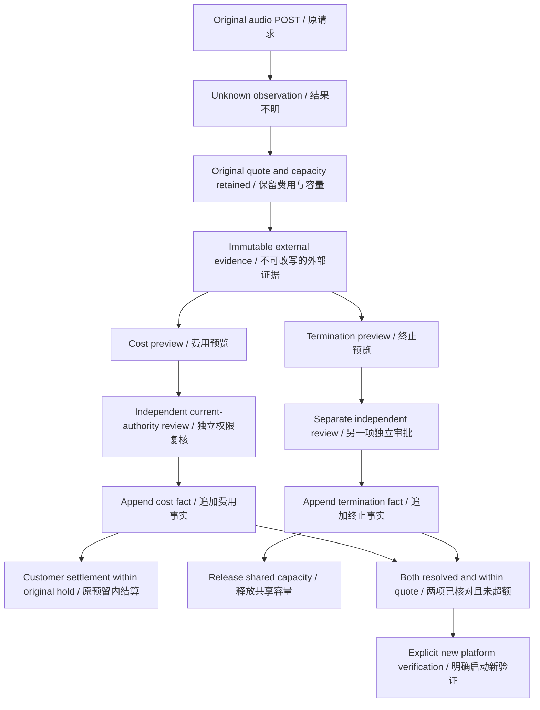

# 音讯费用与终止对账 / Audio evidence accounting

此增量补齐客户音讯作业与平台语音／转录验证在原始 POST 结果不明后的人工对账流程。账号、模型与外部证据可使用明确标注的假数据；实际执行仍使用原生 PostgreSQL、公司兼容网关协议及 Codex。全部开发位于 `dev/`，不使用 Docker、WSL 或其他虚拟化。

This increment resolves accounting after an original customer audio or platform verification POST becomes unknown. Accounts, models and external evidence can be explicitly synthetic. Execution uses native PostgreSQL, the company-compatible gateway protocol and Codex; no virtualization is used.

原始作业、请求哈希、模型、冻结费率、音源版本、用量是否已知及媒体验证结果均保留。独立确认追加在 SQL122 的三张不可变表中：`ai_audio_evidence`、`ai_audio_cost_confirmations`、`ai_audio_termination_confirmations`。费用与容量分别使用追加记录构成的视图；没有伪造回调、主动查单协议或自动重发。

Original operations, request hashes, models, frozen rates, source versions, usage observations and media qualification remain unchanged. SQL122 adds three immutable tables for evidence, cost confirmations and termination confirmations. Separate views derive cost and capacity. There is no fabricated callback, provider lookup protocol or automatic POST replay.

证据必须绑定原始请求 UUID、操作 UUID、数据模式、模型、网关指纹、请求及音源 SHA-256、计费种类与单位。观察时间须在派发后且不晚于当前时间。未执行的证据只能声明零用量、零费用。账单金额以十进制微港币字符串传输；费用确认按原冻结费率乘整数用量精确核对。来源费用与原费率不一致时，可单独审查终止证据释放容量，费用继续保持不明。

Evidence binds the original request and operation UUIDs, data mode, model, gateway fingerprint, request/source hashes, usage kind and pricing unit. Observation must follow dispatch and cannot be in the future. An unexecuted operation requires zero usage and cost. Decimal micro-HKD strings retain exact amounts. Cost approval requires integer units multiplied by the original frozen rate. A mismatching invoice can support separately reviewed termination while cost remains unknown.

每项费用确认、容量释放均使用既有后台预览、操作与审批体系。请求者不能审批自己的操作，证据提交者也不能审批该证据的后果。创建预览、申请审批、提交决定时均重新核对近期 MFA、当前角色、明确拒绝规则、企业／项目范围及冻结事实；竞争提交只允许一个最终确认事实。只读请求权限不会返回金额或证据正文。证据正文读取需要独立费用读取权限并记入审计。

Each cost or capacity action uses the existing preview, operation and approval engine. Neither requester nor evidence author can approve the consequences. Current MFA, roles, explicit denies, tenant/project scope and frozen observations are checked at preview, submission and decision. Concurrent approvals produce at most one confirmation. Requests-only readers receive neither amounts nor evidence bodies; evidence reads require cost authority and are audited.

费用确认不会直接扣款，也不会释放容量；容量释放不会将未知费用归零。客户结算仍通过 `ai.tasks.settle` 独立审批，只能在原任务预留范围内结算一次，业务结果保留失败。已确认外部费用高于原报价时，追加事实标记预算违约并封锁后续原预算支出；不会擅自扩大客户预留或自动补扣。

Cost confirmation neither debits a customer nor releases capacity. Termination approval does not turn unknown cost into zero. Customer settlement still requires independent `ai.tasks.settle` approval, occurs once within the original reservation and retains a failed business outcome. An externally confirmed overquote is recorded as a violation and blocks further spending against the original envelope, without expanding the customer's hold or automatically collecting the difference.

平台音讯验证的费用与终止事实都确认后，且没有超额，管理员才能明确发起新一次验证。旧验证、旧媒体品质结论及旧 POST 均保留；同一个幂等键始终读取旧回执。人工证据不是服务商签名账单，也不能代替真实声音、粤语品质、转录准确度或媒体格式验证。

A new platform verification requires both cost and termination confirmation and no overquote. The administrator must explicitly start it. The old verification, media result and POST remain intact; the original idempotency key always returns the original receipt. Human evidence is not a provider-authenticated invoice or qualification of voice, Cantonese, transcription accuracy or media format.

后台入口为 **调用管理 → 配音与转写作业 → 音讯费用与容量对账**。支持客户／平台两种范围、原始状态、费用／容量状态及企业、项目、任务、发版和验证 UUID 筛选。签名分页游标绑定当前身份、权限、筛选及可见对账状态；可见确认发生变化后须重新读取最新页。

The Admin entry is **Provider controls → Speech & transcription jobs → Audio cost and capacity accounting**. Filters cover customer/platform funding, original state, cost/capacity state and workspace/project/task/release/validation UUIDs. Signed cursors bind current identity, authority, filters and visible accounting state; a visible confirmation invalidates old pages.

Web、无边框 Desktop 及 Chrome 原生右侧 Side Panel 均展示独立确认金额与人工证据来源。音讯生成成功与否、可下载文件及原始请求结果不受人工对账改写。Desktop 的本地 Codex 执行与可撤销完整权限、Extension 的云端 Agent 与文件授权模型保持原约束。

Web, frameless Desktop and the native Chrome right Side Panel display independently confirmed amounts and human-evidence provenance. Accounting does not manufacture successful generation or downloadable files. Desktop retains local Codex and revocable full permission; Extension retains the cloud Agent and explicit file authorization.

当前契约：[OpenAPI](../contracts/audio-accounting.openapi.json)。历史语音契约、SQL001–121 及其原始验证档案保留。阶段 106 整批回归的一项未归因超时及其未修改文件两项重放通过继续保留，不能以本轮影响范围回归取代整体产品验收。

The [current OpenAPI](../contracts/audio-accounting.openapi.json) is additive. Historical audio contracts, SQL001–121 and original evidence archives remain intact. Stage106's unattributed full-run timeout and passing unchanged two-case replay retain their original scope; affected regression is not complete-product acceptance.

客户确认与后台等待按任务 → 授权记录的顺序加锁；等待服务自行取得任务行锁，不依赖调用方是否锁定任务。回归用真实 PostgreSQL 阻塞任务行，观察等待连接并以 NOWAIT 验证授权行未被反向占用，再通过真实客户会话确认。后台保存证据只刷新当前展开详情，避免整个列表刷新使详情折叠。

Customer confirmation and the background wait use task → authorization lock order. The wait service takes the task lock itself. Regression deliberately blocks the task in PostgreSQL, observes the waiter and uses NOWAIT to prove it has not taken the authorization in reverse order, then confirms through an actual customer session. Saving evidence refreshes the current open detail without remounting the entire queue.
