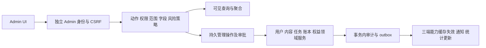

# Admin 控制面、权限与账务实施设计

0.3.0 实际账号邀请、本人 MFA、状态/会话与权限委派增量见 [管理员身份生命周期](14-admin-identity-lifecycle.md)。本册其他规划范围继续保留，实际验收单独记录。

实施状态：本分册保留长期设计约束；本轮锁定版本、实际 API/工具、各端实现与差异，以 [实际开发清单](12-implementation-and-repositories.md) 和 [运行验收](../quality/04-implementation-acceptance.md) 为准，未实现项没有删除。

版本：1.5 · 2026-10-18 · 对应 ADMIN01 / REQ-083–102。产品页面与交互以 [Admin Dashboard](../product/08-admin-dashboard.md) 为准。开发根目录固定为 D:\dev\copypasted\自有agent，所有设计、契约、工具与核查报告在 docs 内维护。

## 1. 工程与信任边界

新增规划目录 apps/admin（React/TypeScript/Vite 管理端）、业务服务的 admin 模块、packages/access（权限/策略）、packages/admin-client（类型化调用），复用现有身份、用户、内容、任务、用量和账本领域服务。此目录清单为待实现工程，不代表已有应用源码。

管理端使用 /v1/admin/* 的专用认证与授权入口，独立 AdminSession cookie/CSRF audience；用户 WebSession、UserBearer、DeviceBearer 和企业 Owner 均不能调用。管理员初始化由受控运维种子完成，禁止公开注册或通过普通用户字段升级为平台管理员。MFA、近期认证、会话撤销和失效必须在真实试点前验证。

后台查询服务可按明确授予进行跨企业汇总；实际变更展开到具体 tenant/project 并调用相同领域命令，不为控制台启用数据库 owner 或 BYPASSRLS。全局统计使用有字段投影的受限查询角色，不能把读取全局用户表的能力传递给普通用户服务。

## 2. 权限判定与传播

每次请求依次核验 AdminSession audience/有效期/MFA → 管理员状态及 auth_version → 精确 permission_key → global/企业/项目 scope → 对象归属/状态/版本 → 字段投影及动作限额 → 风险/审批摘要。显式 deny 优先于 allow；没有规则时拒绝。相同策略用于页面动作、API、worker、导出及下载，服务端不接受客户端声明 approved 或 is_admin。

授权记录含角色版本、数据范围、有效期、可委派范围及金额/批次/时段约束。角色定义使用显式权限键集合，新增权限不会因通配符自动授予旧角色。super_admin 也只能执行已经登记的业务动作，并服从不可篡改账本和审批分离。

管理员跨企业读取正文由 admin.content.body.read 权限及 scope 决定，不要求通用「支持工单授权」作为所有内容管理员的前置。支持人员则需有效 SupportSession/Grant，取支持授权与自身角色的交集；两条路径都记录访问。联系方式、成本、正文、下载和导出是独立字段/动作权限，不允许通过搜索索引绕开。

权限撤销事务递增 auth_version/policy_version 并写 outbox；API 和 worker 以权威版本复核，不能仅等待缓存 TTL。计划到期按当前时间实时判断，调度作业只做通知/缓存清理，调度失败不能延长 VIP。离线客户端只保留界面缓存，不获得新的收费或云端读取许可。

## 3. 新增逻辑表与不变量

| 表 | 核心字段与约束 |
| --- | --- |
| admin_principals / admin_sessions | user_ref、state、auth_version、MFA、audience、过期/撤销；与企业 Membership 分离 |
| admin_role_versions / admin_role_bindings | 精确权限集合、scope、字段集、delegable、effective_from/until、版本；组合外键核验范围 |
| admin_operations | actor、action、target、tenant/project、expected_version、参数摘要、reason、幂等键、状态及结果引用 |
| admin_approval_requests / decisions | operation、policy_version、冻结摘要、独立审批人、有效期、结果；同一审批不能用于不同参数 |
| admin_audit_events | 不可变事件 ID、actor/受益人、对象、动作、差异摘要、结果、拒绝原因、request/operation/approval 与时间 |
| billing_accounts / credit_buckets | user/tenant 唯一主体与币种；付费/赠送/授信分开，桶记录来源、到期及预留 |
| account_transactions / payment_records | 正金额+方向、源消费/付款、external_event_id、operation、入账/实收/退款状态；账目追加 |
| plan_versions / entitlement_grants | 主体、精确方案、来源、区间、优先级、included_credit_ref、revocation 与版本；VIP 不等于余额 |
| effective_entitlements | 可重建投影及 policy_version；权威判定仍检查来源授予与实时到期 |
| content_control_records | resource_type/id/version、隔离/恢复/删除动作、原共享状态、原因及 actor；不原地修改不可变产物 |
| catalog_release_versions | 目录/公告/帮助/入口配置、目标分群、依赖、发布时间、回滚源版本及发布人 |
| admin_bulk_jobs / items / export_jobs | 冻结过滤快照与 ID/版本清单、逐项幂等结果、导出字段/申请人、文件 TTL及审计 |
| support_sessions | target_user/tenant、允许动作、工单/授权、到期、操作者及撤销；不保存用户登录 token |

全局 User 与企业 Membership 仍是不同对象；统计统一使用 initiator_user_id 和 billing_account_id，不能按 membership 重复计费。财务、内容、权限表间的引用保留 tenant/project 身份，拒绝跨账户冲正与越界引用。

## 4. 管理操作状态机与一致性

admin_operations 状态为 pending_approval、queued、running、succeeded、partially_succeeded、failed、cancelled、reconciling。仅服务端从策略决定是否进入审批；客户端不传执行成功标记。列表操作返回持久 operation_id，202 表示已接受，执行结果通过 GET 查询。

幂等唯一键按 actor+action+target+Idempotency-Key 绑定参数 hash；同键同参返回原操作，同键异参返回 409。领域幂等同时绑定真实付款/usage/原账目，管理员换一个请求键也不能重复退款或充值。资金写入不自动重放已被上游接受但结果未知的动作。

对象变更与对应审计/outbox 在同一数据库事务提交；无法持久审计则回滚资金、权限及内容控制写入。异步领域动作先保存意图并在实际执行事务补充结果。审计记录脱敏差异，不复制全文、密钥或完整请求体；拒绝事件走独立受限审计写入，不能伪装成功。

## 5. 费用、退款与 VIP 事务

费用操作：验证管理员及目标账户 → 预览/冻结参数及风险决策 → 锁定账户/相关桶和原账目 → 检查 expected_version、有效预留、可退余额及可用金额 → 追加账目/创建赠额桶 → 更新投影、审计与 outbox → 提交。资金计算用 bigint/Decimal，资金增减拒绝零值/负值及浮点；信用上限可显式设为零，但不得侵占已有未结义务。

并发退款通过原消费行锁与累计退款约束保证不超额；原消费金额、退款金额、退款支付状态分别保留。撤回赠额只操作未消费且未预留部分；赠额到期不删除消费和预留。更改授信或预算上限时不得低于已消费/承诺且未处理的余额义务，具体超额处置先预览再提交。

线下付款核实与手工记账记录引用外部凭据摘要；状态不明进入 reconciling，不将管理员点击当支付机构确认。退回产品额度和支付退款分别为两个可关联操作，外部失败不能导致「已退款」假象。

VIP 授予锁定主体/方案与当前权益版本，检测重叠和续期基准，创建 grants 与撤销/修订记录，更新有效策略版本和审计/outbox；包含赠额时由同一事务生成一次性 credit_reference。商业套餐是独立于任务执行的授权资料，不修改 runtime_profiles.kernel='codex'、内部 AI 路由和模型选择。

赠额+VIP组合由一个父操作关联子操作；同库可整体提交时使用事务，外部付款等不能原子化时明确逐项结果与补偿，不用两次前端请求假装原子成功。用户端余额与权益以服务端返回的 resource_version 更新，通知/缓存延迟不改变下一次调用的真实授权。

## 6. 内容控制与配置发布

后台对象注册表逐类声明 metadata/read/download/update/moderate/delete/restore、领域处理器、版本约束和字段投影；未注册对象拒绝，不能传任意 SQL 表名或动态执行脚本。资源类型映射覆盖 [产品矩阵](../product/08-admin-dashboard.md)，校验范围独立于列表筛选。

隔离事务更新 content_policy_version、共享链接与索引可见性记录，写审计/outbox；预览/下载/检索和 Agent 每次后续读取检查该版本。敏感下载采用代理鉴权，普通预签名链接不作即时撤销承诺。隔离恢复重新计算当前共享权限，不直接恢复已撤销成员或原来的公开链接。

编辑不可变资产生成新版本；记忆/说明使用 expected_version；删除按原生命周期编排，财务与审计不是可通过内容中心直接删除的对象。预览 HTML/SVG 时隔离脚本及网络，避免管理员会话被客户内容盗用。

目录、公告、帮助和前台入口先创建 draft、验证依赖/语言/目标人群、预览，再发布不可变版本；回滚发布新版本引用旧定义。角色发布仍满足 G08，能力仍需真实验证；后台开关不能将 planned/unverified 项变为可执行，也不能回退到其他内核或外部模型地址。

## 7. API 契约与迁移

管理 API 由 [后台契约生成器](../tools/build_admin_contracts.py) 扩展现有 OpenAPI，包含独立 AdminSession、csrf_admin token 和每操作精确 x-permission；请求不依赖用户端 X-Tenant-ID 自动获取跨企业权限。权限目录与固定样例见 [契约说明](../contracts/README.md)。所有新 API 当前均为设计契约。

GET /v1/admin/users 等查询显式 scope/filters，分页游标绑定排序/过滤快照。AdminOperation 包含 actor、目标、参数 hash、策略结果、状态和审计/领域结果引用。高影响动作走预览/审批/执行服务，所有写操作要求幂等键；既有对象变更校验 expected_version，新建对象用业务唯一键和来源版本；请求字段白名单不含任意 balance、is_admin、approved 或 api_key。

迁移采用先扩展：建立后台身份/权限/审计及只读视图 → 回填 billing_account 和消费归因 → 校验旧账本对齐 → 接入人工调整及权益来源 → 开放内容控制与配置发布。企业管理员权限不自动映射平台管理员，旧 support.metadata 不再访问新后台，需显式迁移授权。旧用户计费接口继续只在所属企业范围生效。

## 8. 开发工作包及依赖

| 包 | 交付 | 依赖与验收重点 |
| --- | --- | --- |
| AD01 管理身份与权限 | 独立登录/MFA、会话、八类角色、scope/字段/限额、有效权限解释 | M01；TC-083/094/096，普通用户及企业 Admin 拒绝 |
| AD02 用户与企业治理 | A02/A03/A04、搜索分页、账号/成员状态、会话撤销 | AD01；TC-084/085，跨企业一人不重复 |
| AD03 用量与财务读模型 | 用户/企业/任务聚合、来源下钻、成本字段、账户/流水和导出 | 费用账本；TC-086/097/098，合计可复算 |
| AD04 人工费用操作 | 充值核实、赠额、扣减/冲正、退款和授信、并发幂等 | AD01/03/08；TC-087/101，不能直接改余额 |
| AD05 VIP/方案/额度 | 主体、方案版本、生效/到期、续期/撤销、有效策略与赠额关联 | AD01/04；TC-088/089/102，权益不代替资源许可 |
| AD06 全对象内容与执行 | 注册表、正文授权、版本修订、隔离/恢复/删除、任务/计划控制 | 资产/任务/设备服务；TC-090/091/092 |
| AD07 目录与前台发布 | 角色/Skill/帮助/公告/入口、能力配置、草稿预览及回滚 | G08/内部能力注册；TC-093/099 |
| AD08 审计、策略与支持 | 持久审计、风险/审批、独立支持视角、撤权传播 | AD01；TC-095/096/100，审批人不能自批 |
| AD09 管理端页面与批量 | A01–A16、筛选/表格/表单、批次/导出、品牌及可访问交互 | 各领域 API；TC-097/098及对应对象用例 |
| AD10 集成、迁移与运行验收 | 数据回填、账本对齐、权限攻击/恢复/跨端测试与手册 | 全部 AD 包；G10，固定证据和回滚演练 |

AD01 与 AD08 审计基础先于写操作，AD02/03 建立可查基础，随后 AD04/05/06，AD07/09按接口可并行实施，最后 AD10。这是工程依赖设计，不在本轮调度子代理、不虚构工期。M1 子集及 M2 全量以产品分册和发布计划为准。

## 9. 性能、风险与发布门槛 G10

后台基准额外准备 100,000 用户、1,000 企业、1,000,000 条用量/审计事件和 5 个并发管理员；声明机器/索引/缓存条件，列表与详情 P95≤1s、聚合≤3s为待验证目标。重查询/导出走异步限额队列，不能挤占用户任务接受。游标索引、时间分区和汇总投影按实际测量采用，不提前宣称性能达标。

G10 必须提交真实后台/服务端证据：普通及企业管理员不可访问；用户与消费列表完整且无重复；人工赠额/退款和VIP开通真实反映用户端；并发/重复无重复入账；全对象内容控制与执行器同步；字段/范围及下载导出撤权有效；审批、审计故障、批量部分失败、权限实时失效和恢复通过。M1 验收最小运营子集，M2 再验收本阶段全量功能，不将尚未开发的对象计为通过。

核查只使用原生工具，不启动本地 Docker/WSL 或虚拟化。没有真实后台应用、数据库或支付/模型接入时，schema/权限目录验证均只标 design_only；不将静态权限矩阵解释为权限服务已实现。

## 10. 读模型、预览与权限细则

/v1/admin/billing/accounts/{account_id}/previews、entitlement-previews 和 jobs/batch-previews 提供受控试算：返回载荷 hash、目标版本、风险决策、缺失权限及有效期，不产生账项、权益或批量副作用。预览同样校验拟执行动作、范围和字段，不能用只读身份试探越权金额。正式提交重新计算，预览过期、余额/版本/权限变化时返回冲突，不能拿预览结果当授权。

全局用户资料/状态/会话写入只接受全局管理范围；企业范围通过成员关系命令管理该企业，项目范围仅有获准项目对象能力。账务账户和 VIP 至少核验账户主体范围，个人授予需全局范围，项目授权不能修改整个企业钱包。管理员、方案、全局目录及策略修改需要全局管理权限。/admin/me 返回有效权限解释，不会把 scope 扩大为全局。

普通 jobs.read 仅可查询本人作业或另有源数据管理权限的作业，并检查目标范围；不能凭 operation/job ID 读取其他管理员资金操作。导出权限始终与源数据读取、字段和当前范围取交集；sensitive 许可不单独授予联系方式或内部成本。敏感读记录访问原因，不在 URL 或日志中附带正文。

索引设计：users 按状态/注册时间/id 和允许的搜索键；成员关系 tenant_id+user_id；usage/ledger 按 billing_account_id+occurred_at+id 及 tenant/project/user 维度；audit 按 actor/target+occurred_at+id；grant 按 subject+有效区间；job_items 按 job_id+target_id 唯一。分页游标绑定过滤/排序摘要，汇总投影带 as_of/watermark，财务事实和实时授权不依赖有延迟的投影。实际索引与聚合策略以 NFR 负载实测决定。

退款模式必须绑定原事件：产品消费退款返还可用额度并引用原 consume；外部现金退款引用原已确认充值/付款及尚可退的实付资金，不能将赠额或已抵扣消费再次套现。两个模式分别有累计已退约束，跨模式检查同一资金来源及未结预留，未知外部结果进入对账。VIP 暂停/恢复不自动延长原 ends_at，恢复时仍需当前方案、权限和时段有效。

## 0.2.0 实施定位

持续专家、私密会话、范围记忆、计划批准及跨端实现的实际边界见 [持续工作约束](../technical/13-persistent-agents-conversations-memory.md) 和 [本轮验收](../quality/05-persistent-work-acceptance.md)。本分册的完整长期要求继续保留，不能由页面存在或局部测试推定全部完成。
