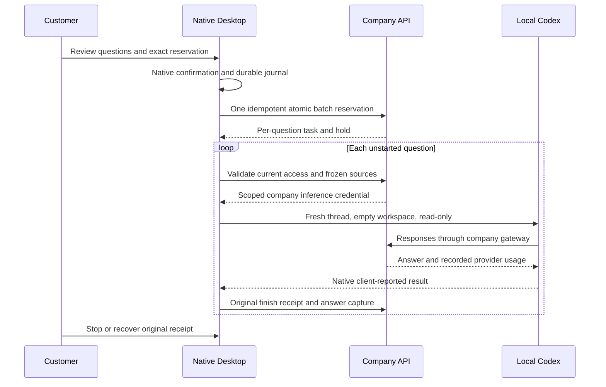
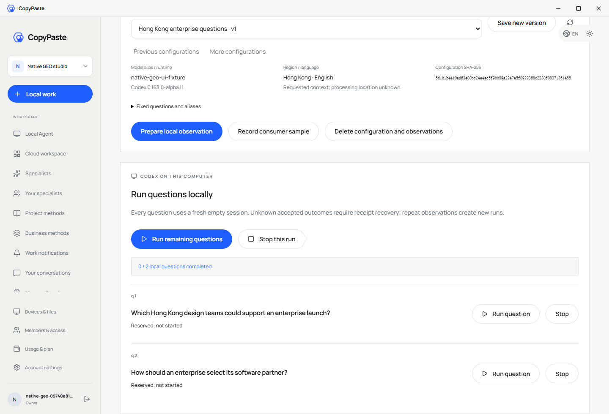
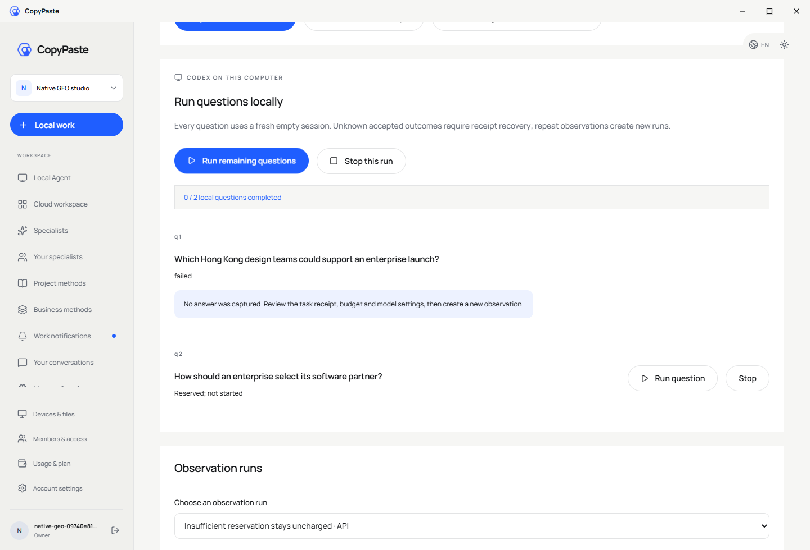
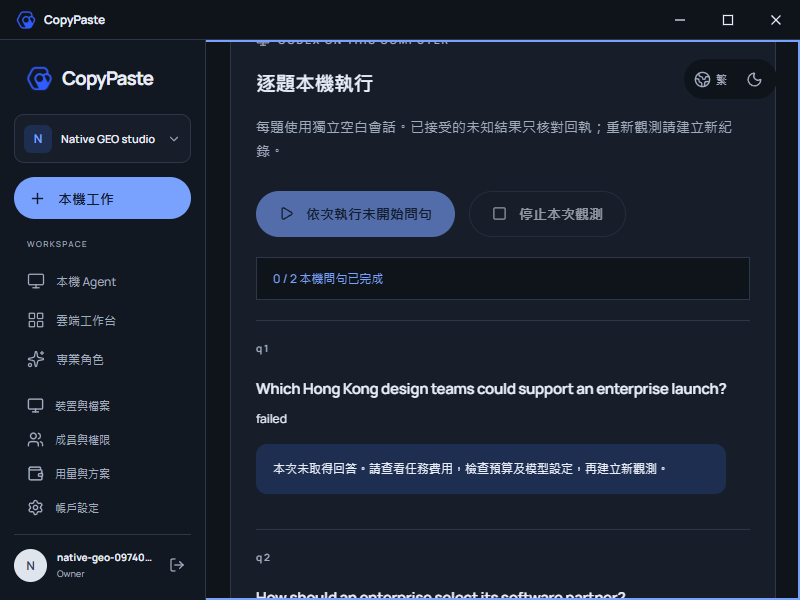
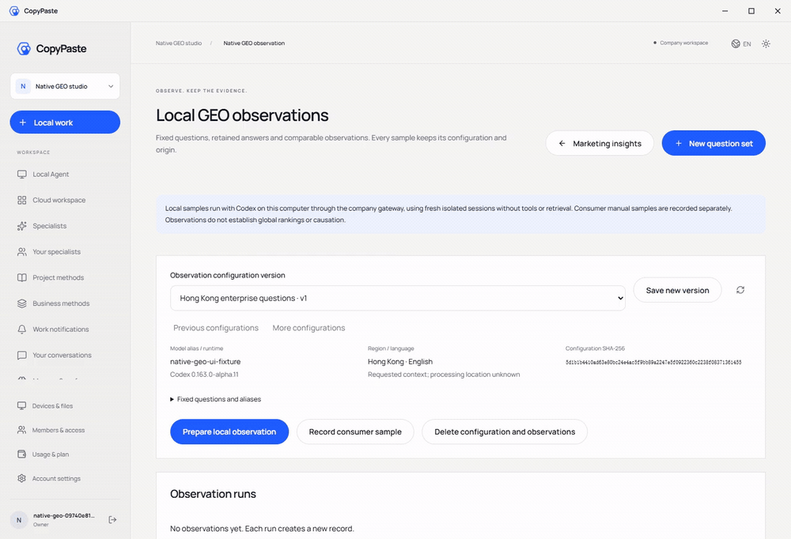

# Desktop 本机 GEO 观测 / Desktop-native GEO observations

本项补齐 Desktop 的本机 GEO 入口。现有 Web / Extension 云端观测与历史记录继续按原协议运行。此文件描述实现目标，验收结果须由本项独立测试凭证补充；不得据此宣称全产品完成或真实模型专业效果已经通过。

The Desktop runs each fixed question with its own local Codex process, empty workspace and fresh thread. All model traffic goes through the company gateway. Existing cloud and manual observations retain their original provenance.

## 绑定与执行 / Binding and execution

- 用户选择已固定的无品牌 Agent 问句集，核对每题和总预留金额，并通过本机确认卡授权。服务端原子预留整个问句集，每题绑定独立的本机会话、设备、登录授权族和工作目录摘要。
- 本机日志先落盘再请求预留。响应丢失时复用同一请求键核对，不创建替代任务；已进入本机运行但结果不明的问句只报告未知结果，不自动重跑。
- 每题使用空白工作目录、独立 Codex Home、只读授权和无工具的观测协议。禁用命令、浏览器、程序、公司业务工具、检索和项目指引；保留实验明确固定的角色、Agent 指令和 skills。
- Native task preparation never enqueues a cloud worker. Account changes, permission withdrawal and current server-side source or plan revocation remain execution barriers. Ordinary Desktop sessions retain their customer-granted full local access mode.

## 证据与界面 / Evidence and interface

- 显示逐题准备、运行、完成、失败及费用核对状态。保存实际原始回答、SHA-256、字面品牌命中及链接文本；不将字面命中解释为排名或因果结论。
- 新观测固定实际 Desktop 运行时、协议和执行位置；与云端的有效配置不同，比较时明确显示。重复观测新增运行，不覆盖历史。
- Reuse CopyPaste visual tokens, keyboard focus, bilingual copy and responsive layouts. Keep the frameless shell and hidden scrollbar rails while retaining wheel and keyboard scrolling. Include actual application screenshots and interaction recordings in the bilingual delivery READMEs.

## 验证范围 / Verification scope

新增 SQL 123，不改写 SQL 001–122、Stage83 原始契约或 Stage109 证据。测试必须覆盖真实原生 PostgreSQL、本机 Codex、原生授权与配额、无云端派发、无工具请求、独立线程、费用未知和撤权；实际 Electron 交互需独立留档。All qualifications use explicitly synthetic accounts and model responses until live service acceptance is authorized and configured.

## 接口与内部约束 / API and internal controls

[原生接口契约](../contracts/desktop-geo.openapi.json)单独补充 `desktop-configuration` 和 `desktop-runs`；原 GEO 契约保持原始字节。配置只返回本机审核需要的问句、模型、角色、版本与配额。批量请求严格校验问句顺序、独立会话和目录摘要、单设备、固定运行时及金额范围，并一次性完成预留和绑定。

运行时固定 `0.163.0-alpha.11` 及现有本机二进制 SHA-256。该内核仍声明 `request_user_input` 控制工具，即使关闭相关功能标志；公司网关沿用已存在的过滤逻辑，移除该声明，实际模型端收到 `tools: []`。其他工具声明直接拒绝；本机观测也禁止进入等待客户补充输入的分支。因此验证分别覆盖内核请求边界和公司服务实际收到的请求，不能混淆两者。

项目配置读取仍验证预算上限，但项目宣传指令不进入 GEO 任务。SQL 123 在保留既有绑定触发器的基础上校验原生协议、费用任务、原生执行记录和来源范围。普通 Desktop 全权限模式、Web 云端 GEO 和 Extension 云端入口均按各自协议验证。

本机日志包含整批原请求和幂等键；未知预留可以重取原凭证。已接受 turn 使用原线程完成回执核对，禁止重开观测。页面卸载或切换记录后，在开始下一题之前再次检查停止标志。当前账号、服务端授权族和本机授权必须共同满足执行条件。

本机回答资产使用 `native_client_reported_output` 来源标记；费用取公司凭证。回答中的链接是模型输出文本，不代表已抓取或独立核实该网页。字面提及、引用和同配置比较不代表市场排名或因果效果。

## 实际验证与交付 / Qualification and delivery

最终凭证为 [desktop-geo-checkpoint.json](../quality/desktop-geo-checkpoint.json)，绑定 1,851 个当前源码／契约文件。选用 `desktop-geo-core-03` 的九个后端测试文件（135 项）、Desktop 控制器测试（46 项）和真实固定版本 Codex 测试（20 项），以及 `desktop-geo-clients-03` 的 11 项构建／类型检查。全部通过，无取消、跳过或待办；仅覆盖本次相关功能，不扩称当前全平台回归。

最终实际桌面旅程 `desktop-geo-ui-05` 在新打包的无边框 Electron 内完成九项流程：浏览器邮箱登录与 PKCE 返回、工作区创建、固定问句表单、整批原生确认、独立本机推理、回答／费用保存、同配置重复比较、停止、预算不足退出及双语紧凑窗口检查。四个成功任务各结算 30 微额，三个未派发任务取消费用为零，一个预算不足任务在生成派发前失败且费用为零。四个成功回答使用四个不同的真实 Codex 线程；公司模型端实际收到 `tools: []`。

预算不足的负例使用每题 HKD 0.01；当前假模型的默认单次输出预留需要更高金额，实际返回 `AI_REQUEST_BUDGET_EXHAUSTED`。界面明确提示检查任务费用、预算和模型设置后新建观测，不重跑已接受的问题。正常完整流程采用每题 HKD 0.10，原生对话框确认两题合计 HKD 0.20。此金额是测试配置，不是对真实服务收费的承诺。

页面完成加载后，在实际 800×600 中文深色窗口验证无横向溢出、无滚动条轨道，并实际使用滚轮及 Home／End 键访问根滚动容器。五张截图等候字体及画面绘制，再由实际页面截图取得；GIF／MP4 来自实际窗口的连续录制。测试自建浏览器、Electron、API、模型夹具、预览服务与原生 PostgreSQL 均已关闭。

原生确认框使用明确的自动化答复夹具；没有声称人工点击、真实公司模型效果、真实支付或生产签名安装器通过。Stage106 的全量测试超时及其未改写复查仍保留原范围。本次不更改原 102 项需求、TC 和 G01–G10，也不把局部检查提升为完整产品验收。

此前的失败尝试与验证器保持原始字节，包括最低预算拒绝、误用扩展构建脚本及误将非滚动的 main 元素当作滚动容器的测试。最后仅对原生页面增加失败后的客户提示及刷新对应文件摘要；后端、本机控制器和内核源码保留核心测试时的字节。该页面改动由最终实际桌面流程与客户端构建重新验证，前后摘要在凭证的 `post_core_renderer_corrections` 中列明。

