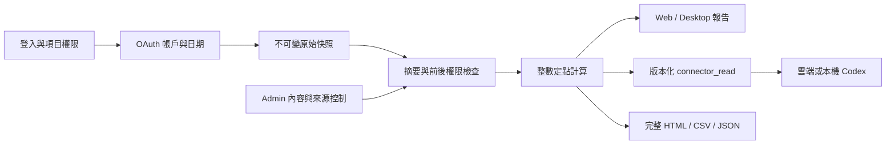

# 網站與搜尋分析報告實作

本增量將 GA4／Search Console 的原始連接快照接到可重算的網站報告。範圍固定為單一快照、帳戶、報告粒度及捕獲日期，提供流量、事件與搜尋表現的摘要、維度拆分和完整 HTML／CSV／JSON 下載。報告直接計算來源資料，不建立 AI 任務，不另外呼叫模型或加收 AI 費用；正常 Agent 對話仍依原有費用流程。

## 客戶使用流程

登入並建立企業／項目 → 在「連接應用」完成帳戶 OAuth → 確認可讀帳戶及項目 → 同步快照 → 開啟「來源快照」→「網站分析與報告」→ 選擇帳戶／報告、日期、可選維度 → 查看分析或下載。篩選器有未提交修改時，明示現有結果及下載仍使用已顯示範圍。分頁只限制畫面行數，三種下載包含當次範圍的完整分組。

Web 使用雲端帳戶及項目權限。Desktop 的同一報告頁使用原生登入憑證、公司 API 與專用下載橋接；桌面 Agent 仍在客戶本機執行 Codex。原生請求橋接支援 Search Console 的網址型屬性：只禁止路徑中的編碼分隔符，查詢參數可攜帶合法網址；兩種報告路由均僅允許 GET。Extension 維持瀏覽器右側原生 Side Panel，雲端角色可讀獲准快照並返回報告連結；完整連接與報告畫面使用既有公司 Web 入口。

## 計算規則

來源十進位最多 12 位小數，使用整數定點計算，禁止浮點貨幣累計；比率與加權排名以 8 位小數 HALF_UP。GA4 流量累計已捕獲行的 sessions、screenPageViews、keyEvents、totalRevenue；退款可以使 totalRevenue 為負，其他指標仍禁止負數。重要事件／工作階段明示為事件比值，不能稱為轉換率。

GA4 totalUsers 是不重複用戶：只有單一來源行可以展示其值，跨行、跨日、跨報告不得直接相加，返回 null／non_additive_unique_users。GA4 事件報告單獨保留 eventCount／keyEvents，不捏造流量或收入欄位。

搜尋 CTR = 合計 clicks ÷ 合計 impressions。排名 = Σ(position × impressions) ÷ Σ(impressions)，限定所捕獲的 byPage 行；不得將它說成 Search Console 全站的正式平均排名。零曝光行沒有排名不影響計算；有曝光卻缺排名時返回未知。Search Console 使用來源捕獲的 America/Los_Angeles 日期，保留 top rows、匿名查詢省略及平台覆蓋限制。無返回行、缺失指標、零分母分別標示；沒有記錄的日期不補零。

帳戶、報告、幣種及時區由凍結查詢規格決定。檢查原始檔案 SHA-256、規格摘要、狀態、資料模式、行數、項目綁定、來源行鍵與重複維度。拒絕錯誤粒度、越界日期和跨帳戶混算。計算摘要覆蓋完整來源、選擇、摘要、分組及限制，分頁不改變摘要。最多 10,000 個分組、完整輸出最多 8 MiB。

## 權限與生命週期

新增兩條唯讀 GET 路由，沿用現有快照讀取與內容權限，見[附加 API 合約](../contracts/web-analytics.openapi.json)。讀檔前後均重查權限與來源有效性；輸出前取得短暫來源共享鎖，來源正在變更則拒絕並要求重載。路徑項目、租戶與實際來源必須一致。隔離、刪除、清除、過期或撤權的來源不再可讀。斷開 OAuth 停止未來同步，原有快照依保留政策繼續存在。

回應 private, no-store、nosniff；下載要求當下登入與同等權限。HTML 為獨立靜態檔案，轉義來源字串，無腳本、無外部資源並提供限制性 CSP。CSV 沿用既有公式注入防護，對有風險首字元加入文字前綴；需要未修飾的機器值時使用 JSON。已下載到客戶電腦的離線檔案無法由服務端收回。

## 角色版本與各端邊界

marketing-analyst 升級為 1.2.0，新增 web-analytics@1.0.0 skill，沿用 connector.read。新版本 connector_read 可攜帶 analysis 選擇並返回受控分頁及需授權的完整報告連結；工具每頁最多兩個分組，避免巨大模型輸出。1.1.0 角色及原始工具描述／輸入合約保持原樣，舊任務不自動變更版本。新發布仍標記 pending_live_validation，沒有把合成模型測試當作專業能力驗收。本機只讀模式允許 connector_read，但仍由公司服務逐次核對項目及來源權限；不因此開啟公司寫入工具。

Admin 沿用來源隔離、保留期限、項目／成員／帳戶控制；這輪不引入另一套網站資料授權。報告頁定期重新核對，失去權限後清除目前結果並顯示錯誤。

## 指標依據

GA4 指標與退款：[官方 Data API schema](https://developers.google.com/analytics/devguides/reporting/data/v1/api-schema)；到達頁與工作階段：[官方 sessions 說明](https://developers.google.com/analytics/devguides/collection/ga4/sessions)。搜尋分組、CTR／position 與日期：[Search Analytics query](https://developers.google.com/webmaster-tools/v1/searchanalytics/query)；來源返回行與分組限制：[取得搜尋資料](https://developers.google.com/webmaster-tools/v1/how-tos/all-your-data)。加權計算是本系統對已捕獲行的確定性推導，不是對平台未返回資料的估算。

## 驗證範圍

驗證結果以後續本輪不可覆寫的原始報告及 checkpoint 為準。使用獲准的假帳戶、假資料與假模型驗證流程；真實供應商帳戶、模型效果、正式安裝簽名及原始全產品驗收不因此視為完成。原始 REQ／TC 與 G01–G10 條件不刪減。
