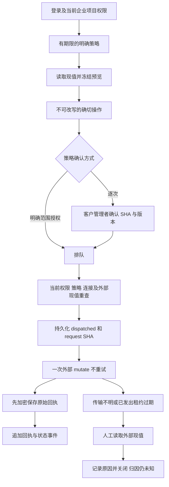

# Google Ads 预算执行与异常回执

本次将 marketing 连接器由报表读取扩展到一项有边界的外部操作：Google Ads 非共享 STANDARD / DAILY 预算的平均每日金额修改。Web 和 Desktop 提供策略、确切预览、人工确认、历史、回执及未知结果核对；Admin 提供独立的范围、策略和异常处理权限。Codex 是唯一 Agent 内核。模型、广告账户及操作验收使用用户允许的假数据，未连接真实广告账户或产生真实广告费。

## 使用路径

客户登录并选择企业和项目，在「连接应用」完成 Google Ads OAuth、选择广告主账户、确认项目绑定，再打开「管理预算与操作」。默认没有执行策略，因此 OAuth 并不直接允许预算变更。项目 owner/admin 可以保存有期限的账户策略：唯一预算 ID 白名单、账户币种、平均每日上限、单次差额上限及确认方式。期限为未来最多 30 天，默认逐次由客户管理者确认；选择范围内自动执行时，界面另需明确授权。

客户输入预算 ID 和新金额后先读外部现值。服务保存不可修改、绑定当前用户授权版本的预览，展示现值、新值、策略版本与有效期。金额或预算输入变化会清除旧预览。预览最长 10 分钟，每用户／项目最多 100 个未过期预览。提交操作只接受原 preview_id、source SHA 和原目标／金额，重复创建返回原操作的当前状态。待执行操作最长 15 分钟且不超过策略到期时间。

逐次确认只能由当前客户管理者对确切 payload SHA 和 operation version 完成。普通项目成员可在具有写入权时提案；Codex 和平台 Admin 无法冒充客户确认。策略明确允许范围内执行时，满足相同校验的提案直接排队。修改策略会取消旧策略下尚未发出的操作。取消只适用于 awaiting_confirmation、queued、checking。

Desktop 使用客户本机 Codex 和已授权的公司 API bridge；完整权限仍由客户主动授予和撤回。广告连接器凭证保留在服务器，AI 请求继续走公司内部 OpenAI 兼容接口。本地完整权限不会免除服务器预算策略。Extension 维持原生 Chrome 右 Side Panel、云端 Codex 与获准附件上传；新版角色可在现有云端任务中使用预算工具，完整预算管理界面从公司 Web 入口打开。

## 执行与持久化



迁移 124 增加 policies、previews、operations、receipts、events。策略、回执及事件为追加记录；预览不可更新。操作身份、冻结 specification、确认人与 request SHA 由数据库触发器限制，状态变迁和版本递增同样由数据库限制。RLS 按企业与 data_mode 强制隔离；cp_app 对业务事实只有读取能力。tenant/account/budget 的未解决目标唯一约束跨项目、连接生效，换连接不能绕过未明操作。

worker 用 SKIP LOCKED 领取 queued，checking 阶段重新核对创建人及确认人的当前权限、所属项目、连接绑定与凭证版本、配置指纹、策略版本及期限、任务状态。远端现值 SHA 必须与预览一致。新旧金额相同记为 no_change，不发 mutate。通过最终校验后先提交 dispatched、lease token、request SHA，再向固定 Google Ads campaignBudgets:mutate 发出一次请求：一项 update、amount_micros mask、partialFailure=false、validateOnly=false、MUTABLE_RESOURCE 回应。无通用重试逻辑。

回执只有在资源名、金额、请求 SHA 和 mutable resource 均相符时才证明 succeeded。已知原子拒绝为 failed；传输中断、模糊响应或已发出请求的租约过期为 unknown。checking 租约到期属于发出前失败。unknown 不回排队，也不能直接取消后重发。用户须读取当前值、在十分钟内引用该 observation SHA，填写原因并明确接受归因未知，才能 closed_unknown。现值等于目标不构成原请求成功的因果证明。

收到已知回应后，先以主密钥 AEAD 加密写入 DATA_DIR/external-budget-receipts，独占临时文件、fsync 后原子改名；再写数据库。数据库失败时恢复进程只补记相同原回执，绝不重发外部修改。文件路径拒绝目录／文件符号链接，绑定 tenant、project、operation、lease、payload、request SHA 和环境，文件上限 2 MiB。异常文件保留并记录脱敏错误。若文件系统与数据库同时故障，仍可能只保留 dispatched／unknown；系统不虚构成功或 exactly-once 外部保证。

## Admin 控制

新增权限为 admin.external_budget.read、admin.external_budget.policy.write、admin.external_budget.resolve，均支持 global／tenant／project 范围，显式 deny 优先。每次请求及观察前后重新校验当前管理者与近期十分钟 MFA；列表按有效范围生成 SQL，策略和回执读写均审计。货币有上限的旧管理授权按 HKD 解释；非 HKD 账户需要匹配且没有金额上限的授权，禁止直接重用数值换算成其他币种。

后台可查操作、不可改写回执及时间线，可追加策略版本、取消未发出操作、观察并记录关闭未知结果。后台不存在客户确认 endpoint。旧管理员角色不会自动获得新权限。已经存在的部署由本地运维明确执行下面命令，为已启用、完成登记、永久全局 super 且无相交 deny 的管理员追加一个独立 operator binding；命令有审计并要求以下明确参数，不覆盖旧角色：

```powershell
# 在 dev/copypaste-platform 内运行，先使用正常运维配置完成迁移。
npm run admin:enable-external-budget -- operator@example.com --acknowledge-global-budget-authority
```

## 版本与接口

marketing-analyst 1.3.0 增加 external-budget@1.0.0 和 connector.budget.read／prepare。保留旧 1.2.0 的完整角色与 Skill digest，不自动扩大历史 Agent 权限。新工具 external_budget_preview、external_budget_prepare、external_budget_status 均由当前任务权限约束；ask／plan 和 Desktop read-only 只允许 preview／status。没有让模型修改策略或自行确认的工具。原生 pinned Codex 与合成模型分别验证只读拒绝 prepare、完整模式只能形成等待确认的操作。

完整请求、响应、18 条路由及执行边界见 [OpenAPI](../contracts/external-budget.openapi.json)。后端保留规范摘要和 schemas mirror，路由以 additive contract 发布，不重写历史快照。

## 外部系统边界

Google Ads 平均每日预算不是每日最高扣款，广告实际费用由 Google 向广告账户收取，平台 AI 账单独立。直接点击预算面板不产生额外模型调用、AI 任务或 AI 费用；Codex 任务本身继续使用既有任务预算及模型计费。

Google Ads 不提供在此更新流程中锁定远程预算对象的 CAS。最终读取到 mutate 之间若有其他操作者修改，平台无法排除竞争。因此保证当前权限入场、固定请求一次发送及真实回执留存，不能承诺其他平台或人工并发的全局事务。权限撤回以 dispatched 入场提交为边界；已准入且即将发出的请求无法由后来的撤回强制收回。Meta 本次维持 ads_read，没有添加投放或广告发布权限。

## 验证与证据

[本轮检查点](../quality/external-budget-checkpoint.json) 记录最终通过的后端、真实本机 Codex、客户端构建及实际 Web／Admin／未签名 Desktop 流程。所有已执行验证脚本与失败尝试逐份保留；失败不得覆盖成通过。媒体为实际界面截图、GIF 和 MP4，账户和提供商回应明确为合成数据。原 102 项需求／用例及 G01–G10 不因本项局部交付改写为完整验收。

本功能不代表真实公司模型、真实 Google Ads 账户、广告费、Meta 写入、商店审核、正式签名或全产品验收已完成。

## 官方依据

- [预算建立与共享属性](https://developers.google.com/google-ads/api/docs/campaigns/budgets/create-budgets)：默认共享属性需明确核对，本功能仅接受非共享预算。
- [CampaignBudget 字段](https://developers.google.com/google-ads/api/fields/v26/campaign_budget)：amount_micros、period、status、type 及 reference_count。
- [MutateCampaignBudgetsRequest](https://developers.google.com/google-ads/api/reference/rpc/v26/MutateCampaignBudgetsRequest)：原子失败、验证模式及回应内容。
- [MutateCampaignBudgetResult](https://developers.google.com/google-ads/api/reference/rpc/v26/MutateCampaignBudgetResult)：mutable resource 回执条件。
- [API 并发结构](https://developers.google.com/google-ads/api/docs/concepts/api-structure)：远端对象更新的并发限制。

## English operating summary

Authorize a synthetic or configured Google Ads advertiser, bind it to the current project, and explicitly enable a short-lived budget policy. Read and freeze the exact before/after amount, submit the original preview, and obtain customer-manager confirmation unless execution within that exact policy was explicitly authorized. The worker rechecks source and authority, persists dispatch admission, and sends one atomic fixed-field mutation. Known replies are encrypted before database persistence; recovery records the original reply without sending again. Unknown outcomes require a fresh observation and an explicit manual closure that retains unknown attribution. Admin uses separate read, policy-write and resolution permissions plus current MFA, and cannot impersonate customer confirmation. Only local Codex operates the Desktop Agent; all AI uses the company gateway.
