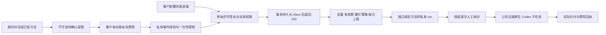

# 私有云端事件工作 / Private signed event workflows

本增量落实 REQ-033 中的正式事件触发，复用既有私有流程、项目授权、子任务计费与人工审批。Web 与 Chrome 原生右侧 Side Panel 使用公司云端 Codex；Desktop 继续使用客户本机 Codex 和本机流程。所有模型流量仍经公司 OpenAI 兼容网关。验证中的模型、客户和外部发送端使用明确的假数据，数据库、浏览器和标明的 Codex 进程使用真实原生运行时。

This increment implements formal event triggering for existing private cloud workflows. It retains project authorization, child-task accounting and per-run human review. Desktop remains customer-local. Synthetic model responses do not qualify live models or provider accounts.

## 用户路径

客户可在流程顾问对话中说明事件类型、固定输入、预期交付、每日额度时区、起止时间、最短间隔、每日次数、事件有效期和繁忙策略。也可从已有私有流程的运行记录选择“由事件启动”。系统先保存待确认提案，不启用、不预留全部未来费用、不向外部发送请求。

客户核对固定流程版本、角色与 Skill 摘要、输入版本、每次 Agent 预算及每日预算，明确勾选后启用。顾问来源任务必须已成功完成，来源资料须仍可访问。每日预算为固定流程中各 Codex 步骤预算之和乘每日最大次数；实际子任务仍按原计费逻辑预留和结算。顾问准备费用另计。固定数据不会自动变成实时数据；需要新的数据版本时应修订流程。

启用返回接收地址、密钥版本和一次性签名密钥。界面默认遮住密钥，客户可明确显示或复制。密钥只保存在当前界面状态中，不写浏览器持久存储、对话或日志。幂等重试响应不再次返回密钥；响应丢失或密钥遗失须明确轮换，旧密钥立即失效。客户自行把密钥配置到受其控制的发送端，模型没有取密钥、签名、启用或批准费用的工具。

Web 提供提案、启用、拒绝、修订、确认后恢复、暂停、停止、轮换、事件游标分页、固定方法版本、签名示例及指向实际流程运行的链接。原生 Side Panel 提供对话提案确认、密钥管理、事件分页、暂停和停止；完整方法编辑及恢复在 Web 工作区进行。它不启动本地 Agent。来源撤回、访问失败、切换项目和退出登录清除不可再访问的私有视图。

## 签名协议

这是 **Workmate 自有接收协议**，不表示已支持 Google、Meta、Stripe 或其他平台的原生 Webhook 签名。客户控制的适配发送端须按下述格式签名并发送 UTF-8 JSON。生产接收地址使用公司部署的 HTTPS Origin。

```text
POST /v1/hooks/workflow-events/<trigger_uuid>
Content-Type: application/json
X-Workmate-Key-Version: <positive_integer>
X-Workmate-Timestamp: <10-digit_unix_seconds>
X-Workmate-Signature: v1=<lowercase_HMAC_SHA256_hex>

HMAC input bytes = UTF8(
  "workmate.event.v1\n" + trigger_uuid + "\n" +
  key_version + "\n" + timestamp + "\n"
) + exact_original_request_body_bytes
```

```json
{
  "event_id": "campaign-brief-001",
  "event_type": "campaign.ready",
  "occurred_at": "2026-10-27T08:00:00.000Z",
  "data": { "brief": "Review the authorized campaign evidence" }
}
```

时间戳允许前后五分钟误差。签名绑定触发器 ID 与密钥版本，按原始请求字节计算；不能在验签前反序列化后重新序列化。JSON 最多 32 KiB；data 最多六层、300 个值、每字符串 4,000 字符、每键 80 字符，拒绝特殊原型键和非有限数值。上述补充限制由实际解析器验证。event_id 仅允许字母、数字、点、下划线、冒号和连字符，最长 128 字符；event_type 为 3–80 字符的小写类别标识。

同一触发器的 event_id 全局去重，包括旧方法版本与旧密钥版本的已接收事件。完全相同的原始字节返回原回执；相同 ID、不同原始字节返回 409。重试可重新生成当前时间戳和签名，但必须保留原始内容与 ID。轮换后使用新版本密钥签名。生产规则同时限制入口请求频率、每触发器每分钟 120 个新事件和 100 条 pending 事件；429 时按同一 ID／原始内容稍后重试。202 表示持久化回执成功，不代表工作已完成。

错误签名不保存 inbox。有效签名仍需检查当前账户、项目权限、授权版本及来源资料可访问性；撤权返回不可用，不能通过旧签名继续收集内容。未生效、已暂停、不匹配类型或已过期的合法新事件保留明确的忽略／过期回执，不启动工作。

## 执行与并发



后台每批扫描最多 20 个规则，以 last_checked_at 轮转，避免一直繁忙的前几个规则饿死其他规则。事务先取得用户权限锁，再取得规则行锁。并发实例对同一规则串行化；inbox 的 launched 变更及独立 run 创建在同一事务提交。

同一规则跨方法版本最多一个未解决运行。检查包括 running／awaiting_approval 的流程，以及 queued、running、paused、awaiting_approval、needs_input、reconciling 的子任务。skip 在繁忙或未到最短间隔时保存 skipped_overlap；latest 将旧 pending 标为 coalesced，只保留最新一条，待当前运行和最短间隔允许后执行。保留事件仍受原有效期限制。

每日次数和预算按客户确认的 IANA 时区统计。修订方法不会清空当日已执行次数或先前版本的授权预算；新运行须同时满足当前版本次数和累计预算上限。失败停止未来调度并标明需核对，不能自动重放未知结果或费用。恢复需要新的不可变提案和客户确认，并在旧运行已解决后创建新方法 revision；旧回执和旧 run 不改绑。

事件 data 只作为先前步骤回执中的不可信证据传给既有流程引擎，不改变固定步骤、角色、工具、输入版本和预算。流程引擎保留人工审批；每个真正调用的子任务使用现有预留、结算、取消和对账逻辑。对外邮件、消息、广告写入或发布仍须各自已有的客户配置与授权；一个签名事件本身不授予这些权限。

## 数据约束与删除

只新增向前迁移 `126-private-cloud-events.sql`，SQL001–125 保持原字节。五张表保存待确认请求、规则、不可变方法版本、加密密钥及 inbox。租户和 private_owner 双重 RLS；队列身份没有访问权；应用身份不能插入 inbox。公开入口只有通过签名与当前权限核查后才使用控制身份保存 inbox。

密钥使用公司 MASTER_KEY 认证加密，明文内部绑定触发器 ID 与密钥版本，防止跨规则调换密文。密钥只能撤销，不能改写；旧密钥清除密文。提案和版本的固定事实不可变；已终态回执不能重写。workflow_runs 额外绑定触发器、方法版本和唯一 inbox，SQL 触发器核对原确认请求、原始任务、精确已发布方法、角色摘要及当前规则状态，禁止伪造或改绑。

删除来源任务或方法会级联清除相关提案正文、方法正文、事件 data、密钥密文及包含其引用的幂等响应，并保留已撤回的幂等墓碑。周期清理也处理来源保留期到期。审计和不含正文的身份、原始内容摘要、状态及财务绑定按既有策略保留。新表随原生备份进入快照；任务删除标记的恢复重放同样触发级联。恢复环境仍受双重执行隔离约束，不自动重启事件。 原生恢复回归同时检查保留规则及其加密密钥／事件事实，并在旧快照中重放较新的来源删除，核对五张事件表、幂等响应墓碑及三个服务身份的 CONNECT 隔离。备份测试逐一核对全部当前迁移版本与 SQL 原始摘要，避免把升级后的版本数量写死为旧值。

## 后台与角色

Admin 提供分页、状态筛选、规则／企业／项目／用户 ID、状态、控制版本、方法与密钥版本、每次及每日预算、待处理数量、错误码与创建时间。需要当前十分钟内 MFA 和范围内 `admin.execution.read`，显式 deny 优先。不会返回规则名称、事件类型、正文、来源引用、接收地址或密钥。

暂停另需 `admin.execution.pause`、原因及精确控制版本，记录审计。暂停未来事件，保留已启动工作。后台没有代用户恢复、确认费用、获取密钥或修改私有内容的事件接口；相关完整用户、余额和 VIP 管理由现有专属权限模块处理。

流程顾问通过加法发布升为 `1.3.0`，增加产品 Skill `workflow-events@1.0.0`，保留所有先前角色／Skill 摘要和模型、工具授权。仅 Web／Extension 云端版本得到 `workflow_event_preview`、`workflow_event_request`、`workflow_event_status`；只读任务不获得 request。Desktop 继续保留已有本机流程工具，新 Skill 明确本机执行约束。

## 验证与交付边界

确切的选用测试、真实浏览器截图、录制及源代码摘要以 [本增量核查凭证](../quality/cloud-events-checkpoint.json) 为准；未形成该凭证前不得视为通过。所有失败尝试的原始报告及当时源代码保留。接口规范由实际运行时 Zod schema 导出到 [OpenAPI](../contracts/cloud-events.openapi.json)。

本项不宣称真实商业模型、真实广告账户原生事件适配或完整产品验收通过。原 102 项需求、TC、G01–G10 和其他未满足业务要求继续有效。本增量也不扩大之前原生恢复关于生产切换、异地耐久性、PITR、RPO／RTO 的验收结论。


## 本机复现 / Native reproduction

在 `dev/copypaste-delivery/` 中使用新的两位尝试编号（不可覆盖旧报告）运行：

```powershell
node scripts/run-cloud-events-v1.mjs NN focused
node scripts/run-cloud-events-v1.mjs NN core
node scripts/run-cloud-events-v1.mjs NN clients
node scripts/run-cloud-events-ui-v4.mjs NN
```

`focused` 覆盖全部事件业务和真实备份／删除重放；`core` 同时复查既有计划、流程、来源、登录及迁移和恢复；`clients` 对六个仓库关联的客户端与服务端执行 13 项构建／类型检查。UI 使用独立原生 PostgreSQL、动态端口、真实登录及 PKCE 和锁定版 Codex。原生 Side Panel 使用已经置备的 Chrome for Testing，避免正式版 Chrome 对开发扩展启动参数的限制。页面内容和回执在测试中真实产生，模型及事件发送端为假数据。结束关闭本轮创建的浏览器、右侧栏、预览服务和数据库，保留用户原有实例；不使用 Docker／WSL。

Every attempt retains exact source bytes, verifier versions and raw logs, including unsuccessful attempts. Do not modify implementation files while a frozen qualification is running. Pick the resulting report identifiers and hashes from the checkpoint instead of treating an older successful UI run as validation of newer source.
