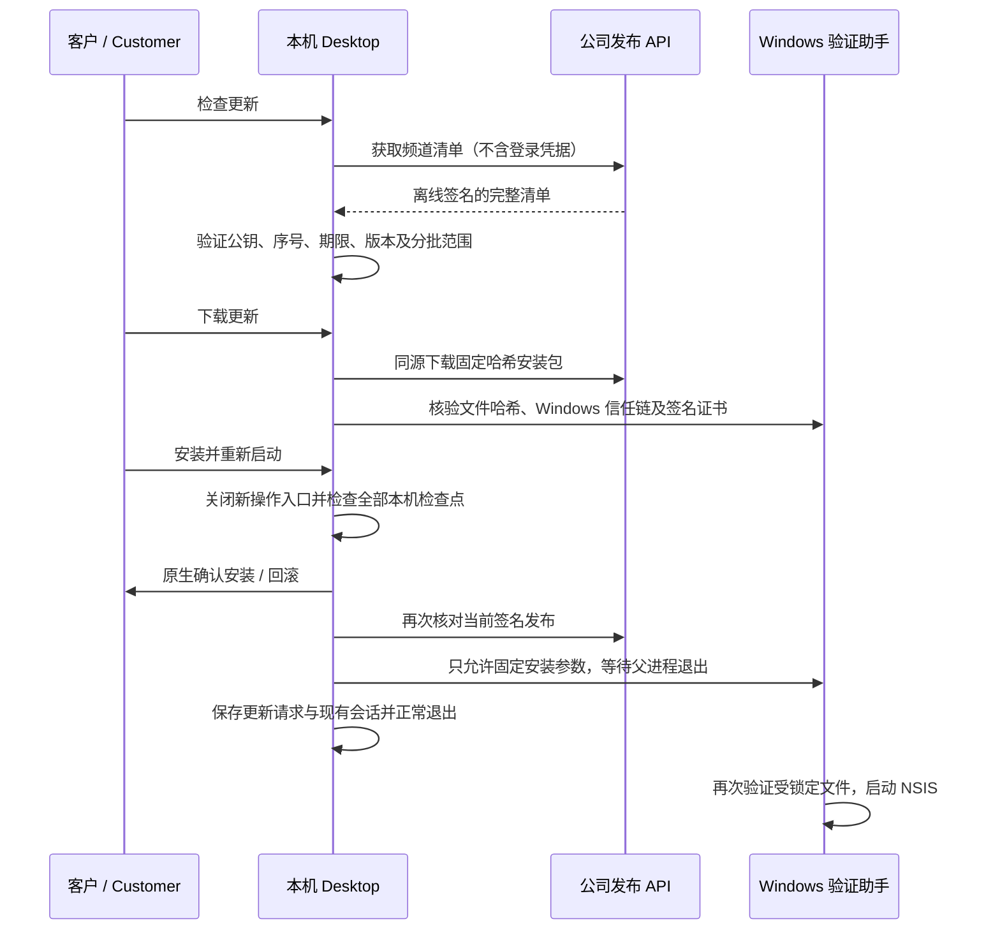

# Desktop 受控更新 / Controlled Desktop updates

本增量实现原需求 REQ-039、REQ-054 与端侧模块第 5 节中的应用内更新链路。Desktop 继续在客户本机运行 Codex；Web 和 Extension 继续使用云端 Codex。更新服务不接触客户的 AI 密钥、文件授权、费用或 VIP 权益。

## 客户操作

无须登录，在无边框标题栏点击更新按钮即可打开更新页面；登录后也能从账户设置进入。页面沿用 CopyPaste 蓝、白、圆角、字重和深浅主题，支持繁体中文与英文。隐藏滚动条，同时保留真实下载进度、滚轮及键盘滚动，不允许横向溢出。

用户依次选择“检查更新”“下载更新”“安装并重新启动”。不自动安装，也不自动终止工作。安装前须完成或停止本机任务、处理待确认输入和不确定结果、完成费用结算、暂停目录自动工作，并关闭 Agent 持有的浏览器及程序资源。正在执行的 IPC 或目录调度同样阻止安装。校验失败后恢复操作入口，不修改原始用户文件及会话授权。

开发与可携版本可检查、下载、校验及移除更新，但不执行应用内安装。正式安装版本还必须找到本安装目录中的 NSIS 卸载入口。当前实现面向 Windows x64；没有将这项实现计作 macOS 安装验收。



## 发布协议与信任根

`copypaste-desktop-update-v1` 使用 Ed25519 对按键名字典序排列的紧凑 JSON payload 签名。`key_id` 必须等于 SPKI 公钥 DER 的 SHA-256。服务器和客户端分别验证固定 app id、平台、频道、严格三段数字版本、字节数、SHA-256、Windows 签名证书 SHA-256、双语说明、分批比例、签发/到期时间以及动作。有效期最多 31 天，未来签发容差 5 分钟。

`install` 只接受升级；`rollback` 只允许用户确认降级；`withdraw` 的 release 必须为空。回滚和撤回需要新的、更高的离线签名序号，不能直接切换回旧清单。客户端加密保存每个频道已观察的最高序号及清单哈希；同序号不同正文也拒绝。清单一旦过期、缺失、被替换或撤回，之前下载的文件不能取得安装资格。

`rollout_basis_points` 为 0–10000。客户端使用持久化的随机安装 ID 和固定应用/频道计算稳定分组；不使用邮箱、租户、消费或设备文件生成分组。调整分批范围须重新签名并增加序号。回滚/撤回覆盖整个频道。

生产安装版本只接受构建时固定的公钥与最低序号，不允许环境变量替换。未配置公钥时只禁用更新，工作区仍可使用。`COPYPASTE_DEV_UPDATE_TRUST_FILE` 仅用于未打包的开发程序，读取显式的公钥文件；已打包程序忽略它。不得把测试密钥设为生产默认信任根。

## 后台与权限

Admin 新增 Desktop 发布面板：选择频道、暂存已签名清单、分块上传/继续上传、校验文件、核对发布范围、填写原因、确认发布、查看当前头和历史。历史按最新序号分页，发布记录不可修改或删除。后台不生成或保存离线私钥。

`admin.desktop_updates.read`、`stage`、`publish` 是独立的全局权限。三者都要求 10 分钟内 MFA；任何重叠 deny 优先。租户/项目授权不能发全平台安装包。数据库对普通用户与队列角色撤销这些表的访问。全局授权、新安装 bootstrap 和旧安装显式升级分开，旧管理员不自动取得新权限。

旧安装授权由已注册的永久全局 super admin 在运维命令中显式完成：

```powershell
npm run admin:enable-desktop-updates -- admin@example.com --acknowledge-global-desktop-release-control
```

命令验证现有角色定义，禁止覆盖权限漂移，记录审计，并撤销旧管理员会话，要求重新登录。常规分工可以只委派 read、stage 或 publish 中的一项；具备多项权限的同一管理员可以完成发布，当前没有宣称双人会签已强制执行。

上传使用固定 4 MiB 分块、严格大小和逐块哈希，最后一块可更短。聚合时重新读取每个块、核对总长度/哈希和 Windows 文件头，再原子保存。重复块必须完全相同；冲突不会覆盖已接受数据。发布再次流式核对磁盘实际字节；不接收管理员提供的任意服务器路径、下载域名或执行参数。

暂存和发布要求幂等键；发布还须匹配当前 revision 与完整签名清单哈希。频道锁和行锁防止并发覆盖。每次发布追加不可变记录，保留上一个发布 ID、操作者、原因和时间。撤回也遵循完整签名和权限流程。

## 原生下载与安装

清单与安装包只能来自已配置公司的 API origin。使用无凭据请求、拒绝重定向、限定响应大小/时间、检查下载实际字节，取消和失败删除本次临时文件。缓存目录位于应用自己的 userData 下，拒绝链接/路径别名，文件名仅由已签名哈希生成。删除下载不删除用户原有目录，反重放序号仍保留。

Windows 原生助手使用 `WinVerifyTrust` 检查 Authenticode 信任链和吊销状态，再比较实际证书 DER 的 SHA-256。不能用有效的清单签名代替 Windows 信任链。网络/吊销不可验证时拒绝安装。核查助手持有 `FileShare.Read` 句柄，阻止文件在验证与启动之间写入、改名或删除。安装路径及 `/S --updated --force-run` 参数由主进程固定，renderer 不能提供命令行。显式 `--force-run` 对应锁定版 NSIS 的静默安装后启动条件，保证“安装并重新启动”的意图。启动前要求精确 `COMMIT` 握手；助手等待原应用退出后再核验并启动，60 秒内未退出则停止。

安装请求先记录目标版本、序号和请求时间，不将“已请求安装”冒充安装完成。原生会话仍沿用原检查点与不确定结果处理，升级不会自动重跑费用未知的任务或恢复撤回权限。目录自动工作在应用重启后仍需客户再次启用。

## 运维构建

服务器配置 `DESKTOP_UPDATE_PUBLIC_KEYS`（key id 到 PEM 的 JSON）及 `DESKTOP_UPDATE_MIN_SEQUENCE`；客户端构建使用显式的 `COPYPASTE_UPDATE_TRUST_FILE` 文件，其中只有 `keys` 与 `minimumSequence`。这些值是公钥配置，不含模型密钥。

`npm run package:release` 要求显式公钥文件、正整数最低序号及 Windows 签名凭据，启用 electron-builder 的强制代码签名。普通 `package` / `package:dir` 保留开发验证用途，不视作已签署生产发行。不得把开发构建当作公司已签名安装包交付。

所有打包命令还需要显式 `COPYPASTE_LOCAL_CODEX_BIN`，指向符合 `contracts/local-codex-runtime.json` 的本机 `codex.exe` 及同目录配套助手；不会从 PATH 猜测或自动下载。当前工作区的锁定副本位于 `dev/copypaste-desktop/.data/runtime/windows-x64/codex.exe`。本次开发包单独生成到 `dev/copypaste-desktop/release/desktop-updates-116-final/`，保留此前版本，输出 0.6.0 Setup 和 Portable；这些是未签名开发交付，不具备正式更新发行资格。

离线操作员先构建并签署 Windows 安装包，再根据实际文件长度、SHA-256 和签名证书 SHA-256 准备 payload，使用单独保管的 Ed25519 私钥签名：

```powershell
npm run desktop-update:sign -- --payload payload.json --private-key offline-release.pem --out signed-release.json
```

输出文件采用排他创建，不覆盖旧签名清单。将签名清单和对应安装包交给获授权的发布管理员；不将私钥提交 Git 或上传 Admin。轮换信任根需要先发布包含新旧公钥的已签名客户端，再迁移发布签名，最后通过新客户端撤销旧公钥。灾难恢复后须保持客户端最高序号约束，必要时使用新签名序号发布，不能要求客户清除反重放状态。

## 备份与恢复

SQL001–126 不变，只追加 SQL127。数据库备份包含不可变的发布定义/历史。加密原生归档增加严格受限的 `desktop_update` 条目，包含 ready/published 安装包及其完整长度/哈希；同哈希只归档一次。恢复重新校验归档，复制到隔离环境，保持原发布头。未完成上传的块不归档，恢复时清除其“已上传”块索引，以便重新上传；签名定义继续保留。恢复环境仍由原有 quarantine/CONNECT 栅栏保护，不会自行成为生产发布服务。

## 核查与范围

选择的源代码、原始测试输出、失败尝试、截图与实际交互录制由 `docs/quality/desktop-updates-final-checkpoint.json` 统一引用。当前选定回归为 64 项后台、96 项桌面单元及 22 项本机 Codex 检查，全部通过，无跳过或取消；13 项构建／类型检查、4 条真实 Admin／Electron 流程、5 种布局、5 张截图及 2 组 GIF／MP4 通过。记录工具从完整 TAP 和原始 UI 报告核对数字，分别标明惰性签名文件与公司正式安装包的验证范围。

Windows 信任链的正向测试使用本机真实已签名 Node 文件，并验证签名证书不符、哈希不符、未签名文件和未确认握手会被拒绝。该文件只是不会运行的测试素材，不是产品安装器。应用内发布/下载核查通过真实 Admin、API、原生 Electron 主进程和 `WinVerifyTrust`。当前未提供公司代码签名凭据，因此不宣称已完成真实公司签名的产品安装/升级/回滚、跨版本数据恢复或 macOS 验收。模型仍按已授权方式使用假数据。

原 102 项 REQ/TC 与 G01–G10 保持原编号、条件和判定；本增量不把单项更新核查等同于整产品商业上线验收。

依据：[Microsoft WINTRUST_FILE_INFO](https://learn.microsoft.com/en-us/windows/win32/api/wintrust/ns-wintrust-wintrust_file_info)、[Microsoft WinVerifyTrust](https://learn.microsoft.com/en-us/windows/win32/api/wintrust/nf-wintrust-winverifytrust)、[electron-builder NSIS](https://www.electron.build/docs/nsis/)。精确运行协议以两个端中逐字相同的 `desktop-update-contract.ts`、原生助手源代码和 [OpenAPI](../contracts/desktop-updates.openapi.json) 为准。
