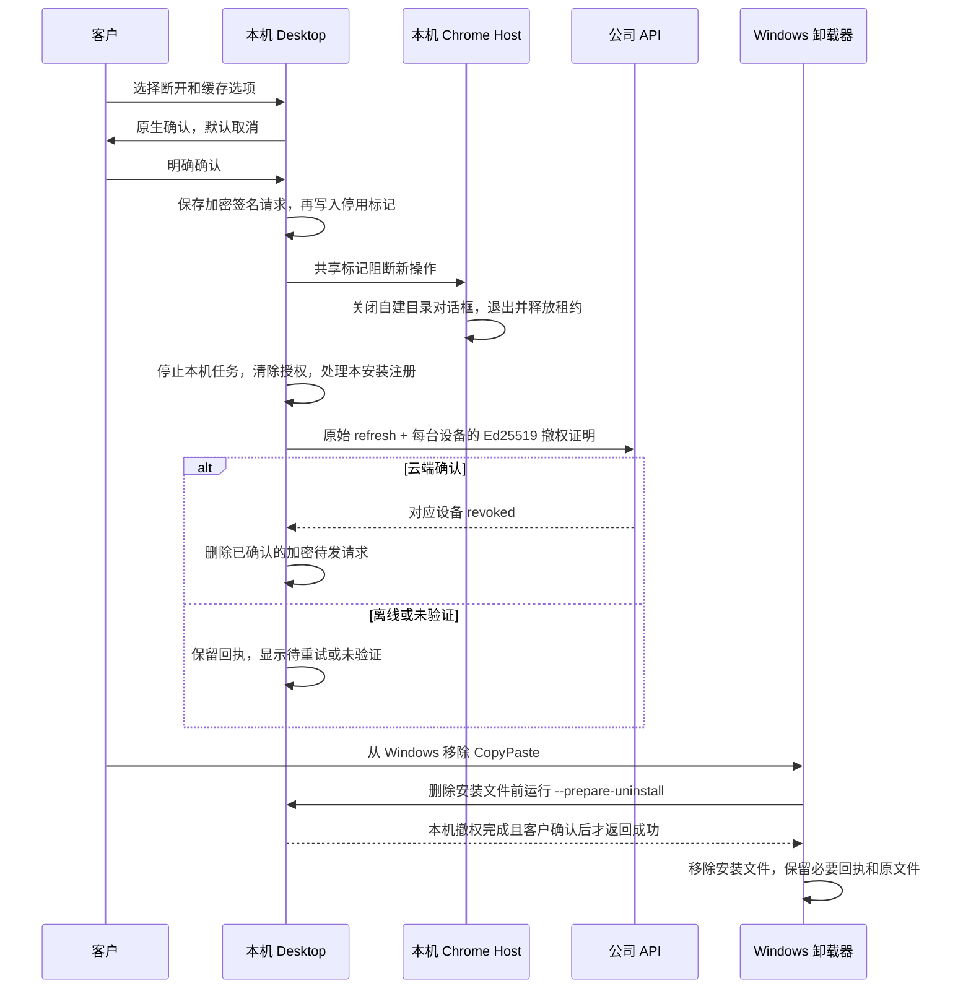

# Desktop 断开、卸载与缓存清理 / Desktop withdrawal and removal

本增量落实 REQ-039、REQ-054 及端侧模块中的卸载流程。Desktop 0.7.0 继续在客户本机运行 Codex；Extension 继续使用原生右侧 Side Panel，选择并上传获准文件给云端 Codex。断开不会删除企业账户、改变消费/VIP、撤销其他电脑，或将本机任务切换到云端。

## 客户流程

登录前可从自绘标题栏的“此电脑与卸载”按钮进入；登录后也能从账户设置进入。页面使用 CopyPaste 蓝白色系、繁体中文/英文和深浅主题。隐藏纵向滚动条，保留滚轮、键盘滚动及真实状态；禁止横向溢出。

客户点击“断开此电脑”，在 Windows 原生确认框复核影响范围，并选择是否清理应用缓存和已下载更新。原生对话框默认取消。确认前不修改凭据、授权、注册表或原文件。主进程拒绝来自非应用主框架、非固定页面或不合法参数的 IPC；渲染层不能提供删除路径、设备凭据、私钥或任意命令。

确认后关闭新的本机操作入口。先将带设备签名的撤权请求写入 DPAPI 包裹密钥保护的 AES-GCM 日志，再在共享文件锁中写入持久停用标记。随后清除本机登录、撤销文件授权、停止 Codex/目录任务/本机程序，关闭本应用创建的 Agent 浏览器页面，等待仍在运行的已登记 Native Host 退出，并处理本安装的 Chrome 注册。

本机停止完成后尝试云端撤权；页面分别显示本机、云端、Host 注册和缓存结果。网络失败或答复不可信时保留原请求和加密凭据，显示“待重试”；不得显示云端已撤销。客户可重试、打开 Web 设备页核查，或在重装/重新打开应用后重试。云端仍不可达时允许卸载程序本体，保留加密回执和必要金钥；卸载后不会声称后台重试进程仍在运行。

“前往 Windows 卸载”只打开固定系统 URI `ms-settings:appsfeatures`，不接收任意可执行文件或参数。Windows 卸载器在删除安装文件之前再次启动本安装的 `--prepare-uninstall` 入口并要求本机确认。如果另一个 Desktop 主进程还在运行、客户取消、本机撤权未完成、Host/缓存步骤失败，则中止删除，保留可重试的安装。

重新使用此电脑需要客户完成新的 Web 授权、PKCE 回调及公司 token 交换。新登录不恢复原文件夹授权、Chrome 来源或目录自动任务。旧的离线撤权请求绑定旧 refresh family，不得撤销新登录。若新登录已签发而停用标记未能移除，先持久化该新凭据的撤权请求，再清除该登录，防止孤立凭据。



## 云端撤权协议

`POST /v1/auth/native/disconnect` 使用严格请求/响应 schema，详见 [OpenAPI](../contracts/desktop-removal.openapi.json)。不需要仍有效的短期 access token，也不要求用户仍属于原企业；已移除成员仍应能撤销自己的旧设备。使用已过期、已使用或已撤销的 refresh token，只能撤销其原 Desktop family，不会获得新的访问权。

请求包含固定协议 `copypaste.desktop-disconnect.v1`、固定 `client_id=desktop`、UUID request_id、原 refresh_token，以及最多 64 个不重复的 `(tenant_id,device_id)` 签名。大于 64 台时客户端分批保存，每批独立 request_id。签名正文是下列 UTF-8 紧凑 JSON 数组，签名为 Ed25519、无填充 base64url、严格 86 字符：

```text
["copypaste.desktop-disconnect.v1","desktop",request_id,sha256(refresh_token),tenant_id,device_id]
```

服务器使用原 refresh 凭据的 user_id，要求设备同属此用户、同一 tenant/id、Desktop 类型，并使用设备登记的 Ed25519 公钥验证。所有设备查询和更新都显式约束这三个身份条件。私钥只在客户本机加密保存，待发请求不含私钥。借用其他电脑/用户的 ID、替换 tenant、换签名密钥、替换 refresh 凭据或 request_id 均不能撤销该设备。

事务锁顺序与已有刷新/登出一致：用户 → refresh 凭据 → 按固定顺序排列的设备。撤销该 family 的 token/session，将有效证明对应设备置为 revoked、清空云端 grants，并取消 pending/claimed 文件命令。已经完成的结果、消费记录与原文件保留。重复请求返回相同语义，设备撤权审计不会重复追加。未知凭据、异主设备、Extension 凭据、错误密钥和不存在的设备均使用 `unverified`，不泄露设备所有者。

`ok=true` 表示处理了请求，不代表所有设备都成功撤销。客户端逐项核对 request_id、数量、顺序、tenant/id 和结果，全部 revoked 后才移除对应待发请求。任何未验证项保留并提示人工核查；无设备的 family-only 请求与已有 native revoke 相同，采用统一确认语义。响应使用 `Cache-Control: no-store`。凭据不能写入日志、截图、README 或 Git。

## Host 与注册表所有权

Native Host 的每次操作都检查持久停用标记；LocalFiles 执行在 Desktop/Host 共享文件锁内再次检查，防止在确认后出现新的授权或写入。目录选择对话框属于 Host 自建子进程，Host 只终止这些自己持有的进程。已运行 Host 监测标记、结束 stdin 消费并释放自己的 PID/UUID 租约。Desktop 等待已登记 Host 退出，不按进程名字杀死用户进程。

Chrome 注册/移除使用同一 Windows 用户、注册键对应的命名互斥锁。只有当前 HKCU 默认值指向本 manifest，并且 manifest 内 launcher 也属于当前安装，才移除默认值；其他安装的注册保留并明确显示。不会删除整个 Chrome 注册分支。开发脚本同样服从停用标记与共享文件锁，不能绕过停用状态重新授权。

较旧版本已经运行的 Host 可能没有新的租约/标记协议。卸载钩子检测到尚有 CopyPaste 进程时会中止并提示关闭对应 Chrome 文件连接或另一个安装；不强制杀死。新版本受控更新先写入临时 Host 暂停标记、等待 Host 退出，再交给已验证安装助手。更新后新主进程移除临时暂停标记；更新不是撤权，不清除登录和授权日志。

## 缓存及回执保留

缓存选项只清理 Electron 默认会话的 cache/storage，以及当前 userData 下固定的 `update-cache`。清理前验证实际绝对路径、根目录和缓存根均不是 symlink/junction；递归操作使用不会追随内部链接的 Node 删除实现。没有由渲染层输入路径，也不递归删除整个 userData。

客户原始文件、已选工作目录、客户下载目录、本机会话/不确定操作记录、费用结算资料、离线撤权请求及 DPAPI 包裹金钥保留。已有不确定操作不能因卸载而被伪造为成功、自动重跑或擦除。清理失败显示独立待重试状态。历史回执并非缓存。

NSIS 钩子拒绝 `--delete-app-data`，避免 electron-builder 的通用参数擦除待发撤权和结算回执；普通缓存清理由本机确认框授权。正式发布仍使用已有 `package:release`，要求显式公司签名凭据、公钥及最低发布序号，缺失时拒绝正式打包。当前可生成 Windows x64 未签名开发 Setup/Portable；不将开发安装器等同公司签名生产版本。

## 核查与复现

交付仓库提供 `run-desktop-removal-v1.mjs NN core|native|clients` 和选定的 `run-desktop-removal-ui-v2.mjs NN`；每次使用新的两位编号，保留源码快照、原始 TAP、真实界面、GIF/MP4 和失败尝试。核查使用原生 Windows、独立 PostgreSQL、DPAPI、真实 Node Native Host、Electron IPC 和 Web PKCE；不使用 Docker/WSL/虚拟化。结束关闭所有本次创建的浏览器、Electron、Host 和数据库，保留用户已有程序。

选定结果统一记录在 [撤权检查点](../quality/desktop-removal-checkpoint.json)。原有 102 项需求和 G01–G10 不因本增量而缩减或标记全部完成；真实模型、公司签名已安装产品的卸载/跨版本升级和 macOS 仍须独立验收。界面测试自动控制隔离进程的原生确认答案及 shell URI，不冒充客户人工点击或真实 Windows Settings 卸载实录。

## English operational notes

Desktop 0.7.0 adds a computer/removal page before sign-in and in account settings. A separate native confirmation, cancelled by default, stops local Codex/folder/program work, closes owned Agent pages, withdraws local grants and Chrome origins, and retires only devices proven by both the original Desktop credential owner and each device's Ed25519 key. It preserves the company account, other computers, customer originals and unsettled receipts.

The encrypted outbox is durable before local sign-out. Offline or malformed acknowledgements remain explicitly pending; unverified devices stay queued for retry or review on Web Devices. The app retries when reopened, including after reinstall; it does not claim to run a retry daemon after uninstall. A new Web authorization/PKCE login creates a fresh family without restoring old permissions. Old queued requests remain bound to their original family.

Windows removal invokes this installation's preparation mode before deleting files. Cancellation, an active main application, unfinished local withdrawal, or Host/cache failure stops removal. An update skips disconnection; a transient Host pause lets current Hosts exit without revoking login. Older Hosts or other installations are never killed by name. Chrome registry deletion additionally checks the manifest's launcher ownership inside the per-user mutex.

Optional cleanup covers only app caches/storage and the fixed, checked update-cache directory. It rejects root/cache junctions, never follows descendant links, never accepts a renderer-supplied deletion path, and retains encrypted withdrawal/settlement records plus their key. The generic `--delete-app-data` option is refused. Production packaging still requires company signing credentials; unsigned development packages, controlled native-dialog responses and mock model data are explicitly identified in evidence.
