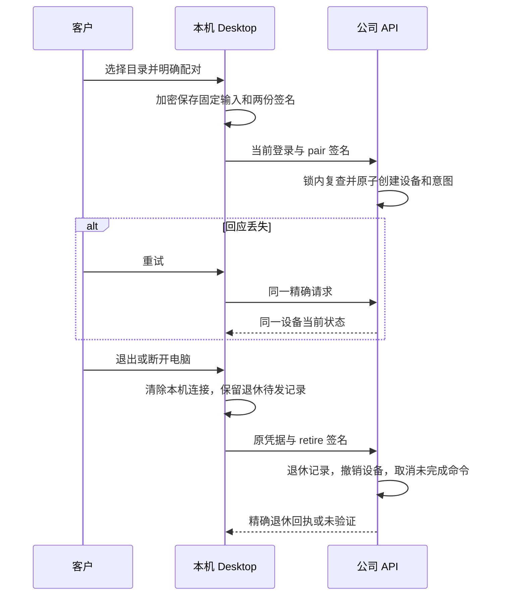

# 可恢复的 Desktop 设备配对 / Recoverable native pairing

Desktop 0.7.1 将本机目录的云端排程配对改为持久、固定输入的流程。它继续使用本机 Codex、公司 AI 网关、无边框界面及隐藏滚动条。Extension 的原生右侧 Side Panel 与云端 Codex 执行位置保持原有边界。

## 客户行为

在“设备 → 本机资料夹”明确选取目录，再点击“同步云端排程权限”。旧设备撤销失败时停止替换，保留原 ID；客户可检查网络后重试。新配对发出之前已保存加密意图。服务器已创建而回应丢失时，再次点击恢复同一设备，不新建重复设备，也不显示未经确认的成功。

更改目录授权后再次明确配对时，先退休先前的配对；选择目录本身不会自动发布新配对。退出或换账户会把尚未确认的创建一并标记为待退休。退出会先将这些意图标记为待撤销，并清除本机连接；联网时重试。断开电脑、卸载准备会将所有配对的预签名撤销请求保存到原有加密待发日志，逐项核对服务器回执；离线或未验证结果继续显示待重试。客户原文件和未结算记录保留。

收到迟到响应时检查原会话 epoch；已切换账户就不接入旧设备。连接写入和本机清理经过同一串行控制器，避免旧响应在清理后重新写回设备映射。失效或撤销的配对不自动复活；再次明确配对会使用新意图。过期或已撤销的本机目录授权需重新选择。

## 服务器状态与授权

新增迁移 `128-desktop-pairings.sql`，保留 SQL001–127。私有记录以 `(user_id, id)` 唯一，绑定 tenant、原 refresh family、固定输入摘要、公钥及实际 device ID；状态为 paired 或 retired。退休状态不能恢复，身份字段不能修改，应用 SQL 只有受 RLS 约束的读取权，没有伪造、更新或删除记录的权限。

退休可以先于创建到达。此时保存该用户命名空间中的永久退休记录；同一签名创建之后到达时返回 410。不同用户即使使用同一随机 ID，也访问各自命名空间，不得修改或推断对方记录。退休记录的 tenant UUID 不设置外键，从而让未知 tenant 的私有取消具有相同回执；它不创建企业、成员、设备或访问权。

创建和退休都先锁定凭据所有者，再操作配对记录。创建在锁内复查当前 native session、Desktop 客户端、原 refresh family、用户版本、成员及企业状态，随后同事务创建设备和配对记录。失效、异主、Extension 或新 family 不能重放旧意图。重复创建读取同一设备当前状态，不延长授权，不重新激活 revoked 设备。

退休接受原 Desktop refresh 凭据，允许它已使用、过期或撤销，也允许原成员已移除；只能处理该凭据所有者和原 family 的精确配对，不能赋予读取、执行权限，也不撤销另一个新登录 family。设备置为 revoked，清空 grants，取消 pending/claimed 命令；已完成结果和费用事实保留。重复回执不会重复追加退休审计。

## 签名与存储

共享契约 `desktop-pairing-contract.ts` 在服务端与 Desktop 中字节一致。请求含固定协议、原 refresh token、输入与 Ed25519 签名；输入包含随机配对 ID、tenant、名称、公钥和已获准的限时 grants。签名的 UTF-8 数组为：

```text
["copypaste.desktop-pairing.v1", action, sha256(refresh_token), sha256(canonical(input))]
```

action 分为 pair 和 retire，二者不能互用。Desktop 在发出请求前预签两个动作，并把精确请求持久保存到 DPAPI 包裹密钥保护的 AES-GCM 日志；私钥不进入配对请求、云端记录或退休待发日志。请求不包含客户原文件正文或本机绝对目录。退出、卸载和自动重试均使用原签名，不以新登录替换旧凭据。

HTTP 协议与实际 Zod schema 的逐字镜像见 [OpenAPI](../contracts/native-pairings.openapi.json)：创建为 `POST /v1/auth/native/device-pair`，要求有效 native Bearer；退休为 `POST /v1/auth/native/device-pair/retire`，使用单向凭据与精确签名。所有回执为 no-store。名称、权限、tenant、family 或 ID 变化均不能复用原配对。



## 验证与边界

使用 `node scripts/run-native-pairing-v1.mjs NN core|native|clients` 与选定版本 `run-native-pairing-ui-vN.mjs NN`；每次采用新的两位编号。保留完整失败尝试、TAP、原始日志、源文件快照及实际截图/GIF/MP4。测试使用原生 PostgreSQL、Windows 加密、真实 Electron IPC 和 HTTP；不调度 Docker/WSL。自动化关闭自己创建的浏览器、Electron、Host 和数据库，保留用户现有程序。

最新选定结果见 [检查点](../quality/native-pairing-checkpoint.json)。交互注入明确的 HTTP503，包括服务器已提交创建后返回失败；这是隔离测试的失败条件，不是对真实供应商故障的宣称。原生目录/确认对话框答案在本次拥有的进程内控制，不冒充人工操作。模型与客户数据为假数据。

沿用阶段117已核对的相同 NSIS 钩子；本轮不增加公司签名安装版本卸载、跨版本升级或 macOS 的验收结论。开发安装包仍未签名。原 102 项 REQ/TC 与 G01–G10 保留，相关子流程通过不代表完整产品或真实模型/业务质量验收。

## English operational notes

Choose a local folder and explicitly pair cloud scheduling. The main process durably stores the fixed request and separate pair/retire signatures before HTTP. A failed legacy-device retirement stops replacement. A committed create with a lost response recovers the same device on retry. Expired grants or a retired device never regain access through replay.

Pair creation and retirement serialize on the credential owner. Creation rechecks the live Desktop session, original refresh family, user version and workspace authority inside the transaction. Retirement is one-way and works with the original expired/revoked credential, including after membership removal. A private tombstone can precede creation and prevents a late create from reviving the pairing. Other users and fresh login families remain isolated.

Sign-out marks intents for retirement and clears local connections; failed acknowledgements remain durable. Disconnect/uninstall also captures their exact signed requests in the existing encrypted removal journal. Unknown device IDs are therefore recoverable without inventing an acknowledgement. Native customer originals and uncertain financial records remain intact. QA uses synthetic accounts/models and controlled native-dialog decisions; production signing, installed-product qualification, macOS and original complete-product acceptance remain open.
