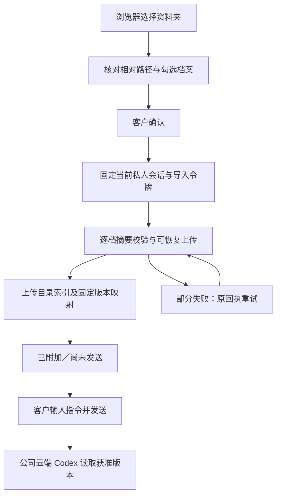

# Extension：客户选择的资料夹

本轮补齐 Chrome 原生右侧 Side Panel 的独立资料夹导入。浏览器负责客户选择、核对与上传，Codex 在公司云端运行。此入口直接使用浏览器资料夹选择器，无需安装 Desktop 或授予 nativeMessaging。

## 客户操作

1. 登录并选定企业、专案及私人会话，点击输入框旁的「资料夹」。浏览器只返回客户选择的档案及相对路径。
2. 核对资料夹名称、相对路径、文件数与体积，逐档勾选。确认前不读取文件内容、不建立会话、不上传。
3. 点击「确认并上传」。逐档执行私人会话的可恢复分片上传，再上传 JSON 目录索引。进度及失败状态显示于核对面板。
4. 失败时「重试未完成项目」保留成功项，使用失败档案的原始 File 与原上传回执重试；目录索引失败时只重试索引。
5. 返回会话后输入指令并按「发送」，才建立任务、冻结附件版本及预算。上传完成不会自行调度 Codex 或占用任务预算。

资料夹上限为 1,000 个候选档案；每个非空档案最大 5 MiB，每条讯息最多 20 个附件，其中保留一个索引位置。因此空白会话最多勾选 19 个资料夹档案，已有附件会减少此数量。空档案及过大档案不可勾选；隐藏路径与 node_modules、dist、build、coverage、__pycache__、vendor 预设不勾选，符合大小限制的项可由客户明确选择。此上限是当前产品实现，不代表无限目录同步。

## 目录与私人资料边界

只接受同一根资料夹下的相对路径；拒绝绝对路径、磁碟代号、反斜线、控制字元、空组件、`.`、`..`、重复路径及过深路径。上传档名使用根目录前缀、稳定序号与受限长度的原档名，避免两个子目录内同名文件冲突；原始相对路径写入索引。

索引协议 `copypaste.selected-folder.v1` 记录资料夹名称，以及每个获选文件的 `relative_path`、`uploaded_filename`、`asset_id`、`asset_version_id`、`sha256`、`size_bytes`、`content_type`。索引和文件沿用既有私人会话上传端点；索引不包含本机绝对路径或系统文件句柄。

每个文件在客户确认后读取并计算 SHA-256。后台验证上传 manifest、分片、完成结果、当前用户、企业、专案、会话及字节摘要；面板再次确认不可变版本、长度和摘要。云端任务必须绑定全部所选文件版本及索引版本。文件工具继续施行既有内容类型与大小限制，例如 `asset_text_read` 接受 text/plain、text/csv、application/json 且至多 500,000 bytes；资料夹导入成功不等于任意格式均已具备解析器。

## 状态与异常恢复

核对阶段只持有当前面板内的 File 对象；确认后取得会话导入令牌，锁定会话切换、其他附件变动及发送。上传成功的项目以不可变版本保留，不会在重试时再次建立 chip。取消移除本批待发送附件，并阻止后续队列及迟到结果重新附加；已经提交的私人上传仍依既有存储生命周期保留。

切换账号、企业、专案、会话或退出会使旧核对与导入令牌失效。每次异步读取、摘要及上传后重新核对令牌与身份世代。面板关闭后不在 Chrome storage 保存文件内容或句柄；重新开启需重新选择文件，后台仅保留精确范围的上传回执。

## 交付索引

历史发布 manifest 接近 GitHub 100 MiB 单文件上限，因此新增 `workmate.proofs.sharded.v1`。保留旧 manifest 原始字节、所有历史 proof 行与字段；以每片不超过 20 MiB 的 JSON 切片保存完整 proof 集。顶层记录每片路径、字节长度、SHA-256、数量及总数量。

新读取器拒绝缺片、摘要或数量不符、重复 proof 身份、重复切片路径、目录逃逸及未知格式。新发布器使用 `publish-workmate-v2.mjs --push`，在原有七仓库历史、凭据、媒体、链接及远端祖先核查之外，逐条核对实际提交对象。旧发布器遇到新状态会停止。八个远端分支继续原子推送且不强推。

精确运行、原始失败、实际页面截图与 GIF／MP4 见 [本轮证据](../quality/extension-folder-checkpoint.json)。模型决策与客户资料继续使用已授权的假数据；真实供应商、完整业务交付、公司签名安装包及 macOS 的验收不得由本轮局部结果推断。
