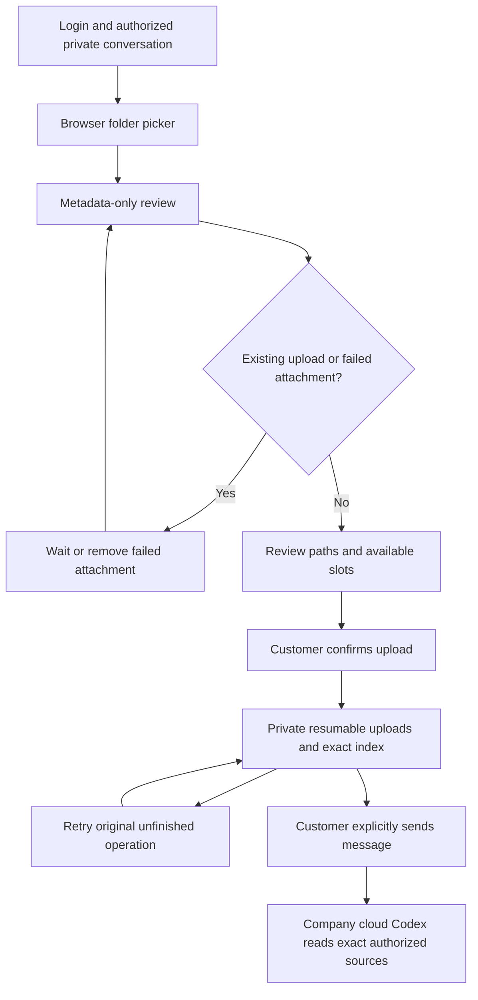
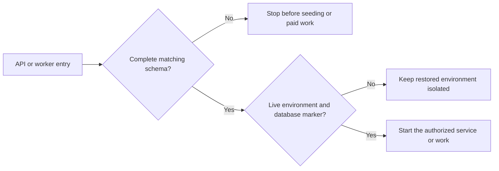

# 完整回归与附件恢复 / Integrated regression and attachment recovery

本轮交付包含 Backend 0.5.1 的数据库版本准入和 Extension 0.5.2 的附件恢复。各端保持独立仓库；真实模型、客户和文件采用明确的模拟夹具，原生 PostgreSQL、Chrome 右侧栏及 Codex 进程实际运行。最终选定的源码、测试数量、失败尝试、页面和录制以[当前检查点](../quality/integrated-recovery-checkpoint.json)为准。

This increment delivers backend schema admission and Extension attachment recovery. PostgreSQL, Chrome's native right Side Panel and pinned Codex actually run; model decisions, accounts and source files are synthetic. The linked checkpoint identifies final source bytes, complete inventories, unsuccessful attempts, actual screens and recordings. It does not replace live provider or installed product acceptance.

## Extension 使用逻辑 / Extension usage

客户先登录，选择有权限的企业、专案及私人会话。按「资料夹」后，浏览器提供所选目录的文件列表；确认前只读取路径、名称、大小等元数据，不读取文件内容、不上传、不建立任务。

1. 核对文件；隐藏／构建路径预设不选，空档和超过 5 MiB 的文件不可选。
2. 若已有普通附件正在上传，弹窗内说明原因并暂停确认；已有失败附件时，明确提示返回会话移除失败项再选取。清除阻塞后才允许确认。
3. 输入框上限仍为 20 个附件。资料夹保留一个相对路径索引的位置，空白输入框最多选 19 个内容文件；已有普通附件会进一步减少可选数量。
4. 达到上限时，已选项保持可取消，未选项禁用。取消一个勾选后可选择替代项，不会静默丢弃另一个选择。
5. 小文件以字节显示，例如 `34 B`；其余按 KiB／MiB 显示，非空文件不会显示成 `0.0 KB`。
6. 明确确认后按顺序执行私人可恢复上传；完成响应丢失时，重试沿用同一文件、附件和回执，不重复上传已完成内容。相对路径索引绑定确切 asset/version/SHA/bytes。
7. 上传完成后回到会话，客户另按「发送」才创建任务。换账号、企业、专案或会话会使旧选取失效；取消不会替客户自动发送。

Sign in, choose the authorized company/project/private conversation, then choose a browser folder. Review reads metadata only. Pending or failed ordinary attachments block confirmation with an explanation inside the modal. The 20-attachment composer limit reserves one entry for the relative-path index; the maximum is 19 selected content files before existing attachments. At capacity, checked items remain removable and unchecked items are disabled until a slot is freed. Small files display exact bytes. Explicit confirmation starts sequential private resumable uploads; exact completed receipts survive retry. Sending a message is a separate customer action.

## 数据库与工作执行 / Database and execution admission

API 启动、Worker 启动、派发和单任务入口都先核查数据库。Backend 0.5.1 要求 SQL001–128 的完整版本集合，同时保留恢复环境状态和数据库隔离标记检查；单纯存在 SQL125 的恢复表不足以允许新版服务接待客户。

缺少历史表、恢复表、任何中间版本或最新版本时，返回运营诊断 `SCHEMA_UPGRADE_REQUIRED`；数据库比本服务版本更高时，返回 `SCHEMA_VERSION_UNSUPPORTED`，要求使用匹配的服务版本。检查在目录播种、队列启动及付费操作前执行，不自动赋予应用身份 DDL 权限，也没有环境变量绕过开关。新增迁移时必须同步更新 `requiredSchemaVersion`，测试会将其与磁盘中的完整前向迁移集合比较。

API construction and every worker entry check the complete required migration sequence before catalog seeding, queue startup or paid work. A missing table or migration reports `SCHEMA_UPGRADE_REQUIRED`; a newer database reports `SCHEMA_VERSION_UNSUPPORTED`. Restored environments remain subject to the independent live-state and database-marker fence. Operators apply owner migrations or install the matching API release; runtime identities do not gain DDL authority.

原 SQL001–128 不改写。音频升级夹具在真实 SQL101 上直接建立旧资料，所有约束、RLS、预算函数保持开启；逐步核查 SQL102／103，再升级全部当前迁移后启动新版 API。未提交音频取消、未知费用保留、已完成媒体字节不变，不补造人的确认。SQL120／121／122 的预算函数 OID 和预编译调用分别在准确边界及后续完整升级后核查。

Published SQL001–128 remain unchanged. The historical audio fixture seeds the actual SQL101 shape with constraints, RLS and budget functions enabled. It checks SQL102/103 boundaries and starts current HTTP only after all current migrations. Unsubmitted audio is cancelled, unknown cost remains unknown, completed media bytes survive, and human consent is never backfilled. Budget function identities and prepared callers are checked at their original boundaries and after later upgrades.

已隔离／移除内容对应的请求回执保留唯一性墓碑，原请求重试返回 `410 REQUEST_RESULT_REMOVED`，不重建任务或再次预留费用。跨所有者、跨专案、跨企业的读取仍返回不可见结果。路由清单保留原始基线，显式补入现有广告预算端点及配对、更新、事件、恢复端点；当前为 602 个常规操作及一个条件演示操作，实际注册集合必须完全相等。

Removed content retains an idempotency tombstone: exact retry returns `410 REQUEST_RESULT_REMOVED` and cannot recreate paid work. Private-owner/project/tenant visibility remains enforced. The route declaration preserves the original baseline and explicitly includes existing budget operations plus native pairing, updates, events and recovery. Its 602 regular operations and one conditional demo operation must exactly match actual registration.

## 浏览器回收时序 / Browser reclamation lifecycle

浏览器控制进程被中止时，原生宿主先关闭 Chromium Job，再写最终回执并退出。`job_empty` 本身不足以表明临时目录已经无人使用。宿主在建立浏览器 Job 前以 CreateNew 写入并刷盘独立的 host-owner.json，记录准确执行、控制进程及宿主身份；可变状态回执被中断替换时仍可判断归属。孤立目录回收同时要求控制进程和原生宿主均已退出，并独立确认 Job 为空；测试主动移除可变回执并以有限次数观察完整退出和实际回收结果。格式错误的独立身份记录不会退回旧版回执；仅旧目录缺少该文件时允许沿用旧版检查。存活的拥有者、无法确认的进程状态或 Job 均不会被当作删除许可。

On controller death, the native host closes the Chromium job before writing its final receipt and exiting. An empty job alone does not authorize directory deletion. Before creating a browser job, the host exclusively creates and flushes host-owner.json with the exact execution, controller and host identity. Interrupted mutable status replacement cannot remove this independent ownership record. Reclamation requires both owners to have exited and an independent empty-job inspection. The test deliberately removes mutable telemetry before checking actual recovery. A malformed ownership record fails closed; only an absent file permits legacy receipt validation. The test waits within a fixed deadline for that complete lifecycle and the actual reclamation result; it preserves the existing protection for live or unconfirmed owners.

原生宿主仍每 50ms 检查进程、取消及截止时间，但把状态文件与令牌快照写入合并为至多每 250ms 一次，减少反复替换文件的 I/O。浏览器导航与沙箱进程观测使用调用方总预算中的剩余时间，移除独立的 5 秒导航与固定轮数观测上限；不延长调用方已指定的总时长，也不跳过进程归属、受限令牌与低完整性校验。新增实际运行超过 5 秒的有限页面，核查它在 30 秒总预算内完成；无限脚本、调用方取消和独立会话隔离仍须通过。崩溃测试先确认原生写入进程退出，再模拟可变回执缺失，避免与正常退出阶段的文件写入竞争。

The native host still checks process exit, cancellation and deadlines every 50ms, while coalescing status writes and token snapshots to at most once per 250ms. Navigation and strict sandbox observation use the remaining caller budget, without an unrelated five-second navigation cap or fixed observation count. Caller deadlines, process ownership and restricted low-integrity token checks remain enforced. A real finite page that runs beyond five seconds must finish within its explicit 30-second budget; infinite scripts, cancellation and isolation remain covered. Crash simulation removes mutable telemetry only after the actual writer exits.

执行完成后，Chromium 可能需要刷新其独占临时配置。关闭阶段使用独立且有界的 6 秒清理窗口，避免原来固定 4 秒上限把已完成的正常退出误当成取消。它不增加页面执行预算：调用方超时或取消仍立即通知原生宿主；正常执行后仍必须取得实际退出码、独立的空 Job 回执并删除自有目录。原生宿主的最终硬截止与执行预算加清理窗口一致，最高 36 秒；无法确认退出时不能报告成功。

After execution, Chromium may need to flush its exclusively owned temporary profile. Shutdown has a separate bounded six-second cleanup window, replacing a four-second cap that could cancel otherwise normal exits. This does not add page execution time: timeout or caller cancellation still notifies the native host immediately. Success still requires the actual exit code, an independently verified empty job and deletion of the owned directory. The guardian's final hard deadline matches execution plus cleanup, at most 36 seconds; unverified shutdown never passes.

## 验证与交付 / Verification and delivery

Delivery 的 `run-integrated-recovery-full-v2.mjs NN MAX_FILES` 枚举当前全部后端测试，使用新建原生 PostgreSQL 端口和 UUID 目录，归档精确源码、原始 TAP 与执行器。`run-integrated-recovery-v1.mjs NN extension|clients` 检查附件单元与各端构建；`run-integrated-recovery-client-units-v1.mjs NN` 枚举 Web／Admin／Desktop／Delivery 当前所有顶层单元测试；`run-integrated-recovery-ui-v1.mjs NN` 执行真实登录、PKCE、原生 Chrome 侧栏、文件核对／失败恢复及云端 Codex 读取。各次执行用全新编号，禁止覆盖已执行的报告和工具。

The complete backend runner enumerates every current test file, owns a fresh native database, and archives exact sources and raw TAP. Client unit/build runners enumerate the current selected inventories. The real Chrome journey covers sign-in/PKCE, native Side Panel review, attachment blockers, capacity replacement, completion-response loss and actual cloud Codex file reads. Every attempt uses a fresh number. Executed verifiers and reports are retained unchanged.

最终以当前源码再次选定完整后端回归、63 项 Extension 单元、229 项 Web／Admin／Desktop／Delivery 单元、13 项构建／类型检查及实际页面记录。通过报告不允许包含失败、取消、跳过或 todo；源码在执行前后必须一致。浏览器、临时服务及自有数据库在结束后清理；现有用户服务和页面保留。禁止本地 Docker、WSL 或虚拟化。

Selected final evidence requires passing complete counts, zero failures/cancellations/skips/todos, unchanged source bytes and cleanup of owned resources. Current client unit evidence contains 63 Extension checks and 229 Web/Admin/Desktop/Delivery checks, alongside 13 build/type checks and the actual UI journey. Original complete-product and live-role acceptance decisions remain separate.

主文档和六个独立组件的中英 README、实际页面、GIF／MP4、更新说明与源码共同提交。发布用 `node scripts/publish-workmate-v3.mjs --push`，核查全部历史 Git proof 切片后原子非强推八个远程分支，逐一确认远程提交等于本地提交。历史失败不改成通过，模拟验证不表述为真实供应商专业效果或签名安装验收。

Documentation and six independent component repositories retain bilingual READMEs, actual media and change notes. The V3 publisher verifies all historical sharded Git proofs, then atomically pushes and checks all eight nonforce refs. Synthetic verification is not represented as live professional quality or signed installation acceptance.

## 可恢复的完整清单 / Resumable complete inventory

新版执行器在启动原生数据库前冻结全部测试清单、源码、支持工具和验证器哈希。每个测试文件有独立原始 TAP、真实退出码、实际文件清理回执及不可覆盖的 JSON。相同编号续跑时，只有摘要、完整终态计数、退出码、源码和清理结果全部一致的通过项可被复用；缺失、失败或中断的文件保留原记录并以新子编号重跑。最终汇总是完整清单索引，各文件各自真实退出，不能把拼接输出伪造成单次 TAP。

The V2 runner freezes the complete test inventory, source and support-tool bytes before starting PostgreSQL. Each file retains its real terminal exit, raw TAP, actual fixture cleanup and exclusive JSON receipt. Resumption reuses only fully verified passing files. Missing, failed and interrupted attempts remain unchanged and receive a new child attempt. The final result is an inventory index of real individual exits, never a fabricated single-process TAP summary.

测试目录的身份在任何目录或数据库建立前独立写入并刷盘。中断回收要求原拥有者及每个工作进程均已退出；复用的 PID、存活进程或访问错误均不能触发清理。数据库端口和原生 postmaster 状态需独立确认。旧 full-04 的 1164 条已观察输出作为中断保留，不视作完整通过，不自动删除无法证明归属的历史目录。

Fixture ownership is exclusively written and flushed before creating a directory or database. Interrupted reclamation requires both the old launcher and every registered worker to be gone. Live or reused PIDs and inaccessible process state cannot authorize deletion. The database port and recorded postmaster are checked independently. The 1164 observed full-04 results remain partial interruption evidence; they cannot qualify the complete suite or justify deleting ambiguous historical directories.

full-06 中同一浏览器集成用例有两次失败，均原样保留。另一次只观察原工具回执的诊断执行通过五项原测试，保留实际截图、失败断言、修复后截图及重放结果；诊断本身不替代完整回归。曾准备的集成夹具预算修改脚本在前置断言处退出，没有修改产品或测试源码。随后完整清单继续使用相同的 15 秒默认执行预算；只以最终完整清单的真实结果作本轮资格判断，不把未证实的失败原因写成确定结论。

Both unsuccessful full-06 browser integration attempts remain unchanged. A scoped observation of the original tool receipts passed its five original tests, including actual screenshots, a failed assertion, corrected output and replay. It does not replace the complete inventory. A proposed fixture-budget application stopped at a precondition before mutating product or test source. The later complete inventory retains the same 15-second default execution budget. Qualification follows the actual complete result, without asserting an unproven failure cause.
