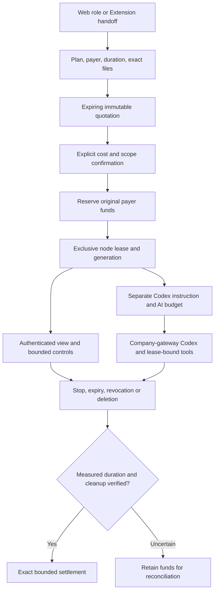

# 专属云端资源与客户端执行边界 / Dedicated cloud resources and client execution

本次补齐 REQ-059 的可选专属云端环境，以及三端入口、客户授权、费用和后台资源控制。它使用既有登录、企业／专案、私有文件、Codex、钱包及任务系统。Desktop 的工作继续由客户本机 Codex 执行；Extension 继续使用浏览器原生右侧 Side Panel，读取客户确认的文件并上传给云端。

This implementation adds the optional dedicated cloud environment in REQ-059 using the existing identity, workspace, private files, Codex, wallet and task systems. Desktop work executes in customer-local Codex. The extension remains a native right Side Panel that uploads explicitly approved files for cloud execution.

当前开发与实际验证均使用 Windows 原生工具、独立 PostgreSQL、真实 Chromium／Electron 和锁定的 Codex。模型、媒体和资源节点的测试响应明确使用假数据。Linux 物理节点的代码、安装恢复及协议已有实现，但本机没有启动 Linux、Docker、WSL 或虚拟机；真实远端节点及正式模型效果需要各自的实际环境验证。本文不能当作完整产品验收回执。

Development and validation use native Windows tools, owned PostgreSQL, real Chromium/Electron and pinned Codex. Provider/media/node responses are explicit test fixtures. Linux physical-node code, installation recovery and protocol support are implemented, but no Linux, Docker, WSL or VM was started locally. Actual remote-node operation and production model quality need their respective environments. This document is not complete-product acceptance.

## 客户工作流程 / Customer workflow

1. 客户登录，选择所属企业和专案；角色目录中的专属电脑入口导向 Web 资源工作台。Extension 只打开同一公司 Web 页面，点击入口本身不创建付费任务或资源租约。
2. 选择版本化资源方案、付款账户、固定时长、工作说明和确切私有文件版本。终端、可视操作和 Codex 控制分别授权；Codex 控制默认未勾选。
3. 服务端提供有期限的报价，冻结方案、资源规格、文件版本、权限、付款方、最高费用及规格摘要。客户另行勾选费用／范围确认，才预留额度并分配独占节点。报价与租约均不会自动续期。
4. 客户可查看原会话，发送有界终端或鼠标／键盘操作。画面只接受经过严格 PNG 校验的当前会话数据；超过新鲜度时主动清空，不依赖客户机器的墙上时钟。
5. 已确认允许 Codex 的运行中会话可另建 Codex 工作。提示、AI 费用上限和明确确认独立于电脑租用费用，绑定同一私有所有者、节点代次和规格摘要。响应丢失后沿用原请求身份，不重复分配或重复预留。
6. 停止、到期、凭证变更、权限撤销或删除均撤销后续工具／推理权限。结束请求不等于物理清理完成；只有真实匹配的运行时长与清理证据才能结算或释放，未知情况保留待核对。

Sign in and choose a workspace; review the versioned plan, payer, fixed duration, private file versions and separate terminal/visual/Codex permissions. Accept the exact quote before reservation. Optional Codex work requires an additional instruction and AI-budget confirmation. Stable request identities survive response loss. Stop, expiry, revocation and erasure end subsequent authority; unresolved physical cleanup or usage remains reconciling.

## 数据、权限和费用 / Data, authority and billing

新增 SQL129，SQL001–128 保持原文件。服务启动所需完整 schema 版本同步为 129，仍执行独立的恢复环境隔离。租约、命令、付款分摊、费用来源、画面和任务绑定均由数据库约束及 RLS 管理。客户会话只对原私有所有者开放；节点只能读取自己当前代次获准的文件，不能使用通用项目文件权限扩大范围。

SQL129 is additive; SQL001–128 remain unchanged. Schema admission requires the complete history through 129 and preserves the independent recovery fence. Database constraints and RLS cover sessions, commands, funding allocations, charge sources, frames and task bindings. Customer sessions remain private to their owner; a node reads only the exact files approved for its active generation.

金额使用整数港币微单位及向上取整，客户端 AI 上限使用精确十进制解析。预留按现有资金批次分摊；同一控制锁的获取顺序固定，避免节点、用户及维护任务交叉竞争。命令发送前持久化身份和参数摘要；结果不明时不能重放可能已执行的操作。资源费与模型费分别记录，不用零费用替代未知费用，也不自动延长用户确认的时长。

Amounts use integer HKD micros with ceiling rules; the client parses AI ceilings as exact decimals. Holds allocate existing funding lots. A canonical control-lock order serializes allocation, authority and maintenance. Command identity and payload hashes are durable before effects. Unknown outcomes cannot replay possible side effects. Resource and inference costs remain separate and bounded by the original confirmations.

R19「专属电脑操作员」绑定精确技能包和 `computer_inspect`、`computer_command`、`computer_command_result` 三个工具。可信画面作为真实图像输入传递给 Codex；返回的文本、URL 或伪造 JSON 不升级为可信图像。任务在排队、执行、推理、工具和成果读取等入口重查当前租约、所有者、权限版本、规格摘要和代次。普通任务创建接口不能绕过专属电脑授权。

The computer-operator preset pins its skill package and three lease-bound tools. Trusted frames become actual image inputs to Codex; text, URLs and forged JSON cannot impersonate trusted images. Admission, execution, inference, tools and result reads recheck current lease, owner, authority version, specification hash and generation. Generic task creation cannot bypass dedicated-computer consent.

## 后台控制 / Admin control

后台增加方案、节点及会话工作面板，复用独立管理员登录、MFA、理由、版本比较交换、操作幂等和审计。基础设施管理、会话读取、停止和对账采用四项独立权限，并继续遵守企业／专案的数据范围和显式拒绝规则。

Admin adds plan, node and session panels using independent administrator identity, MFA, reasons, version comparisons, idempotency and audit. Infrastructure management, session reads, stop and reconciliation have four distinct permissions with existing scope and explicit-deny enforcement.

方案以不可变版本发布；节点注册／凭证轮换只在首次成功响应显示凭证，保存的幂等响应不含密钥。关闭窗口、卸载页面或权限变化清除当前界面中的凭证。管理员可查看状态、运行时间、费用、预留和清理事实，不能借资源列表取得客户画面、文件内容或工作说明。停止与对账不会伪造物理清理证据。

Plans publish immutable versions. Enrollment and rotation reveal credentials once; stored retry receipts omit secrets, and close/unmount/authority changes clear the UI value. Admin sees status, duration, cost, holds and cleanup facts without customer pixels, file contents or purpose text. Stop and reconciliation do not manufacture physical-cleanup evidence.

## 原生物理节点 / Native physical node

Delivery 的 `src/cloud-node/`、`native/` 与 `deployment/copypaste-cloud-node.service` 提供 Linux 物理节点代理。固定公司 HTTPS API，不公开 Codex 或桌面控制端口。Node22 原生执行，使用 systemd 用户、cgroup、XFS project quota、Xvfb、Openbox 和固定参数工具；不需要容器或虚拟机。

Delivery provides a Linux physical-node agent under `src/cloud-node/`, `native/` and its systemd service. It uses the fixed company HTTPS API without exposing Codex or desktop-control ports. Native Node22/systemd, cgroups, XFS project quotas, Xvfb, Openbox and fixed tool arguments provide the runtime without containers or VMs.

代理在执行前持久化命令、租约身份和主机启动事实；轮询、心跳及看门狗独立于长命令。缺少可验证的运行时长或清理事实时保留未知状态。容量准入核查实际 CPU、可用内存、cgroup 控制器、磁盘和 inode 限额。终止时先结束所属进程组，独立观察进程及 cgroup 为空，再清理确切 UUID 工作目录；其他节点或用户文件不会成为清理目标。

The agent journals command/lease identity and boot facts before effects; polling, heartbeats and the watchdog remain independent of command execution. Capacity checks measure physical CPU/free RAM/controllers/disk/inodes. Shutdown ends the owned process group, independently observes empty process/cgroup state, then removes only the exact owned workspace. Missing proof preserves an unknown outcome.

源代码包包含固定允许清单、摘要和平台限制。安装器先验证外部固定摘要、文件名、字节、模式和宿主要求；写入前持久备份，只操作固定路径，默认不启动服务。中断恢复必须指定确切的自有安装 UUID，恢复原字节及模式后仍保持服务停止。实际 Linux 安装、恢复和运行需要在真实部署主机另行核查。

The source bundle pins an exact allowlist, hashes and platform constraints. Installation checks the externally pinned digest, paths, bytes, modes and host prerequisites, journals backups before mutation, touches fixed paths and does not start the service. Recovery requires the exact owned installation UUID and restores original bytes/modes with the service stopped. Actual installation, recovery and execution still require qualification on the deployment host.

## 删除、恢复与三端边界 / Erasure, recovery and client boundaries

客户删除内容时保留必要财务事实，清除画面、工作说明和文件作用域；活动节点先进入停止／核对流程。数据备份恢复后强制旧租约进入待核对、撤销活动任务绑定、清除画面并隔离空闲节点；只有匹配的恢复实例身份才能执行该步骤，恢复数据库不能冒充在线环境继续收费或派发工作。

Erasure preserves necessary financial facts while removing frames, purpose and file scope; active nodes first stop/reconcile. Restored backups fence old leases, revoke active task bindings, clear frames and quarantine idle nodes. The operation requires the exact restored-instance identity; restored data cannot resume paid work as a live environment.

Desktop 渲染层明确拒绝专属云电脑及节点控制 API，本机角色目录和新建专家选择不提供 R19；既有云角色记录保持准确的只读提示。Extension 角色入口打开同一公司的 Web 资源页，普通发送不能伪造 R19 任务；原文件选取、逐项恢复上传、路径索引和独立发送流程继续保留。

Desktop denies dedicated-computer/node APIs at the authenticated renderer bridge and excludes R19 from native creation while preserving accurate historical labels. Extension hands the user to the fixed company Web page; ordinary messages cannot forge R19 tasks. Existing explicit file review, recoverable upload, path index and separate Send remain intact.

## 原生准备与版本 / Native prerequisites and versions

云端服务的 `CODEX_BIN`／`CODEX_VERSION` 是独立的运营配置，必须指向相互匹配、已经批准的实际 Codex 二进制与版本；测试中采用 Desktop 锁定副本，不代表全局替换云端配置。Desktop 的实际本机版本和 SHA-256 以其 `contracts/local-codex-runtime.json` 为准。开发演示仍需准备这些原生前提，不能将 API／页面启动等同于 Agent 已可执行。

Cloud `CODEX_BIN` and `CODEX_VERSION` are independent operator settings and must match an approved actual binary. Qualification uses the separately pinned Desktop copy without globally replacing cloud release configuration. Desktop's contract records its actual native version and digest. Starting the API or pages alone does not establish Agent readiness.

[本机 Codex 监督与准备](70-desktop-native-codex-supervisor.md) · [版本与运行前提核对](106-selected-inputs-and-runtime-readiness.md) · [打包所需显式原生路径](116-desktop-updates.md)。各仓库 README 提供对应启动入口；完整本机准备、精确版本及未签名发行边界按这些原生文档执行。

## 验证记录 / Verification records

当前源码验证使用独立编号并保留失败。完整后端执行器逐文件归档源代码、原始 TAP、真实退出码和数据库清理回执，支持在同一不可变源码计划下续跑。Desktop 另跑全部当前单元测试、真实原生 Codex 协议测试和实际打包界面；Web／Admin 与原生右侧栏分别运行真实登录和交互，生成未修饰的截图、按墙上时间录制的 GIF／MP4。结论以交付时同步的机器可读证据为准，不能把仅假节点协议测试表述为真实远端执行。

Each source-bound attempt retains failures. The complete backend runner archives every test file's exact source, raw TAP, actual exit and owned-database cleanup, and resumes only the same immutable source plan. Desktop separately verifies the full current unit inventory, real native Codex and an actual packaged UI; Web/Admin and the native Side Panel exercise real authentication and interactions with unedited screenshots and wall-clock GIF/MP4 recordings. Final machine-readable evidence governs conclusions; synthetic node protocol checks do not prove real remote execution.
