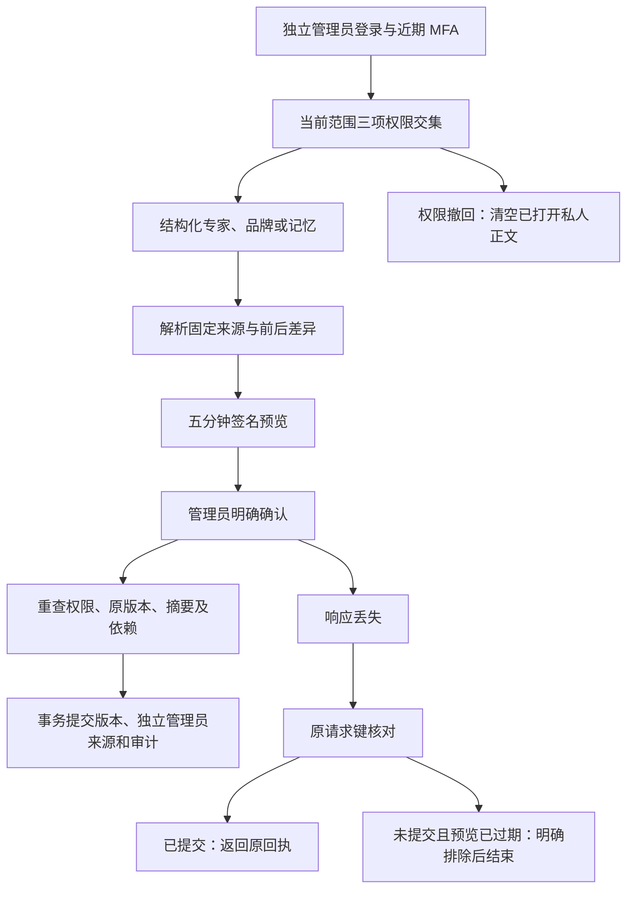

# 专家、品牌与记忆的管理员修订 / Administrator profile revisions

本增量扩展现有内容修订体系，覆盖客户保存的专家、品牌资料，以及企业、项目、品牌、个人、私人会话五种范围的记忆。团队、共享项目说明和业务方法的修订行为保留。对应 REQ-005/006/013/048/090/094/096；完整产品及其他管理资源继续按原台账验收。

## 客户与管理员使用流程

客户照常创建专家、品牌或记忆。管理员用独立身份和 MFA 登录，在获准范围的内容列表选择“修订”，通过结构化字段修改内容、填写原因、预览差异、明确勾选确认，再新增不可变版本。旧会话和任务继续固定原输入；管理员修订不替客户启动任务、批准预算或开通本机权限。

| 对象 | 可编辑内容 | 固定边界 |
| --- | --- | --- |
| 客户专家 | 名称、工作说明、已固定角色允许的工具子集 | Codex、运行时、模型、Skill 安装/版本/摘要、模板、品牌与启用状态保留；系统默认助手不可修改 |
| 品牌资料 | 名称、色系、语气、核准文案、字体来源和使用依据、Logo、事实、价格和促销有效期 | 新来源必须是当前项目可用的共享确切版本；实际字体/PNG字节和原领域规则重新检查；旧任务保留原品牌 |
| 记忆 | 名称、正文、未来到期时间或无期限 | 原范围、客户拥有者、项目、品牌及会话保留；不允许借修订迁移私人数据 |

品牌表单提供字体使用来源、使用依据、允许渠道与有效期。旧版品牌不会自动补写字体授权、事实或 Logo，必须由管理员明确填写。货币输入按币种的小数位精确转换为整数，拒绝超精度、负数、指数和超限金额；预览显示可读金额，例如 `HK$128.90`。输入日期按浏览器本机时区解释，差异预览明确显示香港时间 `HKT`。

## 权限、并发与数据边界

所有六类对象的操作均要求 `admin.content.read`、`admin.content.body.read`、`admin.content.version.create` 同时覆盖当前对象；显式 deny 优先。会话、近期 MFA、CSRF、当前权限及作用域在事务中重查并持锁。企业/个人范围记忆没有项目范围，须拥有对应企业或全局权限；同企业任一相关项目的显式拒绝会阻止覆盖整个企业的记忆修订。私人会话记忆继续属于原客户及原会话，归档、隔离、删除或来源撤回后拒绝修订。

预览绑定管理员、会话、授权版本、对象、内容版本、管理版本、前后摘要、完整输入、原因、目标版本和五分钟期限。确认重新解析所有依赖；客户并发修改、后台竞争、Skill停用、素材撤回或预览篡改均拒绝覆盖。相同幂等键仅产生一个版本，其他键不能重用旧预览覆盖赢家。

浏览器仅保留原请求键、对象和签名摘要，不持久保存正文或原因。真实提交成功但响应丢失后，刷新页面仍能核对原回执；恢复成功窗口保留至主动关闭。当前授权丢失时清除正文、原因、预览和历史；迟到响应不能重新显示已撤回的私人内容。

## API与版本存储

六类闭集为 `agents`、`brand_profiles`、`memories`、`agent_groups`、`project_configurations`、`solutions`。共用六条已登记路由：

| 方法 | 路径后缀 | 作用 |
| --- | --- | --- |
| GET | `/v1/admin/content-revisions/{kind}/{id}` | 读取当前编辑定义、版本、固定上下文与参照 |
| GET | `/history?before=` | 每页20条稳定历史，仅返回修订元数据 |
| GET | `/options?q=` | 搜索当前范围确切参照，每类最多200项 |
| POST | `/previews` | 校验完整定义、原因和预期版本，生成签名差异 |
| POST | `/apply` | 当前会话明确确认并原子追加版本 |
| POST | `/requests/{key}` | 按原请求锁核对结果，不另发新修改 |

迁移 `131-admin-profile-revisions.sql` 新增 `admin_profile_revisions`，与既有迁移130事实表分开，SQL001–130保留原文。三类版本新增独立管理员来源及事实外键。客户来源为空时必须有真实管理员和修订事实；历史品牌未知创建者继续保留未知，不能伪造客户。普通应用及队列角色不能插入管理员事实或伪造管理员来源。

事实、版本、对象指针、精确来源和审计在同一事务提交，延迟约束验证实际目标版本、范围、摘要和成功审计。事实与来源不可变；审计失败全部回滚。专家保留原 Skill 精确绑定；品牌沿用实际来源校验和自动版本快照。普通客户在管理员修订后继续编辑时记录真实客户来源，不继承管理员事务上下文。

记忆新增不可变定义快照以固定名称、正文、期限和范围。永久删除时显式擦除各版本正文与定义快照，防止新快照遗留私人正文；原审计与账务元数据保留。旧的品牌/记忆“仅改名”入口不再绕过完整版本预览流程。客户读取版本时可识别 `administrator`、`customer` 或历史品牌的 `legacy_unattributed`，不暴露内部管理员身份。

## 实际验证与媒体

| 编号 | 已验证结果 | 真实范围 |
| --- | --- | --- |
| 124-01 | 68/68后端检查 | 完整运行修订、原三类修订、持续工作、品牌生产和架构兼容五个相关文件；新修订专项25项 |
| 124-02 | 11/11后台单元 | 包含HKD、JPY及三位小数币种的精确金额转换及非法输入 |
| 124-03 | 8/8实际页面 | 真实邮件/MFA登录、三类编辑、客户读取、旧会话版本及原始品牌保留 |
| 124-04 | 真正丢失响应恢复 | 实际服务先完成记忆修订，再丢弃HTTP响应；刷新核对原结果，仅一次修改，无正文持久副本 |
| 124-05 | 实时撤权与无费用副作用 | 实际项目deny清除已打开私人内容；任务、预留和AI请求数不增加 |
| 124-06 | 14次布局观察 | 三类表单和预览在375/768/1024/1440px的视口、弹窗和输入边界检查 |
| 124-07 | 8PNG、3GIF、3MP4 | 使用第04批当前源码的真实录制；原始帧、旧媒体及失败记录保留 |

后端文件为 `admin-profile-revisions.test.ts`、`admin-content-revisions.test.ts`、`persistent-work.test.ts`、`brand-production.test.ts`、`schema-compatibility.test.ts`。测试包括五种记忆范围、三权限交集、MFA/CSRF/会话、预览篡改、客户竞争、并发幂等、依赖撤回、来源归属、数据库角色与不可变性、审计回滚、删除快照擦除以及普通客户后续创建者。68项不是全部后端重跑。

初次后端两项失败分别涉及新增来源字段的接口文档同步及预览失效状态码断言；第二批继续发现中央接口文档副本未同步。第03批当前后端全部通过，原失败与各自源码不覆盖。实际页面第01/02批在截图与视口调整竞争时失败，V3将截图和调整串行后通过；第04批在保留全部边界检查的基础上补验可读价格和HKT日期。第三批通过仅对应当时源码，不冒充当前字段显示的证明。

当前8项页面操作无模型调用。业务回归沿用获准假模型/媒体及测试额度；实际邮件、数据库、文件、权限、HTTP丢失响应与页面交互均执行。所属浏览器、API、预览、原生PostgreSQL及测试端口已关闭，所属夹具回收通过；没有调度Docker/WSL/虚拟机。

[限定检查点](../quality/admin-profile-checkpoint-124.json) · [原始证据索引](../quality/admin-profile-evidence-124/index.json) · [编号剩余事项](../quality/remaining-work-stage124.md) · [更新说明](../changes/124-admin-profile-revisions.md) · [双语截图与录制](https://github.com/copypasteltd/workmate/blob/admin/README.md)

## 发布和剩余范围

V7保留全部历史证明身份，旧阶段123、122及全量回归按原源码作为历史核查；当前124绑定精确源码、相关文件、实际页面及媒体。六个组件和中央文档提交一致后检查凭据、链接、历史Git对象与远端祖先，普通原子推送八个映射引用，并读取远端实际SHA。最终发布状态以执行回执为准。

其他资源修订、完整后台权限矩阵、全部业务专业交付、生产身份/供应商、签名安装与原102条整体验收仍跟踪。Desktop继续在客户本机运行Codex，客户独立授予可撤销完整权限；Extension继续为原生右侧Side Panel、获准文件上传和云端Codex。

Stage124 adds actual administrator revisions for saved specialists, brands and all five memory scopes. Signed previews, intersecting current permissions and recent MFA precede atomic versions, distinct administrator provenance and audit. Pinned execution inputs, customer ownership and old conversations remain fixed. Exact money and explicit HKT dates support meaningful review; legacy font rights require explicit completion. Memory erasure clears content and definition snapshots. All 68 checks across five complete related backend files, 11 Admin unit checks, eight actual UI flows and 14 viewport observations passed; eight screenshots and three GIF/MP4 pairs retain raw captures and earlier failures. A real dropped committed response recovers exactly once, and live project denial clears private state without AI/task/budget side effects. Owned native resources closed. V7 verifies committed current sources and historical evidence before ordinary atomic eight-ref publication and SHA readback. Full product, live professional quality and production qualification remain separate.
