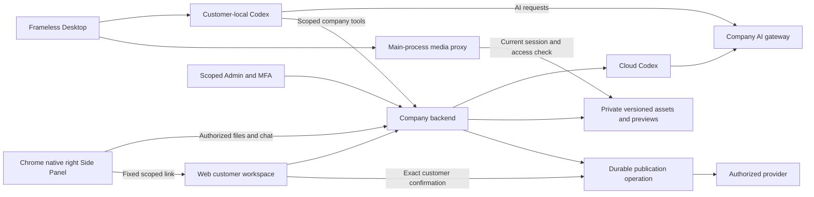
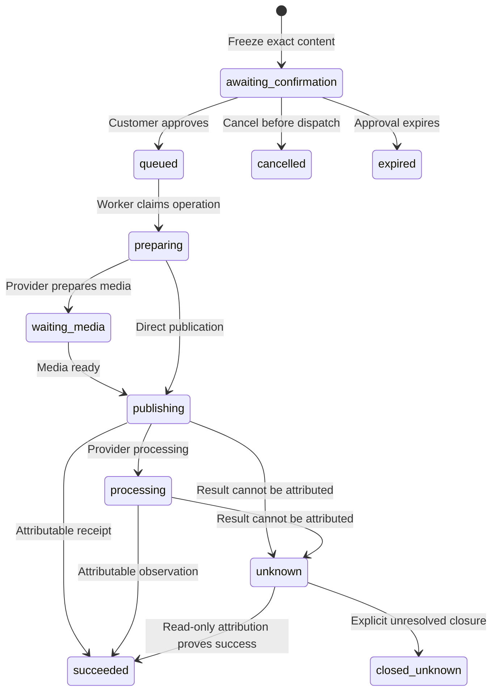

# 阶段125：受控营销发布与原生媒体 / Controlled publishing and native media

本阶段把营销素材从“生成与交付”接到客户逐次确认后的社交发布，并提供项目范围的后台管理。当前为开发与验收中的增量，不能据此宣布整个产品、全部角色或正式提供方验收完成。所有正式AI请求仍走公司服务器，Codex仍是唯一Agent内核。

This increment connects marketing deliverables to explicit customer-approved social publishing and scoped administration. It is under implementation and qualification. It does not close whole-product, professional-role or live-provider acceptance. Codex remains the only Agent kernel and company servers remain the AI gateway.

## 客户的完整流程 / Customer journey

1. 客户完成邮箱验证码或企业身份登录，进入自己的企业与项目。
2. 在Web连接获授权的Meta账户。提供方回调绑定原用户、会话与一次性状态；连接成功不自动启用账户。
3. 企业/项目管理者明确选择允许的项目和品牌账户，配置格式、24小时数量上限及到期时间。
4. 客户选择当前项目获准读取的具体素材版本，填写文字、替代文字及相应格式字段。选中的版本与摘要随预览冻结。
5. 页面展示实际输出媒体。PNG等输入需要发布JPEG时，用户预览的是实际衍生JPEG；视频通过有界范围读取播放。
6. 客户进入确认记录，核对目标账户、文字、版本与媒体后主动勾选确认。默认不勾选。Agent和Admin均不能代替此确认。
7. Worker在确认有效后执行持久步骤，保存提供方回执与费用/配额状态。客户可以继续查看历史与执行详情。
8. 请求结果不明时进入核对状态。只读观察与人工处置不重新发送原写动作；人工结案保留“结果未证实”的事实。

Customer flow: sign in → choose workspace/project → authorize an account in Web → explicitly enable scope/policy → select exact asset versions → review actual outgoing media → approve the frozen content → track durable execution and attributable receipts. An unknown outcome is reconciled without resending the original write.

## 三端职责 / Client responsibilities

| 端 | 本阶段行为 | 执行位置与确认 |
| --- | --- | --- |
| Web | 账户连接、项目范围、策略、素材选择、实际预览、逐次确认、历史和未知结果核对 | Codex在云端；客户在当前身份与项目中确认 |
| Extension | 原生右侧Side Panel继续以聊天和附件为主体；增加折叠的项目发布列表、主动读取详情和受限Web跳转 | 文件经客户授权上传云端；发布的实际媒体核对与确认进入Web |
| Desktop | 本机工作台提供发布页面；主进程代理受保护媒体，渲染层使用不含Bearer的临时能力地址 | Codex继续在客户本机运行；本机完整权限由客户主动授予和撤销 |
| Admin | 项目范围列表、策略配置、独立正文/媒体读取、取消未发送操作、只读核对及未知结果结案 | 独立管理员身份、有效MFA和动作/对象范围权限；不替代客户确认 |

## 已建格式与状态 / Formats and states

服务端定义八个独立格式：Facebook文字/链接、单图、相簿、视频，以及Instagram单图、Reel、轮播与Story。各格式的字段、素材数量和媒体规格按服务端协议验证；连接器能力与当前策略必须同时允许。前端显示可用格式不代替服务端权限验证。

状态包括`awaiting_confirmation`、`queued`、`preparing`、`waiting_media`、`publishing`、`processing`、`succeeded`、`failed`、`cancelled`、`expired`、`unknown`、`closed_unknown`。`closed_unknown`不等于远端失败，不能作为自动重发依据。

Eight independent server formats cover Facebook text/link, photo, gallery and video, plus Instagram photo, Reel, carousel and Story. Both current account capabilities and project policy must permit the operation. Twelve states preserve confirmation, processing and unknown-outcome distinctions; manual closure never proves provider failure.

此图表示主要路径；明确拒绝、来源失效、到期及授权变化由各状态的服务端转换条件处理，不由前端自行推断成功。

## 版本、外部写动作与恢复 / Versioning and recovery

- 确认绑定用户、企业、项目、账户与授权版本、策略版本、内容摘要、具体素材版本和有效期。任何变化都不能借用旧确认。
- 外部写动作先记录持久意图，再执行有限步骤；失去响应的写动作保留未知状态，恢复进程不盲目重发。
- 原请求查询只查询已存在的操作或管理变更；失去响应时保留原请求键，避免新建第二次写动作。
- 回执与实际输出媒体有独立的恢复处理。恢复数据库不会被解释成“外部副作用未发生”。
- 来源撤销、到期或权限不足时，正文和媒体读取同步拒绝。管理员拥有列表权限不自动拥有正文权限。

Approvals bind exact identity, scope, authorization/policy versions, content digest, source versions and expiry. Durable intent precedes external writes. Unknown responses retain the original identity and are not replayed after a process or database restore. Content and media access is revalidated independently from metadata access.

## 原生媒体与文件安全 / Native media and files

Desktop主进程通过`workmate-media`协议提供有界媒体读取：能力与窗口、原生会话及当前范围绑定，支持HEAD和HTTP范围；流式读取保持背压，限制并发与有效期，并检查实际长度、MIME和摘要。登出、窗口销毁或会话切换会撤销能力及在途读取。Bearer不进入渲染层、地址栏或日志，不通过JSON IPC传输整段大视频。

Extension的跳转消息只接受规范的企业、项目及可选操作UUID。后台重新检查当前项目与操作访问权，并在异步请求后复核会话标识，最后构造配置内固定Web站点的路径。折叠、隐藏、换账户或换项目后停止轮询并清除已展示的私有详情；打开列表不会自动读取所有正文。

Desktop streams protected media through a main-process protocol bound to the owning window and native session. Range/HEAD, integrity checks, bounded concurrency and revocation apply without exposing Bearer credentials or buffering an entire large video in JSON IPC. Extension handoffs validate UUID scope, current access and session continuity before opening a fixed configured Web destination. Private details are cleared when the panel is folded, hidden or changes account/project.

## 后台权限 / Admin authority

| 动作 | 必须具备 | 约束 |
| --- | --- | --- |
| 查看发布元数据 | `admin.publication.read` | 当前项目范围、显式拒绝与有效MFA |
| 查看私有正文/媒体 | 上述权限及`admin.content.body.read` | 主动打开；当前来源仍可读；撤权后停止展示 |
| 修改发布策略 | `admin.publication.policy.write` | 项目与账户范围、预期版本、有效MFA、审计 |
| 取消未发送/处理未知结果 | `admin.publication.resolve` | 服务端检查实际状态与范围；不能确认客户发布 |
| 原管理请求恢复 | 原动作权限及读取权限 | 原管理员、原对象与原请求键；重新核对当前授权 |

旧管理员不会自动获得新增发布权限。显式升级命令要求已完成身份设置、有效且永久的全局超级管理员身份和明确命令参数，并拒绝相关显式deny。只创建独立的三权限发布角色，不附带正文读取权限。首次实际新增授权时，在同一事务中撤销旧会话并记录审计；重复或并发执行不重复授权、撤销新会话或伪造第二次变更。

Existing administrators do not silently acquire publication permissions. The explicit operator command requires an enrolled permanent global super administrator, acknowledgement and no relevant deny. It grants a separate three-permission role, keeps body-read independent, revokes old sessions atomically on a new grant and is idempotent on repeated/concurrent invocation.

## Codex工具 / Codex tools

`publication_accounts`、`publication_preview`、`publication_prepare`、`publication_status`通过当前任务/项目权限提供给获准角色。Skill随角色版本加载；`prepare`最多产生待确认操作，不能替客户发布。Desktop公司工具允许列表接入这些工具，但仍由本机Codex发起调用，不能把Desktop执行移到云端。

The four scoped tools support account discovery, preview, preparation and status. Preparation stops at customer confirmation. Desktop uses its local Codex runtime to call company tools; it does not substitute a cloud Agent for local execution.

## 当前验证与限制 / Qualification status

| 检查 | 当前记录 | 边界 |
| --- | --- | --- |
| 模拟授权浏览器回跳 | `publication-consent-03`，授权/取消/拒绝未配置目标三项通过 | 真实浏览器、模拟提供方和自建回调站点；不含正式账户 |
| Web/Admin完整发布旅程 | `publications-ui-10`终态失败，已记录5项通过 | 延迟范围响应、OAuth及实际媒体已覆盖；成功状态定位文案错误，四档布局实际仅观察到375/768px，后续Admin未完成 |
| Desktop媒体与会话逻辑 | `media-03`，21/21通过 | 新增发布页面仍需实际Electron协议与原生操作验收 |
| Extension查看与跳转逻辑 | `extension-02`，70/70通过 | 新增发布查看仍需实际Chrome原生Side Panel验收 |
| Admin显式授权命令 | `backend-07`，实际原生数据库与子进程5/5通过 | 明确确认、新增授权撤销旧会话、并发幂等及拒绝组合；不代表整个后台验收 |
| 后端完整相关回归 | `backend-09`，117/117通过；分析专项08为12/12 | 当前捕获源码匹配，包含两个实际原生Codex分析角色；并非全产品回归，旧05偶发超时根因仍未确定 |
| 正式服务与专业效果 | 尚未验收 | 用户已授权假数据，真实账号、模型质量和专业业务另验 |

模拟授权页的表单策略允许精确配置的提供方自身、公司API和Web站点，覆盖整个回跳链。实际浏览器复现先证明了旧策略在API回调之后阻断Web；修正后授权与取消均通过，向其他地址提交仍被浏览器阻止。保留修正前失败及检查器负向导航等待错误的原始记录。

保存账户范围后，策略操作必须等待新的账户、设置和策略快照，避免用户立即打开的编辑器被稍后返回的旧版本关闭。后台刷新保留可读内容，但不会把刷新前快照视为当前修改依据。新增实际页面检查会故意延迟范围读取，验证按钮等待及后续编辑器行为。

最新Web检查已到达实际发布成功回执，但检查器仍等待不存在的`Published`精确文案；产品显示`Publication confirmed by provider`。原失败与录制保留，修正检查器并完成后续旅程后才能作为完整通过证据。并发截图与视口变化期间，原始观察未覆盖声明的全部四档宽度；1024/1440px必须重新实际核验。Desktop最新开发包位于`dev/copypaste-desktop-publication-125/release/publications-125-02/win-unpacked/`，仍未签名且新增发布页面原生验收未完成。

The consent page allows only the configured provider, company API and Web origins across the full redirect chain. Actual browser reproduction proved the earlier API-to-Web block; the corrected chain passes approval and denial while rejecting an unrelated destination. Scope-dependent policy editing waits for fresh authority after scope changes; an intentionally delayed response is part of the browser regression.

The current related backend run passes all 117 checks; the explicit Admin upgrade CLI passes all five and the analysis diagnostic run passes all twelve, including two actual native Codex roles. These bounded results do not explain the earlier intermittent timeout. Web/Admin run10 remains failed after five recorded checks: its success locator expects an incorrect label and its actual layout observations cover only 375/768px. Later Admin publishing checks, complete four-width validation, native Desktop/Side Panel acceptance, integration and product-source publication remain open. The latest Desktop directory package is an unsigned development build.

[需求与未完成项 / Requirements and open work](../quality/remaining-work-current-review-125-v7.md)
