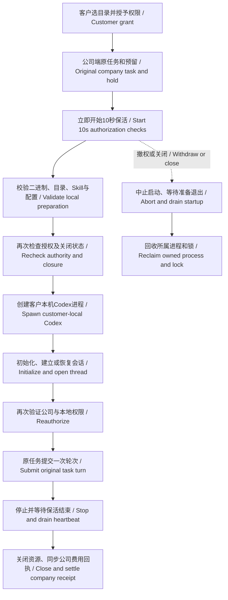

# Desktop 本机启动生命周期 / Customer-local startup lifecycle

Desktop 始终在客户电脑运行固定版本的 Codex。公司服务负责账户、企业/项目权限、模型请求及账务；本地完整权限由客户授予并可撤销。此变更修复启动期间的租约和撤权时序，不改变执行位置。

Desktop always runs pinned Codex on the customer's computer. Company services enforce account, tenant/project, inference and billing authority. The customer grants and can revoke local full access. This change corrects startup lease and cancellation ordering while preserving that execution model.

## 问题与行为 / Problem and behavior

公司端开始执行后，任务初始租约为45秒。原实现等本机 `start()` 完成才启动10秒保活；初始化和建立/恢复原生会话各有30秒请求期限，另有二进制校验等准备工作，因此合规的启动仍可能超过初始租约。

The original 45-second company lease was not periodically renewed until local `start()` completed. Native initialization and thread start/resume each have a 30-second request deadline, in addition to preparation. Startup could therefore outlast its initial lease without accepting a model turn.

主任务和工作流子任务现在在收到并验证公司端启动许可后立即开启保活。子任务继续复查父任务权限。准备、启动和执行共享原任务和预留；原生启动完成后再次验证公司和本机授权，才保存执行阶段并提交轮次。已有轮次结果不明时仍进入核对流程。

Main tasks and workflow children now begin periodic authorization immediately after validating company startup admission. Children continue checking their parent. Preparation, startup and execution retain the original task and reservation. Startup completion is followed by another authorization check before recording the execution phase and submitting a turn. Unknown accepted-turn results still require reconciliation.

## 关闭与撤权 / Closure and withdrawal

本机启动加入准备完成屏障。关闭先设置不可再启动的状态，拒绝正在等待的初始化/建会话请求，再等待准备阶段退出并清理进程、事件及锁。启动错误路径先结束准备屏障，再等待清理，避免互相等待。配置写入和二进制校验后的同步检查阻止撤权后迟到创建进程。

Startup now exposes a preparation completion barrier. Closing first prevents further spawning and rejects pending initialize/thread requests, then drains preparation before reclaiming the owned process, events and lock. The failure path releases its preparation barrier before joining cleanup, avoiding a dependency cycle. Checks after asynchronous preparation prevent late spawning after withdrawal.

正常完成时仍先停止并等待正在进行的保活，再关闭原生进程、浏览器和本地程序，最后同步终态账务。不得在终态后继续把任务当成运行中续租。本机关闭/撤权不依赖另一轮模型响应。

Normal completion still stops and drains heartbeat before closing native/browser/program resources and synchronizing terminal accounting. A terminal execution must not be renewed as running. Local close/revoke does not wait for another model response.

## 验证边界 / Evidence boundaries

控制层采用可控时钟覆盖主任务、子任务跨越初始租约、公司撤权、本机撤权及终态后停止保活；完整相关文件共73项。固定真实 Codex 的完整本机文件共38项，其中新增13项覆盖四个准备边界的关闭/撤权、两个待响应原生请求的关闭/撤权，以及实际超过45秒的一次轮次。

The 73 related controller checks cover main/child lease renewal, withdrawal and terminal heartbeat draining. The complete real pinned-native file has 38 checks, including 13 new cases for preparation boundaries, pending startup RPC cancellation and a real elapsed startup over 45 seconds followed by one turn. Controlled faults delay only captured test-owned native pipes; production timeouts remain unchanged.

实际打包窗口、真实本地数据库、一次公司预留/扣费、截图和录像以[本轮检查点](../quality/local-startup-checkpoint-127.json)及其归档为准。模型回答和原生确认对话框的选择使用明确的测试数据；不能据此认定生产模型、签名安装或全部专业角色已验收。

The [current checkpoint](../quality/local-startup-checkpoint-127.json) binds actual packaged-window, native SQL, original reservation/charge and media evidence. Model responses and native-dialog decisions are synthetic. These checks do not qualify a live provider, signed installation or all professional roles.

## 后续恢复约束 / Remaining recovery requirements

此版本不自动重启失败的 Desktop 启动。安全恢复仍需公司端在同一原任务上先撤销旧推理/工具权限、关闭并等待旧请求退出，再原子证明没有任何模型计数、推理或工具准入记录。费用为零或客户端没有拿到结果都不足以证明可以重试。

Automatic Desktop startup replay remains unimplemented. Recovery needs company-side revocation and draining of old inference/tool authority, followed by an atomic proof that no input-count, inference or tool admission occurred. Zero charge or a missing client result is insufficient proof for replay.

还需持久化有限启动次数及同一幂等恢复请求，在客户端崩溃、丢失响应、撤权和工作流子任务中保持原预算与权限。已经提交轮次、已接受或结果不明的工作仍不可自动重做。相关事项继续记入[完整待完成表](../quality/remaining-work-stage127.md)。

Further work must persist bounded launch counts and the same idempotent recovery request across crashes, lost responses, withdrawal and workflow children, while retaining original budget and authority. Submitted, accepted or unknown work must not be automatically repeated. These items remain in the [numbered open-work register](../quality/remaining-work-stage127.md).
